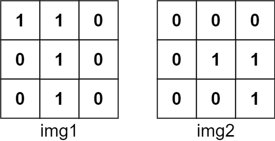

# 两种方法：暴力枚举 / 卷积（Python/Java/C++/Go）

> **[835. 图像重叠](https://leetcode.cn/problems/image-overlap/solutions/4022390/liang-chong-fang-fa-bao-li-mei-ju-juan-j-6bqq/) · Medium**

> **所属题单**
> - [数学算法 · 七、杂项](../../../刷题路径/灵神原版题单/数学算法/七、杂项.md) · §7.4 卷积

> **题目描述**
> 给你两个图像 `img1` 和 `img2` ，两个图像的大小都是 `n x n` ，用大小相同的二进制正方形矩阵表示。二进制矩阵仅由若干 `0` 和若干 `1` 组成。
>
> **转换** 其中一个图像，将所有的 `1` 向左，右，上，或下滑动任何数量的单位；然后把它放在另一个图像的上面。该转换的 **重叠** 是指两个图像 **都** 具有 `1` 的位置的数目。
>
> 请注意，转换 **不包括** 向任何方向旋转。越过矩阵边界的 `1` 都将被清除。
>
> 最大可能的重叠数量是多少？
>
> **示例 1：**
>
> 
>
> ```
>
> 输入：img1 = [[1,1,0],[0,1,0],[0,1,0]], img2 = [[0,0,0],[0,1,1],[0,0,1]]
> 输出：3
> 解释：将 img1 向右移动 1 个单位，再向下移动 1 个单位。
>
> 
>
> 两个图像都具有 1 的位置的数目是 3（用红色标识）。
>
> 
> ```
>
> **示例 2：**
>
> ```
>
> 输入：img1 = [[1]], img2 = [[1]]
> 输出：1
> ```
>
> **示例 3：**
>
> ```
>
> 输入：img1 = [[0]], img2 = [[0]]
> 输出：0
> ```
>
> **提示：**
>
> - `n == img1.length == img1[i].length`
>
> - `n == img2.length == img2[i].length`
>
> - `1 <= n <= 30`
>
> - `img1[i][j]` 为 `0` 或 `1`
>
> - `img2[i][j]` 为 `0` 或 `1`

> **题解**
> ## 方法一：暴力枚举
>
> {:width=350px}
>
> 为方便描述，把 $\textit{img}_1$ 简记为 $A$，把 $\textit{img}_2$ 简记为 $B$。
>
> 如果把 $A$ 向下移动 $x$ 个单位，向右移动 $y$ 个单位（向上/向左则 $x,y$ 为负），那么 $A_{i,j}$ 对应着 $B_{i+x,\,j+y}$。例如，把 $A$ 向下移动 $1$ 个单位，向右移动 $1$ 个单位，那么 $A_{0,0}$ 对应 $B_{1,1}$。
>
> 移动后，重叠 $1$ 的个数为
>
> $$
> f(x,y) = \sum_{i=0}^{n-1}\sum_{j=0}^{n-1} A_{i,j}\cdot B_{i+x,\,j+y}
> $$
>
> > **注 1**：如果 $A_{i,j}$ 和 $B_{i+x,\,j+y}$ 都是 $1$，才能把计数器增加一，否则计数器不变。这等价于把计数器增加 $A_{i,j}\cdot B_{i+x,\,j+y}$。
> > 
> > **注 2**：超出下标范围的元素视作 $0$。
>
> 枚举 $x$ 和 $y$，答案为
>
> $$
> \max_{-(n-1)\le x,y\le n-1} f(x,y)
> $$
>
> 代码实现时，由于 $0$ 对答案无贡献，可以只遍历满足 $0\le i < n$ 且 $0\le i+x< n$ 的 $i$，即 
>
> $$
> \max(-x,0)\le i < \min(n-x,n)
> $$
>
> 对于 $j$，同理有
>
> $$
> \max(-y,0)\le j < \min(n-y,n)
> $$
>
> ```python
> class Solution:
>     def largestOverlap(self, img1: List[List[int]], img2: List[List[int]]) -> int:
>         n = len(img1)
>         ans = 0
>         for dx in range(1 - n, n):
>             for dy in range(1 - n, n):
>                 cnt1 = 0
>                 for i in range(max(-dx, 0), min(n - dx, n)):
>                     for j in range(max(-dy, 0), min(n - dy, n)):
>                         # 两个数都是 1，才能让 cnt1 增加 1
>                         cnt1 += img1[i][j] * img2[i + dx][j + dy]
>                 ans = max(ans, cnt1)
>         return ans    
> ```
>
>
> #### 复杂度分析
>
> - 时间复杂度：$\mathcal{O}(n^4)$，其中 $n$ 是 $\textit{img}_i$ 的行数和列数。
> - 空间复杂度：$\mathcal{O}(1)$。
>
> ## 方法二：二维卷积
>
> > 本质上来说，我们计算的是 $A$ 和 $B$ 的互相关（cross-correlation）。
>
> 为了和卷积联系上，定义 $B$ 的翻转矩阵 $\widetilde{B}_{i,j} = B_{n-1-i,\,n-1-j}$。
>
> 计算 $A$ 和 $\widetilde{B}$ 的二维卷积
>
> $$
> C_{x,y} = \sum_{i=0}^{n-1}\sum_{j=0}^{n-1} A_{i,j}\cdot \widetilde{B}_{x-i,\,y-j}
> $$
>
> 其中 $0\le x,y\le 2n-2$。超出下标范围的元素视作 $0$。
>
> 代入 $\widetilde{B}$ 的定义，上式变为
>
> $$
> C_{x,y} = \sum_{i=0}^{n-1}\sum_{j=0}^{n-1} A_{i,j}\cdot B_{n-1-x+i,\,n-1-y+j}
> $$
>
> 令 $x' = n-1-x$，$y' = n-1-y$，上式变为
>
> $$
> C_{x,y} = \sum_{i=0}^{n-1}\sum_{j=0}^{n-1} A_{i,j}\cdot B_{i+x',\,j+y'} = f(x',y')
> $$
>
> 其中 $-(n-1)\le x',y'\le n-1$。
>
> 上式表明，卷积矩阵 $C$ 恰好对应着所有 $(2n-1)^2$ 种平移情况，所以答案为 $C$ 中的最大值。
>
>
> > [!example]+ NumPy
> > ```python
> > import numpy as np
> >
> > class Solution:
> >     def largestOverlap(self, img1: List[List[int]], img2: List[List[int]]) -> int:
> >         a = np.array(img1, dtype=np.int8)
> >         b = np.array(img2, dtype=np.int8)
> >         b = np.flip(b)
> >
> >         n = len(img1)
> >         shape = (n * 2 - 1, n * 2 - 1)
> >         fa = np.fft.fft2(a, shape)
> >         fb = np.fft.fft2(b, shape)
> >         conv = np.rint(np.fft.ifft2(fa * fb).real)
> >
> >         return int(conv.max())
> > ```
>
>
> > [!example]- SciPy
> > ```python
> > from scipy.signal import correlate2d
> >
> > class Solution:
> >     def largestOverlap(self, img1: List[List[int]], img2: List[List[int]]) -> int:
> >         return int(correlate2d(img1, img2).max())
> > ```
>
>
> #### 复杂度分析
>
> - 时间复杂度：$\mathcal{O}(n^2\log n)$，其中 $n$ 是 $\textit{img}_i$ 的行数和列数。
> - 空间复杂度：$\mathcal{O}(n^2)$。
>
> 相关题目，见下面数学题单的「**§7.4 卷积**」。
>
> ## 分类题单
>
> [如何科学刷题？](https://leetcode.cn/discuss/post/3141566/ru-he-ke-xue-shua-ti-by-endlesscheng-q3yd/)
>
> 1. [滑动窗口与双指针（定长/不定长/单序列/双序列/三指针/分组循环）](https://leetcode.cn/discuss/post/3578981/ti-dan-hua-dong-chuang-kou-ding-chang-bu-rzz7/)
> 2. [二分算法（二分答案/最小化最大值/最大化最小值/第K小）](https://leetcode.cn/discuss/post/3579164/ti-dan-er-fen-suan-fa-er-fen-da-an-zui-x-3rqn/)
> 3. [单调栈（基础/矩形面积/贡献法/最小字典序）](https://leetcode.cn/discuss/post/3579480/ti-dan-dan-diao-zhan-ju-xing-xi-lie-zi-d-u4hk/)
> 4. [网格图（DFS/BFS/综合应用）](https://leetcode.cn/discuss/post/3580195/fen-xiang-gun-ti-dan-wang-ge-tu-dfsbfszo-l3pa/)
> 5. [位运算（基础/性质/拆位/试填/恒等式/思维）](https://leetcode.cn/discuss/post/3580371/fen-xiang-gun-ti-dan-wei-yun-suan-ji-chu-nth4/)
> 6. [图论算法（DFS/BFS/拓扑排序/基环树/最短路/最小生成树/网络流）](https://leetcode.cn/discuss/post/3581143/fen-xiang-gun-ti-dan-tu-lun-suan-fa-dfsb-qyux/)
> 7. [动态规划（入门/背包/划分/状态机/区间/状压/数位/数据结构优化/树形/博弈/概率期望）](https://leetcode.cn/discuss/post/3581838/fen-xiang-gun-ti-dan-dong-tai-gui-hua-ru-007o/)
> 8. [常用数据结构（前缀和/差分/栈/队列/堆/字典树/并查集/树状数组/线段树）](https://leetcode.cn/discuss/post/3583665/fen-xiang-gun-ti-dan-chang-yong-shu-ju-j-bvmv/)
> 9. [数学算法（数论/组合/概率期望/博弈/计算几何/随机算法）](https://leetcode.cn/discuss/post/3584388/fen-xiang-gun-ti-dan-shu-xue-suan-fa-shu-gcai/)
> 10. [贪心与思维（基本贪心策略/反悔/区间/字典序/数学/思维/脑筋急转弯/构造）](https://leetcode.cn/discuss/post/3091107/fen-xiang-gun-ti-dan-tan-xin-ji-ben-tan-k58yb/)
> 11. [链表、树与回溯（前后指针/快慢指针/DFS/BFS/直径/LCA）](https://leetcode.cn/discuss/post/3142882/fen-xiang-gun-ti-dan-lian-biao-er-cha-sh-6srp/)
> 12. [字符串（KMP/Z函数/Manacher/字符串哈希/AC自动机/后缀数组/子序列自动机）](https://leetcode.cn/discuss/post/3144832/fen-xiang-gun-ti-dan-zi-fu-chuan-kmpzhan-ugt4/)
>
> [我的题解精选（已分类）](https://github.com/EndlessCheng/codeforces-go/blob/master/leetcode/SOLUTIONS.md)
>
> 欢迎关注 [B站@灵茶山艾府](https://space.bilibili.com/206214)
