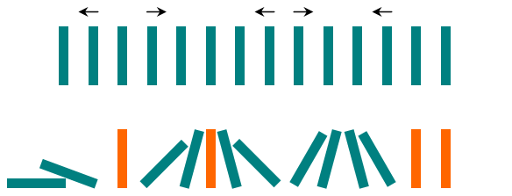

# 分类讨论，简洁写法（Python/Java/C++/C/Go/JS/Rust）

> **[838. 推多米诺](https://leetcode.cn/problems/push-dominoes/solutions/3667176/fen-lei-tao-lun-jian-ji-xie-fa-pythonjav-bztd/) · Medium · 难度分 1638**

> **所属题单**
> - [滑动窗口与双指针 · 六、分组循环](../../../刷题路径/灵神原版题单/滑动窗口与双指针/六、分组循环.md)
> - [贪心算法 · 五、思维题](../../../刷题路径/灵神原版题单/贪心算法/五、思维题.md) · §5.8 分类讨论

> **题目描述**
> `n` 张多米诺骨牌排成一行，将每张多米诺骨牌垂直竖立。在开始时，同时把一些多米诺骨牌向左或向右推。
>
> 每过一秒，倒向左边的多米诺骨牌会推动其左侧相邻的多米诺骨牌。同样地，倒向右边的多米诺骨牌也会推动竖立在其右侧的相邻多米诺骨牌。
>
> 如果一张垂直竖立的多米诺骨牌的两侧同时有多米诺骨牌倒下时，由于受力平衡， 该骨牌仍然保持不变。
>
> 就这个问题而言，我们会认为一张正在倒下的多米诺骨牌不会对其它正在倒下或已经倒下的多米诺骨牌施加额外的力。
>
> 给你一个字符串 `dominoes` 表示这一行多米诺骨牌的初始状态，其中：
>
> - `dominoes[i] = 'L'`，表示第 `i` 张多米诺骨牌被推向左侧，
>
> - `dominoes[i] = 'R'`，表示第 `i` 张多米诺骨牌被推向右侧，
>
> - `dominoes[i] = '.'`，表示没有推动第 `i` 张多米诺骨牌。
>
> 返回表示最终状态的字符串。
>
> **示例 1：**
>
> ```
>
> 输入：dominoes = "RR.L"
> 输出："RR.L"
> 解释：第一张多米诺骨牌没有给第二张施加额外的力。
> ```
>
> **示例 2：**
>
> 
>
> ```
>
> 输入：dominoes = ".L.R...LR..L.."
> 输出："LL.RR.LLRRLL.."
> ```
>
> **提示：**
>
> - `n == dominoes.length`
>
> - `1 <= n <= 10⁵`
>
> - `dominoes[i]` 为 `'L'`、`'R'` 或 `'.'`

> **题解**
> ## 分类讨论
>
> 下文把 $\texttt{.}$ 叫做点。
>
> 根据题意，有四种情况：
>
> - $\texttt{L...L}$：中间的点全部变成 $\texttt{L}$。
> - $\texttt{R...R}$：中间的点全部变成 $\texttt{R}$。
> - $\texttt{R...L}$：前一半的点全部变成 $\texttt{R}$，后一半的点全部变成 $\texttt{L}$。特别地，如果有奇数个点，则正中间的点不变。
> - $\texttt{L...R}$：不变。
>
> ## 实现技巧
>
> 为方便处理开头和结尾的点，可以在字符串前后各加一个哨兵，即定义 $s = \texttt{L} + \textit{dominoes} + \texttt{R}$。
>
> 初始化 $\textit{pre}=0$，表示上一个 $\texttt{L}$ 或 $\texttt{R}$ 的位置。
>
> 遍历 $s$：
>
> - 如果 $s[i]$ 是点，跳过。
> - 否则，如果 $s[i]=s[\textit{pre}]$，说明从 $\textit{pre}$ 到 $i$ 是 $\texttt{L...L}$ 或者 $\texttt{R...R}$，把中间的点全部变成 $s[i]$。
> - 否则，如果 $s[i]=\texttt{L}$，说明从 $\textit{pre}$ 到 $i$ 是 $\texttt{R...L}$，把前一半的点全部变成 $\texttt{R}$，后一半的点全部变成 $\texttt{L}$。
>     - 具体地，有 $i-\textit{pre}-1$ 个点，一半就是 $\textit{half} = \left\lfloor\dfrac{i-\textit{pre}-1}{2}\right\rfloor$。
>     - 前一半的点从 $\textit{pre}+1$ 到 $\textit{pre}+\textit{half} = \left\lfloor\dfrac{\textit{pre}+i-1}{2}\right\rfloor$。
>     - 后一半的点从 $i - \textit{half} = \left\lfloor\dfrac{\textit{pre}+i}{2}\right\rfloor+1$ 到 $i-1$。
> - 否则，从 $\textit{pre}$ 到 $i$ 是 $\texttt{L...R}$，不变。
> - 记录 $\textit{pre}=i$，继续循环。
>
> ```python
> class Solution:
>     def pushDominoes(self, dominoes: str) -> str:
>         s = list('L' + dominoes + 'R')  # 前后各加一个哨兵
>         pre = 0  # 上一个 L 或 R 的位置
>         for i, ch in enumerate(s):
>             if ch == '.':
>                 continue
>             if ch == s[pre]:  # L...L 或 R...R
>                 s[pre + 1: i] = ch * (i - pre - 1)  # 全变成 s[i]
>             elif ch == 'L':  # R...L
>                 half = (i - pre - 1) // 2
>                 s[pre + 1: pre + half + 1] = 'R' * half  # 前一半变 R
>                 s[i - half: i] = 'L' * half  # 后一半变 L
>             pre = i
>         return ''.join(s[1:-1])  # 去掉前后哨兵
> ```
>
>
> #### 复杂度分析
>
> - 时间复杂度：$\mathcal{O}(n)$，其中 $n$ 是 $\textit{dominoes}$ 的长度。每个点至多被修改一次，总的循环次数是 $\mathcal{O}(n)$。
> - 空间复杂度：$\mathcal{O}(n)$ 或 $\mathcal{O}(1)$，取决于实现。
>
> ## 相似题目
>
> [2211. 统计道路上的碰撞次数](https://leetcode.cn/problems/count-collisions-on-a-road/)
>
> ## 分类题单
>
> [如何科学刷题？](https://leetcode.cn/circle/discuss/RvFUtj/)
>
> 1. [滑动窗口与双指针（定长/不定长/单序列/双序列/三指针/分组循环）](https://leetcode.cn/circle/discuss/0viNMK/)
> 2. [二分算法（二分答案/最小化最大值/最大化最小值/第K小）](https://leetcode.cn/circle/discuss/SqopEo/)
> 3. [单调栈（基础/矩形面积/贡献法/最小字典序）](https://leetcode.cn/circle/discuss/9oZFK9/)
> 4. [网格图（DFS/BFS/综合应用）](https://leetcode.cn/circle/discuss/YiXPXW/)
> 5. [位运算（基础/性质/拆位/试填/恒等式/思维）](https://leetcode.cn/circle/discuss/dHn9Vk/)
> 6. [图论算法（DFS/BFS/拓扑排序/基环树/最短路/最小生成树/网络流）](https://leetcode.cn/circle/discuss/01LUak/)
> 7. [动态规划（入门/背包/划分/状态机/区间/状压/数位/数据结构优化/树形/博弈/概率期望）](https://leetcode.cn/circle/discuss/tXLS3i/)
> 8. [常用数据结构（前缀和/差分/栈/队列/堆/字典树/并查集/树状数组/线段树）](https://leetcode.cn/circle/discuss/mOr1u6/)
> 9. [数学算法（数论/组合/概率期望/博弈/计算几何/随机算法）](https://leetcode.cn/circle/discuss/IYT3ss/)
> 10. [贪心与思维（基本贪心策略/反悔/区间/字典序/数学/思维/脑筋急转弯/构造）](https://leetcode.cn/circle/discuss/g6KTKL/)
> 11. [链表、二叉树与回溯（前后指针/快慢指针/DFS/BFS/直径/LCA/一般树）](https://leetcode.cn/circle/discuss/K0n2gO/)
> 12. [字符串（KMP/Z函数/Manacher/字符串哈希/AC自动机/后缀数组/子序列自动机）](https://leetcode.cn/circle/discuss/SJFwQI/)
>
> [我的题解精选（已分类）](https://github.com/EndlessCheng/codeforces-go/blob/master/leetcode/SOLUTIONS.md)
>
> 欢迎关注 [B站@灵茶山艾府](https://space.bilibili.com/206214)
