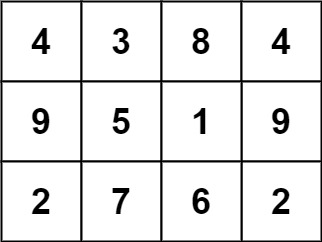
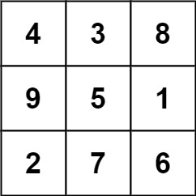
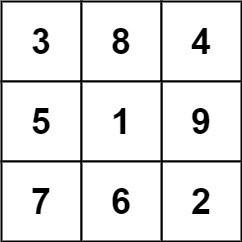

# 840. 矩阵中的幻方

Medium · [力扣原题](https://leetcode.cn/problems/magic-squares-in-grid/)

| 作者 | 题解 | 动画讲解 |
|---|---|---|
| 灵茶山艾府 | [📄 题解](灵茶山艾府.md) | [▶︎ 0840 矩阵中的幻方 · 灵茶山艾府.mp4](0840%20矩阵中的幻方%20·%20灵茶山艾府.mp4) |
| yiduobo | [📄 题解](yiduobo.md) | [▶︎ 0840 矩阵中的幻方 · yiduobo.mp4](0840%20矩阵中的幻方%20·%20yiduobo.mp4) |

## 题目描述

`3 x 3` 的幻方是一个填充有 **从 `1` 到 `9`**  的不同数字的 `3 x 3` 矩阵，其中每行，每列以及两条对角线上的各数之和都相等。

给定一个由整数组成的`row x col` 的 `grid`，其中有多少个 `3 × 3` 的 “幻方” 子矩阵？

注意：虽然幻方只能包含 1 到 9 的数字，但 `grid` 可以包含最多15的数字。

**示例 1：**



```

输入: grid = [[4,3,8,4],[9,5,1,9],[2,7,6,2]
输出: 1
解释:
下面的子矩阵是一个 3 x 3 的幻方：



而这一个不是：



总的来说，在本示例所给定的矩阵中只有一个 3 x 3 的幻方子矩阵。
```

**示例 2:**

```

输入: grid = [[8]]
输出: 0
```

**提示:**

- `row == grid.length`

- `col == grid[i].length`

- `1 <= row, col <= 10`

- `0 <= grid[i][j] <= 15`

---
[↑ 返回 0800-0899](../README.md) · [总索引](../../../索引.md) · [仓库首页](../../../README.md)
