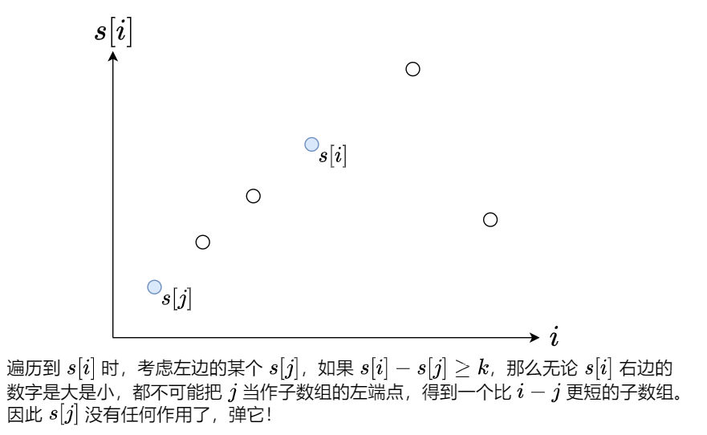
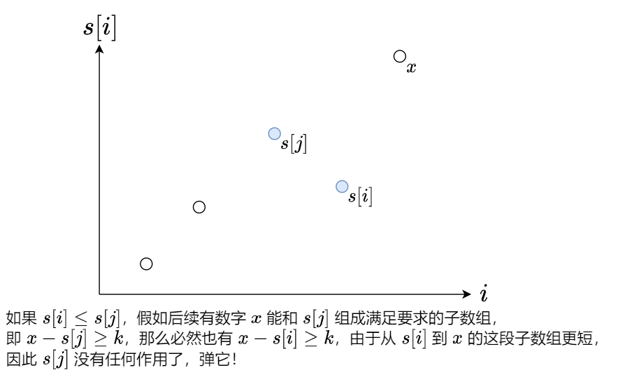

# 两张图秒懂单调队列（Python/Java/C++/Go）

> **[862. 和至少为 K 的最短子数组](https://leetcode.cn/problems/shortest-subarray-with-sum-at-least-k/solutions/1925036/liang-zhang-tu-miao-dong-dan-diao-dui-li-9fvh/) · Hard · 难度分 2307**

> **所属题单**
> - [常用数据结构 · 四、队列](../../../刷题路径/灵神原版题单/常用数据结构/四、队列.md) · §4.4 单调队列

> **题目描述**
> 给你一个整数数组 `nums` 和一个整数 `k` ，找出 `nums` 中和至少为 `k` 的 **最短非空子数组** ，并返回该子数组的长度。如果不存在这样的 **子数组** ，返回 `-1` 。
>
> **子数组** 是数组中 **连续** 的一部分。
>
> **示例 1：**
>
> ```
>
> 输入：nums = [1], k = 1
> 输出：1
> ```
>
> **示例 2：**
>
> ```
>
> 输入：nums = [1,2], k = 4
> 输出：-1
> ```
>
> **示例 3：**
>
> ```
>
> 输入：nums = [2,-1,2], k = 3
> 输出：3
> ```
>
> **提示：**
>
> - `1 <= nums.length <= 10⁵`
>
> - `-10⁵ <= nums[i] <= 10⁵`
>
> - `1 <= k <= 10⁹`

> **题解**
> #### 前置知识：前缀和
>
> 定义前缀和 $\textit{s}[0]=0$，$\textit{s}[i+1] = \sum\limits_{j=0}^{i}\textit{nums}[j]$。
>
> 例如 $\textit{nums}=[1,2,-1,2]$，对应的前缀和数组为 $s=[0,1,3,2,4]$。
>
> 通过前缀和，我们可以把**子数组的和转换成两个前缀和的差**，即
>
> $$
> \sum_{j=\textit{left}}^{\textit{right}}\textit{nums}[j] = \sum\limits_{j=0}^{\textit{right}}\textit{nums}[j] - \sum\limits_{j=0}^{\textit{left}-1}\textit{nums}[j] = \textit{s}[\textit{right}+1] - \textit{s}[\textit{left}]
> $$
>
> 例如 $\textit{nums}$ 的子数组 $[2,-1,2]$ 的和就可以用 $s[4]-s[1]=4-1=3$ 算出来。
>
> > 注：为方便计算，常用左闭右开区间 $[\textit{left},\textit{right})$ 来表示子数组，此时子数组的和为 $\textit{s}[\textit{right}] - \textit{s}[\textit{left}]$，子数组的长度为 $\textit{right}-\textit{left}$。
>
> ---
>
> 求出 $\textit{nums}$ 的前缀和 $s$ 后，我们可以写一个暴力算法，枚举所有满足 $i>j$ 且 $s[i]-s[j]\ge k$ 的子数组 $[j,i)$，取其中最小的 $i-j$ 作为答案。
>
> 但这个暴力算法是 $O(n^2)$ 的，如何优化呢？
>
> 我们可以遍历 $s$，同时用某个合适的数据结构来维护遍历过的 $s[i]$，并**及时移除无用的 $s[i]$**。
>
> 优化一：
>
> 
>
> 优化二：
>
> 
>
> 做完这两个优化后，再把 $s[i]$ 加到这个数据结构中。
>
> 由于优化二保证了数据结构中的 $s[i]$ 会形成一个递增的序列，因此优化一移除的是序列最左侧的若干元素，优化二移除的是序列最右侧的若干元素。我们需要一个数据结构，它支持移除最左端的元素和最右端的元素，以及在最右端添加元素，故选用**双端队列**。
>
> > 注：由于双端队列的元素始终保持单调递增，因此这种数据结构也叫做**单调队列**。
>
> ```python
> class Solution:
>     def shortestSubarray(self, nums: List[int], k: int) -> int:
>         ans = inf
>         s = list(accumulate(nums, initial=0))  # 计算前缀和
>         q = deque()
>         for i, cur_s in enumerate(s):
>             while q and cur_s - s[q[0]] >= k:
>                 ans = min(ans, i - q.popleft())  # 优化一
>             while q and s[q[-1]] >= cur_s:
>                 q.pop()  # 优化二
>             q.append(i)
>         return ans if ans < inf else -1
> ```
>
>
> 另一种写法是，在计算前缀和的同时去计算答案，这需要在双端队列中额外存储前缀和的值。
>
> 由于前缀和的初始值 $0$ 在遍历 $\textit{nums}$ 之前就算出来了，因此需要在遍历之前，往双端队列中插入前缀和 $0$ 及其下标 $-1$。
>
> > 注 1：为什么是 $-1$？因为上面遍历的是 $\textit{s}$，下面遍历的是 $\textit{nums}$，这两者的下标偏移了一位。
> > 注 2：该写法在 $\textit{nums}$ 是一个**流**的时候也适用。
>
> ```python
> class Solution:
>     def shortestSubarray(self, nums: List[int], k: int) -> int:
>         ans = inf
>         cur_s = 0
>         q = deque([(0, -1)])
>         for i, x in enumerate(nums):
>             cur_s += x  # 计算前缀和
>             while q and cur_s - q[0][0] >= k:
>                 ans = min(ans, i - q.popleft()[1])  # 优化一
>             while q and q[-1][0] >= cur_s:
>                 q.pop()  # 优化二
>             q.append((cur_s, i))
>         return ans if ans < inf else -1
> ```
>
>
> #### 复杂度分析
>
> - 时间复杂度：$O(n)$。虽然我们写了个二重循环，但站在 $\textit{nums}[i]$ 的视角看，它在二重循环中最多入队出队各一次，因此整个二重循环的时间复杂度为 $O(n)$。
> - 空间复杂度：$O(n)$。最坏情况下单调队列中会存储 $O(n)$ 个元素。
>
> #### 相似题目
>
> 如果 $\textit{nums}$ 的元素均为非负数，那么可以用双指针做，即
>
> - [209. 长度最小的子数组](https://leetcode.cn/problems/minimum-size-subarray-sum/)（你也可以直接把本题代码复制过去，改改也能过，区别在于双指针是 $O(1)$ 空间的）
>
> 另外附一些单调队列/单调栈的题目。
>
> 做题时，无论题目变成什么样，请记住一个核心原则：**及时移除无用数据，保证队列/栈的有序性**。
>
> 单调队列：
>
> - [面试题 59-II. 队列的最大值](https://leetcode.cn/problems/dui-lie-de-zui-da-zhi-lcof/)（单调队列模板题）
> - [239. 滑动窗口最大值](https://leetcode.cn/problems/sliding-window-maximum/)
> - [1438. 绝对差不超过限制的最长连续子数组](https://leetcode.cn/problems/longest-continuous-subarray-with-absolute-diff-less-than-or-equal-to-limit/)
>
> 单调栈：
>
> - [496. 下一个更大元素 I](https://leetcode.cn/problems/next-greater-element-i/)（单调栈模板题）
> - [503. 下一个更大元素 II](https://leetcode.cn/problems/next-greater-element-ii/)
> - [456. 132 模式](https://leetcode.cn/problems/132-pattern/)
> - [739. 每日温度](https://leetcode.cn/problems/daily-temperatures/)
> - [901. 股票价格跨度](https://leetcode.cn/problems/online-stock-span/)
> - [1124. 表现良好的最长时间段](https://leetcode.cn/problems/longest-well-performing-interval/)
> - [1475. 商品折扣后的最终价格](https://leetcode.cn/problems/final-prices-with-a-special-discount-in-a-shop/)
>
> 矩形系列：
>
> - [84. 柱状图中最大的矩形](https://leetcode.cn/problems/largest-rectangle-in-histogram/)
> - [85. 最大矩形](https://leetcode.cn/problems/maximal-rectangle/)
> - [1504. 统计全 1 子矩形](https://leetcode.cn/problems/count-submatrices-with-all-ones/)
>
> 贡献法：
>
> - [907. 子数组的最小值之和](https://leetcode.cn/problems/sum-of-subarray-minimums/)
> - [1856. 子数组最小乘积的最大值](https://leetcode.cn/problems/maximum-subarray-min-product/)
> - [2104. 子数组范围和](https://leetcode.cn/problems/sum-of-subarray-ranges/)
> - [2281. 巫师的总力量和](https://leetcode.cn/problems/sum-of-total-strength-of-wizards/)（关底 BOSS）
>
> ---
>
> 欢迎关注我的B站频道：[灵茶山艾府](https://space.bilibili.com/206214)，每周更新算法讲解视频哦~
