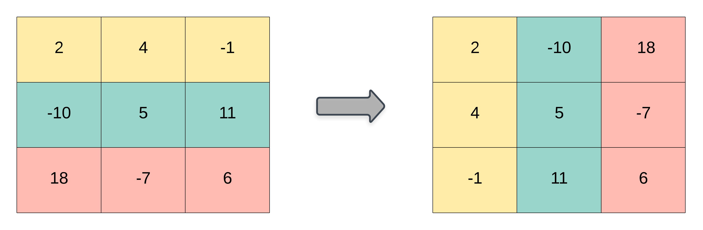

# 简单题，简单做（Python/Java/C++/C/Go/JS/Rust）

> **[867. 转置矩阵](https://leetcode.cn/problems/transpose-matrix/solutions/3655185/jian-dan-ti-jian-dan-zuo-pythonjavaccgoj-5ipt/) · Easy**

> **题目描述**
> 给你一个二维整数数组 `matrix`， 返回 `matrix` 的 **转置矩阵** 。
>
> 矩阵的 **转置** 是指将矩阵的主对角线翻转，交换矩阵的行索引与列索引。
>
> 
>
> **示例 1：**
>
> ```
>
> 输入：matrix = [[1,2,3],[4,5,6],[7,8,9]]
> 输出：[[1,4,7],[2,5,8],[3,6,9]]
> ```
>
> **示例 2：**
>
> ```
>
> 输入：matrix = [[1,2,3],[4,5,6]]
> 输出：[[1,4],[2,5],[3,6]]
> ```
>
> **提示：**
>
> - `m == matrix.length`
>
> - `n == matrix[i].length`
>
> - `1 <= m, n <= 1000`
>
> - `1 <= m * n <= 10⁵`
>
> - `-10⁹ <= matrix[i][j] <= 10⁹`

> **题解**
> 创建一个新的 $n\times m$ 的矩阵 $\textit{ans}$。
>
> 从左到右，遍历 $\textit{matrix}$ 的每一列，把这一列中的元素 $\textit{matrix}[i][j]$ 填到 $\textit{ans}[j][i]$ 中。
>
> ```python
> class Solution:
>     def transpose(self, matrix: List[List[int]]) -> List[List[int]]:
>         m, n = len(matrix), len(matrix[0])
>         ans = [[0] * m for _ in range(n)]
>         for i, row in enumerate(matrix):
>             for j, x in enumerate(row):
>                 ans[j][i] = x
>         return ans
> ```
>
> > [!example]- Python3 库函数
> > ```python
> > class Solution:
> >     def transpose(self, matrix: List[List[int]]) -> List[List[int]]:
> >         return list(zip(*matrix))
> > ```
>
>
> #### 复杂度分析
>
> - 时间复杂度：$\mathcal{O}(mn)$，其中 $m$ 和 $n$ 分别为 $\textit{matrix}$ 的行数和列数。
> - 空间复杂度：$\mathcal{O}(1)$。返回值不计入。
>
> ## 分类题单
>
> [如何科学刷题？](https://leetcode.cn/circle/discuss/RvFUtj/)
>
> 1. [滑动窗口与双指针（定长/不定长/单序列/双序列/三指针/分组循环）](https://leetcode.cn/circle/discuss/0viNMK/)
> 2. [二分算法（二分答案/最小化最大值/最大化最小值/第K小）](https://leetcode.cn/circle/discuss/SqopEo/)
> 3. [单调栈（基础/矩形面积/贡献法/最小字典序）](https://leetcode.cn/circle/discuss/9oZFK9/)
> 4. [网格图（DFS/BFS/综合应用）](https://leetcode.cn/circle/discuss/YiXPXW/)
> 5. [位运算（基础/性质/拆位/试填/恒等式/思维）](https://leetcode.cn/circle/discuss/dHn9Vk/)
> 6. [图论算法（DFS/BFS/拓扑排序/最短路/最小生成树/二分图/基环树/欧拉路径）](https://leetcode.cn/circle/discuss/01LUak/)
> 7. [动态规划（入门/背包/状态机/划分/区间/状压/数位/数据结构优化/树形/博弈/概率期望）](https://leetcode.cn/circle/discuss/tXLS3i/)
> 8. [常用数据结构（前缀和/差分/栈/队列/堆/字典树/并查集/树状数组/线段树）](https://leetcode.cn/circle/discuss/mOr1u6/)
> 9. [数学算法（数论/组合/概率期望/博弈/计算几何/随机算法）](https://leetcode.cn/circle/discuss/IYT3ss/)
> 10. [贪心与思维（基本贪心策略/反悔/区间/字典序/数学/思维/脑筋急转弯/构造）](https://leetcode.cn/circle/discuss/g6KTKL/)
> 11. [链表、二叉树与回溯（前后指针/快慢指针/DFS/BFS/直径/LCA/一般树）](https://leetcode.cn/circle/discuss/K0n2gO/)
> 12. [字符串（KMP/Z函数/Manacher/字符串哈希/AC自动机/后缀数组/子序列自动机）](https://leetcode.cn/circle/discuss/SJFwQI/)
>
> [我的题解精选（已分类）](https://github.com/EndlessCheng/codeforces-go/blob/master/leetcode/SOLUTIONS.md)
>
> 欢迎关注 [B站@灵茶山艾府](https://space.bilibili.com/206214)
