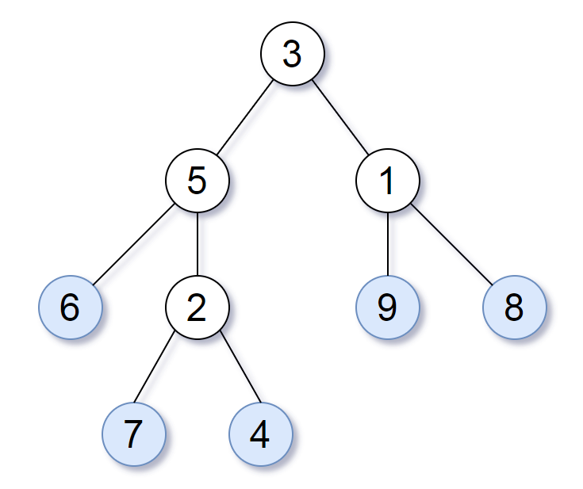

# 简单题，简单做（Python/Java/C++/Go/JS/Rust）

> **[872. 叶子相似的树](https://leetcode.cn/problems/leaf-similar-trees/solutions/3741528/jian-dan-ti-jian-dan-zuo-pythonjavacgojs-b8ns/) · Easy · 难度分 1288**

> **所属题单**
> - [链表、二叉树与回溯 · 二、二叉树](../../../刷题路径/灵神原版题单/链表、二叉树与回溯/二、二叉树.md) · §2.1 遍历二叉树

> **题目描述**
> 请考虑一棵二叉树上所有的叶子，这些叶子的值按从左到右的顺序排列形成一个 **叶值序列** 。
>
> 
>
> 举个例子，如上图所示，给定一棵叶值序列为 `(6, 7, 4, 9, 8)` 的树。
>
> 如果有两棵二叉树的叶值序列是相同，那么我们就认为它们是 <em>叶相似</em> 的。
>
> 如果给定的两个根结点分别为 `root1` 和 `root2` 的树是叶相似的，则返回 `true`；否则返回 `false` 。
>
> **示例 1：**
>
> 
>
> ```
>
> 输入：root1 = [3,5,1,6,2,9,8,null,null,7,4], root2 = [3,5,1,6,7,4,2,null,null,null,null,null,null,9,8]
> 输出：true
> ```
>
> **示例 2：**
>
> 
>
> ```
>
> 输入：root1 = [1,2,3], root2 = [1,3,2]
> 输出：false
> ```
>
> **提示：**
>
> - 给定的两棵树结点数在 `[1, 200]` 范围内
>
> - 给定的两棵树上的值在 `[0, 200]` 范围内

> **题解**
> 按照同样的 DFS 顺序遍历这两棵二叉树，比如都按照先左子树再右子树的方式。
>
> 遍历到叶子时，把节点值加到一个列表中。
>
> 最后判断两个列表是否相同。
>
> ```python
> class Solution:
>     def leafValues(self, root: Optional[TreeNode]) -> List[int]:
>         res = []
>         def dfs(node: Optional[TreeNode]) -> None:
>             if node is None:  # 空节点
>                 return
>             if node.left is None and node.right is None:  # 叶子
>                 res.append(node.val)
>                 return
>             dfs(node.left)
>             dfs(node.right)
>         dfs(root)
>         return res
>
>     def leafSimilar(self, root1: Optional[TreeNode], root2: Optional[TreeNode]) -> bool:
>         return self.leafValues(root1) == self.leafValues(root2)
> ```
>
>
> #### 复杂度分析
>
> - 时间复杂度：$\mathcal{O}(n+m)$，其中 $n$ 和 $m$ 分别是两棵二叉树的大小（节点个数）。
> - 空间复杂度：$\mathcal{O}(n+m)$。
>
> ## 分类题单
>
> [如何科学刷题？](https://leetcode.cn/circle/discuss/RvFUtj/)
>
> 1. [滑动窗口与双指针（定长/不定长/单序列/双序列/三指针/分组循环）](https://leetcode.cn/circle/discuss/0viNMK/)
> 2. [二分算法（二分答案/最小化最大值/最大化最小值/第K小）](https://leetcode.cn/circle/discuss/SqopEo/)
> 3. [单调栈（基础/矩形面积/贡献法/最小字典序）](https://leetcode.cn/circle/discuss/9oZFK9/)
> 4. [网格图（DFS/BFS/综合应用）](https://leetcode.cn/circle/discuss/YiXPXW/)
> 5. [位运算（基础/性质/拆位/试填/恒等式/思维）](https://leetcode.cn/circle/discuss/dHn9Vk/)
> 6. [图论算法（DFS/BFS/拓扑排序/基环树/最短路/最小生成树/网络流）](https://leetcode.cn/circle/discuss/01LUak/)
> 7. [动态规划（入门/背包/划分/状态机/区间/状压/数位/数据结构优化/树形/博弈/概率期望）](https://leetcode.cn/circle/discuss/tXLS3i/)
> 8. [常用数据结构（前缀和/差分/栈/队列/堆/字典树/并查集/树状数组/线段树）](https://leetcode.cn/circle/discuss/mOr1u6/)
> 9. [数学算法（数论/组合/概率期望/博弈/计算几何/随机算法）](https://leetcode.cn/circle/discuss/IYT3ss/)
> 10. [贪心与思维（基本贪心策略/反悔/区间/字典序/数学/思维/脑筋急转弯/构造）](https://leetcode.cn/circle/discuss/g6KTKL/)
> 11. 【本题相关】[链表、二叉树与回溯（前后指针/快慢指针/DFS/BFS/直径/LCA/一般树）](https://leetcode.cn/circle/discuss/K0n2gO/)
> 12. [字符串（KMP/Z函数/Manacher/字符串哈希/AC自动机/后缀数组/子序列自动机）](https://leetcode.cn/circle/discuss/SJFwQI/)
>
> [我的题解精选（已分类）](https://github.com/EndlessCheng/codeforces-go/blob/master/leetcode/SOLUTIONS.md)
>
> 欢迎关注 [B站@灵茶山艾府](https://space.bilibili.com/206214)
