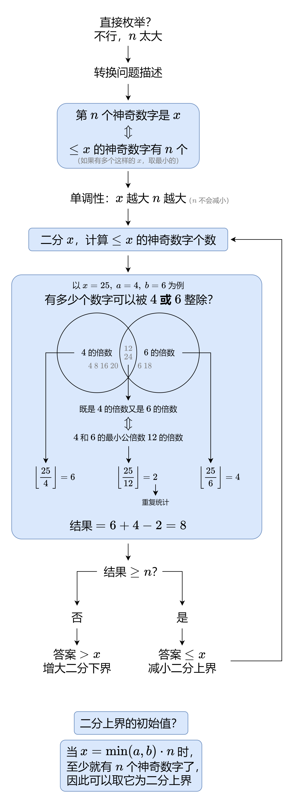

# 二分答案+容斥原理（Python/Java/C++/Go）

> **[878. 第 N 个神奇数字](https://leetcode.cn/problems/nth-magical-number/solutions/1984641/er-fen-da-an-rong-chi-yuan-li-by-endless-9j34/) · Hard · 难度分 1897**

> **所属题单**
> - [二分算法 · 二、二分答案](../../../刷题路径/灵神原版题单/二分算法/二、二分答案.md) · §2.6 第 K 小/大
> - [数学算法 · 二、组合数学](../../../刷题路径/灵神原版题单/数学算法/二、组合数学.md) · §2.3 容斥原理

> **题目描述**
> 一个正整数如果能被 `a` 或 `b` 整除，那么它是神奇的。
>
> 给定三个整数 `n` , `a` , `b` ，返回第 `n` 个神奇的数字。因为答案可能很大，所以返回答案 **对** `10⁹ + 7` **取模** 后的值。
>
> **示例 1：**
>
> ```
>
> 输入：n = 1, a = 2, b = 3
> 输出：2
> ```
>
> **示例 2：**
>
> ```
>
> 输入：n = 4, a = 2, b = 3
> 输出：6
> ```
>
> **提示：**
>
> - `1 <= n <= 10⁹`
>
> - `2 <= a, b <= 4 * 10⁴`

> **题解**
> 
>
> ## 补充
>
> 下面代码采用开区间二分，这仅仅是二分的一种写法，使用闭区间或者半闭半开区间都是可以的。
>
> - 开区间左端点初始值：$1$。一定无法满足要求。注意 $a$ 和 $b$ 都 $\ge 2$。
> - 开区间左端点初始值（优化）：$\min(a,b)+n-2$。神奇数字最小是 $\min(a,b)$，第 $n$ 个神奇数字至少是 $\min(a,b)+n-1$，再减一就一定无法满足要求了。
> - 开区间右端点初始值：$\min(a,b)\cdot n$。一定满足要求。
>
> ## 答疑
>
> **问**：能否讲解一下二分的原理和代码中的细节？
>
> **答**：见 [二分查找又死循环了？一个视频讲透二分本质！](https://www.bilibili.com/video/BV1AP41137w7/)
>
> **问**：为什么二分循环结束时，得到的一定是一个神奇数字？
>
> **答**：设答案为 $x$，循环结束时，$\le x$ 的神奇数字有 $n$ 个，而 $\le x-1$ 的神奇数字不足 $n$ 个（可结合视频中的红蓝染色来理解）。**只有当 $x$ 是一个神奇数字时，才会出现这种情况。**
>
> 这也同时说明，在二分循环中，我们**不能在计算结果恰好等于 $n$ 的时候，直接返回答案**，而是要继续二分。
>
> **问**：最小公倍数是怎么算的？
>
> **答**：利用最小公倍数与最大公约数的关系 $\text{lcm}(a,b) = \dfrac{a\cdot b}{\text{gcd}(a,b)}$。计算 $\text{gcd}(a,b)$ 可以用辗转相除法。
>
> ```python
> class Solution:
>     def nthMagicalNumber(self, n: int, a: int, b: int) -> int:
>         lcm = math.lcm(a, b)
>         left = min(a, b) + n - 2
>         right = min(a, b) * n  # 开区间 (left, right)
>         while left + 1 < right:  # 开区间不为空
>             mid = (left + right) // 2
>             if mid // a + mid // b - mid // lcm >= n:
>                 right = mid  # 范围缩小到 (left, mid)
>             else:
>                 left = mid  # 范围缩小到 (mid, right)
>         return right % 1_000_000_007
> ```
>
> > [!example]- Python3 库函数
> > ```python
> > class Solution:
> >     def nthMagicalNumber(self, n: int, a: int, b: int) -> int:
> >         lcm = math.lcm(a, b)
> >         left = min(a, b) + n - 1  # 左闭右开
> >         right = min(a, b) * n
> >         check = lambda x: x // a + x // b - x // lcm >= n
> >         return bisect_left(range(right), True, lo=left, key=check) % 1_000_000_007
> > ```
>
>
> #### 复杂度分析
>
> - 时间复杂度：$\mathcal{O}(\log(\min(a,b)\cdot n)))$。
> - 空间复杂度：$\mathcal{O}(1)$。
>
> ## 相似题目
>
> - [1201. 丑数 III](https://leetcode.cn/problems/ugly-number-iii/)
>
> ## 分类题单
>
> [如何科学刷题？](https://leetcode.cn/circle/discuss/RvFUtj/)
>
> 1. [滑动窗口与双指针（定长/不定长/单序列/双序列/三指针/分组循环）](https://leetcode.cn/circle/discuss/0viNMK/)
> 2. [二分算法（二分答案/最小化最大值/最大化最小值/第K小）](https://leetcode.cn/circle/discuss/SqopEo/)
> 3. [单调栈（基础/矩形面积/贡献法/最小字典序）](https://leetcode.cn/circle/discuss/9oZFK9/)
> 4. [网格图（DFS/BFS/综合应用）](https://leetcode.cn/circle/discuss/YiXPXW/)
> 5. [位运算（基础/性质/拆位/试填/恒等式/思维）](https://leetcode.cn/circle/discuss/dHn9Vk/)
> 6. [图论算法（DFS/BFS/拓扑排序/最短路/最小生成树/二分图/基环树/欧拉路径）](https://leetcode.cn/circle/discuss/01LUak/)
> 7. [动态规划（入门/背包/状态机/划分/区间/状压/数位/数据结构优化/树形/博弈/概率期望）](https://leetcode.cn/circle/discuss/tXLS3i/)
> 8. [常用数据结构（前缀和/差分/栈/队列/堆/字典树/并查集/树状数组/线段树）](https://leetcode.cn/circle/discuss/mOr1u6/)
> 9. [数学算法（数论/组合/概率期望/博弈/计算几何/随机算法）](https://leetcode.cn/circle/discuss/IYT3ss/)
> 10. [贪心与思维（基本贪心策略/反悔/区间/字典序/数学/思维/脑筋急转弯/构造）](https://leetcode.cn/circle/discuss/g6KTKL/)
> 11. [链表、二叉树与回溯（前后指针/快慢指针/DFS/BFS/直径/LCA/一般树）](https://leetcode.cn/circle/discuss/K0n2gO/)
> 12. [字符串（KMP/Z函数/Manacher/字符串哈希/AC自动机/后缀数组/子序列自动机）](https://leetcode.cn/circle/discuss/SJFwQI/)
>
> [我的题解精选（已分类）](https://github.com/EndlessCheng/codeforces-go/blob/master/leetcode/SOLUTIONS.md)
>
> 欢迎关注 [B站@灵茶山艾府](https://space.bilibili.com/206214)
