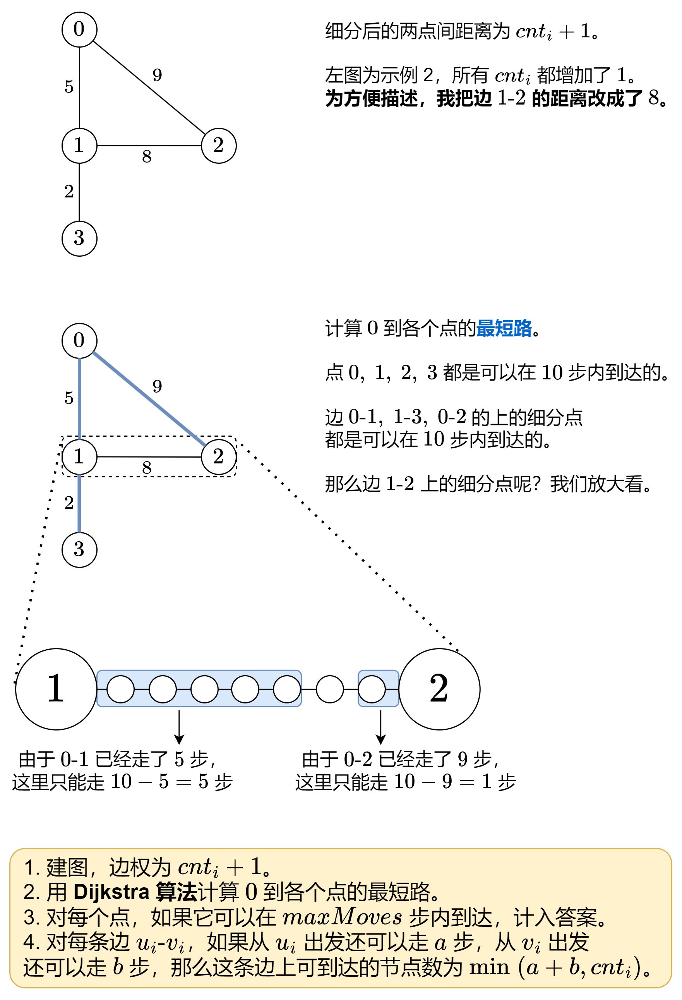

# 【图解】转换成单源最短路问题，附题单（Python/Java/C++/Go）

> **[882. 细分图中的可到达节点](https://leetcode.cn/problems/reachable-nodes-in-subdivided-graph/solutions/1991509/tu-jie-zhuan-huan-cheng-dan-yuan-zui-dua-6l8o/) · Hard · 难度分 2328**

> **所属题单**
> - [图论算法 · 三、最短路](../../../刷题路径/灵神原版题单/图论算法/三、最短路.md) · §3.1 单源最短路：Dijkstra 算法

> **题目描述**
> 给你一个无向图（**原始图**），图中有 `n` 个节点，编号从 `0` 到 `n - 1` 。你决定将图中的每条边 **细分** 为一条节点链，每条边之间的新节点数各不相同。
>
> 图用由边组成的二维数组 `edges` 表示，其中 `edges[i] = [u_i, v_i, cnt_i]` 表示原始图中节点 `u_i` 和 `v_i` 之间存在一条边，`cnt_i` 是将边 **细分** 后的新节点总数。注意，`cnt_i == 0` 表示边不可细分。
>
> 要 **细分** 边 `[ui, vi]` ，需要将其替换为 `(cnt_i + 1)` 条新边，和 `cnt_i` 个新节点。新节点为 `x₁`, `x₂`, ..., `x_(cnt_i)` ，新边为 `[u_i, x₁]`, `[x₁, x₂]`, `[x₂, x₃]`, ..., `[x_(cnt_i-1), x_(cnt_i)]`, `[x_(cnt_i), v_i]` 。
>
> 现在得到一个 **新的细分图** ，请你计算从节点 `0` 出发，可以到达多少个节点？如果节点间距离是 `maxMoves` 或更少，则视为 **可以到达** 。
>
> 给你原始图和 `maxMoves` ，返回 <em>新的细分图中从节点 `0` 出发</em> **<em>可到达的节点数</em>** 。
>
> **示例 1：**
>
> 
>
> ```
>
> 输入：edges = [[0,1,10],[0,2,1],[1,2,2]], maxMoves = 6, n = 3
> 输出：13
> 解释：边的细分情况如上图所示。
> 可以到达的节点已经用黄色标注出来。
> ```
>
> **示例 2：**
>
> ```
>
> 输入：edges = [[0,1,4],[1,2,6],[0,2,8],[1,3,1]], maxMoves = 10, n = 4
> 输出：23
> ```
>
> **示例 3：**
>
> ```
>
> 输入：edges = [[1,2,4],[1,4,5],[1,3,1],[2,3,4],[3,4,5]], maxMoves = 17, n = 5
> 输出：1
> 解释：节点 0 与图的其余部分没有连通，所以只有节点 0 可以到达。
> ```
>
> **提示：**
>
> - `0 <= edges.length <= min(n * (n - 1) / 2, 10⁴)`
>
> - `edges[i].length == 3`
>
> - `0 <= u_i < v_i < n`
>
> - 图中 **不存在平行边**
>
> - `0 <= cnt_i <= 10⁴`
>
> - `0 <= maxMoves <= 10⁹`
>
> - `1 <= n <= 3000`

> **题解**
> **前置知识**：[Dijkstra 算法介绍](../../0700-0799/0743%20网络延迟时间/灵茶山艾府.md)
>
> 
>
> ```python
> class Solution:
>     def reachableNodes(self, edges: List[List[int]], maxMoves: int, n: int) -> int:
>         g = [[] for _ in range(n)]
>         for u, v, cnt in edges:
>             g[u].append((v, cnt + 1))
>             g[v].append((u, cnt + 1))  # 建图
>
>         dist = self.dijkstra(g, 0, maxMoves)  # 从 0 出发的最短路
>
>         ans = sum(d <= maxMoves for d in dist)  # 可以在 maxMoves 步内到达的点的个数
>         for u, v, cnt in edges:
>             a = max(maxMoves - dist[u], 0)
>             b = max(maxMoves - dist[v], 0)
>             ans += min(a + b, cnt)  # 这条边上可以到达的节点数
>         return ans
>
>     # Dijkstra 算法模板
>     # 返回从 start 到每个点的最短路
>     def dijkstra(self, g: List[List[Tuple[int]]], start: int, maxMoves: int) -> List[int]:
>         dist = [inf] * len(g)
>         dist[start] = 0
>         h = [(0, start)]
>
>         # 优化：最短路 >= maxMoves 就不用再算了（注意本题边权 > 0）
>         while h and h[0][0] < maxMoves:
>             d, x = heappop(h)
>             if d > dist[x]:
>                 continue
>             for y, wt in g[x]:
>                 new_d = d + wt
>                 if new_d < dist[y]:
>                     dist[y] = new_d
>                     heappush(h, (new_d, y))
>         return dist
> ```
>
>
> #### 复杂度分析
>
> - 时间复杂度：$\mathcal{O}(n + m\log m)$，其中 $m$ 为 $\textit{edges}$ 的长度。注意如果同一个点的最短路被更新多次，堆中会有多个相同点，因此堆中的元素个数是 $\mathcal{O}(m)$ 的，每次入堆出堆的时间复杂度为 $\mathcal{O}(\log m)$。
> - 空间复杂度：$\mathcal{O}(n+m)$。
>
> ## 分类题单
>
> [如何科学刷题？](https://leetcode.cn/circle/discuss/RvFUtj/)
>
> 1. [滑动窗口与双指针（定长/不定长/单序列/双序列/三指针/分组循环）](https://leetcode.cn/circle/discuss/0viNMK/)
> 2. [二分算法（二分答案/最小化最大值/最大化最小值/第K小）](https://leetcode.cn/circle/discuss/SqopEo/)
> 3. [单调栈（基础/矩形面积/贡献法/最小字典序）](https://leetcode.cn/circle/discuss/9oZFK9/)
> 4. [网格图（DFS/BFS/综合应用）](https://leetcode.cn/circle/discuss/YiXPXW/)
> 5. [位运算（基础/性质/拆位/试填/恒等式/思维）](https://leetcode.cn/circle/discuss/dHn9Vk/)
> 6. [图论算法（DFS/BFS/拓扑排序/基环树/最短路/最小生成树/网络流）](https://leetcode.cn/circle/discuss/01LUak/)
> 7. [动态规划（入门/背包/划分/状态机/区间/状压/数位/数据结构优化/树形/博弈/概率期望）](https://leetcode.cn/circle/discuss/tXLS3i/)
> 8. [常用数据结构（前缀和/差分/栈/队列/堆/字典树/并查集/树状数组/线段树）](https://leetcode.cn/circle/discuss/mOr1u6/)
> 9. [数学算法（数论/组合/概率期望/博弈/计算几何/随机算法）](https://leetcode.cn/circle/discuss/IYT3ss/)
> 10. [贪心与思维（基本贪心策略/反悔/区间/字典序/数学/思维/脑筋急转弯/构造）](https://leetcode.cn/circle/discuss/g6KTKL/)
> 11. [链表、二叉树与回溯（前后指针/快慢指针/DFS/BFS/直径/LCA/一般树）](https://leetcode.cn/circle/discuss/K0n2gO/)
> 12. [字符串（KMP/Z函数/Manacher/字符串哈希/AC自动机/后缀数组/子序列自动机）](https://leetcode.cn/circle/discuss/SJFwQI/)
>
> [我的题解精选（已分类）](https://github.com/EndlessCheng/codeforces-go/blob/master/leetcode/SOLUTIONS.md)
>
> 欢迎关注 [B站@灵茶山艾府](https://space.bilibili.com/206214)
