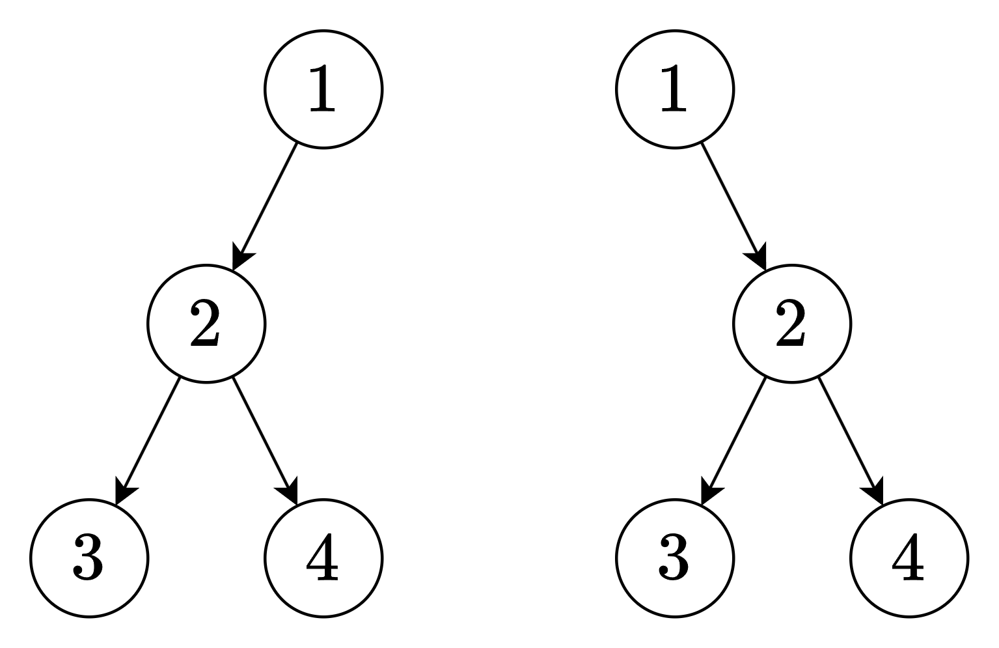
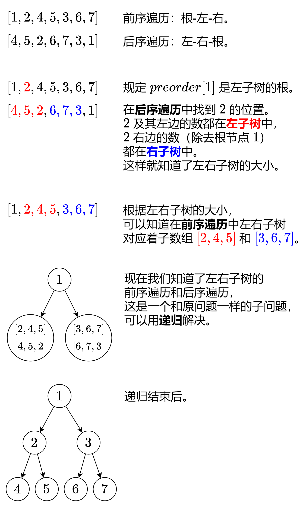

# 【图解】从 O(n^2) 到 O(n)（Python/Java/C++/Go/JS/Rust）

> **[889. 从前序与后序遍历序列构造二叉树](https://leetcode.cn/problems/construct-binary-tree-from-preorder-and-postorder-traversal/solutions/2649218/tu-jie-cong-on2-dao-onpythonjavacgojsrus-h0o5/) · Medium · 难度分 1732**

> **所属题单**
> - [链表、二叉树与回溯 · 二、二叉树](../../../刷题路径/灵神原版题单/链表、二叉树与回溯/二、二叉树.md) · §2.10 创建二叉树

> **题目描述**
> 给定两个整数数组，`preorder` 和 `postorder` ，其中 `preorder` 是一个具有 **无重复** 值的二叉树的前序遍历，`postorder` 是同一棵树的后序遍历，重构并返回二叉树。
>
> 如果存在多个答案，您可以返回其中 **任何** 一个。
>
> **示例 1：**
>
> 
>
> ```
>
> 输入：preorder = [1,2,4,5,3,6,7], postorder = [4,5,2,6,7,3,1]
> 输出：[1,2,3,4,5,6,7]
> ```
>
> **示例 2:**
>
> ```
>
> 输入: preorder = [1], postorder = [1]
> 输出: [1]
> ```
>
> **提示：**
>
> - `1 <= preorder.length <= 30`
>
> - `1 <= preorder[i] <= preorder.length`
>
> - `preorder` 中所有值都 **不同**
>
> - `postorder.length == preorder.length`
>
> - `1 <= postorder[i] <= postorder.length`
>
> - `postorder` 中所有值都 **不同**
>
> - 保证 `preorder` 和 `postorder` 是同一棵二叉树的前序遍历和后序遍历

> **题解**
> **前序遍历**：按照「根-左子树-右子树」的顺序遍历二叉树。
>
> **后序遍历**：按照「左子树-右子树-根」的顺序遍历二叉树。
>
> 首先说明，如果只知道前序遍历和后序遍历，这棵二叉树不一定是唯一的，如下图。
>
> {:width=500px}
>
> 对于这两棵二叉树：
>
> - 前序遍历都是 $[1,2,3,4]$。
> - 后序遍历都是 $[3,4,2,1]$。
>
> > 注：如果二叉树的每个非叶节点都有两个儿子，知道前序和后序就能唯一确定这棵二叉树。
>
> 题目说，如果存在多个答案，我们可以返回其中任何一个。那么不妨**规定**：无论什么情况，在前序遍历中，$\textit{preorder}[1]$ 都是**左子树**的根节点值。
>
> 来看看示例 1 是怎么生成这棵二叉树的。
>
> 
>
> **递归边界**：
>
> - 如果 $\textit{preorder}$ 的长度是 $0$，对应着空节点，返回空。
> - 如果 $\textit{preorder}$ 的长度是 $1$，对应着二叉树的叶子，创建一个叶子节点并返回。
>
> 晕递归的同学推荐先看 [深入理解递归【基础算法精讲 09】](https://www.bilibili.com/video/BV1UD4y1Y769/)
>
> ## 写法一
>
> ```python
> class Solution:
>     def constructFromPrePost(self, preorder: List[int], postorder: List[int]) -> Optional[TreeNode]:
>         if not preorder:  # 空节点
>             return None
>         if len(preorder) == 1:  # 叶子节点
>             return TreeNode(preorder[0])
>         left_size = postorder.index(preorder[1]) + 1  # 左子树的大小
>         left = self.constructFromPrePost(preorder[1: 1 + left_size], postorder[:left_size])
>         right = self.constructFromPrePost(preorder[1 + left_size:], postorder[left_size: -1])
>         return TreeNode(preorder[0], left, right)
> ```
>
>
> #### 复杂度分析
>
> - 时间复杂度：$\mathcal{O}(n^2)$，其中 $n$ 为 $\textit{preorder}$ 的长度。最坏情况下二叉树是一条链，我们需要递归 $\mathcal{O}(n)$ 次，每次都需要 $\mathcal{O}(n)$ 的时间查找 $\textit{preorder}[1]$ 和复制数组。
> - 空间复杂度：$\mathcal{O}(n^2)$。
>
> ## 写法二
>
> 上面的写法有两个优化点：
>
> 1. 用一个哈希表（或者数组）预处理 $\textit{postorder}$ 每个元素的下标，这样就可以 $\mathcal{O}(1)$ 查到 $\textit{preorder}[1]$ 在 $\textit{postorder}$ 的位置，从而 $\mathcal{O}(1)$ 知道左子树的大小。
> 2. 把递归参数改成子数组下标区间（左闭右开区间）的左右端点，从而避免复制数组。
>
> ```python
> class Solution:
>     def constructFromPrePost(self, preorder: List[int], postorder: List[int]) -> Optional[TreeNode]:
>         index = {x: i for i, x in enumerate(postorder)}
>
>         # 注意 post_r 可以省略
>         def dfs(pre_l: int, pre_r: int, post_l: int) -> Optional[TreeNode]:
>             if pre_l == pre_r:  # 空节点
>                 return None
>             if pre_l + 1 == pre_r:  # 叶子节点
>                 return TreeNode(preorder[pre_l])
>             left_size = index[preorder[pre_l + 1]] - post_l + 1  # 左子树的大小
>             left = dfs(pre_l + 1, pre_l + 1 + left_size, post_l)
>             right = dfs(pre_l + 1 + left_size, pre_r, post_l + left_size)
>             return TreeNode(preorder[pre_l], left, right)
>
>         return dfs(0, len(preorder), 0)  # 左闭右开区间
> ```
>
>
> #### 复杂度分析
>
> - 时间复杂度：$\mathcal{O}(n)$，其中 $n$ 为 $\textit{preorder}$ 的长度。递归 $\mathcal{O}(n)$ 次，每次只需要 $\mathcal{O}(1)$ 的时间。
> - 空间复杂度：$\mathcal{O}(n)$。
>
> ## 构造系列
>
> 这三题都可以用本文讲的套路解决。
>
> - [105. 从前序与中序遍历序列构造二叉树](https://leetcode.cn/problems/construct-binary-tree-from-preorder-and-inorder-traversal/)
> - [106. 从中序与后序遍历序列构造二叉树](https://leetcode.cn/problems/construct-binary-tree-from-inorder-and-postorder-traversal/)
> - [889. 根据前序和后序遍历构造二叉树](https://leetcode.cn/problems/construct-binary-tree-from-preorder-and-postorder-traversal/)
>
> ## 分类题单
>
> [如何科学刷题？](https://leetcode.cn/circle/discuss/RvFUtj/)
>
> 1. [滑动窗口与双指针（定长/不定长/单序列/双序列/三指针/分组循环）](https://leetcode.cn/circle/discuss/0viNMK/)
> 2. [二分算法（二分答案/最小化最大值/最大化最小值/第K小）](https://leetcode.cn/circle/discuss/SqopEo/)
> 3. [单调栈（基础/矩形面积/贡献法/最小字典序）](https://leetcode.cn/circle/discuss/9oZFK9/)
> 4. [网格图（DFS/BFS/综合应用）](https://leetcode.cn/circle/discuss/YiXPXW/)
> 5. [位运算（基础/性质/拆位/试填/恒等式/思维）](https://leetcode.cn/circle/discuss/dHn9Vk/)
> 6. [图论算法（DFS/BFS/拓扑排序/最短路/最小生成树/二分图/基环树/欧拉路径）](https://leetcode.cn/circle/discuss/01LUak/)
> 7. [动态规划（入门/背包/状态机/划分/区间/状压/数位/数据结构优化/树形/博弈/概率期望）](https://leetcode.cn/circle/discuss/tXLS3i/)
> 8. [常用数据结构（前缀和/差分/栈/队列/堆/字典树/并查集/树状数组/线段树）](https://leetcode.cn/circle/discuss/mOr1u6/)
> 9. [数学算法（数论/组合/概率期望/博弈/计算几何/随机算法）](https://leetcode.cn/circle/discuss/IYT3ss/)
> 10. [贪心与思维（基本贪心策略/反悔/区间/字典序/数学/思维/脑筋急转弯/构造）](https://leetcode.cn/circle/discuss/g6KTKL/)
> 11. 【本题相关】[链表、二叉树与回溯（前后指针/快慢指针/DFS/BFS/直径/LCA/一般树）](https://leetcode.cn/circle/discuss/K0n2gO/)
> 12. [字符串（KMP/Z函数/Manacher/字符串哈希/AC自动机/后缀数组/子序列自动机）](https://leetcode.cn/circle/discuss/SJFwQI/)
>
> [我的题解精选（已分类）](https://github.com/EndlessCheng/codeforces-go/blob/master/leetcode/SOLUTIONS.md)
>
> 欢迎关注 [B站@灵茶山艾府](https://space.bilibili.com/206214)
