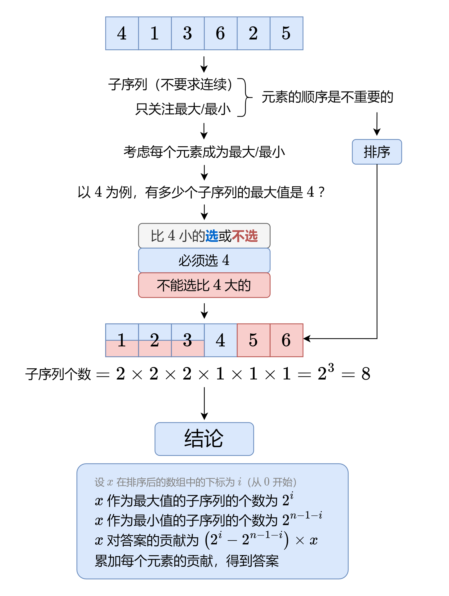

# 计算每个元素对答案的贡献，多解法（Python/Java/C++/Go）

> **[891. 子序列宽度之和](https://leetcode.cn/problems/sum-of-subsequence-widths/solutions/1977682/by-endlesscheng-upd1/) · Hard · 难度分 2183**

> **所属题单**
> - [贪心算法 · 五、思维题](../../../刷题路径/灵神原版题单/贪心算法/五、思维题.md) · §5.5 贡献法

> **题目描述**
> 一个序列的 **宽度** 定义为该序列中最大元素和最小元素的差值。
>
> 给你一个整数数组 `nums` ，返回 `nums` 的所有非空 **子序列** 的 **宽度之和** 。由于答案可能非常大，请返回对 `10⁹ + 7` **取余** 后的结果。
>
> **子序列** 定义为从一个数组里删除一些（或者不删除）元素，但不改变剩下元素的顺序得到的数组。例如，`[3,6,2,7]` 就是数组 `[0,3,1,6,2,2,7]` 的一个子序列。
>
> **示例 1：**
>
> ```
>
> 输入：nums = [2,1,3]
> 输出：6
> 解释：子序列为 [1], [2], [3], [2,1], [2,3], [1,3], [2,1,3] 。
> 相应的宽度是 0, 0, 0, 1, 1, 2, 2 。
> 宽度之和是 6 。
> ```
>
> **示例 2：**
>
> ```
>
> 输入：nums = [2]
> 输出：0
> ```
>
> **提示：**
>
> - `1 <= nums.length <= 10⁵`
>
> - `1 <= nums[i] <= 10⁵`

> **题解**
> 
>
> #### 答疑
>
> **问**：对于数组中有重复元素的情况，这种做法不会重复统计吗？
>
> **答**：不会。例如计算最大值时，如果有多个相同元素 $x$，那么每个 $x$ 都只会考虑在它**左侧**的元素，而不会计入在它**右侧**的元素，所以不会有重复统计发生。
>
> **问**：为什么 $x$ 作为最小值的子序列的个数为 $2^{n-1-i}$？
>
> **答**：因为排序后，$x$ 右侧有 $n-1-i$ 个元素，每个元素都可以选或不选，这有 $2^{n-1-i}$ 种方案，也就对应着 $2^{n-1-i}$ 个子序列。
>
> ```python
> class Solution:
>     def sumSubseqWidths(self, nums: List[int]) -> int:
>         MOD = 1_000_000_007
>         nums.sort()
>         n = len(nums)
>         pow2 = [0] * n
>         pow2[0] = 1
>         for i in range(1, n):
>             pow2[i] = pow2[i - 1] * 2 % MOD  # 预处理 2 的幂次
>         return sum((pow2[i] - pow2[-1 - i]) * x
>                    for i, x in enumerate(nums)) % MOD
> ```
>
>
> 也可以用 [快速幂](https://leetcode.cn/problems/powx-n/solutions/238559/powx-n-by-leetcode-solution/) 计算 $2$ 的幂次。
>
> ```python
> class Solution:
>     def sumSubseqWidths(self, nums: List[int]) -> int:
>         MOD = 1_000_000_007
>         nums.sort()
>         return sum((pow(2, i, MOD) - pow(2, len(nums) - 1 - i, MOD)) * x
>                    for i, x in enumerate(nums)) % MOD
> ```
>
>
> 还可以递推算出 $2^i$ 和 $2^{n-1-i}$（后者需要用到 [逆元](https://oi-wiki.org/math/number-theory/inverse/)）。
>
> 对于本题而言，可以直接用 $\dfrac{10^9+7+1}{2}=500000004$ 当作 $2$ 关于 $10^9+7$ 的逆元。
>
> ```python
> class Solution:
>     def sumSubseqWidths(self, nums: List[int]) -> int:
>         MOD = 1_000_000_007
>         INV2 = (MOD + 1) // 2
>         nums.sort()
>         ans, pow2, pow2r = 0, 1, pow(2, len(nums) - 1, MOD)
>         for x in nums:
>             ans += (pow2 - pow2r) * x
>             pow2 = pow2 * 2 % MOD
>             pow2r = pow2r * INV2 % MOD
>         return ans % MOD
> ```
>
>
> 另外一种思路是计算 $2^i$ 对答案的贡献，即 $(\textit{nums}[i]-\textit{nums}[n-1-i])\times 2^i$。
>
> ```python
> class Solution:
>     def sumSubseqWidths(self, nums: List[int]) -> int:
>         MOD = 1_000_000_007
>         nums.sort()
>         ans, pow2 = 0, 1
>         for x, y in zip(nums, reversed(nums)):
>             ans += (x - y) * pow2
>             pow2 = pow2 * 2 % MOD
>         return ans % MOD
> ```
>
>
> #### 复杂度分析
>
> - 时间复杂度：$\mathcal{O}(n\log n)$，其中 $n$ 为 $\textit{nums}$ 的长度。瓶颈在排序上。
> - 空间复杂度：$\mathcal{O}(1)$，忽略排序时的栈开销，仅用到若干变量。
>
> ## 相关题目
>
> 如果把子序列改成**子数组**要怎么做？
>
> 这题是 [2104. 子数组范围和](https://leetcode.cn/problems/sum-of-subarray-ranges/)。
>
> ## 分类题单
>
> [如何科学刷题？](https://leetcode.cn/circle/discuss/RvFUtj/)
>
> 1. [滑动窗口与双指针（定长/不定长/单序列/双序列/三指针/分组循环）](https://leetcode.cn/circle/discuss/0viNMK/)
> 2. [二分算法（二分答案/最小化最大值/最大化最小值/第K小）](https://leetcode.cn/circle/discuss/SqopEo/)
> 3. [单调栈（基础/矩形面积/贡献法/最小字典序）](https://leetcode.cn/circle/discuss/9oZFK9/)
> 4. [网格图（DFS/BFS/综合应用）](https://leetcode.cn/circle/discuss/YiXPXW/)
> 5. [位运算（基础/性质/拆位/试填/恒等式/思维）](https://leetcode.cn/circle/discuss/dHn9Vk/)
> 6. [图论算法（DFS/BFS/拓扑排序/基环树/最短路/最小生成树/网络流）](https://leetcode.cn/circle/discuss/01LUak/)
> 7. [动态规划（入门/背包/划分/状态机/区间/状压/数位/数据结构优化/树形/博弈/概率期望）](https://leetcode.cn/circle/discuss/tXLS3i/)
> 8. [常用数据结构（前缀和/差分/栈/队列/堆/字典树/并查集/树状数组/线段树）](https://leetcode.cn/circle/discuss/mOr1u6/)
> 9. [数学算法（数论/组合/概率期望/博弈/计算几何/随机算法）](https://leetcode.cn/circle/discuss/IYT3ss/)
> 10. [贪心与思维（基本贪心策略/反悔/区间/字典序/数学/思维/脑筋急转弯/构造）](https://leetcode.cn/circle/discuss/g6KTKL/)
> 11. [链表、二叉树与回溯（前后指针/快慢指针/DFS/BFS/直径/LCA/一般树）](https://leetcode.cn/circle/discuss/K0n2gO/)
> 12. [字符串（KMP/Z函数/Manacher/字符串哈希/AC自动机/后缀数组/子序列自动机）](https://leetcode.cn/circle/discuss/SJFwQI/)
>
> [我的题解精选（已分类）](https://github.com/EndlessCheng/codeforces-go/blob/master/leetcode/SOLUTIONS.md)
>
> 欢迎关注 [B站@灵茶山艾府](https://space.bilibili.com/206214)
