# 【动画】没想明白？一个动画秒懂！（Python/Java/C++/Go）

> **[895. 最大频率栈](https://leetcode.cn/problems/maximum-frequency-stack/solutions/1998430/mei-xiang-ming-bai-yi-ge-dong-hua-miao-d-oich/) · Hard · 难度分 2028**

> **所属题单**
> - [常用数据结构 · 三、栈](../../../刷题路径/灵神原版题单/常用数据结构/三、栈.md) · §3.2 进阶

> **题目描述**
> 设计一个类似堆栈的数据结构，将元素推入堆栈，并从堆栈中弹出**出现频率**最高的元素。
>
> 实现 `FreqStack` 类:
>
> - `FreqStack()` 构造一个空的堆栈。
>
> - `void push(int val)` 将一个整数 `val` 压入栈顶。
>
> - `int pop()` 删除并返回堆栈中出现频率最高的元素。
>
>     - 如果出现频率最高的元素不只一个，则移除并返回最接近栈顶的元素。
>
> **示例 1：**
>
> ```
>
> 输入：
> ["FreqStack","push","push","push","push","push","push","pop","pop","pop","pop"],
> [[],[5],[7],[5],[7],[4],[5],[],[],[],[]]
> 输出：[null,null,null,null,null,null,null,5,7,5,4]
> 解释：
> FreqStack = new FreqStack();
> freqStack.push (5);//堆栈为 [5]
> freqStack.push (7);//堆栈是 [5,7]
> freqStack.push (5);//堆栈是 [5,7,5]
> freqStack.push (7);//堆栈是 [5,7,5,7]
> freqStack.push (4);//堆栈是 [5,7,5,7,4]
> freqStack.push (5);//堆栈是 [5,7,5,7,4,5]
> freqStack.pop ();//返回 5 ，因为 5 出现频率最高。堆栈变成 [5,7,5,7,4]。
> freqStack.pop ();//返回 7 ，因为 5 和 7 出现频率最高，但7最接近顶部。堆栈变成 [5,7,5,4]。
> freqStack.pop ();//返回 5 ，因为 5 出现频率最高。堆栈变成 [5,7,4]。
> freqStack.pop ();//返回 4 ，因为 4, 5 和 7 出现频率最高，但 4 是最接近顶部的。堆栈变成 [5,7]。
> ```
>
> **提示：**
>
> - `0 <= val <= 10⁹`
>
> - `push` 和 `pop` 的操作数不大于 `2 * 10⁴`。
>
> - 输入保证在调用 `pop` 之前堆栈中至少有一个元素。

> **题解**
> **核心思路**：把频率（出现次数）不同的元素，压入不同的栈中。每次出栈时，弹出含有频率最高元素的栈的栈顶。
>
> 同时，为了知道每个元素的频率，还需要用一个哈希表来实时维护。
>
> 下面的 PPT 动画展示了示例 1 是如何操作的。
>
> <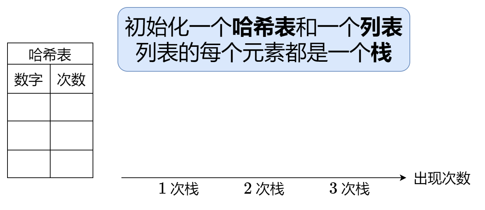,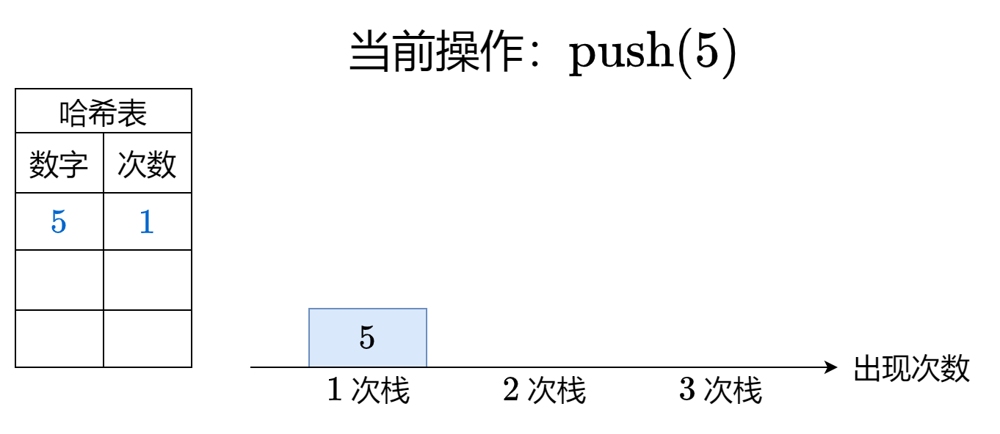,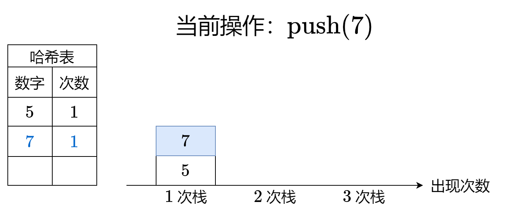,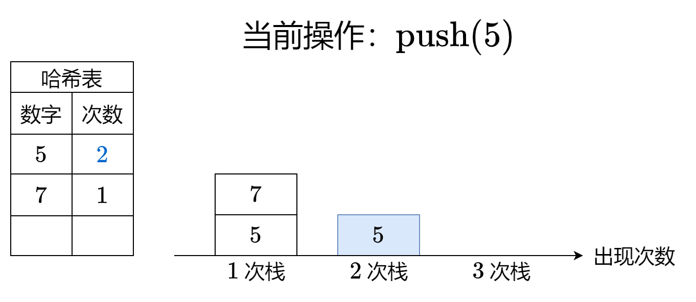,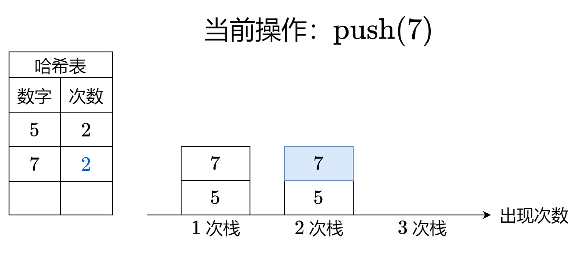,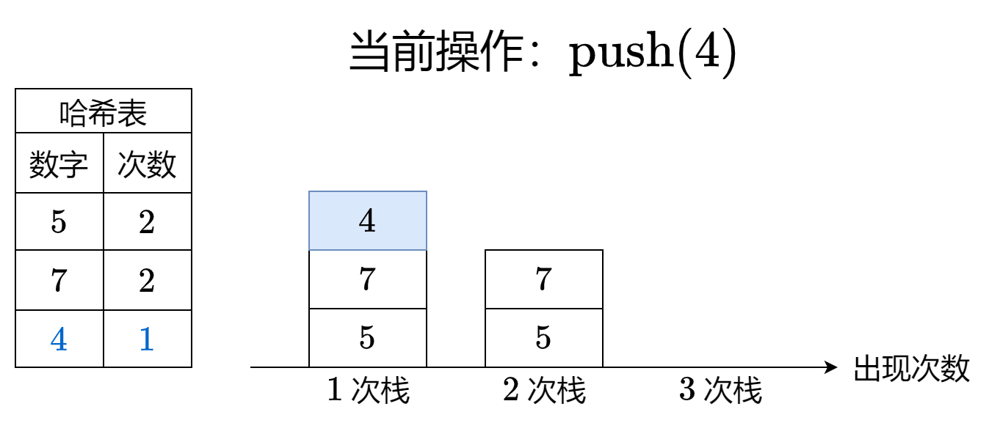,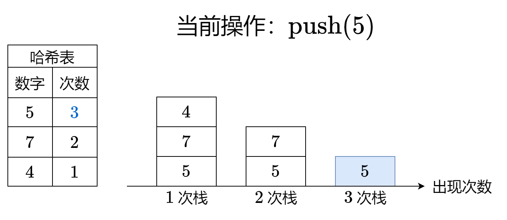,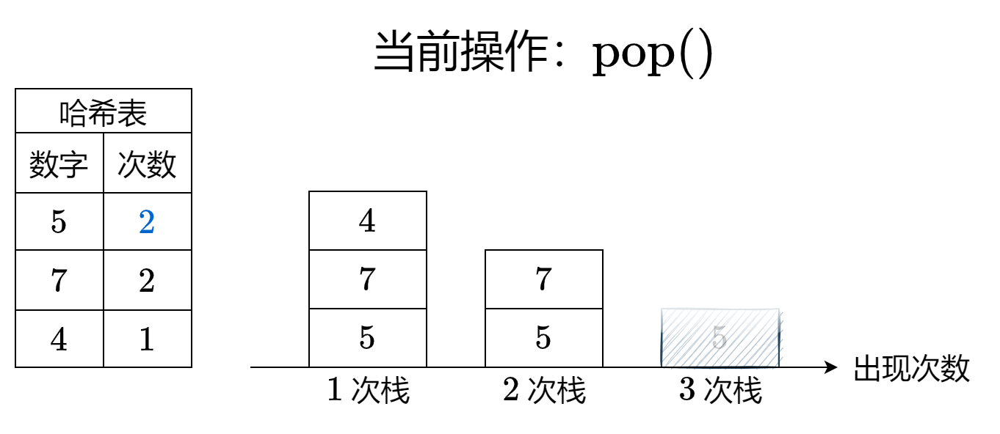,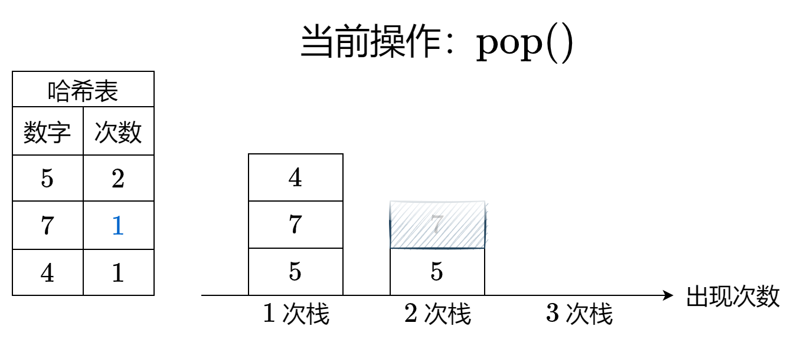,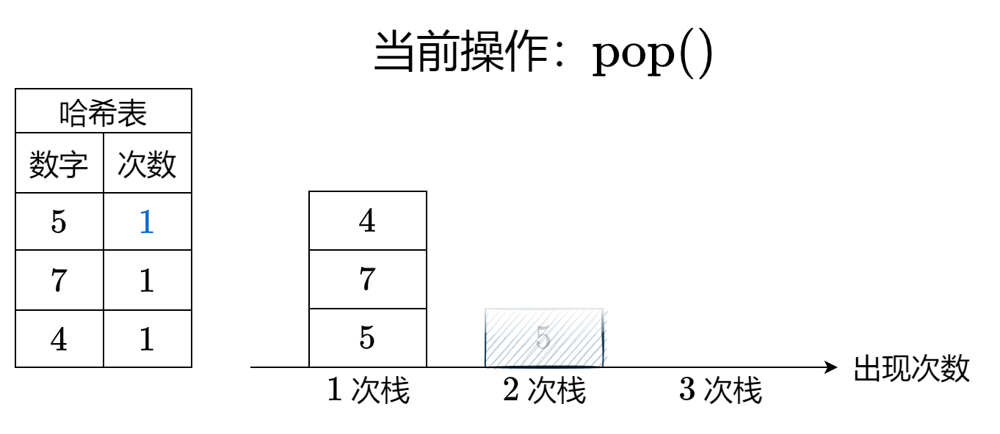,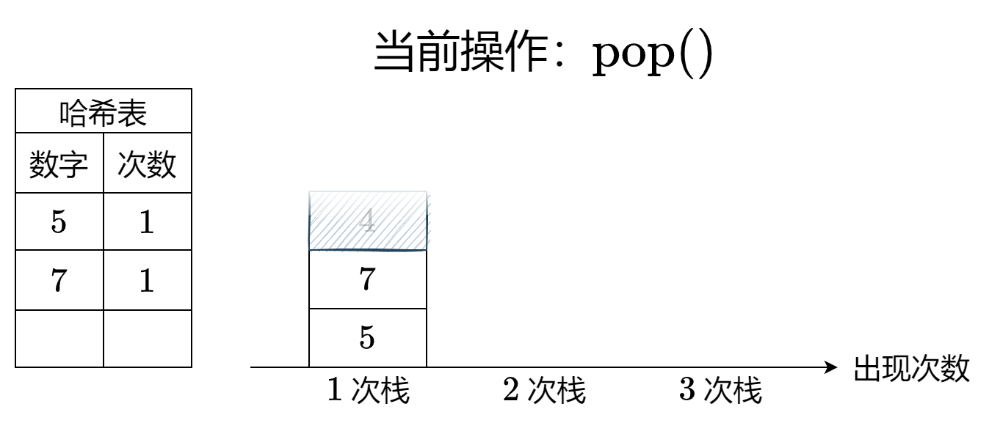>
>
> > 注：代码实现时，为了简单地实现，当元素频率减为 $0$ 时，并没有从哈希表中删除元素。
>
> #### 答疑
>
> **问**：是否会出现**中间**的某个栈为空的情况？
>
> **答**：不会。因为出栈一定是在元素频率最高的栈上发生的，即上面动画中最右侧的非空栈。
>
> **问**：如果有多个相同频率的数字，怎么保证弹出的是一定最接近栈顶的那个数字？
>
> **答**：因为这个做法本质上就是**把原始栈拆分成多个栈**，每个栈都存储着相同频率的数字（这里的频率指的是数字入栈时的频率），且保持了原有的入栈顺序，因此弹出的是一定最接近栈顶的那个数字。
>
> ```python
> class FreqStack:
>     def __init__(self):
>         self.stacks = []  # 栈套栈，stacks 中的每个元素都是一个栈
>         self.cnt = defaultdict(int)  # 每个 val 的出现次数
>
>     def push(self, val: int) -> None:
>         if self.cnt[val] == len(self.stacks):  # 这个元素的频率已经是目前最多的，现在又出现了一次
>             self.stacks.append([val])  # 那么必须创建一个新栈
>         else:
>             self.stacks[self.cnt[val]].append(val)  # 否则就压入对应的栈
>         self.cnt[val] += 1  # 更新频率
>
>     def pop(self) -> int:
>         val = self.stacks[-1].pop()  # 弹出最右侧栈的栈顶元素
>         if not self.stacks[-1]:  # 弹出后，最右侧栈为空
>             self.stacks.pop()  # 删除
>         self.cnt[val] -= 1  # 更新频率
>         return val
> ```
>
>
> #### 复杂度分析
>
> - 时间复杂度：均为 $\mathcal{O}(1)$。
> - 空间复杂度：$\mathcal{O}(q)$，其中 $q$ 为 $\text{push}$ 调用的次数。
>
> ## 分类题单
>
> [如何科学刷题？](https://leetcode.cn/circle/discuss/RvFUtj/)
>
> 1. [滑动窗口（定长/不定长/多指针）](https://leetcode.cn/circle/discuss/0viNMK/)
> 2. [二分算法（二分答案/最小化最大值/最大化最小值/第K小）](https://leetcode.cn/circle/discuss/SqopEo/)
> 3. [单调栈（基础/矩形面积/贡献法/最小字典序）](https://leetcode.cn/circle/discuss/9oZFK9/)
> 4. [网格图（DFS/BFS/综合应用）](https://leetcode.cn/circle/discuss/YiXPXW/)
> 5. [位运算（基础/性质/拆位/试填/恒等式/思维）](https://leetcode.cn/circle/discuss/dHn9Vk/)
> 6. [图论算法（DFS/BFS/拓扑排序/最短路/最小生成树/二分图/基环树/欧拉路径）](https://leetcode.cn/circle/discuss/01LUak/)
> 7. [动态规划（入门/背包/状态机/划分/区间/状压/数位/数据结构优化/树形/博弈/概率期望）](https://leetcode.cn/circle/discuss/tXLS3i/)
> 8. [常用数据结构（前缀和/差分/栈/队列/堆/字典树/并查集/树状数组/线段树）](https://leetcode.cn/circle/discuss/mOr1u6/)
> 9. [数学算法（数论/组合/概率期望/博弈/计算几何/随机算法）](https://leetcode.cn/circle/discuss/IYT3ss/)
> 10. [贪心算法（基本贪心策略/反悔/区间/字典序/数学/思维/脑筋急转弯/构造）](https://leetcode.cn/circle/discuss/g6KTKL/)
>
> [我的题解精选（已分类）](https://github.com/EndlessCheng/codeforces-go/blob/master/leetcode/SOLUTIONS.md)
>
> 欢迎关注 [B站@灵茶山艾府](https://space.bilibili.com/206214)
