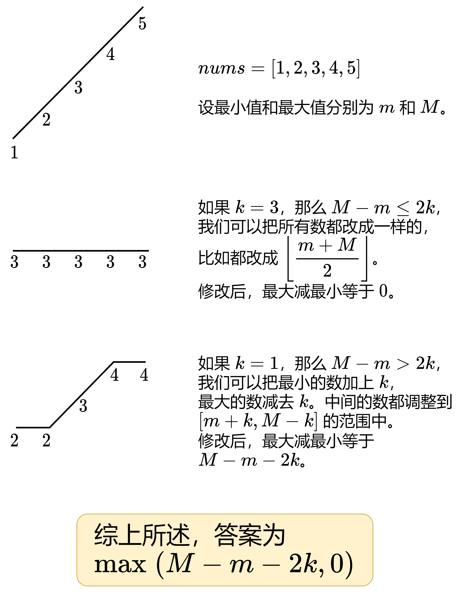

# 【图】分类讨论，简洁写法（Python/Java/C++/C/Go/JS/Rust）

> **[908. 最小差值 I](https://leetcode.cn/problems/smallest-range-i/solutions/2928878/tu-fen-lei-tao-lun-jian-ji-xie-fa-python-9phy/) · Easy**

> **题目描述**
> 给你一个整数数组 `nums`，和一个整数 `k` 。
>
> 在一个操作中，您可以选择 `0 <= i < nums.length` 的任何索引 `i` 。将 `nums[i]` 改为 `nums[i] + x` ，其中 `x` 是一个范围为 `[-k, k]` 的任意整数。对于每个索引 `i` ，最多 **只能** 应用 **一次** 此操作。
>
> `nums` 的 **分数** 是 `nums` 中最大和最小元素的差值。
>
> <em>在对  `nums` 中的每个索引最多应用一次上述操作后，返回 `nums` 的最低 **分数**</em> 。
>
> **示例 1：**
>
> ```
>
> 输入：nums = [1], k = 0
> 输出：0
> 解释：分数是 max(nums) - min(nums) = 1 - 1 = 0。
> ```
>
> **示例 2：**
>
> ```
>
> 输入：nums = [0,10], k = 2
> 输出：6
> 解释：将 nums 改为 [2,8]。分数是 max(nums) - min(nums) = 8 - 2 = 6。
> ```
>
> **示例 3：**
>
> ```
>
> 输入：nums = [1,3,6], k = 3
> 输出：0
> 解释：将 nums 改为 [4,4,4]。分数是 max(nums) - min(nums) = 4 - 4 = 0。
> ```
>
> **提示：**
>
> - `1 <= nums.length <= 10⁴`
>
> - `0 <= nums[i] <= 10⁴`
>
> - `0 <= k <= 10⁴`

> **题解**
> 
>
> ```python
> class Solution:
>     def smallestRangeI(self, nums: List[int], k: int) -> int:
>         return max(max(nums) - min(nums) - k * 2, 0)
> ```
>
>
> #### 复杂度分析
>
> - 时间复杂度：$\mathcal{O}(n)$，其中 $n$ 是 $\textit{nums}$ 的长度。
> - 空间复杂度：$\mathcal{O}(1)$。
>
> ## 思考题
>
> 额外输入一个整数 $m$。如果限制你至多操作 $m$ 次，答案是多少？
>
> 欢迎在评论区分享你的思路/代码。
>
> ## 分类题单
>
> [如何科学刷题？](https://leetcode.cn/circle/discuss/RvFUtj/)
>
> 1. [滑动窗口与双指针（定长/不定长/单序列/双序列/三指针）](https://leetcode.cn/circle/discuss/0viNMK/)
> 2. [二分算法（二分答案/最小化最大值/最大化最小值/第K小）](https://leetcode.cn/circle/discuss/SqopEo/)
> 3. [单调栈（基础/矩形面积/贡献法/最小字典序）](https://leetcode.cn/circle/discuss/9oZFK9/)
> 4. [网格图（DFS/BFS/综合应用）](https://leetcode.cn/circle/discuss/YiXPXW/)
> 5. [位运算（基础/性质/拆位/试填/恒等式/思维）](https://leetcode.cn/circle/discuss/dHn9Vk/)
> 6. [图论算法（DFS/BFS/拓扑排序/最短路/最小生成树/二分图/基环树/欧拉路径）](https://leetcode.cn/circle/discuss/01LUak/)
> 7. [动态规划（入门/背包/状态机/划分/区间/状压/数位/数据结构优化/树形/博弈/概率期望）](https://leetcode.cn/circle/discuss/tXLS3i/)
> 8. [常用数据结构（前缀和/差分/栈/队列/堆/字典树/并查集/树状数组/线段树）](https://leetcode.cn/circle/discuss/mOr1u6/)
> 9. [数学算法（数论/组合/概率期望/博弈/计算几何/随机算法）](https://leetcode.cn/circle/discuss/IYT3ss/)
> 10. [贪心与思维（基本贪心策略/反悔/区间/字典序/数学/思维/脑筋急转弯/构造）](https://leetcode.cn/circle/discuss/g6KTKL/)
> 11. [链表、二叉树与一般树（前后指针/快慢指针/DFS/BFS/直径/LCA）](https://leetcode.cn/circle/discuss/K0n2gO/)
> 12. [字符串（KMP/Z函数/Manacher/字符串哈希/AC自动机/后缀数组/子序列自动机）](https://leetcode.cn/circle/discuss/SJFwQI/)
>
> [我的题解精选（已分类）](https://github.com/EndlessCheng/codeforces-go/blob/master/leetcode/SOLUTIONS.md)
>
> 欢迎关注 [B站@灵茶山艾府](https://space.bilibili.com/206214)
