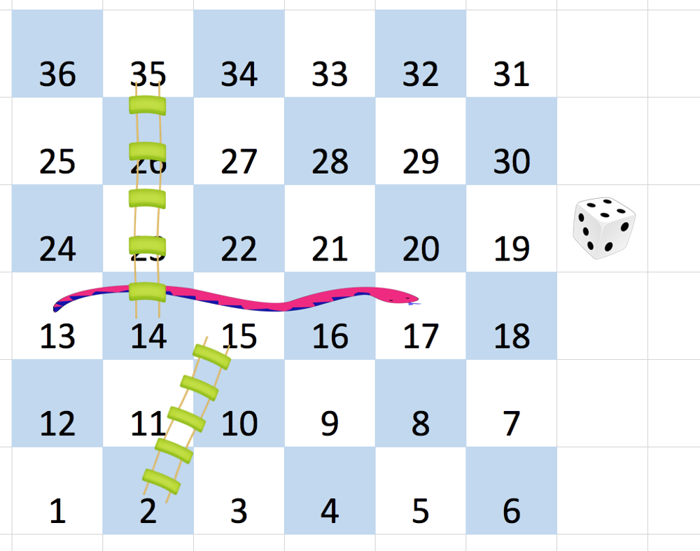

# BFS，注意可能有环（Python/Java/C++/Go/JS/Rust）

> **[909. 蛇梯棋](https://leetcode.cn/problems/snakes-and-ladders/solutions/3690137/bfszhu-yi-ke-neng-you-huan-pythonjavacgo-xcy7/) · Medium · 难度分 2020**

> **所属题单**
> - [网格图 · 二、网格图 BFS](../../../刷题路径/灵神原版题单/网格图/二、网格图%20BFS.md)
> - [面试经典 150 题 · 图的广度优先搜索](../../../刷题路径/灵神原版题单/面试经典%20150%20题/图的广度优先搜索.md)

> **题目描述**
> 给你一个大小为 `n x n` 的整数矩阵 `board` ，方格按从 `1` 到 `n²` 编号，编号遵循 [转行交替方式](https://baike.baidu.com/item/%E7%89%9B%E8%80%95%E5%BC%8F%E8%BD%AC%E8%A1%8C%E4%B9%A6%E5%86%99%E6%B3%95/17195786) ，**从左下角开始** （即，从 `board[n - 1][0]` 开始）的每一行改变方向。
>
> 你一开始位于棋盘上的方格  `1`。每一回合，玩家需要从当前方格 `curr` 开始出发，按下述要求前进：
>
> - 选定目标方格 `next` ，目标方格的编号在范围 `[curr + 1, min(curr + 6, n²)]` 。
>
>     - 该选择模拟了掷 **六面体骰子** 的情景，无论棋盘大小如何，玩家最多只能有 6 个目的地。
>
> - 传送玩家：如果目标方格 `next` 处存在蛇或梯子，那么玩家会传送到蛇或梯子的目的地。否则，玩家传送到目标方格 `next` 。
>
> - 当玩家到达编号 `n²` 的方格时，游戏结束。
>
> 如果 `board[r][c] != -1` ，位于 `r` 行 `c` 列的棋盘格中可能存在 “蛇” 或 “梯子”。那个蛇或梯子的目的地将会是 `board[r][c]`。编号为 `1` 和 `n²` 的方格不是任何蛇或梯子的起点。
>
> 注意，玩家在每次掷骰的前进过程中最多只能爬过蛇或梯子一次：就算目的地是另一条蛇或梯子的起点，玩家也 **不能** 继续移动。
>
> - 举个例子，假设棋盘是 `[[-1,4],[-1,3]]` ，第一次移动，玩家的目标方格是 `2` 。那么这个玩家将会顺着梯子到达方格 `3` ，但 **不能** 顺着方格 `3` 上的梯子前往方格 `4` 。（简单来说，类似飞行棋，玩家掷出骰子点数后移动对应格数，遇到单向的路径（即梯子或蛇）可以直接跳到路径的终点，但如果多个路径首尾相连，也不能连续跳多个路径）
>
> 返回达到编号为 `n²` 的方格所需的最少掷骰次数，如果不可能，则返回 `-1`。
>
> **示例 1：**
>
> 
>
> ```
>
> 输入：board = [[-1,-1,-1,-1,-1,-1],[-1,-1,-1,-1,-1,-1],[-1,-1,-1,-1,-1,-1],[-1,35,-1,-1,13,-1],[-1,-1,-1,-1,-1,-1],[-1,15,-1,-1,-1,-1]]
> 输出：4
> 解释：
> 首先，从方格 1 [第 5 行，第 0 列] 开始。
> 先决定移动到方格 2 ，并必须爬过梯子移动到到方格 15 。
> 然后决定移动到方格 17 [第 3 行，第 4 列]，必须爬过蛇到方格 13 。
> 接着决定移动到方格 14 ，且必须通过梯子移动到方格 35 。
> 最后决定移动到方格 36 , 游戏结束。
> 可以证明需要至少 4 次移动才能到达最后一个方格，所以答案是 4 。
> ```
>
> **示例 2：**
>
> ```
>
> 输入：board = [[-1,-1],[-1,3]]
> 输出：1
> ```
>
> **提示：**
>
> - `n == board.length == board[i].length`
>
> - `2 <= n <= 20`
>
> - `board[i][j]` 的值是 `-1` 或在范围 `[1, n²]` 内
>
> - 编号为 `1` 和 `n²` 的方格上没有蛇或梯子

> **题解**
> ## 思路
>
> **起点**：$1$。
>
> **每一步怎么走**？假设当前在编号 $x$，那么可以移动到 $[x+1,\min(x+6,n^2)]$ 中的编号 $y$。如果编号 $y$ 对应的 $\textit{board}[r][c] > 0$，那么继续移动到编号 $\textit{board}[r][c]$。
>
> **终点**：$n^2$。
>
> 如果无法到达终点（有环），返回 $-1$。
>
> 关于 BFS 双列表的写法，见[【基础算法精讲 13】](https://www.bilibili.com/video/BV1hG4y1277i/)。
>
> ## 细节
>
> 如何把编号 $y$ 转成行号 $r$ 和列号 $c$？
>
> 先确定行号 $r$，再确定列号 $c$。
>
> 把编号**减一**可以看得更清楚，比如示例 1：
>
> - $n=6$。
> - 编号 $[0,5]$ 在倒数 $0$ 行。
> - 编号 $[6,11]$ 在倒数 $1$ 行。
> - 编号 $[12,17]$ 在倒数 $2$ 行。
> - ……
>
> 一般地，$y-1$ 在倒数 $r'=\left\lfloor\dfrac{y-1}{n}\right\rfloor$ 行，即正数 $r=n-1-r'$ 行。
>
> 在 $y-1$ 下面有完整的 $r'$ 行，所以在 $r'$ 行还剩下 $c' = y-1-r'\cdot n = (y-1)\bmod n$：
>
> - 如果 $r'$ 是偶数，那么列号 $c = c'$。
> - 如果 $r'$ 是奇数，那么列号 $c = n-1-c'$。
>
> ```python
> class Solution:
>     def snakesAndLadders(self, board: List[List[int]]) -> int:
>         n = len(board)
>         vis = [False] * (n * n + 1)
>         vis[1] = True  # 题目保证起点没有蛇梯，不写也可以
>         q = [1]  # 起点
>         step = 0
>         while q:
>             tmp = q
>             q = []
>             for x in tmp:
>                 if x == n * n:  # 终点
>                     return step
>                 for y in range(x + 1, min(x + 6, n * n) + 1):
>                     r, c = divmod(y - 1, n)
>                     if r % 2:
>                         c = n - 1 - c  # 奇数行从右到左
>                     nxt = board[-1 - r][c]
>                     if nxt < 0:
>                         nxt = y
>                     if not vis[nxt]:
>                         vis[nxt] = True  # 有环的情况下，避免死循环
>                         q.append(nxt)
>             step += 1
>         return -1  # 无法到达终点
> ```
>
>
> #### 复杂度分析
>
> - 时间复杂度：$\mathcal{O}(Dn^2)$，其中 $n$ 是 $\textit{board}$ 的行数和列数，$D=6$ 是骰子的面数。
> - 空间复杂度：$\mathcal{O}(n^2)$。
>
> 更多相似题目，见下面网格图题单的 BFS 和图论题单的 BFS。
>
> ## 分类题单
>
> [如何科学刷题？](https://leetcode.cn/circle/discuss/RvFUtj/)
>
> 1. [滑动窗口与双指针（定长/不定长/单序列/双序列/三指针/分组循环）](https://leetcode.cn/circle/discuss/0viNMK/)
> 2. [二分算法（二分答案/最小化最大值/最大化最小值/第K小）](https://leetcode.cn/circle/discuss/SqopEo/)
> 3. [单调栈（基础/矩形面积/贡献法/最小字典序）](https://leetcode.cn/circle/discuss/9oZFK9/)
> 4. [网格图（DFS/BFS/综合应用）](https://leetcode.cn/circle/discuss/YiXPXW/)
> 5. [位运算（基础/性质/拆位/试填/恒等式/思维）](https://leetcode.cn/circle/discuss/dHn9Vk/)
> 6. [图论算法（DFS/BFS/拓扑排序/基环树/最短路/最小生成树/网络流）](https://leetcode.cn/circle/discuss/01LUak/)
> 7. [动态规划（入门/背包/划分/状态机/区间/状压/数位/数据结构优化/树形/博弈/概率期望）](https://leetcode.cn/circle/discuss/tXLS3i/)
> 8. [常用数据结构（前缀和/差分/栈/队列/堆/字典树/并查集/树状数组/线段树）](https://leetcode.cn/circle/discuss/mOr1u6/)
> 9. [数学算法（数论/组合/概率期望/博弈/计算几何/随机算法）](https://leetcode.cn/circle/discuss/IYT3ss/)
> 10. [贪心与思维（基本贪心策略/反悔/区间/字典序/数学/思维/脑筋急转弯/构造）](https://leetcode.cn/circle/discuss/g6KTKL/)
> 11. [链表、树与回溯（前后指针/快慢指针/DFS/BFS/直径/LCA）](https://leetcode.cn/circle/discuss/K0n2gO/)
> 12. [字符串（KMP/Z函数/Manacher/字符串哈希/AC自动机/后缀数组/子序列自动机）](https://leetcode.cn/circle/discuss/SJFwQI/)
>
> [我的题解精选（已分类）](https://github.com/EndlessCheng/codeforces-go/blob/master/leetcode/SOLUTIONS.md)
>
> 欢迎关注 [B站@灵茶山艾府](https://space.bilibili.com/206214)
