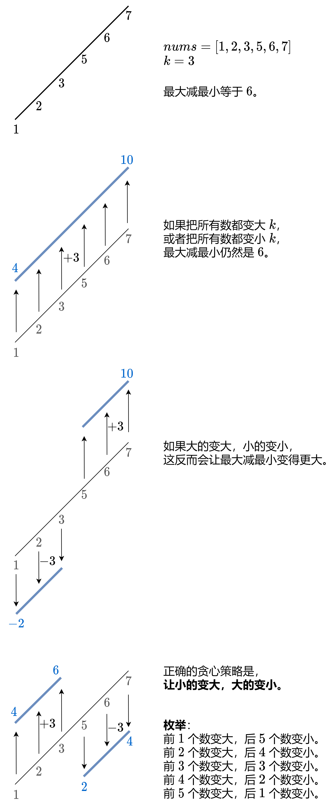

# 【图】小的变大，大的变小（Python/Java/C++/C/Go/JS/Rust）

> **[910. 最小差值 II](https://leetcode.cn/problems/smallest-range-ii/solutions/2928780/xiao-de-bian-da-da-de-bian-xiao-pythonja-8fnp/) · Medium · 难度分 2135**

> **所属题单**
> - [贪心算法 · 一、贪心策略](../../../刷题路径/灵神原版题单/贪心算法/一、贪心策略.md) · §1.1 从最小/最大开始贪心

> **题目描述**
> 给你一个整数数组 `nums`，和一个整数 `k` 。
>
> 对于每个下标 `i`（`0 <= i < nums.length`），将 `nums[i]` 变成  `nums[i] + k` 或 `nums[i] - k` 。
>
> `nums` 的 **分数** 是 `nums` 中最大元素和最小元素的差值。
>
> 在更改每个下标对应的值之后，返回 `nums` 的最小 **分数** 。
>
> **示例 1：**
>
> ```
>
> 输入：nums = [1], k = 0
> 输出：0
> 解释：分数 = max(nums) - min(nums) = 1 - 1 = 0 。
> ```
>
> **示例 2：**
>
> ```
>
> 输入：nums = [0,10], k = 2
> 输出：6
> 解释：将数组变为 [2, 8] 。分数 = max(nums) - min(nums) = 8 - 2 = 6 。
> ```
>
> **示例 3：**
>
> ```
>
> 输入：nums = [1,3,6], k = 3
> 输出：3
> 解释：将数组变为 [4, 6, 3] 。分数 = max(nums) - min(nums) = 6 - 3 = 3 。
> ```
>
> **提示：**
>
> - `1 <= nums.length <= 10⁴`
>
> - `0 <= nums[i] <= 10⁴`
>
> - `0 <= k <= 10⁴`

> **题解**
> 
>
> 为了方便枚举，先把 $\textit{nums}$ 从小到大排序。
>
> 答案初始化为 $\textit{nums}[n-1] - \textit{nums}[0]$，对应着把所有数都变大或者变小的情况。
>
> 考虑把 $\textit{nums}[0]$ 到 $\textit{nums}[i-1]$ 都变大 $k$，把 $\textit{nums}[i]$ 到 $\textit{nums}[n-1]$ 都变小 $k$。
>
> 如此变化后，数组的最大值要么是 $\textit{nums}[i-1]+k$，要么是 $\textit{nums}[n-1]-k$，即
>
> $$
> \max(\textit{nums}[i-1]+k,\textit{nums}[n-1]-k)
> $$
>
> 数组的最小值要么是 $\textit{nums}[0]+k$，要么是 $\textit{nums}[i]-k$，即
>
> $$
> \min(\textit{nums}[0]+k,\textit{nums}[i]-k)
> $$
>
> 最大值最小值之差为
>
> $$
> \max(\textit{nums}[i-1]+k,\textit{nums}[n-1]-k) - \min(\textit{nums}[0]+k,\textit{nums}[i]-k)
> $$
>
> 枚举 $i=1,2,3,\ldots,n-1$，用上式更新答案的最小值。
>
> ```python
> class Solution:
>     def smallestRangeII(self, nums: List[int], k: int) -> int:
>         nums.sort()
>         ans = nums[-1] - nums[0]
>         for x, y in pairwise(nums):
>             mx = max(x + k, nums[-1] - k)
>             mn = min(nums[0] + k, y - k)
>             ans = min(ans, mx - mn)
>         return ans
> ```
>
>
> #### 复杂度分析
>
> - 时间复杂度：$\mathcal{O}(n\log n)$，其中 $n$ 是 $\textit{nums}$ 的长度。瓶颈在排序上。
> - 空间复杂度：$\mathcal{O}(1)$。忽略排序的栈开销。
>
> ## 思考题
>
> 额外输入一个整数 $m$。如果要求恰好修改 $m$ 个元素，答案是多少？本题相当于恰好修改 $n$ 个元素。
>
> 欢迎在评论区分享你的思路/代码。
>
> ## 分类题单
>
> [如何科学刷题？](https://leetcode.cn/circle/discuss/RvFUtj/)
>
> 1. [滑动窗口与双指针（定长/不定长/单序列/双序列/三指针/分组循环）](https://leetcode.cn/circle/discuss/0viNMK/)
> 2. [二分算法（二分答案/最小化最大值/最大化最小值/第K小）](https://leetcode.cn/circle/discuss/SqopEo/)
> 3. [单调栈（基础/矩形面积/贡献法/最小字典序）](https://leetcode.cn/circle/discuss/9oZFK9/)
> 4. [网格图（DFS/BFS/综合应用）](https://leetcode.cn/circle/discuss/YiXPXW/)
> 5. [位运算（基础/性质/拆位/试填/恒等式/思维）](https://leetcode.cn/circle/discuss/dHn9Vk/)
> 6. [图论算法（DFS/BFS/拓扑排序/基环树/最短路/最小生成树/网络流）](https://leetcode.cn/circle/discuss/01LUak/)
> 7. [动态规划（入门/背包/划分/状态机/区间/状压/数位/数据结构优化/树形/博弈/概率期望）](https://leetcode.cn/circle/discuss/tXLS3i/)
> 8. [常用数据结构（前缀和/差分/栈/队列/堆/字典树/并查集/树状数组/线段树）](https://leetcode.cn/circle/discuss/mOr1u6/)
> 9. [数学算法（数论/组合/概率期望/博弈/计算几何/随机算法）](https://leetcode.cn/circle/discuss/IYT3ss/)
> 10. [贪心与思维（基本贪心策略/反悔/区间/字典序/数学/思维/脑筋急转弯/构造）](https://leetcode.cn/circle/discuss/g6KTKL/)
> 11. [链表、二叉树与回溯（前后指针/快慢指针/DFS/BFS/直径/LCA/一般树）](https://leetcode.cn/circle/discuss/K0n2gO/)
> 12. [字符串（KMP/Z函数/Manacher/字符串哈希/AC自动机/后缀数组/子序列自动机）](https://leetcode.cn/circle/discuss/SJFwQI/)
>
> [我的题解精选（已分类）](https://github.com/EndlessCheng/codeforces-go/blob/master/leetcode/SOLUTIONS.md)
>
> 欢迎关注 [B站@灵茶山艾府](https://space.bilibili.com/206214)
