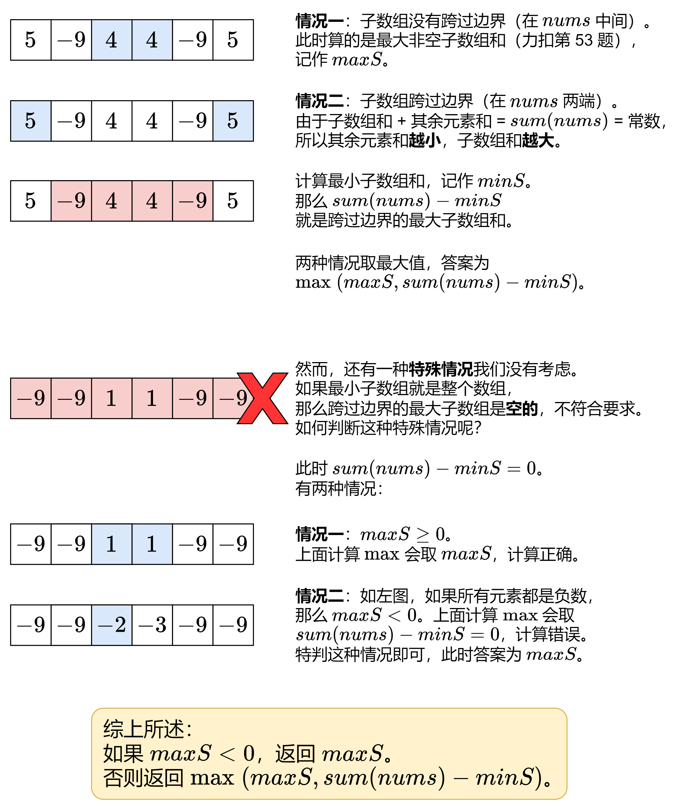

# 【图解】正难则反，一张图秒懂！（Python/Java/C++/C/Go/JS/Rust）

> **[918. 环形子数组的最大和](https://leetcode.cn/problems/maximum-sum-circular-subarray/solutions/2351107/mei-you-si-lu-yi-zhang-tu-miao-dong-pyth-ilqh/) · Medium · 难度分 1777**

> **所属题单**
> - [动态规划 · 一、入门 DP](../../../刷题路径/灵神原版题单/动态规划/一、入门%20DP.md) · §1.3 最大子数组和（最大子段和）
> - [面试经典 150 题 · Kadane 算法](../../../刷题路径/灵神原版题单/面试经典%20150%20题/Kadane%20算法.md)

> **题目描述**
> 给定一个长度为 `n` 的**环形整数数组** `nums` ，返回 <em>`nums` 的非空 **子数组** 的最大可能和</em> 。
>
> **环形数组** 意味着数组的末端将会与开头相连呈环状。形式上， `nums[i]` 的下一个元素是 `nums[(i + 1) % n]` ， `nums[i]` 的前一个元素是 `nums[(i - 1 + n) % n]` 。
>
> **子数组** 最多只能包含固定缓冲区 `nums` 中的每个元素一次。形式上，对于子数组 `nums[i], nums[i + 1], ..., nums[j]` ，不存在 `i <= k1, k2 <= j` 其中 `k1 % n == k2 % n` 。
>
> **示例 1：**
>
> ```
>
> 输入：nums = [1,-2,3,-2]
> 输出：3
> 解释：从子数组 [3] 得到最大和 3
> ```
>
> **示例 2：**
>
> ```
>
> 输入：nums = [5,-3,5]
> 输出：10
> 解释：从子数组 [5,5] 得到最大和 5 + 5 = 10
> ```
>
> **示例 3：**
>
> ```
>
> 输入：nums = [3,-2,2,-3]
> 输出：3
> 解释：从子数组 [3] 和 [3,-2,2] 都可以得到最大和 3
> ```
>
> **提示：**
>
> - `n == nums.length`
>
> - `1 <= n <= 3 * 10⁴`
>
> - `-3 * 10⁴ <= nums[i] <= 3 * 10⁴`​​​​​​​

> **题解**
> 
>
> 如何计算 [53. 最大子数组和](https://leetcode.cn/problems/maximum-subarray/)，请看 [我的题解](../../0000-0099/0053%20最大子数组和/灵茶山艾府.md)，下面代码修改自我题解中的空间优化版本。
>
> ```python
> class Solution:
>     def maxSubarraySumCircular(self, nums: List[int]) -> int:
>         max_f = 0     # 计算最大子数组和的 DP 数组（空间优化成一个变量）
>         max_s = -inf  # 最大子数组和，不能为空
>         min_f = 0     # 计算最小子数组和的 DP 数组（空间优化成一个变量）
>         min_s = 0     # 最小子数组和，可以为空（元素和为 0）
>
>         for x in nums:
>             # 53. 最大子数组和（空间优化写法）
>             max_f = max(max_f, 0) + x
>             max_s = max(max_s, max_f)
>             min_f = min(min_f, 0) + x
>             min_s = min(min_s, min_f)
>
>         if max_s < 0:
>             return max_s
>         return max(max_s, sum(nums) - min_s)
> ```
>
>
> #### 复杂度分析
>
> - 时间复杂度：$\mathcal{O}(n)$，其中 $n$ 是 $\textit{nums}$ 的长度。
> - 空间复杂度：$\mathcal{O}(1)$。
>
> ## 变形题
>
> 如果改成选**两个**不重叠的非空连续子数组，这两个子数组的元素和最大是多少？
>
> - 非环形数组：[P2642 双子序列最大和](https://www.luogu.com.cn/problem/P2642)
> - 环形数组：[P1121 环状最大两段子段和](https://www.luogu.com.cn/problem/P1121)
>
> ## 分类题单
>
> [如何科学刷题？](https://leetcode.cn/circle/discuss/RvFUtj/)
>
> 1. [滑动窗口与双指针（定长/不定长/单序列/双序列/三指针/分组循环）](https://leetcode.cn/circle/discuss/0viNMK/)
> 2. [二分算法（二分答案/最小化最大值/最大化最小值/第K小）](https://leetcode.cn/circle/discuss/SqopEo/)
> 3. [单调栈（基础/矩形面积/贡献法/最小字典序）](https://leetcode.cn/circle/discuss/9oZFK9/)
> 4. [网格图（DFS/BFS/综合应用）](https://leetcode.cn/circle/discuss/YiXPXW/)
> 5. [位运算（基础/性质/拆位/试填/恒等式/思维）](https://leetcode.cn/circle/discuss/dHn9Vk/)
> 6. [图论算法（DFS/BFS/拓扑排序/基环树/最短路/最小生成树/网络流）](https://leetcode.cn/circle/discuss/01LUak/)
> 7. [动态规划（入门/背包/划分/状态机/区间/状压/数位/数据结构优化/树形/博弈/概率期望）](https://leetcode.cn/circle/discuss/tXLS3i/)
> 8. [常用数据结构（前缀和/差分/栈/队列/堆/字典树/并查集/树状数组/线段树）](https://leetcode.cn/circle/discuss/mOr1u6/)
> 9. [数学算法（数论/组合/概率期望/博弈/计算几何/随机算法）](https://leetcode.cn/circle/discuss/IYT3ss/)
> 10. [贪心与思维（基本贪心策略/反悔/区间/字典序/数学/思维/脑筋急转弯/构造）](https://leetcode.cn/circle/discuss/g6KTKL/)
> 11. [链表、树与回溯（前后指针/快慢指针/DFS/BFS/直径/LCA）](https://leetcode.cn/circle/discuss/K0n2gO/)
> 12. [字符串（KMP/Z函数/Manacher/字符串哈希/AC自动机/后缀数组/子序列自动机）](https://leetcode.cn/circle/discuss/SJFwQI/)
>
> [我的题解精选（已分类）](https://github.com/EndlessCheng/codeforces-go/blob/master/leetcode/SOLUTIONS.md)
>
> 欢迎关注 [B站@灵茶山艾府](https://space.bilibili.com/206214)
