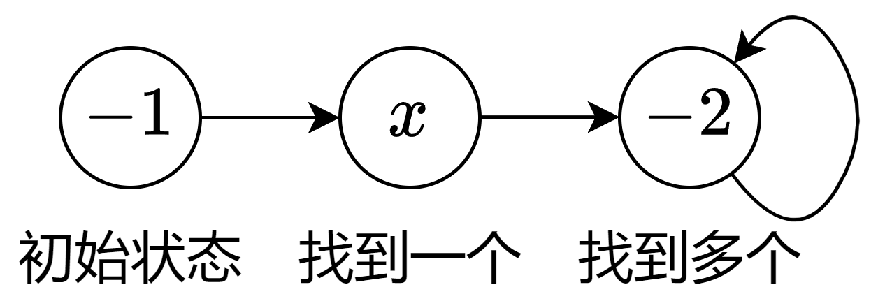

# 只包含一个被感染节点的最大连通块（Python/Java/C++/C/Go/JS/Rust）

> **[924. 尽量减少恶意软件的传播](https://leetcode.cn/problems/minimize-malware-spread/solutions/2741790/zhi-bao-han-yi-ge-bei-gan-ran-jie-dian-d-ym39/) · Hard · 难度分 1869**

> **所属题单**
> - [图论算法 · 一、图的遍历](../../../刷题路径/灵神原版题单/图论算法/一、图的遍历.md) · §1.1 深度优先搜索（DFS）

> **题目描述**
> 给出了一个由 `n` 个节点组成的网络，用 `n × n` 个邻接矩阵图 `graph` 表示。在节点网络中，当 `graph[i][j] = 1` 时，表示节点 `i` 能够直接连接到另一个节点 `j`。
>
> 一些节点 `initial` 最初被恶意软件感染。只要两个节点直接连接，且其中至少一个节点受到恶意软件的感染，那么两个节点都将被恶意软件感染。这种恶意软件的传播将继续，直到没有更多的节点可以被这种方式感染。
>
> 假设 `M(initial)` 是在恶意软件停止传播之后，整个网络中感染恶意软件的最终节点数。
>
> 如果从 `initial` 中**移除某一节点**能够最小化 `M(initial)`， 返回该节点。如果有多个节点满足条件，就返回**索引最小**的节点。
>
> 请注意，如果某个节点已从受感染节点的列表 `initial` 中删除，它以后仍有可能因恶意软件传播而受到感染。
>
> **示例 1：**
>
> ```
>
> 输入：graph = [[1,1,0],[1,1,0],[0,0,1]], initial = [0,1]
> 输出：0
> ```
>
> **示例 2：**
>
> ```
>
> 输入：graph = [[1,0,0],[0,1,0],[0,0,1]], initial = [0,2]
> 输出：0
> ```
>
> **示例 3：**
>
> ```
>
> 输入：graph = [[1,1,1],[1,1,1],[1,1,1]], initial = [1,2]
> 输出：1
> ```
>
> **提示：**
>
> - `n == graph.length`
>
> - `n == graph[i].length`
>
> - `2 <= n <= 300`
>
> - `graph[i][j] == 0` 或 `1`.
>
> - `graph[i][j] == graph[j][i]`
>
> - `graph[i][i] == 1`
>
> - `1 <= initial.length <= n`
>
> - `0 <= initial[i] <= n - 1`
>
> - `initial` 中所有整数均**不重复**

> **题解**
> > 仔细读题：我们移除的仅仅是 $\textit{initial}$ 列表中的节点，不是图中的节点，不会影响图的结构。
>
> 一个大小为 $k$ 的连通块内，如果只有一个节点 $x$ 被感染（$x$ 在 $\textit{initial}$ 中），那么从 $\textit{initial}$ 中移除 $x$ 后，这个连通块不会被感染，从而让 $M(\textit{initial})$ 减少 $k$。
>
> 而如果连通块内至少有两个节点被感染，无论移除哪个节点，仍然会导致连通块的所有节点被感染，$M(\textit{initial})$ 不变。
>
> 所以我们要找的是**只包含一个被感染节点的连通块**，并且这个连通块**越大越好**。
>
> 算法如下：
>
> 1. 遍历 $\textit{initial}$ 中的节点 $x$。
> 2. 如果 $x$ 没有被访问过，那么从 $x$ 开始 DFS，同时用一个 $\textit{vis}$ 数组标记访问过的节点。
> 3. DFS 过程中，统计连通块的大小 $\textit{size}$。
> 4. DFS 过程中，记录访问到的在 $\textit{initial}$ 中的节点。
> 5. DFS 结束后，如果发现该连通块只有一个在 $\textit{initial}$ 中的节点，并且该连通块的大小比最大的连通块更大，那么更新最大连通块的大小，以及答案节点 $x$。如果一样大，就更新答案节点的最小值。
> 6. 最后，如果没找到符合要求的节点，返回 $\min(\textit{initial})$；否则返回答案节点。
>
> 如何判断出「连通块内有一个或多个在 $\textit{initial}$ 中的节点」？要记录被感染的节点列表吗？
>
> 其实无需记录节点列表，而是用如下状态机：
>
> 
>
> - 初始状态为 $-1$。
> - 如果状态是 $-1$，在找到被感染的节点 $x$ 后，状态变为 $x$。
> - 如果状态是非负数 $x$，在找到另一个被感染的节点后，状态变为 $-2$。如果状态已经是 $-2$，则不变。
>
> 此外，可以用一个哈希表或者布尔数组，记录哪些点在 $\textit{initial}$ 中，从而在 DFS 中快速判断当前节点是否在 $\textit{initial}$ 中。
>
> ```python
> class Solution:
>     def minMalwareSpread(self, graph: List[List[int]], initial: List[int]) -> int:
>         st = set(initial)
>         vis = [False] * len(graph)
>         def dfs(x: int) -> None:
>             vis[x] = True
>             nonlocal node_id, size
>             size += 1
>             # 按照状态机更新 node_id
>             if node_id != -2 and x in st:
>                 node_id = x if node_id == -1 else -2
>             for y, conn in enumerate(graph[x]):
>                 if conn and not vis[y]:
>                     dfs(y)
>
>         ans = -1
>         max_size = 0
>         for x in initial:
>             if vis[x]:
>                 continue
>             node_id = -1
>             size = 0
>             dfs(x)
>             if node_id >= 0 and (size > max_size or size == max_size and node_id < ans):
>                 ans = node_id
>                 max_size = size
>         return min(initial) if ans < 0 else ans
> ```
>
>
> #### 复杂度分析
>
> - 时间复杂度：$\mathcal{O}(n^2)$，其中 $n$ 为 $\textit{graph}$ 的长度。瓶颈在遍历 $\textit{graph}$ 上。
> - 空间复杂度：$\mathcal{O}(n)$。
>
> ## 思考题
>
> 如果改成移除 $2$ 个节点呢？改成移除 $k$ 个节点呢？
>
> 欢迎在评论区发表你的思路和代码。
>
> ## 分类题单
>
> [如何科学刷题？](https://leetcode.cn/circle/discuss/RvFUtj/)
>
> 1. [滑动窗口与双指针（定长/不定长/单序列/双序列/三指针/分组循环）](https://leetcode.cn/circle/discuss/0viNMK/)
> 2. [二分算法（二分答案/最小化最大值/最大化最小值/第K小）](https://leetcode.cn/circle/discuss/SqopEo/)
> 3. [单调栈（基础/矩形面积/贡献法/最小字典序）](https://leetcode.cn/circle/discuss/9oZFK9/)
> 4. [网格图（DFS/BFS/综合应用）](https://leetcode.cn/circle/discuss/YiXPXW/)
> 5. [位运算（基础/性质/拆位/试填/恒等式/思维）](https://leetcode.cn/circle/discuss/dHn9Vk/)
> 6. [图论算法（DFS/BFS/拓扑排序/基环树/最短路/最小生成树/网络流）](https://leetcode.cn/circle/discuss/01LUak/)
> 7. [动态规划（入门/背包/划分/状态机/区间/状压/数位/数据结构优化/树形/博弈/概率期望）](https://leetcode.cn/circle/discuss/tXLS3i/)
> 8. [常用数据结构（前缀和/差分/栈/队列/堆/字典树/并查集/树状数组/线段树）](https://leetcode.cn/circle/discuss/mOr1u6/)
> 9. [数学算法（数论/组合/概率期望/博弈/计算几何/随机算法）](https://leetcode.cn/circle/discuss/IYT3ss/)
> 10. [贪心与思维（基本贪心策略/反悔/区间/字典序/数学/思维/脑筋急转弯/构造）](https://leetcode.cn/circle/discuss/g6KTKL/)
> 11. [链表、二叉树与回溯（前后指针/快慢指针/DFS/BFS/直径/LCA/一般树）](https://leetcode.cn/circle/discuss/K0n2gO/)
> 12. [字符串（KMP/Z函数/Manacher/字符串哈希/AC自动机/后缀数组/子序列自动机）](https://leetcode.cn/circle/discuss/SJFwQI/)
>
> [我的题解精选（已分类）](https://github.com/EndlessCheng/codeforces-go/blob/master/leetcode/SOLUTIONS.md)
>
> 欢迎关注 [B站@灵茶山艾府](https://space.bilibili.com/206214)
