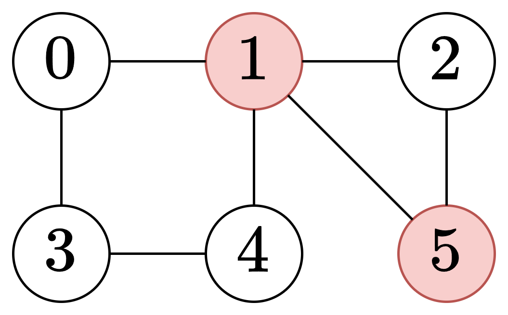

# 逆向思维（Python/Java/C++/C/Go/JS/Rust）

> **[928. 尽量减少恶意软件的传播 II](https://leetcode.cn/problems/minimize-malware-spread-ii/solutions/2743395/ni-xiang-si-wei-pythonjavaccgojsrust-by-jinc3/) · Hard · 难度分 1985**

> **所属题单**
> - [图论算法 · 一、图的遍历](../../../刷题路径/灵神原版题单/图论算法/一、图的遍历.md) · §1.1 深度优先搜索（DFS）

> **题目描述**
> 给定一个由 `n` 个节点组成的网络，用 `n x n` 个邻接矩阵 `graph` 表示。在节点网络中，只有当 `graph[i][j] = 1` 时，节点 `i` 能够直接连接到另一个节点 `j`。
>
> 一些节点 `initial` 最初被恶意软件感染。只要两个节点直接连接，且其中至少一个节点受到恶意软件的感染，那么两个节点都将被恶意软件感染。这种恶意软件的传播将继续，直到没有更多的节点可以被这种方式感染。
>
> 假设 `M(initial)` 是在恶意软件停止传播之后，整个网络中感染恶意软件的最终节点数。
>
> 我们可以从 `initial` 中 **删除一个节点**，**并完全移除该节点以及从该节点到任何其他节点的任何连接。**
>
> 请返回移除后能够使 `M(initial)` 最小化的节点。如果有多个节点满足条件，返回索引 **最小的节点** 。
>
> **示例 1：**
>
> ```
>
> 输入：graph = [[1,1,0],[1,1,0],[0,0,1]], initial = [0,1]
> 输出：0
> ```
>
> **示例 2：**
>
> ```
>
> 输入：graph = [[1,1,0],[1,1,1],[0,1,1]], initial = [0,1]
> 输出：1
> ```
>
> **示例 3：**
>
> ```
>
> 输入：graph = [[1,1,0,0],[1,1,1,0],[0,1,1,1],[0,0,1,1]], initial = [0,1]
> 输出：1
> ```
>
> **提示：**
>
> - `n == graph.length`
>
> - `n == graph[i].length`
>
> - `2 <= n <= 300`
>
> - `graph[i][j]` 是 `0` 或 `1`.
>
> - `graph[i][j] == graph[j][i]`
>
> - `graph[i][i] == 1`
>
> - `1 <= initial.length < n`
>
> - `0 <= initial[i] <= n - 1`
>
> -  `initial` 中每个整数都**不同**

> **题解**
> **前置题目**：[924. 尽量减少恶意软件的传播](https://leetcode.cn/problems/minimize-malware-spread/)
>
> 暴力做法是，枚举删除 $x=\textit{initial}[i]$，然后从其它没有被删除的 $\textit{initial}[j]$ 开始，跑 DFS（或者 BFS 等），计算有多少个点能被感染到。对于每个 $x$，需要 $\mathcal{O}(n^2)$ 的时间遍历 $\textit{graph}$，总的时间复杂度为 $\mathcal{O}(mn^2)$，其中 $m$ 为 $\textit{initial}$ 的长度。
>
> 能否像 924 题那样做到 $\mathcal{O}(n^2)$ 时间？
>
> 逆向思维，从不在 $\textit{initial}$ 中的点 $v$ 出发 DFS，**在不经过** $\textit{initial}$ **中的节点的前提下**，看看 $v$ 是只能被一个点感染到，还是能被多个点感染到。如果 $v$ 只能被点 $x=\textit{initial}[i]$ 感染到，那么在本次 DFS 过程中访问到的其它节点，也只能被点 $x$ 感染到。
>
> 举例说明。
>
> 
>
> 上图中，$\textit{initial}=[1,5]$。我们从 $0$ 出发 DFS，在不经过 $1,5$ 的前提下，可以访问到节点 $0,3,4$，并且发现了**恰好一个**在 $\textit{initial}$ 中的节点 $1$。这意味着删除节点 $1$，就会让 $0,3,4$ 免受感染。而从 $2$ 出发 DFS，可以发现两个在 $\textit{initial}$ 中的节点，所以无论删除节点 $1$ 还是删除节点 $5$，节点 $2$ 一定会被感染。
>
> 具体算法如下：
>
> 1. 创建一个 $\textit{vis}$ 数组，标记在 DFS 中访问过的节点。
> 2. 枚举 $[0,n-1]$ 中没有访问过的，且不在 $\textit{initial}$ 中的节点 $i$。
> 3. 从 $i$ 开始 DFS。
> 4. DFS 过程中，只访问不在 $\textit{initial}$ 中的节点，统计访问到的节点个数 $\textit{size}$。
> 5. DFS 过程中，如果发现了在 $\textit{initial}$ 中的节点，按照 [924 题解](../0924%20尽量减少恶意软件的传播/灵茶山艾府.md) 中的状态机，更新变量 $\textit{nodeId}$。
> 6. DFS 结束后，如果 $\textit{nodeId}\ge 0$，那么把 $\textit{nodeId}$（作为 key）和 $\textit{size}$（作为 value）添加到一个哈希表或数组 $\textit{cnt}$ 中，其中相同的 $\textit{nodeId}$ 要累加 $\textit{size}$。
> 7. 最后，如果 $\textit{cnt}$ 为空，返回 $\min(\textit{initial})$；否则返回 $\textit{cnt}$ 中 $\textit{size}$ 最大的 $\textit{nodeId}$，如果有多个 $\textit{size}$ 一样大，返回其中 $\textit{nodeId}$ 的最小值。
>
> 代码实现时，可以用一个哈希表或者布尔数组，记录哪些点在 $\textit{initial}$ 中，从而在 DFS 中快速判断当前节点的邻居是否在 $\textit{initial}$ 中。
>
> ```python
> class Solution:
>     def minMalwareSpread(self, graph: List[List[int]], initial: List[int]) -> int:
>         st = set(initial)
>         vis = [False] * len(graph)
>         def dfs(x: int) -> None:
>             vis[x] = True
>             nonlocal node_id, size
>             size += 1
>             for y, conn in enumerate(graph[x]):
>                 if conn == 0:
>                     continue
>                 if y in st:
>                     # 按照 924 题的状态机更新 node_id
>                     # 注意避免重复统计，例如上图中的 0 有两条不同路径可以遇到 1
>                     if node_id != -2 and node_id != y:
>                         node_id = y if node_id == -1 else -2
>                 elif not vis[y]:
>                     dfs(y)
>
>         cnt = Counter()
>         for i, seen in enumerate(vis):
>             if seen or i in st:
>                 continue
>             node_id = -1
>             size = 0
>             dfs(i)
>             if node_id >= 0:  # 只找到一个在 initial 中的节点
>                 # 删除节点 node_id 可以让 size 个点不被感染
>                 cnt[node_id] += size
>
>         # size 取反计算最大值，相同最大值取 node_id 最小值
>         return min((-size, node_id) for node_id, size in cnt.items())[1] if cnt else min(initial)
> ```
>
>
> #### 复杂度分析
>
> - 时间复杂度：$\mathcal{O}(n^2)$，其中 $n$ 为 $\textit{nums}$ 的长度。瓶颈在遍历 $\textit{graph}$ 上。
> - 空间复杂度：$\mathcal{O}(n)$。
>
> ## 思考题
>
> 如果改成删除 $2$ 个节点呢？改成删除 $k$ 个节点呢？
>
> 欢迎在评论区发表你的思路和代码。
>
> ## 分类题单
>
> 1. [滑动窗口（定长/不定长/多指针）](https://leetcode.cn/circle/discuss/0viNMK/)
> 2. [二分算法（二分答案/最小化最大值/最大化最小值/第K小）](https://leetcode.cn/circle/discuss/SqopEo/)
> 3. [单调栈（矩形系列/字典序最小/贡献法）](https://leetcode.cn/circle/discuss/9oZFK9/)
> 4. [网格图（DFS/BFS/综合应用）](https://leetcode.cn/circle/discuss/YiXPXW/)
> 5. [位运算（基础/性质/拆位/试填/恒等式/贪心/脑筋急转弯）](https://leetcode.cn/circle/discuss/dHn9Vk/)
> 6. [图论算法（DFS/BFS/拓扑排序/最短路/最小生成树/二分图/基环树/欧拉路径）](https://leetcode.cn/circle/discuss/01LUak/)
> 7. [动态规划（入门/背包/状态机/划分/区间/状压/数位/数据结构优化/树形/博弈/概率期望）](https://leetcode.cn/circle/discuss/tXLS3i/)
>
> 更多题单，点我个人主页 - 讨论发布。
>
> 欢迎关注 [B站@灵茶山艾府](https://space.bilibili.com/206214)
>
> [我的题解精选（已分类）](https://github.com/EndlessCheng/codeforces-go/blob/master/leetcode/SOLUTIONS.md)
