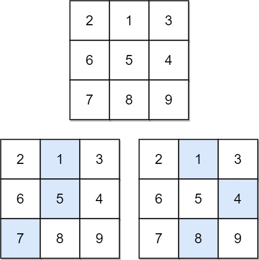
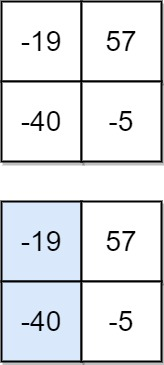

# 931. 下降路径最小和

Medium · 难度分 1573 · [力扣原题](https://leetcode.cn/problems/minimum-falling-path-sum/)

所在刷题路径：labuladong、灵神核心路线、灵神题单·动态规划

| 作者 | 题解 | 动画讲解 |
|---|---|---|
| 灵茶山艾府 | [📄 题解](灵茶山艾府.md) | [▶︎ 动画（GIF）](0931%20下降路径最小和%20·%20灵茶山艾府.gif) · [mp4 文件](0931%20下降路径最小和%20·%20灵茶山艾府.mp4) |
| yiduobo | [📄 题解](yiduobo.md) | [▶︎ 动画（GIF）](0931%20下降路径最小和%20·%20yiduobo.gif) · [mp4 文件](0931%20下降路径最小和%20·%20yiduobo.mp4) |

## 动画讲解

> 动图会循环播放；想暂停、拖进度条请下载上面表格里的 mp4 文件。

### 灵茶山艾府


### yiduobo


## 题目描述

给你一个 `n x n` 的 **方形** 整数数组 `matrix` ，请你找出并返回通过 `matrix` 的**下降路径** 的 **最小和** 。

**下降路径** 可以从第一行中的任何元素开始，并从每一行中选择一个元素。在下一行选择的元素和当前行所选元素最多相隔一列（即位于正下方或者沿对角线向左或者向右的第一个元素）。具体来说，位置 `(row, col)` 的下一个元素应当是 `(row + 1, col - 1)`、`(row + 1, col)` 或者 `(row + 1, col + 1)` 。

**示例 1：**



```

输入：matrix = [[2,1,3],[6,5,4],[7,8,9]]
输出：13
解释：如图所示，为和最小的两条下降路径
```

**示例 2：**



```

输入：matrix = [[-19,57],[-40,-5]]
输出：-59
解释：如图所示，为和最小的下降路径
```

**提示：**

- `n == matrix.length == matrix[i].length`

- `1 <= n <= 100`

- `-100 <= matrix[i][j] <= 100`

---
[↑ 返回 0900-0999](../README.md) · [总索引](../../../索引.md) · [仓库首页](../../../README.md)
