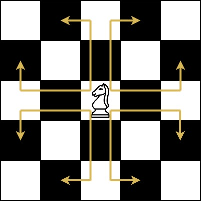
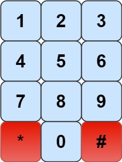
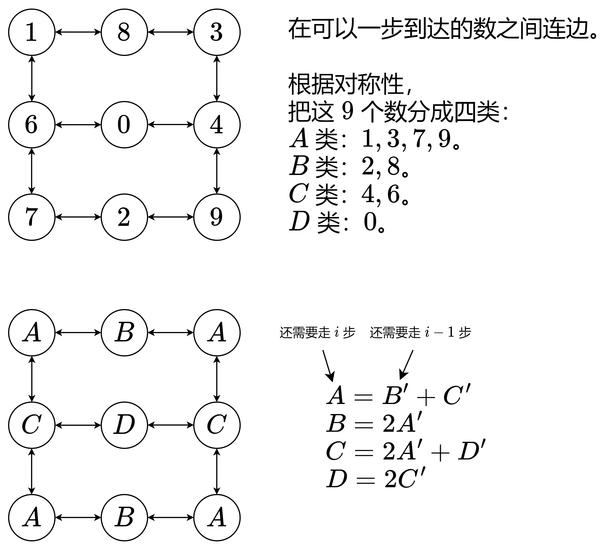

# 教你一步步思考 DP：从记忆化搜索到递推到矩阵快速幂！（Python/Java/C++/Go）

> **[935. 骑士拨号器](https://leetcode.cn/problems/knight-dialer/solutions/3004116/jiao-ni-yi-bu-bu-si-kao-dpcong-ji-yi-hua-x06l/) · Medium**

> **所属题单**
> - [动态规划 · 六、状态机 DP](../../../刷题路径/灵神原版题单/动态规划/六、状态机%20DP.md) · §6.3 进阶
> - [动态规划 · 十一、优化 DP](../../../刷题路径/灵神原版题单/动态规划/十一、优化%20DP.md) · §11.6 矩阵快速幂优化 DP

> **题目描述**
> 象棋骑士有一个**独特的移动方式**，它可以垂直移动两个方格，水平移动一个方格，或者水平移动两个方格，垂直移动一个方格(两者都形成一个 **L** 的形状)。
>
> 象棋骑士可能的移动方式如下图所示:
>
> 
>
> 我们有一个象棋骑士和一个电话垫，如下所示，骑士**只能站在一个数字单元格上**(即蓝色单元格)。
>
> 
>
> 给定一个整数 n，返回我们可以拨多少个长度为 n 的不同电话号码。
>
> 你可以将骑士放置在**任何数字单元格**上，然后你应该执行 n - 1 次移动来获得长度为 n 的号码。所有的跳跃应该是**有效**的骑士跳跃。
>
> 因为答案可能很大，**所以输出答案模** `10⁹ + 7`.
>
> **示例 1：**
>
> ```
>
> 输入：n = 1
> 输出：10
> 解释：我们需要拨一个长度为1的数字，所以把骑士放在10个单元格中的任何一个数字单元格上都能满足条件。
> ```
>
> **示例 2：**
>
> ```
>
> 输入：n = 2
> 输出：20
> 解释：我们可以拨打的所有有效号码为[04, 06, 16, 18, 27, 29, 34, 38, 40, 43, 49, 60, 61, 67, 72, 76, 81, 83, 92, 94]
> ```
>
> **示例 3：**
>
> ```
>
> 输入：n = 3131
> 输出：136006598
> 解释：注意取模
> ```
>
> **提示：**
>
> - `1 <= n <= 5000`

> **题解**
> 首先，由于无法从 $5$ 移动到其他单元格，所以当 $n\ge 2$ 时，马的初始位置不能等于 $5$。
>
> 特判 $n=1$ 的情况，直接返回 $10$。
>
> 在下文中，$n\ge 2$。
>
> ## 一、寻找子问题
>
> 比如 $n=3$，我们要解决的问题（原问题）是：
>
> - 把马放在单元格 $0$ 到 $9$（除了 $5$）上，然后移动 $n-1=2$ 步，一共有多少种移动方案？
>
> 枚举移动到的位置，比如一开始在 $1$，移动到 $6$，那么问题变成：
>
> - 把马放在单元格 $6$ 上，然后移动 $n-2=1$ 步，一共有多少种移动方案？
>
> 这是**和原问题相似的、规模更小的子问题**，可以用**递归**解决。
>
> ## 二、状态定义与状态转移方程（优化前）
>
> 根据上面的讨论，我们需要在递归过程中跟踪以下信息：
>
> - $i$：还需要移动 $i$ 步。
> - $j$：马在单元格 $j$ 上。
>
> 因此，定义状态为 $\textit{dfs}(i,j)$，表示把马放在单元格 $j$ 上，然后移动 $i$ 步，有多少种移动方案。
>
> 枚举马能移动到的单元格 $k$，问题变成：把马放在单元格 $k$ 上，然后移动 $i-1$ 步，有多少种移动方案，即 $\textit{dfs}(i-1,k)$。
>
> 累加得
>
> $$
> \textit{dfs}(i,j) = \sum_{k} \textit{dfs}(i-1,k)
> $$
>
> **递归边界**：$\textit{dfs}(0,j)=1$。无法移动，算作一种移动方案，对应着电话号码 $j$。
>
> **递归入口**：$\sum\limits_{j=0}^{9}\textit{dfs}(n-1,j)$，这是原问题，也是答案。注意 $\textit{dfs}(n-1,5)=0$。
>
> 具体请看视频讲解 [动态规划入门：从记忆化搜索到递推](https://www.bilibili.com/video/BV1Xj411K7oF/)，其中包含把记忆化搜索 1:1 翻译成递推的技巧。
>
> #### 细节
>
> 1. 为避免写出大量的 $\texttt{if-else}$，可以用一个表（数组）保存每个数字可以移动到的数字。
> 2. 把 DFS 写在外面，这样记忆化的值可以在不同的测试数据间共享。
>
> ```python
> MOD = 1_000_000_007
> NEXT = (4, 6), (6, 8), (7, 9), (4, 8), (0, 3, 9), (), (0, 1, 7), (2, 6), (1, 3), (2, 4)
>
> @cache  # 缓存装饰器，避免重复计算 dfs 的结果（记忆化）
> def dfs(i: int, j: int) -> int:
>     if i == 0:
>         return 1
>     return sum(dfs(i - 1, k) for k in NEXT[j]) % MOD
>
> class Solution:
>     def knightDialer(self, n: int) -> int:
>         if n == 1:
>             return 10
>         return (sum(dfs(n - 1, j) for j in range(10))) % MOD
> ```
>
>
> #### 复杂度分析
>
> - 时间复杂度：$\mathcal{O}(nD)$，其中 $D=9$。由于每个状态只会计算一次，动态规划的时间复杂度 $=$ 状态个数 $\times$ 单个状态的计算时间。本题状态个数等于 $\mathcal{O}(nD)$，单个状态的计算时间为 $\mathcal{O}(1)$，所以总的时间复杂度为 $\mathcal{O}(nD)$。
> - 空间复杂度：$\mathcal{O}(nD)$。保存多少状态，就需要多少空间。
>
> ## 三、状态定义与状态转移方程（优化后）
>
> 如下图所示，其实只有 $4$ 种**本质不同**的数字。
>
> 
>
> 把 $A,B,C,D$ 类分别用 $0,1,2,3$ 表示，作为 $\textit{dfs}$ 的第二个参数，那么有状态转移方程
>
> $$
> \begin{aligned}
> \textit{dfs}(i,0) &= \textit{dfs}(i - 1, 1) + \textit{dfs}(i - 1, 2)     \\
> \textit{dfs}(i,1) &= 2\cdot \textit{dfs}(i - 1, 0)    \\
> \textit{dfs}(i,2) &= 2\cdot \textit{dfs}(i - 1, 0) + \textit{dfs}(i - 1, 3)     \\
> \textit{dfs}(i,3) &= 2\cdot \textit{dfs}(i - 1, 2)      \\
> \end{aligned}
> $$
>
> 答案为
>
> $$
> 4\cdot\textit{dfs}(n - 1, 0)  + 2\cdot \textit{dfs}(n - 1, 1) + 2\cdot \textit{dfs}(n - 1, 2)  + \textit{dfs}(n - 1, 3)
> $$
>
> > 注：这相当于把方法二和式 $\sum\limits_{j=0}^{9}\textit{dfs}(n-1,j)$ 中的 $j=1,3,7,9$ 合并成 $4\cdot\textit{dfs}(n - 1, 0)$，其他同理。
>
> ```python
> MOD = 1_000_000_007
>
> @cache  # 缓存装饰器，避免重复计算 dfs 的结果（记忆化）
> def dfs(i: int, j: int) -> int:
>     if i == 0:
>         return 1
>     if j == 0:
>         return (dfs(i - 1, 1) + dfs(i - 1, 2)) % MOD
>     if j == 1:
>         return dfs(i - 1, 0) * 2 % MOD
>     if j == 2:
>         return (dfs(i - 1, 0) * 2 + dfs(i - 1, 3)) % MOD
>     return dfs(i - 1, 2) * 2 % MOD
>
> class Solution:
>     def knightDialer(self, n: int) -> int:
>         if n == 1:
>             return 10
>         return (dfs(n - 1, 0) * 4 + dfs(n - 1, 1) * 2 +
>                 dfs(n - 1, 2) * 2 + dfs(n - 1, 3)) % MOD
> ```
>
>
> #### 复杂度分析
>
> - 时间复杂度：$\mathcal{O}(nD)$，其中 $D=4$。由于每个状态只会计算一次，动态规划的时间复杂度 $=$ 状态个数 $\times$ 单个状态的计算时间。本题状态个数等于 $\mathcal{O}(nD)$，单个状态的计算时间为 $\mathcal{O}(1)$，所以总的时间复杂度为 $\mathcal{O}(nD)$。
> - 空间复杂度：$\mathcal{O}(nD)$。保存多少状态，就需要多少空间。
>
> ## 四、1:1 翻译成递推
>
> 我们可以去掉递归中的「递」，只保留「归」的部分，即自底向上计算。
>
> 具体来说，$f[i][j]$ 的定义和 $\textit{dfs}(i,j)$ 的定义是一样的，都表示把马放在 $j$ 类单元格上，然后移动 $i$ 步，有多少种移动方案。
>
> 相应的递推式（状态转移方程）也和 $\textit{dfs}$ 一样：
>
> $$
> \begin{aligned}
> f[i][0] &= f[i-1][1] + f[i-1][2]     \\
> f[i][1] &= 2\cdot f[i-1][0]    \\
> f[i][2] &= 2\cdot f[i-1][0] + f[i-1][3]     \\
> f[i][3] &= 2\cdot f[i-1][2]      \\
> \end{aligned}
> $$
>
> 初始值 $f[0][j]=1$，翻译自递归边界 $\textit{dfs}(0,j)=1$。
>
> 答案为 $4\cdot f[n-1][0] + 2\cdot f[n-1][1] + 2\cdot f[n-1][2]  + f[n-1][3]$，翻译自递归入口 $4\cdot\textit{dfs}(n - 1, 0)  + 2\cdot \textit{dfs}(n - 1, 1) + 2\cdot \textit{dfs}(n - 1, 2)  + \textit{dfs}(n - 1, 3)$。
>
> ```python
> MOD = 1_000_000_007
> MX = 5000
>
> f = [[1] * 4 for _ in range(MX)]
> for i in range(1, MX):
>     f[i][0] = (f[i - 1][1] + f[i - 1][2]) % MOD
>     f[i][1] = f[i - 1][0] * 2 % MOD
>     f[i][2] = (f[i - 1][0] * 2 + f[i - 1][3]) % MOD
>     f[i][3] = f[i - 1][2] * 2 % MOD
>
> class Solution:
>     def knightDialer(self, n: int) -> int:
>         if n == 1:
>             return 10
>         return (f[n - 1][0] * 4 + f[n - 1][1] * 2 +
>                 f[n - 1][2] * 2 + f[n - 1][3]) % MOD
> ```
>
>
> #### 复杂度分析
>
> - 时间复杂度：$\mathcal{O}(1)$。忽略预处理的时间和空间。
> - 空间复杂度：$\mathcal{O}(1)$。
>
> ## 五、矩阵快速幂优化
>
> 把状态转移方程用矩阵乘法表示，即
>
> $$
> \begin{bmatrix}
> f[i][0] \\
> f[i][1] \\
> f[i][2] \\
> f[i][3] \\
> \end{bmatrix}
> = \begin{bmatrix}
> 0 & 1 & 1 & 0 \\
> 2 & 0 & 0 & 0 \\
> 2 & 0 & 0 & 1 \\
> 0 & 0 & 2 & 0 \\
> \end{bmatrix}
> \begin{bmatrix}
> f[i-1][0] \\
> f[i-1][1] \\
> f[i-1][2] \\
> f[i-1][3] \\
> \end{bmatrix}
> $$
>
> 把上式中的三个矩阵分别记作 $F[i],M,F[i-1]$，即
>
> $$
> F[i] = M\times F[i-1]
> $$
>
> 那么有
>
> $$
> \begin{aligned}
> F[n-1] &= M\times F[n-2]      \\
> &= M\times M\times F[n-3]        \\
> &= M\times M\times M\times  F[n-4]        \\
> &\ \ \vdots  \\
> &= M^{n-1}\times F[0] \\
> \end{aligned}
> $$
>
> 其中 $M^{n-1}$ 可以用**快速幂**计算，原理请看[【图解】一张图秒懂快速幂](../../0000-0099/0050%20Pow%28x,%20n%29/灵茶山艾府.md)。
>
> 初始值
>
> $$
> F[0] =
> \begin{bmatrix}
> 1 \\
> 1 \\
> 1 \\
> 1 \\
> \end{bmatrix}
> $$
>
> > 注：由于力扣不计入预处理的时间，矩阵快速幂的实际运行时间可能比递推慢。
>
> ```python
> MOD = 1_000_000_007
>
> # a @ b，其中 @ 是矩阵乘法
> def mul(a: List[List[int]], b: List[List[int]]) -> List[List[int]]:
>     return [[sum(x * y for x, y in zip(row, col)) % MOD for col in zip(*b)]
>             for row in a]
>
> # a^n @ f0
> def pow_mul(a: List[List[int]], n: int, f0: List[List[int]]) -> List[List[int]]:
>     res = f0
>     while n:
>         if n & 1:
>             res = mul(a, res)
>         a = mul(a, a)
>         n >>= 1
>     return res
>
> class Solution:
>     def knightDialer(self, n: int) -> int:
>         if n == 1:
>             return 10
>         m = [[0, 1, 1, 0], [2, 0, 0, 0], [2, 0, 0, 1], [0, 0, 2, 0]]
>         f0 = [[1], [1], [1], [1]]
>         fn = pow_mul(m, n - 1, f0)
>         return (fn[0][0] * 4 + fn[1][0] * 2 + fn[2][0] * 2 + fn[3][0]) % MOD
> ```
>
> > [!example]- NumPy
> > ```python
> > import numpy as np
> >
> > MOD = 1_000_000_007
> >
> > # a^n @ f0
> > def pow_mul(a: np.ndarray, n: int, f0: np.ndarray) -> np.ndarray:
> >     res = f0
> >     while n:
> >         if n & 1:
> >             res = a @ res % MOD
> >         a = a @ a % MOD
> >         n >>= 1
> >     return res
> >
> > class Solution:
> >     def knightDialer(self, n: int) -> int:
> >         if n == 1:
> >             return 10
> >         m = np.array([[0, 1, 1, 0], [2, 0, 0, 0], [2, 0, 0, 1], [0, 0, 2, 0]], dtype=object)
> >         f0 = np.ones((4,), dtype=object)
> >         fn = pow_mul(m, n - 1, f0)
> >         return (fn[0] * 4 + fn[1] * 2 + fn[2] * 2 + fn[3]) % MOD
> > ```
>
>
> > [!example]- NumPy 写法二
> > ```python
> > import numpy as np
> >
> > class Solution:
> >     def knightDialer(self, n: int) -> int:
> >         if n == 1:
> >             return 10
> >         m = np.array([[0, 1, 1, 0], [2, 0, 0, 0], [2, 0, 0, 1], [0, 0, 2, 0]], dtype=object)
> >         f0 = np.ones((4,), dtype=object)
> >         # 注：没法中途取模，参与运算的数字很大，效率低，所以我并不推荐这种写法
> >         fn = np.linalg.matrix_power(m, n - 1) @ f0
> >         return (fn[0] * 4 + fn[1] * 2 + fn[2] * 2 + fn[3]) % 1_000_000_007
> > ```
>
>
> #### 复杂度分析
>
> - 时间复杂度：$\mathcal{O}(D^3\log n)$，其中 $D=4$ 为矩阵的阶数。
> - 空间复杂度：$\mathcal{O}(D^2)$。
>
> ## 六、Berlekamp-Massey 算法 + Kitamasa 算法
>
> 使用 [Berlekamp-Massey 算法](https://zhuanlan.zhihu.com/p/1966417899825665440) 找规律，可以直接得到线性递推式
>
> $$
> f_n = 6f_{n-2}-4f_{n-4} \ \ (n \ge 5)
> $$
>
> 初始值 $f = [10,20,46,104,240]$。
>
> 然后使用 [Kitamasa 算法](https://zhuanlan.zhihu.com/p/1964051212304364939) 解决。
>
> ```python
> MOD = 1_000_000_007
>
> class Solution:
>     # 给定常系数齐次线性递推式 f(n) = coef[k-1] * f(n-1) + coef[k-2] * f(n-2) + ... + coef[0] * f(n-k)
>     # 以及初始值 f(i) = a[i] (0 <= i < k)
>     # 返回 f(n) % MOD，其中参数 n 从 0 开始
>     # 注意 coef 的顺序
>     # 时间复杂度 O(k^2 log n)，其中 k 是 coef 的长度
>     def kitamasa(self, coef: List[int], a: List[int], n: int) -> int:
>         if n < len(a):
>             return a[n] % MOD
>
>         k = len(coef)
>
>         # 已知 f(n) 的各项系数为 a，f(m) 的各项系数为 b
>         # 计算并返回 f(n+m) 的各项系数 c
>         def compose(a: List[int], b: List[int]) -> List[int]:
>             c = [0] * k
>             for v in a:
>                 for j, w in enumerate(b):
>                     c[j] = (c[j] + v * w) % MOD
>                 # 原地计算下一组系数，比如已知 f(4) 的各项系数，现在要计算 f(5) 的各项系数
>                 # 倒序遍历，避免提前覆盖旧值
>                 bk1 = b[-1]
>                 for i in range(k - 1, 0, -1):
>                     b[i] = (b[i - 1] + bk1 * coef[i]) % MOD
>                 b[0] = bk1 * coef[0] % MOD
>             return c
>
>         # 计算 res_c，以表出 f(n) = res_c[k-1] * a[k-1] + res_c[k-2] * a[k-2] + ... + res_c[0] * a[0]
>         res_c = [0] * k
>         c = [0] * k
>         res_c[0] = c[1] = 1
>         while n > 0:
>             if n % 2:
>                 res_c = compose(c, res_c)
>             # 由于会修改 compose 的第二个参数，这里把 c 复制一份再传入
>             c = compose(c, c[:])
>             n //= 2
>
>         return sum(c * v for c, v in zip(res_c, a)) % MOD
>
>     def knightDialer(self, n: int) -> int:
>         if n == 1:
>             return 10
>         coef = [0, 6, 0, -4]
>         a = [20, 46, 104, 240]
>         return self.kitamasa(coef[::-1], a, n - 2)  #  注意 kitamasa 入参的顺序
> ```
>
>
> #### 复杂度分析
>
> - 时间复杂度：$\mathcal{O}(D^2\log n)$，其中 $D=4$ 为递推式的阶数。
> - 空间复杂度：$\mathcal{O}(D)$。
>
> ## 专题训练
>
> 见下面动态规划题单的「**§11.6 矩阵快速幂优化 DP**」。
>
> ## 分类题单
>
> [如何科学刷题？](https://leetcode.cn/circle/discuss/RvFUtj/)
>
> 1. [滑动窗口与双指针（定长/不定长/单序列/双序列/三指针/分组循环）](https://leetcode.cn/circle/discuss/0viNMK/)
> 2. [二分算法（二分答案/最小化最大值/最大化最小值/第K小）](https://leetcode.cn/circle/discuss/SqopEo/)
> 3. [单调栈（基础/矩形面积/贡献法/最小字典序）](https://leetcode.cn/circle/discuss/9oZFK9/)
> 4. [网格图（DFS/BFS/综合应用）](https://leetcode.cn/circle/discuss/YiXPXW/)
> 5. [位运算（基础/性质/拆位/试填/恒等式/思维）](https://leetcode.cn/circle/discuss/dHn9Vk/)
> 6. [图论算法（DFS/BFS/拓扑排序/基环树/最短路/最小生成树/网络流）](https://leetcode.cn/circle/discuss/01LUak/)
> 7. [动态规划（入门/背包/划分/状态机/区间/状压/数位/数据结构优化/树形/博弈/概率期望）](https://leetcode.cn/circle/discuss/tXLS3i/)
> 8. [常用数据结构（前缀和/差分/栈/队列/堆/字典树/并查集/树状数组/线段树）](https://leetcode.cn/circle/discuss/mOr1u6/)
> 9. [数学算法（数论/组合/概率期望/博弈/计算几何/随机算法）](https://leetcode.cn/circle/discuss/IYT3ss/)
> 10. [贪心与思维（基本贪心策略/反悔/区间/字典序/数学/思维/脑筋急转弯/构造）](https://leetcode.cn/circle/discuss/g6KTKL/)
> 11. [链表、树与回溯（前后指针/快慢指针/DFS/BFS/直径/LCA）](https://leetcode.cn/circle/discuss/K0n2gO/)
> 12. [字符串（KMP/Z函数/Manacher/字符串哈希/AC自动机/后缀数组/子序列自动机）](https://leetcode.cn/circle/discuss/SJFwQI/)
>
> [我的题解精选（已分类）](https://github.com/EndlessCheng/codeforces-go/blob/master/leetcode/SOLUTIONS.md)
>
> 欢迎关注 [B站@灵茶山艾府](https://space.bilibili.com/206214)
