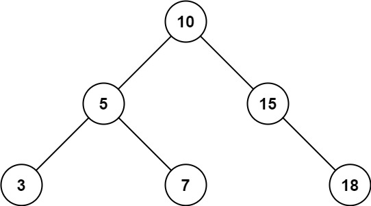
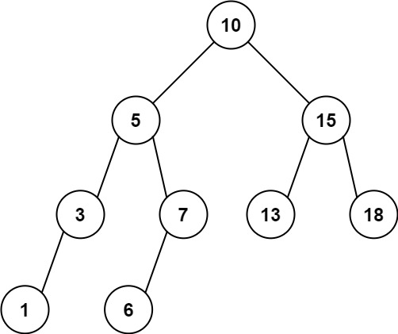

# 简洁写法（Python/Java/C++/Go/JS/Rust）

> **[938. 二叉搜索树的范围和](https://leetcode.cn/problems/range-sum-of-bst/solutions/2653989/jian-ji-xie-fa-pythonjavacgojsrust-by-en-7jw4/) · Easy · 难度分 1335**

> **所属题单**
> - [链表、二叉树与回溯 · 二、二叉树](../../../刷题路径/灵神原版题单/链表、二叉树与回溯/二、二叉树.md) · §2.9 二叉搜索树

> **题目描述**
> 给定二叉搜索树的根结点 `root`，返回值位于范围 <em>`[low, high]`</em> 之间的所有结点的值的和。
>
> **示例 1：**
>
> 
>
> ```
>
> 输入：root = [10,5,15,3,7,null,18], low = 7, high = 15
> 输出：32
> ```
>
> **示例 2：**
>
> 
>
> ```
>
> 输入：root = [10,5,15,3,7,13,18,1,null,6], low = 6, high = 10
> 输出：23
> ```
>
> **提示：**
>
> - 树中节点数目在范围 `[1, 2 * 10⁴]` 内
>
> - `1 <= Node.val <= 10⁵`
>
> - `1 <= low <= high <= 10⁵`
>
> - 所有 `Node.val` **互不相同**

> **题解**
> 二叉搜索树满足如下性质：
>
> - 左子树的节点值都小于根节点的值。
> - 右子树的节点值都大于根节点的值。
> - 任意节点的左子树和右子树都是二叉搜索树。
>
> 根据这些性质，设根节点的值为 $x$，分类讨论：
>
> - 如果 $x>\textit{high}$，那么 $x$ 不在 $[\textit{low},\textit{high}]$ 范围内，并且根据二叉搜索树的性质，右子树的所有节点值都大于 $x$，从而大于 $\textit{high}$，所以也不在 $[\textit{low},\textit{high}]$ 范围内，我们只需计算**左子树**的在 $[\textit{low},\textit{high}]$ 范围内的节点值之和。
> - 如果 $x<\textit{low}$，那么 $x$ 不在 $[\textit{low},\textit{high}]$ 范围内，并且根据二叉搜索树的性质，左子树的所有节点值都小于 $x$，从而小于 $\textit{low}$，所以也不在 $[\textit{low},\textit{high}]$ 范围内，我们只需计算**右子树**的在 $[\textit{low},\textit{high}]$ 范围内的节点值之和。
> - 否则，$\textit{low}\le x \le \textit{high}$，那么 $x$ 在 $[\textit{low},\textit{high}]$ 范围内，且左右子树都可能有节点在 $[\textit{low},\textit{high}]$ 范围内，我们累加 $x$、左子树的在 $[\textit{low},\textit{high}]$ 范围内的节点值之和、右子树的在 $[\textit{low},\textit{high}]$ 范围内的节点值之和，这三部分的和作为答案。
>
> 由于要计算的问题都形如「某棵子树在 $[\textit{low},\textit{high}]$ 范围内的节点值之和」，所以可以用**递归**解决。
>
> 晕递归的同学推荐先看 [深入理解递归【基础算法精讲 09】](https://www.bilibili.com/video/BV1UD4y1Y769/)。
>
> > 注：如果你知道线段树，可以看出下面的代码就是线段树的 `query`。
>
> #### 写法一
>
> ```python
> class Solution:
>     def rangeSumBST(self, root: Optional[TreeNode], low: int, high: int) -> int:
>         if root is None:
>             return 0
>         x = root.val
>         if x > high:  # 右子树没有节点在范围内，只需递归左子树
>             return self.rangeSumBST(root.left, low, high)
>         if x < low:  # 左子树没有节点在范围内，只需递归右子树
>             return self.rangeSumBST(root.right, low, high)
>         return x + self.rangeSumBST(root.left, low, high) + \
>                    self.rangeSumBST(root.right, low, high)
> ```
>
>
> #### 写法二
>
> ```python
> class Solution:
>     def rangeSumBST(self, root: Optional[TreeNode], low: int, high: int) -> int:
>         if root is None:
>             return 0
>         x = root.val
>         s = x if low <= x <= high else 0
>         if x > low:  # 左子树可能有节点值在范围内
>             s += self.rangeSumBST(root.left, low, high)
>         if x < high:  # 右子树可能有节点值在范围内
>             s += self.rangeSumBST(root.right, low, high)
>         return s
> ```
>
>
> #### 复杂度分析
>
> - 时间复杂度：$\mathcal{O}(n)$，其中 $n$ 为二叉搜索树的节点个数。最坏情况下每个节点都在范围内，需要遍历整棵树。
> - 空间复杂度：$\mathcal{O}(n)$。最坏情况下二叉搜索树是一条链（注意题目没有保证树是平衡的），递归需要 $\mathcal{O}(n)$ 的栈空间。
>
> 欢迎关注 [B站@灵茶山艾府](https://space.bilibili.com/206214)
>
> [往期题解精选（已分类）](https://github.com/EndlessCheng/codeforces-go/blob/master/leetcode/SOLUTIONS.md)
