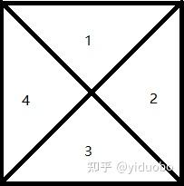
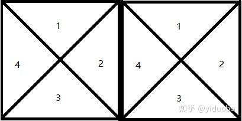
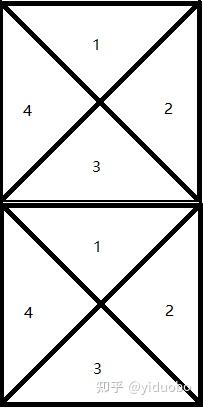

# 959. 由斜杠划分区域

> **[yiduobo的每日leetcode 959.由斜杠划分区域](https://zhuanlan.zhihu.com/p/360526370) · 知乎 · 2021-03-28 · 赞同 0**
> 力扣：[959. 由斜杠划分区域](https://leetcode.cn/problems/regions-cut-by-slashes/)

祖传的手艺不想丢了，所以按顺序写一个leetcode的题解。计划每日两题，争取不卡题吧

959.由斜杠划分区域

[力扣](https://leetcode-cn.com/problems/regions-cut-by-slashes/)

直接按照几何做法是比较复杂的，不妨试着逆向思维，根据斜杠的情况对格子进行合并。

具体来说就是先将一个单元格根据两条对角线按顺时针分成4个部分，如下图



对于一个"/"，我们可以认为1和4合并到了一起，2和3合并到了一起。

对于一个"\\"，我们可以认为1和2合并到了一起，3和4合并到了一起。

对于一个白板，则可以认为1、2、3、4都合并到了一起。

另外，对于左右相邻的两个格子，如下图



可以发现左侧格子的2与右侧格子的4在任何情况下都是合并在一起的

而对于上下相邻的两个格子，则有



上面格子的3与下面格子的1在任何情况下都是合并在一起的

而对于合并问题，自然又是并查集出马了。于是现在有了一种做法：

1、设这里的grid边长为N，那么一共有N \* N个格子，每个格子有4个部分，那么一共有N \* N \* 4个部分。对每个部分依次编号，同时设每个部分的父亲为自身。

2、遍历每个格子，设当前处理到第i行第j列：

当前格子的2编号应该是(i \* n + j) \* 4 + 2

当前格子右侧格子的4编号应该是(i \* n + j + 1) \* 4 + 4

将右侧格子的4的父亲置为当前格子的2

当前格子的3编号应该是(i \* n + j) \* 4 + 3

当前格子下面格子的1编号应该是((i + 1) \* n + j) \* 4 + 1

将下面格子的1的父亲置为当前格子的3

当前格子的1编号应该是(i \* n + j) \* 4 + 1

当前格子的1编号应该是(i \* n + j) \* 4 + 2

当前格子的1编号应该是(i \* n + j) \* 4 + 3

当前格子的1编号应该是(i \* n + j) \* 4 + 4

若当前grid[i][j]为'/'，则合并当前格子的1和4，2和3

若当前grid[i][j]为'\\'，则合并当前格子的1和2，3和4

若当前grid[i][j]为空白，则合并当前格子的1、2、3、4

完成所有合并之后，每个连通块的父亲应该是同一个，那么只需要统计最后剩下多少个不同的父亲，就可以知道最终划分出了多少个区域。

最后附上python代码：

```python
class Solution(object):
    def regionsBySlashes(self, grid):
        """
        :type grid: List[str]
        :rtype: int
        """

        n = len(grid)
        fa = range(n * n * 4 + 1)

        for i in range(n):
            for j in range(n - 1):
                left_pos = (i * n + j) * 4 + 2
                right_pos = (i * n + j + 1) * 4 + 4
                fa[right_pos] = left_pos
        
        for i in range(n - 1):
            for j in range(n):
                up_pos = (i * n + j) * 4 + 3
                donw_pos = ((i + 1) * n + j) * 4 + 1
                fa[donw_pos] = up_pos
        
        for i in range(n):
            for j in range(n):
                square = (i * n + j) * 4 + 1
                if grid[i][j] == ' ':
                    self.union(square, square + 1, fa)
                    self.union(square, square + 2, fa)
                    self.union(square, square + 3, fa)
                elif grid[i][j] == '/':
                    self.union(square, square + 3, fa)
                    self.union(square + 1, square + 2, fa)
                else:
                    self.union(square, square + 1, fa)
                    self.union(square + 2, square + 3, fa)
        
        res = 0
        for i in range(1, n * n * 4 + 1):
            if self.find(i, fa) == i:
                res += 1
        
        return res
    
    def find(self, now, fa):
        if fa[now] != now:
            fa[now] = self.find(fa[now], fa)
        
        return fa[now]
    
    def union(self, x, y, fa):
        fa_x = self.find(x, fa)
        fa_y = self.find(y, fa)
        if fa_x < fa_y:
            fa[fa_y] = fa_x
        else:
            fa[fa_x] = fa_y
```
