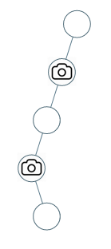

# 968. 监控二叉树

Hard · 难度分 2124 · [力扣原题](https://leetcode.cn/problems/binary-tree-cameras/)

所在刷题路径：灵神题单·动态规划、灵神题单·链表树与回溯

| 作者 | 题解 | 动画讲解 |
|---|---|---|
| 灵茶山艾府 | [📄 题解](灵茶山艾府.md) | [▶︎ 0968 监控二叉树 · 灵茶山艾府.mp4](0968%20监控二叉树%20·%20灵茶山艾府.mp4) |
| yiduobo | [📄 题解](yiduobo.md) | [▶︎ 0968 监控二叉树 · yiduobo.mp4](0968%20监控二叉树%20·%20yiduobo.mp4) |

## 题目描述

给定一个二叉树，我们在树的节点上安装摄像头。

节点上的每个摄影头都可以监视**其父对象、自身及其直接子对象。**

计算监控树的所有节点所需的最小摄像头数量。

**示例 1：**


```
输入：[0,0,null,0,0]
输出：1
解释：如图所示，一台摄像头足以监控所有节点。
```

**示例 2：**



```
输入：[0,0,null,0,null,0,null,null,0]
输出：2
解释：需要至少两个摄像头来监视树的所有节点。 上图显示了摄像头放置的有效位置之一。
```

**提示：**

1. 给定树的节点数的范围是 `[1, 1000]`。

2. 每个节点的值都是 0。

---
[↑ 返回 0900-0999](../README.md) · [总索引](../../../索引.md) · [仓库首页](../../../README.md)
