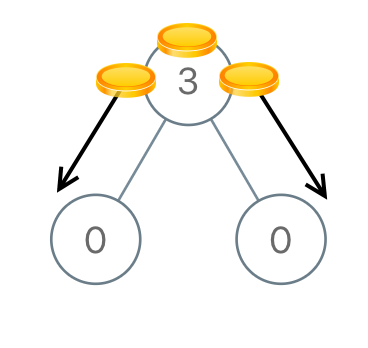
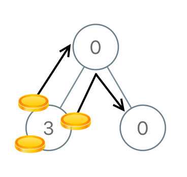
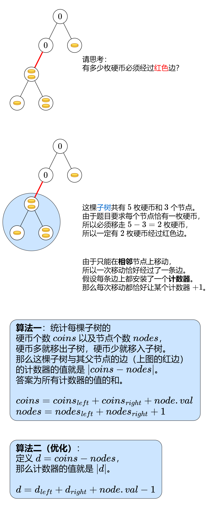
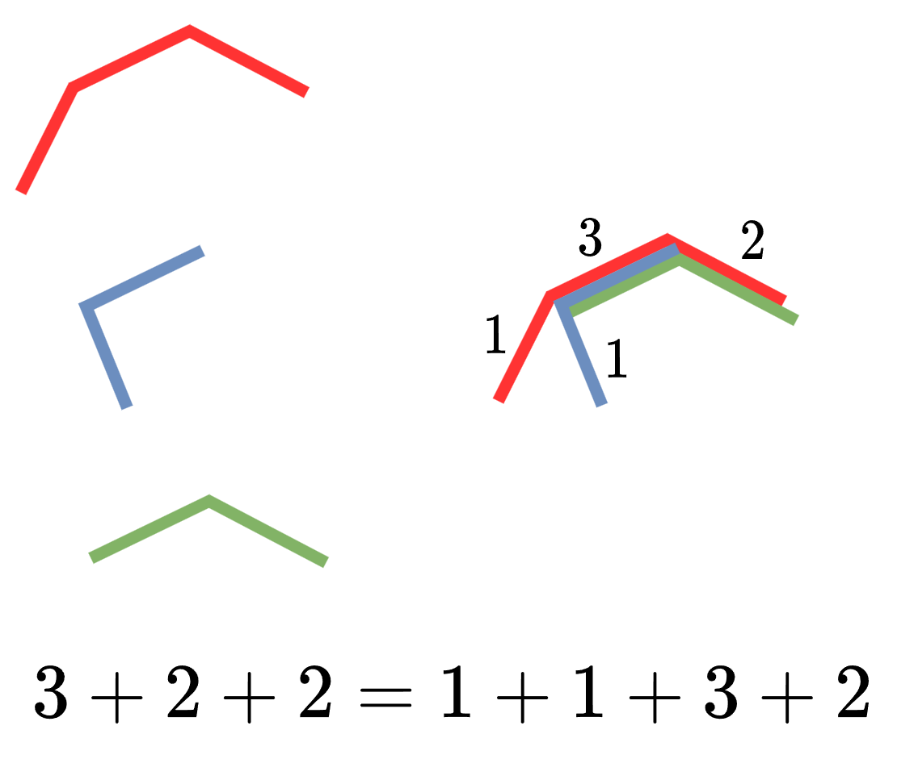

# 【图解】贡献法（Python/Java/C++/Go/JS）

> **[979. 在二叉树中分配硬币](https://leetcode.cn/problems/distribute-coins-in-binary-tree/solutions/2343262/tu-jie-mei-you-si-lu-jin-lai-miao-dong-p-vrni/) · Medium · 难度分 1709**

> **所属题单**
> - [链表、二叉树与回溯 · 二、二叉树](../../../刷题路径/灵神原版题单/链表、二叉树与回溯/二、二叉树.md) · §2.16 其他
> - [贪心算法 · 五、思维题](../../../刷题路径/灵神原版题单/贪心算法/五、思维题.md) · §5.5 贡献法

> **题目描述**
> 给你一个有 `n` 个结点的二叉树的根结点 `root` ，其中树中每个结点 `node` 都对应有 `node.val` 枚硬币。整棵树上一共有 `n` 枚硬币。
>
> 在一次移动中，我们可以选择两个相邻的结点，然后将一枚硬币从其中一个结点移动到另一个结点。移动可以是从父结点到子结点，或者从子结点移动到父结点。
>
> 返回使每个结点上 **只有** 一枚硬币所需的 **最少** 移动次数。
>
> **示例 1：**
>
> 
>
> ```
>
> 输入：root = [3,0,0]
> 输出：2
> 解释：一枚硬币从根结点移动到左子结点，一枚硬币从根结点移动到右子结点。
> ```
>
> **示例 2：**
>
> 
>
> ```
>
> 输入：root = [0,3,0]
> 输出：3
> 解释：将两枚硬币从根结点的左子结点移动到根结点（两次移动）。然后，将一枚硬币从根结点移动到右子结点。
> ```
>
> **提示：**
>
> - 树中节点的数目为 `n`
>
> - `1 <= n <= 100`
>
> - `0 <= Node.val <= n`
>
> - 所有 `Node.val` 的值之和是 `n`

> **题解**
> 
>
> ## 答疑
>
> **问**：如何理解计算 $\textit{coins}$ 和 $\textit{nodes}$ 的公式？
>
> **答**：请学习「递归」「子问题」等概念，具体请看[【基础算法精讲 09】](https://www.bilibili.com/video/BV1UD4y1Y769/)。
>
> **问**：算法二的公式是怎么得到的？
>
> **答**：（注意 $d$ 没有取绝对值，只在加到答案时取了绝对值）
>
> $$
> \begin{aligned}
> d=&\ \textit{coins}-\textit{nodes}\\
> =&\ (\textit{coins}_{\textit{left}} + \textit{coins}_{\textit{right}} + \textit{node}.\textit{val}) - (\textit{nodes}_{\textit{left}} + \textit{nodes}_{\textit{right}} + 1)\\
> =&\ (\textit{coins}_{\textit{left}} -\textit{nodes}_{\textit{left}}) +(\textit{coins}_{\textit{right}} -\textit{nodes}_{\textit{right}}) +  \textit{node}.\textit{val} - 1\\
> =&\ d_{\textit{left}} +d_{\textit{right}} +  \textit{node}.\textit{val} - 1
> \end{aligned}
> $$
>
> **问**：根节点没有父节点，代码中为什么没有特判根节点呢？
>
> **答**：根节点处统计的是整棵树，其中 $\textit{coins}=n,\textit{nodes}=n$。因为 $|\textit{coins}-\textit{nodes}|=0$，对答案无影响，所以无需特判根节点。
>
> **问**：这种思路的**本质**是什么？
>
> **答**：横看成岭侧成峰，每枚硬币移动的路径长度并不好计算，但是把这些路径**叠起来**，转换成每条边经过了多少枚硬币，就容易计算了（如下图）。
>
> 
>
> 路径是由边组成的，所有路径长度之和，等同于把「每条边出现在多少条路径中」相加。这种技巧叫做**贡献法**。更多相关题目，见文末的题单。
>
> ## 算法一
>
> ```python
> class Solution:
>     def distributeCoins(self, root: Optional[TreeNode]) -> int:
>         def dfs(node: Optional[TreeNode]) -> Tuple[int, int]:
>             if node is None:
>                 return 0, 0
>             coins_l, nodes_l = dfs(node.left)
>             coins_r, nodes_r = dfs(node.right)
>             coins = coins_l + coins_r + node.val  # 子树硬币个数
>             nodes = nodes_l + nodes_r + 1  # 子树节点数
>             nonlocal ans
>             ans += abs(coins - nodes)
>             return coins, nodes
>
>         ans = 0
>         dfs(root)
>         return ans
> ```
>
>
> ## 算法二（优化）
>
> ```python
> class Solution:
>     def distributeCoins(self, root: Optional[TreeNode]) -> int:
>         ans = 0
>         def dfs(node: Optional[TreeNode]) -> int:
>             if node is None:
>                 return 0
>             d = dfs(node.left) + dfs(node.right) + node.val - 1
>             nonlocal ans
>             ans += abs(d)
>             return d
>         dfs(root)
>         return ans
> ```
>
>
> #### 复杂度分析
>
> - 时间复杂度：$\mathcal{O}(n)$，其中 $n$ 为二叉树的节点个数。每个节点都会递归恰好一次。
> - 空间复杂度：$\mathcal{O}(n)$。最坏情况下，二叉树是一条链，递归需要 $\mathcal{O}(n)$ 的栈空间。
>
> ## 思考题
>
> 1. 如果硬币总个数 $\le n$ 个，要求最终每个节点**至多**有一枚硬币，最少要移动多少次呢？
> 2. 如果硬币总个数 $\ge n$ 个，要求最终每个节点**至少**有一枚硬币，最少要移动多少次呢？
> 3. 假设每个节点 $\textit{node}$ 都多了一个属性值 $\textit{target}$，要求最终**至少**有 $\textit{node}.\textit{target}$ 枚硬币，最少要移动多少次呢？（保证总硬币个数不低于所有节点的 $\textit{target}$ 之和。）
>
> 欢迎在评论区分享你的思路。
>
> ## 专题训练
>
> 见下面贪心与思维题单的「**§5.5 贡献法**」。
>
> ## 分类题单
>
> [如何科学刷题？](https://leetcode.cn/circle/discuss/RvFUtj/)
>
> 1. [滑动窗口与双指针（定长/不定长/单序列/双序列/三指针/分组循环）](https://leetcode.cn/circle/discuss/0viNMK/)
> 2. [二分算法（二分答案/最小化最大值/最大化最小值/第K小）](https://leetcode.cn/circle/discuss/SqopEo/)
> 3. [单调栈（基础/矩形面积/贡献法/最小字典序）](https://leetcode.cn/circle/discuss/9oZFK9/)
> 4. [网格图（DFS/BFS/综合应用）](https://leetcode.cn/circle/discuss/YiXPXW/)
> 5. [位运算（基础/性质/拆位/试填/恒等式/思维）](https://leetcode.cn/circle/discuss/dHn9Vk/)
> 6. [图论算法（DFS/BFS/拓扑排序/基环树/最短路/最小生成树/网络流）](https://leetcode.cn/circle/discuss/01LUak/)
> 7. [动态规划（入门/背包/划分/状态机/区间/状压/数位/数据结构优化/树形/博弈/概率期望）](https://leetcode.cn/circle/discuss/tXLS3i/)
> 8. [常用数据结构（前缀和/差分/栈/队列/堆/字典树/并查集/树状数组/线段树）](https://leetcode.cn/circle/discuss/mOr1u6/)
> 9. [数学算法（数论/组合/概率期望/博弈/计算几何/随机算法）](https://leetcode.cn/circle/discuss/IYT3ss/)
> 10. [贪心与思维（基本贪心策略/反悔/区间/字典序/数学/思维/脑筋急转弯/构造）](https://leetcode.cn/circle/discuss/g6KTKL/)
> 11. [链表、树与回溯（前后指针/快慢指针/DFS/BFS/直径/LCA）](https://leetcode.cn/circle/discuss/K0n2gO/)
> 12. [字符串（KMP/Z函数/Manacher/字符串哈希/AC自动机/后缀数组/子序列自动机）](https://leetcode.cn/circle/discuss/SJFwQI/)
>
> [我的题解精选（已分类）](https://github.com/EndlessCheng/codeforces-go/blob/master/leetcode/SOLUTIONS.md)
>
> 欢迎关注 [B站@灵茶山艾府](https://space.bilibili.com/206214)
