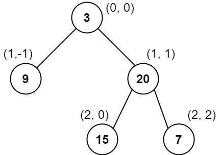
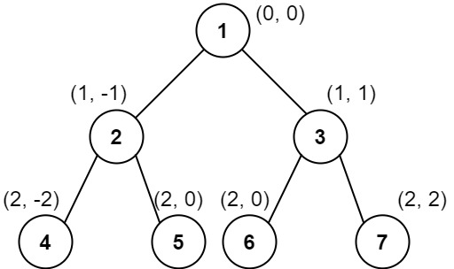

# 四种写法：DFS+哈希表/双数组/单数组（Python/Java/C++/Go）

> **[987. 二叉树的垂序遍历](https://leetcode.cn/problems/vertical-order-traversal-of-a-binary-tree/solutions/2638913/si-chong-xie-fa-dfsha-xi-biao-shuang-shu-tg6q/) · Hard · 难度分 1676**

> **所属题单**
> - [链表、二叉树与回溯 · 二、二叉树](../../../刷题路径/灵神原版题单/链表、二叉树与回溯/二、二叉树.md) · §2.16 其他

> **题目描述**
> 给你二叉树的根结点 `root` ，请你设计算法计算二叉树的 **垂序遍历** 序列。
>
> 对位于 `(row, col)` 的每个结点而言，其左右子结点分别位于 `(row + 1, col - 1)` 和 `(row + 1, col + 1)` 。树的根结点位于 `(0, 0)` 。
>
> 二叉树的 **垂序遍历** 从最左边的列开始直到最右边的列结束，按列索引每一列上的所有结点，形成一个按出现位置从上到下排序的有序列表。如果同行同列上有多个结点，则按结点的值从小到大进行排序。
>
> 返回二叉树的 **垂序遍历** 序列。
>
> **示例 1：**
>
> 
>
> ```
>
> 输入：root = [3,9,20,null,null,15,7]
> 输出：[[9],[3,15],[20],[7]]
> 解释：
> 列 -1 ：只有结点 9 在此列中。
> 列  0 ：只有结点 3 和 15 在此列中，按从上到下顺序。
> 列  1 ：只有结点 20 在此列中。
> 列  2 ：只有结点 7 在此列中。
> ```
>
> **示例 2：**
>
> 
>
> ```
>
> 输入：root = [1,2,3,4,5,6,7]
> 输出：[[4],[2],[1,5,6],[3],[7]]
> 解释：
> 列 -2 ：只有结点 4 在此列中。
> 列 -1 ：只有结点 2 在此列中。
> 列  0 ：结点 1 、5 和 6 都在此列中。
>           1 在上面，所以它出现在前面。
>           5 和 6 位置都是 (2, 0) ，所以按值从小到大排序，5 在 6 的前面。
> 列  1 ：只有结点 3 在此列中。
> 列  2 ：只有结点 7 在此列中。
> ```
>
> **示例 3：**
>
> 
>
> ```
>
> 输入：root = [1,2,3,4,6,5,7]
> 输出：[[4],[2],[1,5,6],[3],[7]]
> 解释：
> 这个示例实际上与示例 2 完全相同，只是结点 5 和 6 在树中的位置发生了交换。
> 因为 5 和 6 的位置仍然相同，所以答案保持不变，仍然按值从小到大排序。
> ```
>
> **提示：**
>
> - 树中结点数目总数在范围 `[1, 1000]` 内
>
> - `0 <= Node.val <= 1000`

> **题解**
> 
>
> 看示例 3，我们需要知道每个节点的行号 $\textit{row}$、列号 $\textit{col}$ 以及节点值 $\textit{val}$。
>
> 如果知道了这些信息，那么问题相当于，给你这些三元组： 
>
> $$
> (2,-2,4),(1,-1,2),(0,0,1),(2,0,6),(2,0,5),(1,1,3),(2,2,7)
> $$
>
> 每个三元组表示 $(\textit{row},\textit{col},\textit{val})$，你需要把这些三元组按照 $\textit{col}$ 分组，也就是把 $\textit{col}$ 相同的分到同一组，每组只保留 $\textit{val}$，每组的 $\textit{val}$ 按照 $\textit{row}$ 从小到大排序，$\textit{row}$ 相同的按照 $\textit{val}$ 从小到大排序。分组后的结果就是答案 $[[4],[2],[1,5,6],[3],[7]]$。
>
> 为了获取每个节点的信息，我们可以用 DFS，除了参数 $\textit{node}$ 外，还需要参数 $\textit{row}$ 和 $\textit{col}$ 表示当前节点的行号和列号。每往下递归一层，就把 $\textit{row}$ 加一。如果往左儿子递归，就把 $\textit{col}$ 减一；如果往右儿子递归，就把 $\textit{col}$ 加一。
>
> 在 DFS 的同时，用一个哈希表（或者有序字典）来记录这些数据。哈希表的 key 是 $\textit{col}$，哈希表的 value 是一个列表，列表中保存 $(\textit{row},\textit{val})$ 二元组。
>
> DFS 结束后，按照 key 从小到大遍历哈希表，对于哈希表的每个 value，把 value 中的二元组排序，最后取出 value 中的 $\textit{val}$ 加入答案。
>
> 晕递归的同学可以看 [深刻理解递归【基础算法精讲 09】](https://www.bilibili.com/video/BV1UD4y1Y769/)
>
> ## 写法一
>
> ```python
> class Solution:
>     def verticalTraversal(self, root: Optional[TreeNode]) -> List[List[int]]:
>         groups = defaultdict(list)
>         def dfs(node: Optional[TreeNode], row: int, col: int):
>             if node is None:
>                 return
>             groups[col].append((row, node.val))  # col 相同的分到同一组
>             dfs(node.left, row + 1, col - 1)
>             dfs(node.right, row + 1, col + 1)
>         dfs(root, 0, 0)
>
>         ans = []
>         for _, g in sorted(groups.items()):
>             g.sort()  # 按照 row 排序，row 相同按照 val 排序
>             ans.append([val for _, val in g])
>         return ans
> ```
>
>
> ## 写法二
>
> 也可以在 DFS 的同时记录 $\textit{col}$ 的最小值，这样无需对 key 排序，也无需使用有序字典。
>
> ```python
> class Solution:
>     def verticalTraversal(self, root: Optional[TreeNode]) -> List[List[int]]:
>         groups = defaultdict(list)
>         min_col = 0
>         def dfs(node: Optional[TreeNode], row: int, col: int):
>             if node is None:
>                 return
>             nonlocal min_col
>             min_col = min(min_col, col)
>             groups[col].append((row, node.val))  # col 相同的分到同一组
>             dfs(node.left, row + 1, col - 1)
>             dfs(node.right, row + 1, col + 1)
>         dfs(root, 0, 0)
>
>         ans = []
>         for col in range(min_col, min_col + len(groups)):
>             g = groups[col]
>             g.sort()  # 按照 row 排序，row 相同按照 val 排序
>             ans.append([val for _, val in g])
>         return ans
> ```
>
>
> ## 写法三
>
> 也可以用两个列表记录数据，一个列表 $\textit{left}$ 负责统计负数 $\textit{col}$，另一个列表 $\textit{right}$ 负责统计非负数 $\textit{col}$。
>
> > 注：相当于用两个列表来模拟双端队列。
>
> ```python
> class Solution:
>     def verticalTraversal(self, root: Optional[TreeNode]) -> List[List[int]]:
>         left, right = [], []
>         def dfs(node: Optional[TreeNode], row: int, col: int):
>             if node is None:
>                 return
>             if col < -len(left):
>                 left.append([])
>             elif col == len(right):
>                 right.append([])
>             (left[-col - 1] if col < 0 else right[col]).append((row, node.val))
>             dfs(node.left, row + 1, col - 1)
>             dfs(node.right, row + 1, col + 1)
>         dfs(root, 0, 0)
>
>         ans = []
>         for g in left[::-1] + right:
>             g.sort()
>             ans.append([val for _, val in g])
>         return ans
> ```
>
>
> ## 写法四
>
> 大道至简，把所有 $(\textit{col},\textit{row},\textit{val})$ 全部丢到同一个列表中，排序后按照 $\textit{col}$ 分组。
>
> ```python
> class Solution:
>     def verticalTraversal(self, root: Optional[TreeNode]) -> List[List[int]]:
>         data = []
>         def dfs(node: Optional[TreeNode], row: int, col: int):
>             if node is None:
>                 return
>             data.append((col, row, node.val))
>             dfs(node.left, row + 1, col - 1)
>             dfs(node.right, row + 1, col + 1)
>         dfs(root, 0, 0)
>
>         ans = []
>         last_col = inf
>         data.sort()
>         for col, _, val in data:
>             if col != last_col:
>                 last_col = col
>                 ans.append([])
>             ans[-1].append(val)
>         return ans
> ```
>
> > [!example]- Python3 groupby
> > ```python
> > class Solution:
> >     def verticalTraversal(self, root: Optional[TreeNode]) -> List[List[int]]:
> >         data = []
> >         def dfs(node: Optional[TreeNode], row: int, col: int):
> >             if node is None:
> >                 return
> >             data.append((col, row, node.val))
> >             dfs(node.left, row + 1, col - 1)
> >             dfs(node.right, row + 1, col + 1)
> >         dfs(root, 0, 0)
> >
> >         data.sort()
> >         return [[d[2] for d in g] for _, g in groupby(data, key=lambda d: d[0])]
> > ```
>
>
> #### 复杂度分析
>
> 最坏情况下，有多少个节点在同一个坐标 $(\textit{row},\textit{col})$？
>
> 从 $(0,0)$ 出发，向左再向右可以到达 $(2,0)$，向右再向左也可以到达 $(2,0)$。这 $2$ 个在 $(2,0)$ 的节点，按照同样的方法可以得到 $4$ 个在 $(4,0)$ 的节点。依此类推。如果当前有 $2^k$ 个节点在同一个坐标，那么增加 $2^{k+2}$ 个节点，就可以得到 $2^{k+1}$ 个在同一坐标的节点。
>
> - $n=5$ 时，最多有 $2$ 个节点在同一个坐标。
> - $n=5+8=13$ 时，最多有 $4$ 个节点在同一个坐标。
> - $n=5+8+16=29$ 时，最多有 $8$ 个节点在同一个坐标。
> - $n=5+8+16+32=61$ 时，最多有 $16$ 个节点在同一个坐标。
> - ……
> - $n=2^{k+2}-3$ 时，最多有 $2^k$ 个节点在同一个坐标。
>
> 所以最坏情况下有大约 $\dfrac{n}{4}$ 个节点在同一个坐标，无论用何种方式遍历二叉树，基于比较的排序都需要 $\mathcal{O}(n\log n)$ 的时间。
>
> - 时间复杂度：$\mathcal{O}(n\log n)$，其中 $n$ 为二叉树的节点个数。瓶颈在排序上。
> - 空间复杂度：$\mathcal{O}(n)$。
>
> ## 分类题单
>
> [如何科学刷题？](https://leetcode.cn/circle/discuss/RvFUtj/)
>
> 1. [滑动窗口与双指针（定长/不定长/单序列/双序列/三指针/分组循环）](https://leetcode.cn/circle/discuss/0viNMK/)
> 2. [二分算法（二分答案/最小化最大值/最大化最小值/第K小）](https://leetcode.cn/circle/discuss/SqopEo/)
> 3. [单调栈（基础/矩形面积/贡献法/最小字典序）](https://leetcode.cn/circle/discuss/9oZFK9/)
> 4. [网格图（DFS/BFS/综合应用）](https://leetcode.cn/circle/discuss/YiXPXW/)
> 5. [位运算（基础/性质/拆位/试填/恒等式/思维）](https://leetcode.cn/circle/discuss/dHn9Vk/)
> 6. [图论算法（DFS/BFS/拓扑排序/基环树/最短路/最小生成树/网络流）](https://leetcode.cn/circle/discuss/01LUak/)
> 7. [动态规划（入门/背包/划分/状态机/区间/状压/数位/数据结构优化/树形/博弈/概率期望）](https://leetcode.cn/circle/discuss/tXLS3i/)
> 8. [常用数据结构（前缀和/差分/栈/队列/堆/字典树/并查集/树状数组/线段树）](https://leetcode.cn/circle/discuss/mOr1u6/)
> 9. [数学算法（数论/组合/概率期望/博弈/计算几何/随机算法）](https://leetcode.cn/circle/discuss/IYT3ss/)
> 10. [贪心与思维（基本贪心策略/反悔/区间/字典序/数学/思维/脑筋急转弯/构造）](https://leetcode.cn/circle/discuss/g6KTKL/)
> 11. [链表、二叉树与回溯（前后指针/快慢指针/DFS/BFS/直径/LCA/一般树）](https://leetcode.cn/circle/discuss/K0n2gO/)
> 12. [字符串（KMP/Z函数/Manacher/字符串哈希/AC自动机/后缀数组/子序列自动机）](https://leetcode.cn/circle/discuss/SJFwQI/)
>
> [我的题解精选（已分类）](https://github.com/EndlessCheng/codeforces-go/blob/master/leetcode/SOLUTIONS.md)
>
> 欢迎关注 [B站@灵茶山艾府](https://space.bilibili.com/206214)
