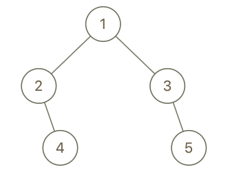

# DFS+记录深度和父节点（Python/Java/C++/Go）

> **[993. 二叉树的堂兄弟节点](https://leetcode.cn/problems/cousins-in-binary-tree/solutions/2635560/liang-chong-dfs-xie-fa-pythonjavacgojsru-wzb2/) · Easy · 难度分 1288**

> **所属题单**
> - [链表、二叉树与回溯 · 二、二叉树](../../../刷题路径/灵神原版题单/链表、二叉树与回溯/二、二叉树.md) · §2.13 二叉树 BFS

> **题目描述**
> 在二叉树中，根节点位于深度 `0` 处，每个深度为 `k` 的节点的子节点位于深度 `k+1` 处。
>
> 如果二叉树的两个节点深度相同，但 **父节点不同** ，则它们是一对<em>堂兄弟节点</em>。
>
> 我们给出了具有唯一值的二叉树的根节点 `root` ，以及树中两个不同节点的值 `x` 和 `y` 。
>
> 只有与值 `x` 和 `y` 对应的节点是堂兄弟节点时，才返回 `true` 。否则，返回 `false`。
>
> 示例 1：
>
> 
>
> ```
>
> 输入：root = [1,2,3,4], x = 4, y = 3
> 输出：false
> ```
>
> 示例 2：
>
> 
>
> ```
>
> 输入：root = [1,2,3,null,4,null,5], x = 5, y = 4
> 输出：true
> ```
>
> **示例 3：**
>
> 
>
> ```
>
> 输入：root = [1,2,3,null,4], x = 2, y = 3
> 输出：false
> ```
>
> **提示：**
>
> - 二叉树的节点数介于 `2` 到 `100` 之间。
>
> - 每个节点的值都是唯一的、范围为 `1` 到 `100` 的整数。

> **题解**
> DFS 传入三个参数：
>
> - 当前节点 $\textit{node}$。
> - $\textit{node}$ 的父节点 $\textit{fa}$。
> - $\textit{node}$ 的深度 $\textit{d}$。为了方便判断，根节点的深度为 $1$。
>
> 如果 $\textit{node}$ 的节点值等于 $x$ 或者 $y$：
>
> - 如果之前没有找到 $x$ 或 $y$，那么记录 $\textit{node}$ 的深度到变量 $\textit{depth}$ 中，记录 $\textit{node}$ 的父节点到变量 $\textit{father}$ 中。
> - 如果之前找到 $x$ 或 $y$，那么现在 $x$ 和 $y$ 都找到了。如果 $\textit{depth}=d$ 且 $\textit{father}\ne \textit{fa}$，说明 $x$ 和 $y$ 对应的节点是堂兄弟节点，否则不是。
>
> 注意题目保证树中节点值互不相同。
>
> 晕递归的同学可以看 [深刻理解递归【基础算法精讲 09】](https://www.bilibili.com/video/BV1UD4y1Y769/)
>
> ## 写法一
>
> ```python
> class Solution:
>     def isCousins(self, root: Optional[TreeNode], x: int, y: int) -> bool:
>         depth = father = None
>         def dfs(node: Optional[TreeNode], fa: Optional[TreeNode], d: int) -> bool:
>             if node is None:
>                 return False
>             if node.val == x or node.val == y:  # 找到 x 或 y
>                 nonlocal depth, father
>                 if depth:  # 之前已找到 x y 其中一个
>                     return depth == d and father != fa
>                 depth, father = d, fa  # 之前没找到，记录信息
>             return dfs(node.left, node, d + 1) or dfs(node.right, node, d + 1)
>         return dfs(root, None, 1)
> ```
>
>
> ## 写法二（优化）
>
> 上面的代码在 $x$ 和 $y$ 都找到，但不是堂兄弟节点时，仍然会继续递归。
>
> 改为在此时记录答案，并将 DFS 返回值的含义改为「$x$ 和 $y$ 都已找到」。
>
> ```python
> class Solution:
>     def isCousins(self, root: Optional[TreeNode], x: int, y: int) -> bool:
>         ans = False
>         depth = father = None
>         def dfs(node: Optional[TreeNode], fa: Optional[TreeNode], d: int) -> bool:
>             if node is None:
>                 return False
>             if node.val == x or node.val == y:  # 找到 x 或 y
>                 nonlocal ans, depth, father
>                 if depth:  # 之前找到 x y 其中一个
>                     ans = depth == d and father != fa
>                     return True  # 表示 x 和 y 都找到
>                 depth, father = d, fa  # 之前没找到，记录信息
>             return dfs(node.left, node, d + 1) or dfs(node.right, node, d + 1)
>         dfs(root, None, 1)
>         return ans
> ```
>
>
> ## 写法三（优化）
>
> 如果已经找到了 $x$ 和 $y$ 的其中一个，此时 $\textit{depth}>0$，我们无需递归深度超过 $\textit{depth}$ 的点。
>
> ```python
> class Solution:
>     def isCousins(self, root: Optional[TreeNode], x: int, y: int) -> bool:
>         ans = False
>         depth = father = None
>         def dfs(node: Optional[TreeNode], fa: Optional[TreeNode], d: int) -> bool:
>             nonlocal ans, depth, father
>             if node is None or depth and d > depth:
>                 return False
>             if node.val == x or node.val == y:  # 找到 x 或 y
>                 if depth:  # 之前找到 x y 其中一个
>                     ans = depth == d and father != fa
>                     return True  # 表示 x 和 y 都找到
>                 depth, father = d, fa  # 之前没找到，记录信息
>             return dfs(node.left, node, d + 1) or dfs(node.right, node, d + 1)
>         dfs(root, None, 1)
>         return ans
> ```
>
>
> #### 复杂度分析
>
> - 时间复杂度：$\mathcal{O}(n)$，其中 $n$ 为二叉树的节点个数。
> - 空间复杂度：$\mathcal{O}(n)$。最坏情况下，二叉树退化成一条链，递归需要 $O(n)$ 的栈空间。
>
> ## 分类题单
>
> [如何科学刷题？](https://leetcode.cn/circle/discuss/RvFUtj/)
>
> 1. [滑动窗口与双指针（定长/不定长/单序列/双序列/三指针/分组循环）](https://leetcode.cn/circle/discuss/0viNMK/)
> 2. [二分算法（二分答案/最小化最大值/最大化最小值/第K小）](https://leetcode.cn/circle/discuss/SqopEo/)
> 3. [单调栈（基础/矩形面积/贡献法/最小字典序）](https://leetcode.cn/circle/discuss/9oZFK9/)
> 4. [网格图（DFS/BFS/综合应用）](https://leetcode.cn/circle/discuss/YiXPXW/)
> 5. [位运算（基础/性质/拆位/试填/恒等式/思维）](https://leetcode.cn/circle/discuss/dHn9Vk/)
> 6. [图论算法（DFS/BFS/拓扑排序/基环树/最短路/最小生成树/网络流）](https://leetcode.cn/circle/discuss/01LUak/)
> 7. [动态规划（入门/背包/划分/状态机/区间/状压/数位/数据结构优化/树形/博弈/概率期望）](https://leetcode.cn/circle/discuss/tXLS3i/)
> 8. [常用数据结构（前缀和/差分/栈/队列/堆/字典树/并查集/树状数组/线段树）](https://leetcode.cn/circle/discuss/mOr1u6/)
> 9. [数学算法（数论/组合/概率期望/博弈/计算几何/随机算法）](https://leetcode.cn/circle/discuss/IYT3ss/)
> 10. [贪心与思维（基本贪心策略/反悔/区间/字典序/数学/思维/脑筋急转弯/构造）](https://leetcode.cn/circle/discuss/g6KTKL/)
> 11. [链表、二叉树与回溯（前后指针/快慢指针/DFS/BFS/直径/LCA/一般树）](https://leetcode.cn/circle/discuss/K0n2gO/)
> 12. [字符串（KMP/Z函数/Manacher/字符串哈希/AC自动机/后缀数组/子序列自动机）](https://leetcode.cn/circle/discuss/SJFwQI/)
>
> [我的题解精选（已分类）](https://github.com/EndlessCheng/codeforces-go/blob/master/leetcode/SOLUTIONS.md)
>
> 欢迎关注 [B站@灵茶山艾府](https://space.bilibili.com/206214)
