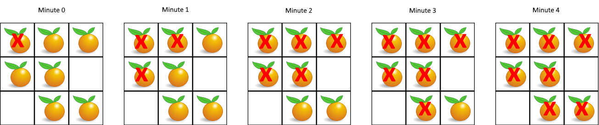

# 多源 BFS，附变形题（Python/Java/C++/Go/JS/Rust）

> **[994. 腐烂的橘子](https://leetcode.cn/problems/rotting-oranges/solutions/2773461/duo-yuan-bfsfu-ti-dan-pythonjavacgojsrus-yfmh/) · Medium**

> **所属题单**
> - [网格图 · 二、网格图 BFS](../../../刷题路径/灵神原版题单/网格图/二、网格图%20BFS.md)
> - [LeetCode 热题 100 · 图论](../../../刷题路径/灵神原版题单/LeetCode%20热题%20100/图论.md)

> **题目描述**
> 在给定的 `m x n` 网格 `grid` 中，每个单元格可以有以下三个值之一：
>
> - 值 `0` 代表空单元格；
>
> - 值 `1` 代表新鲜橘子；
>
> - 值 `2` 代表腐烂的橘子。
>
> 每分钟，腐烂的橘子 **周围 4 个方向上相邻** 的新鲜橘子都会腐烂。
>
> 返回 <em>直到单元格中没有新鲜橘子为止所必须经过的最小分钟数。如果不可能，返回 `-1`</em> 。
>
> **示例 1：**
>
> 
>
> ```
>
> 输入：grid = [[2,1,1],[1,1,0],[0,1,1]]
> 输出：4
> ```
>
> **示例 2：**
>
> ```
>
> 输入：grid = [[2,1,1],[0,1,1],[1,0,1]]
> 输出：-1
> 解释：左下角的橘子（第 2 行， 第 0 列）永远不会腐烂，因为腐烂只会发生在 4 个方向上。
> ```
>
> **示例 3：**
>
> ```
>
> 输入：grid = [[0,2]]
> 输出：0
> 解释：因为 0 分钟时已经没有新鲜橘子了，所以答案就是 0 。
> ```
>
> **提示：**
>
> - `m == grid.length`
>
> - `n == grid[i].length`
>
> - `1 <= m, n <= 10`
>
> - `grid[i][j]` 仅为 `0`、`1` 或 `2`

> **题解**
> 
>
> 看示例 1：
>
> 1. 统计所有初始就腐烂的橘子的位置，加到列表 $q$ 中，现在 $q = [(0,0)]$。
> 2. 初始化答案 $\textit{ans}=0$。模拟橘子腐烂的过程，不断循环，直到没有新鲜橘子，或者 $q$ 为空。
> 3. 答案加一，在第 $\textit{ans}=1$ 分钟，遍历 $q$ 中橘子的四方向相邻的新鲜橘子，把这些橘子腐烂，$q$ 更新为这些橘子的位置，现在 $q = [(0,1),(1,0)]$。
> 4. 答案加一，在第 $\textit{ans}=2$ 分钟，遍历 $q$ 中橘子的四方向相邻的新鲜橘子，把这些橘子腐烂，$q$ 更新为这些橘子的位置，现在 $q = [(0,2),(1,1)]$。
> 5. 答案加一，在第 $\textit{ans}=3$ 分钟，遍历 $q$ 中橘子的四方向相邻的新鲜橘子，把这些橘子腐烂，$q$ 更新为这些橘子的位置，现在 $q = [(2,1)]$。
> 6. 答案加一，在第 $\textit{ans}=4$ 分钟，遍历 $q$ 中橘子的四方向相邻的新鲜橘子，把这些橘子腐烂，$q$ 更新为这些橘子的位置，现在 $q = [(2,2)]$。
> 7. 由于没有新鲜橘子，退出循环。
>
> 为了判断是否有永远不会腐烂的橘子（如示例 2），我们可以统计初始新鲜橘子的个数 $\textit{fresh}$。在 BFS 中，每有一个新鲜橘子被腐烂，就把 $\textit{fresh}$ 减一，这样最后如果发现 $\textit{fresh}>0$，就意味着有橘子永远不会腐烂，返回 $-1$。
>
> 代码实现时，在 BFS 中要将 $\textit{grid}[i][j]=1$ 的橘子修改成 $2$（或者其它不等于 $1$ 的数），这可以保证每个橘子加入 $q$ 中至多一次。如果不修改，我们就无法知道哪些橘子被腐烂过了，比如示例 1 中 $(0,1)$ 去腐烂 $(1,1)$，而 $(1,1)$ 在此之后又重新腐烂 $(0,1)$，如此反复，程序就会陷入死循环。读者可以注释掉下面代码中的 `grid[i][j] = 2` 这行代码试试。
>
> 关于 BFS 的原理，请看[【基础算法精讲 13】](https://www.bilibili.com/video/BV1hG4y1277i/)。
>
> ### 答疑
>
> **问**：如果代码不在 `while` 中判断 $\textit{fresh} > 0$，会发生什么？
>
> **答**：会在腐烂完所有新鲜橘子后，多循环一次。这会导致 $\textit{ans}$ 比实际多 $1$。
>
> ```python
> class Solution:
>     def orangesRotting(self, grid: List[List[int]]) -> int:
>         m, n = len(grid), len(grid[0])
>         fresh = 0
>         q = []
>         for i, row in enumerate(grid):
>             for j, x in enumerate(row):
>                 if x == 1:
>                     fresh += 1  # 统计新鲜橘子个数
>                 elif x == 2:
>                     q.append((i, j))  # 一开始就腐烂的橘子
>
>         ans = 0
>         while q and fresh:
>             ans += 1  # 经过一分钟
>             tmp = q
>             q = []
>             for x, y in tmp:  # 已经腐烂的橘子
>                 for i, j in (x - 1, y), (x + 1, y), (x, y - 1), (x, y + 1):  # 四方向
>                     if 0 <= i < m and 0 <= j < n and grid[i][j] == 1:  # 新鲜橘子
>                         fresh -= 1
>                         grid[i][j] = 2  # 变成腐烂橘子
>                         q.append((i, j))
>
>         return -1 if fresh else ans
> ```
>
>
> #### 复杂度分析
>
> - 时间复杂度：$\mathcal{O}(mn)$，其中 $m$ 和 $n$ 分别为 $\textit{grid}$ 的行数和列数。
> - 空间复杂度：$\mathcal{O}(mn)$。
>
> ## 变形题（2025.7.16 添加）
>
> 1. 你可以把至多 $1$ 个 $1$ 改成 $2$，最小化最终新鲜橘子个数。
> 2. 你可以把至多 $k$ 个 $1$ 改成 $2$，最小化最终新鲜橘子个数。
> 3. 你可以把至多 $1$ 个 $2$ 改成 $1$，最大化最终新鲜橘子个数。
> 4. 你可以把至多 $k$ 个 $2$ 改成 $1$，最大化最终新鲜橘子个数。
>
> 欢迎在评论区分享你的思路/代码。
>
> 更多相似题目，见下面网格图题单中的 **BFS**。
>
> ## 分类题单
>
> [如何科学刷题？](https://leetcode.cn/circle/discuss/RvFUtj/)
>
> 1. [滑动窗口与双指针（定长/不定长/单序列/双序列/三指针/分组循环）](https://leetcode.cn/circle/discuss/0viNMK/)
> 2. [二分算法（二分答案/最小化最大值/最大化最小值/第K小）](https://leetcode.cn/circle/discuss/SqopEo/)
> 3. [单调栈（基础/矩形面积/贡献法/最小字典序）](https://leetcode.cn/circle/discuss/9oZFK9/)
> 4. [网格图（DFS/BFS/综合应用）](https://leetcode.cn/circle/discuss/YiXPXW/)
> 5. [位运算（基础/性质/拆位/试填/恒等式/思维）](https://leetcode.cn/circle/discuss/dHn9Vk/)
> 6. [图论算法（DFS/BFS/拓扑排序/基环树/最短路/最小生成树/网络流）](https://leetcode.cn/circle/discuss/01LUak/)
> 7. [动态规划（入门/背包/划分/状态机/区间/状压/数位/数据结构优化/树形/博弈/概率期望）](https://leetcode.cn/circle/discuss/tXLS3i/)
> 8. [常用数据结构（前缀和/差分/栈/队列/堆/字典树/并查集/树状数组/线段树）](https://leetcode.cn/circle/discuss/mOr1u6/)
> 9. [数学算法（数论/组合/概率期望/博弈/计算几何/随机算法）](https://leetcode.cn/circle/discuss/IYT3ss/)
> 10. [贪心与思维（基本贪心策略/反悔/区间/字典序/数学/思维/脑筋急转弯/构造）](https://leetcode.cn/circle/discuss/g6KTKL/)
> 11. [链表、二叉树与回溯（前后指针/快慢指针/DFS/BFS/直径/LCA/一般树）](https://leetcode.cn/circle/discuss/K0n2gO/)
> 12. [字符串（KMP/Z函数/Manacher/字符串哈希/AC自动机/后缀数组/子序列自动机）](https://leetcode.cn/circle/discuss/SJFwQI/)
>
> [我的题解精选（已分类）](https://github.com/EndlessCheng/codeforces-go/blob/master/leetcode/SOLUTIONS.md)
>
> 欢迎关注 [B站@灵茶山艾府](https://space.bilibili.com/206214)
