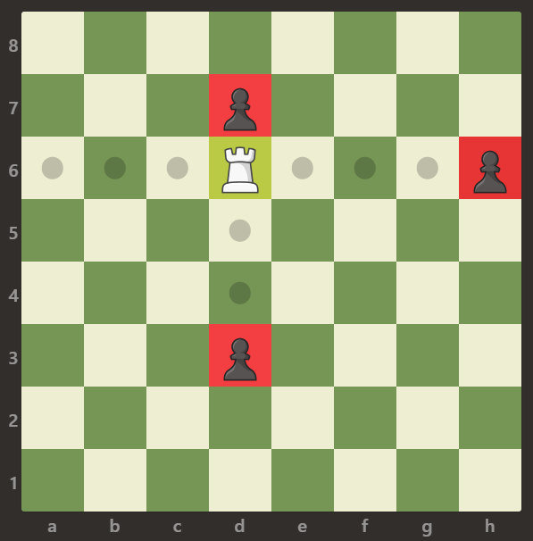
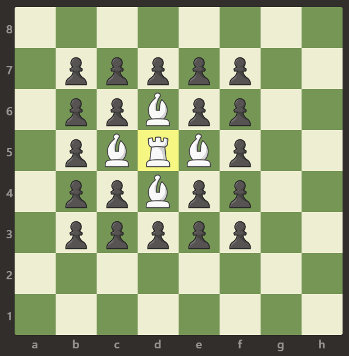
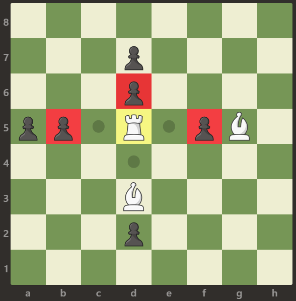

# 简单题，简单做（Python/Java/C++/Go）

> **[999. 可以被一步捕获的棋子数](https://leetcode.cn/problems/available-captures-for-rook/solutions/2997419/jian-dan-ti-jian-dan-zuo-pythonjavacgo-b-3vhr/) · Easy**

> **题目描述**
> 给定一个 `8 x 8` 的棋盘，**只有一个** 白色的车，用字符 `'R'` 表示。棋盘上还可能存在白色的象 `'B'` 以及黑色的卒 `'p'`。空方块用字符 `'.'` 表示。
>
> 车可以按水平或竖直方向（上，下，左，右）移动任意个方格直到它遇到另一个棋子或棋盘的边界。如果它能够在一次移动中移动到棋子的方格，则能够 **吃掉** 棋子。
>
> 注意：车不能穿过其它棋子，比如象和卒。这意味着如果有其它棋子挡住了路径，车就不能够吃掉棋子。
>
> 返回白车 **攻击** 范围内 **兵的数量**。
>
> **示例 1：**
>
> 
>
> ```
>
> 输入：[[".",".",".",".",".",".",".","."],[".",".",".","p",".",".",".","."],[".",".",".","R",".",".",".","p"],[".",".",".",".",".",".",".","."],[".",".",".",".",".",".",".","."],[".",".",".","p",".",".",".","."],[".",".",".",".",".",".",".","."],[".",".",".",".",".",".",".","."]]
> 输出：3
> 解释：
> 在本例中，车能够吃掉所有的卒。
> ```
>
> **示例 2：**
>
> 
>
> ```
>
> 输入：[[".",".",".",".",".",".",".","."],[".","p","p","p","p","p",".","."],[".","p","p","B","p","p",".","."],[".","p","B","R","B","p",".","."],[".","p","p","B","p","p",".","."],[".","p","p","p","p","p",".","."],[".",".",".",".",".",".",".","."],[".",".",".",".",".",".",".","."]]
> 输出：0
> 解释：
> 象阻止了车吃掉任何卒。
> ```
>
> **示例 3：**
>
> 
>
> ```
>
> 输入：[[".",".",".",".",".",".",".","."],[".",".",".","p",".",".",".","."],[".",".",".","p",".",".",".","."],["p","p",".","R",".","p","B","."],[".",".",".",".",".",".",".","."],[".",".",".","B",".",".",".","."],[".",".",".","p",".",".",".","."],[".",".",".",".",".",".",".","."]]
> 输出：3
> 解释：
> 车可以吃掉位置 b5，d6 和 f5 的卒。
> ```
>
> **提示：**
>
> 1. `board.length == 8`
>
> 2. `board[i].length == 8`
>
> 3. `board[i][j]` 可以是 `'R'`，`'.'`，`'B'` 或 `'p'`
>
> 4. 只有一个格子上存在 `board[i][j] == 'R'`

> **题解**
> 1. 遍历 $\textit{board}$，找到车的位置 $(x_0,y_0)$。
> 2. 枚举往左右上下四个方向移动。一步一步走，只要没有出界且是空方块，就继续走。
> 3. 如果移动到卒（p）的位置，答案加一。
>
> ```python
> class Solution:
>     def numRookCaptures(self, board: List[List[str]]) -> int:
>         SIZE = 8
>         for i, row in enumerate(board):
>             for j, c in enumerate(row):
>                 if c == 'R':
>                     x0, y0 = i, j
>         ans = 0
>         for dx, dy in (0, -1), (0, 1), (-1, 0), (1, 0):
>             x, y = x0 + dx, y0 + dy
>             while 0 <= x < SIZE and 0 <= y < SIZE and board[x][y] == '.':
>                 x += dx
>                 y += dy
>             if 0 <= x < SIZE and 0 <= y < SIZE and board[x][y] == 'p':
>                 ans += 1
>         return ans
> ```
>
>
> #### 复杂度分析
>
> - 时间复杂度：$\mathcal{O}(L^2)$，其中 $L=8$。
> - 空间复杂度：$\mathcal{O}(1)$。
>
> ## 分类题单
>
> [如何科学刷题？](https://leetcode.cn/circle/discuss/RvFUtj/)
>
> 1. [滑动窗口与双指针（定长/不定长/单序列/双序列/三指针）](https://leetcode.cn/circle/discuss/0viNMK/)
> 2. [二分算法（二分答案/最小化最大值/最大化最小值/第K小）](https://leetcode.cn/circle/discuss/SqopEo/)
> 3. [单调栈（基础/矩形面积/贡献法/最小字典序）](https://leetcode.cn/circle/discuss/9oZFK9/)
> 4. [网格图（DFS/BFS/综合应用）](https://leetcode.cn/circle/discuss/YiXPXW/)
> 5. [位运算（基础/性质/拆位/试填/恒等式/思维）](https://leetcode.cn/circle/discuss/dHn9Vk/)
> 6. [图论算法（DFS/BFS/拓扑排序/最短路/最小生成树/二分图/基环树/欧拉路径）](https://leetcode.cn/circle/discuss/01LUak/)
> 7. [动态规划（入门/背包/状态机/划分/区间/状压/数位/数据结构优化/树形/博弈/概率期望）](https://leetcode.cn/circle/discuss/tXLS3i/)
> 8. [常用数据结构（前缀和/差分/栈/队列/堆/字典树/并查集/树状数组/线段树）](https://leetcode.cn/circle/discuss/mOr1u6/)
> 9. [数学算法（数论/组合/概率期望/博弈/计算几何/随机算法）](https://leetcode.cn/circle/discuss/IYT3ss/)
> 10. [贪心与思维（基本贪心策略/反悔/区间/字典序/数学/思维/脑筋急转弯/构造）](https://leetcode.cn/circle/discuss/g6KTKL/)
> 11. [链表、二叉树与一般树（前后指针/快慢指针/DFS/BFS/直径/LCA）](https://leetcode.cn/circle/discuss/K0n2gO/)
> 12. [字符串（KMP/Z函数/Manacher/字符串哈希/AC自动机/后缀数组/子序列自动机）](https://leetcode.cn/circle/discuss/SJFwQI/)
>
> [我的题解精选（已分类）](https://github.com/EndlessCheng/codeforces-go/blob/master/leetcode/SOLUTIONS.md)
>
> 欢迎关注 [B站@灵茶山艾府](https://space.bilibili.com/206214)
