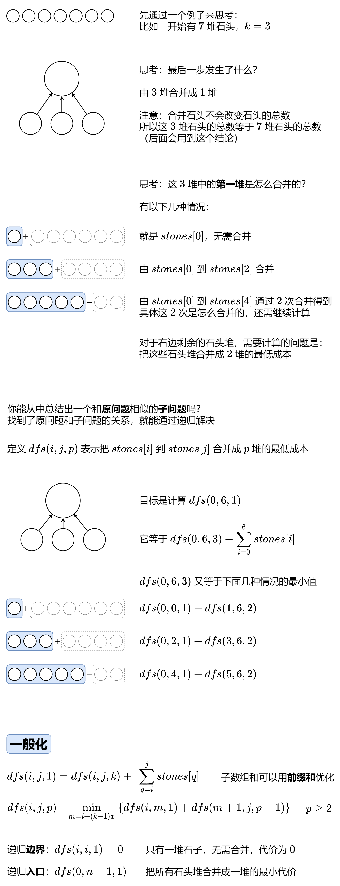
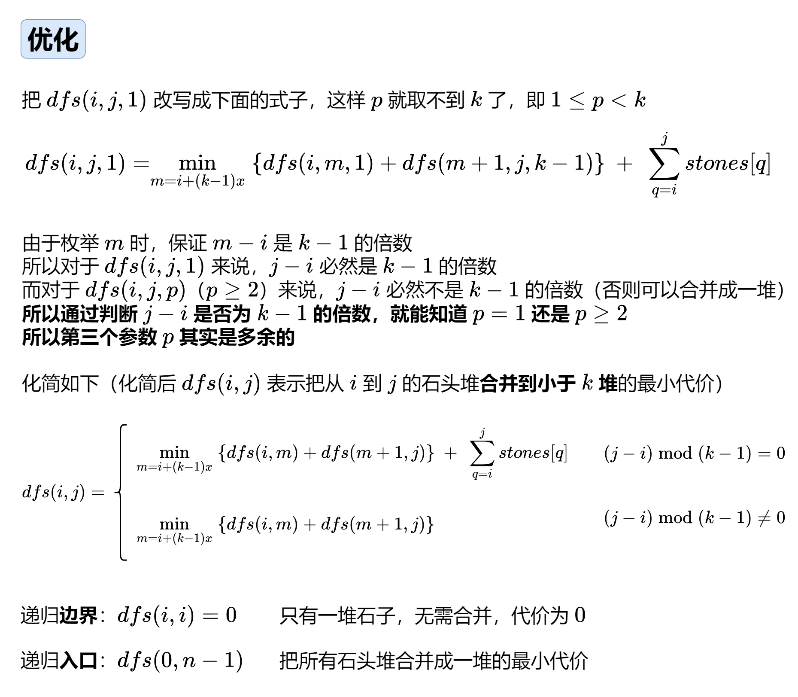

# 【图解】区间 DP：状态设计与优化（Python/Java/C++/Go）

> **[1000. 合并石头的最低成本](https://leetcode.cn/problems/minimum-cost-to-merge-stones/solutions/2207235/tu-jie-qu-jian-dpzhuang-tai-she-ji-yu-yo-ppv0/) · Hard · 难度分 2423**

> **所属题单**
> - [动态规划 · 八、区间 DP](../../../刷题路径/灵神原版题单/动态规划/八、区间%20DP.md) · §8.2 区间 DP

> **题目描述**
> 有 `n` 堆石头排成一排，第 `i` 堆中有 `stones[i]` 块石头。
>
> 每次 **移动** 需要将 **连续的** `k` 堆石头合并为一堆，而这次移动的成本为这 `k` 堆中石头的总数。
>
> 返回把所有石头合并成一堆的最低成本。如果无法合并成一堆，返回 `-1` 。
>
> **示例 1：**
>
> ```
>
> 输入：stones = [3,2,4,1], K = 2
> 输出：20
> 解释：
> 从 [3, 2, 4, 1] 开始。
> 合并 [3, 2]，成本为 5，剩下 [5, 4, 1]。
> 合并 [4, 1]，成本为 5，剩下 [5, 5]。
> 合并 [5, 5]，成本为 10，剩下 [10]。
> 总成本 20，这是可能的最小值。
> ```
>
> **示例 2：**
>
> ```
>
> 输入：stones = [3,2,4,1], K = 3
> 输出：-1
> 解释：任何合并操作后，都会剩下 2 堆，我们无法再进行合并。所以这项任务是不可能完成的。.
> ```
>
> **示例 3：**
>
> ```
>
> 输入：stones = [3,5,1,2,6], K = 3
> 输出：25
> 解释：
> 从 [3, 5, 1, 2, 6] 开始。
> 合并 [5, 1, 2]，成本为 8，剩下 [3, 8, 6]。
> 合并 [3, 8, 6]，成本为 17，剩下 [17]。
> 总成本 25，这是可能的最小值。
> ```
>
> **提示：**
>
> - `n == stones.length`
>
> - `1 <= n <= 30`
>
> - `1 <= stones[i] <= 100`
>
> - `2 <= k <= 30`

> **题解**
> ## 前置知识
>
> 1. [动态规划入门：从记忆化搜索到递推【基础算法精讲 17】](https://www.bilibili.com/video/BV1Xj411K7oF/)
> 2. [区间 DP【基础算法精讲 22】](https://www.bilibili.com/video/BV1Gs4y1E7EU/)
> 3. [前缀和原理](../../0300-0399/0303%20区域和检索%20-%20数组不可变/灵茶山艾府.md)
>
> ## 思路（优化前）
>
> 
>
> 什么时候输出 $-1$ 呢？
>
> 从 $n$ 堆变成 $1$ 堆，需要减少 $n-1$ 堆。而每次合并都会减少 $k-1$ 堆，所以 $n-1$ 必须是 $k-1$ 的倍数。
>
> 代码实现时，由于整个递归中有大量重复递归调用（递归入参相同），且递归函数没有副作用（同样的入参无论计算多少次，算出来的结果都是一样的），因此可以用**记忆化搜索**来优化：
>
> - 如果一个状态（递归入参）是第一次遇到，那么可以在返回前，把状态及其结果记到一个 $\textit{memo}$ 数组（或哈希表）中。
> - 如果一个状态不是第一次遇到，那么直接返回 $\textit{memo}$ 中保存的结果。
>
> ### 答疑
>
> **问**：为什么只考虑分出 $1$ 堆和 $p-1$ 堆，而不考虑分出 $x$ 堆和 $p-x$ 堆？
>
> **答**：无需计算，因为 $p-1$ 堆继续递归又可以分出 $1$ 堆和 $p-2$ 堆，和之前分出的 $1$ 堆组合，就已经能表达出「分出 $2$ 堆和 $p-2$ 堆」的情况了。其他同理。所以只需要考虑分出 $1$ 堆和 $p-1$ 堆。
>
> ```python
> class Solution:
>     def mergeStones(self, stones: List[int], k: int) -> int:
>         n = len(stones)
>         if (n - 1) % (k - 1):  # 无法合并成一堆
>             return -1
>         s = list(accumulate(stones, initial=0))  # 前缀和
>         @cache  # 缓存装饰器，避免重复计算 dfs 的结果
>         def dfs(i: int, j: int, p: int) -> int:
>             if p == 1:  # 合并成一堆
>                 return 0 if i == j else dfs(i, j, k) + s[j + 1] - s[i]
>             return min(dfs(i, m, 1) + dfs(m + 1, j, p - 1) for m in range(i, j, k - 1))
>         return dfs(0, n - 1, 1)
> ```
>
>
> #### 复杂度分析
>
> - 时间复杂度：$O(n^3)$，其中 $n$ 为 $\textit{stones}$ 的长度。动态规划的时间复杂度 $=$ 状态个数 $\times$ 单个状态的计算时间。这里状态个数为 $O(n^2k)$，单个状态的计算时间为 $O\left(\dfrac{n}{k}\right)$，因此时间复杂度为 $O(n^3)$。
> - 空间复杂度：$O(n^2k)$。
>
> 
>
> ```python
> class Solution:
>     def mergeStones(self, stones: List[int], k: int) -> int:
>         n = len(stones)
>         if (n - 1) % (k - 1):  # 无法合并成一堆
>             return -1
>         s = list(accumulate(stones, initial=0))  # 前缀和
>         @cache  # 缓存装饰器，避免重复计算 dfs 的结果
>         def dfs(i: int, j: int) -> int:
>             if i == j:  # 只有一堆石头，无需合并
>                 return 0
>             res = min(dfs(i, m) + dfs(m + 1, j) for m in range(i, j, k - 1))
>             if (j - i) % (k - 1) == 0:  # 可以合并成一堆
>                 res += s[j + 1] - s[i]
>             return res
>         return dfs(0, n - 1)
> ```
>
>
> ## 1:1 翻译成递推
>
> 把 $\textit{dfs}$ 改成 $f$ 数组，把递归改成循环就好了。相当于原来是用递归计算每个状态 $(i,j)$，现在改用循环去计算每个状态 $(i,j)$。
>
> 需要注意循环的顺序：
>
> - 由于 $i<m+1$，$f[i]$ 要能从 $f[m+1]$ 转移过来，必须先计算出 $f[m+1]$，所以 $i$ 要**倒序**枚举；
> - 由于 $j>m$，$f[i][j]$ 要能从 $f[i][m]$ 转移过来，必须先计算出 $f[i][m]$，所以 $j$ 要**正序**枚举。
>
> ```python
> class Solution:
>     def mergeStones(self, stones: List[int], k: int) -> int:
>         n = len(stones)
>         if (n - 1) % (k - 1):  # 无法合并成一堆
>             return -1
>         s = list(accumulate(stones, initial=0))  # 前缀和
>         f = [[0] * n for _ in range(n)]
>         for i in range(n - 1, -1, -1):
>             for j in range(i + 1, n):
>                 f[i][j] = min(f[i][m] + f[m + 1][j] for m in range(i, j, k - 1))
>                 if (j - i) % (k - 1) == 0:  # 可以合并成一堆
>                     f[i][j] += s[j + 1] - s[i]
>         return f[0][-1]
> ```
>
>
> #### 复杂度分析
>
> - 时间复杂度：$O\left(\dfrac{n^3}{k}\right)$，其中 $n$ 为 $\textit{stones}$ 的长度。动态规划的时间复杂度 $=$ 状态个数 $\times$ 单个状态的计算时间。这里状态个数为 $O(n^2)$，单个状态的计算时间为 $O\left(\dfrac{n}{k}\right)$，因此时间复杂度为 $O\left(\dfrac{n^3}{k}\right)$。
> - 空间复杂度：$O(n^2)$。
>
> ## 分类题单
>
> 以下题单没有特定的顺序，可以按照个人喜好刷题。
>
> 1. [滑动窗口（定长/不定长/多指针）](https://leetcode.cn/circle/discuss/0viNMK/)
> 2. [二分算法（二分答案/最小化最大值/最大化最小值/第K小）](https://leetcode.cn/circle/discuss/SqopEo/)
> 3. [单调栈（基础/矩形面积/贡献法/最小字典序）](https://leetcode.cn/circle/discuss/9oZFK9/)
> 4. [网格图（DFS/BFS/综合应用）](https://leetcode.cn/circle/discuss/YiXPXW/)
> 5. [位运算（基础/性质/拆位/试填/恒等式/贪心/脑筋急转弯）](https://leetcode.cn/circle/discuss/dHn9Vk/)
> 6. [图论算法（DFS/BFS/拓扑排序/最短路/最小生成树/二分图/基环树/欧拉路径）](https://leetcode.cn/circle/discuss/01LUak/)
> 7. [动态规划（入门/背包/状态机/划分/区间/状压/数位/数据结构优化/树形/博弈/概率期望）](https://leetcode.cn/circle/discuss/tXLS3i/)
> 8. [常用数据结构（前缀和/差分/栈/队列/堆/字典树/并查集/树状数组/线段树）](https://leetcode.cn/circle/discuss/mOr1u6/)
> 9. [数学算法（数论/组合/概率期望/博弈/计算几何/随机算法）](https://leetcode.cn/circle/discuss/IYT3ss/)
> 10. [贪心算法（基本贪心策略/反悔/区间/字典序/数学/思维/构造）](https://leetcode.cn/circle/discuss/g6KTKL/)
>
> [我的题解精选（已分类）](https://github.com/EndlessCheng/codeforces-go/blob/master/leetcode/SOLUTIONS.md)
>
> 欢迎关注 [B站@灵茶山艾府](https://space.bilibili.com/206214)
