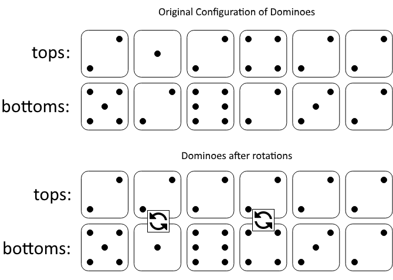

# 都变成 tops[0] 或者 bottoms[0]（Python/Java/C++/C/Go/JS/Rust）

> **[1007. 行相等的最少多米诺旋转](https://leetcode.cn/problems/minimum-domino-rotations-for-equal-row/solutions/3042326/du-bian-cheng-tops0-huo-zhe-bottoms0pyth-zvnj/) · Medium · 难度分 1541**

> **所属题单**
> - [贪心算法 · 五、思维题](../../../刷题路径/灵神原版题单/贪心算法/五、思维题.md) · §5.2 脑筋急转弯

> **题目描述**
> 在一排多米诺骨牌中，`tops[i]` 和 `bottoms[i]` 分别代表第 `i` 个多米诺骨牌的上半部分和下半部分。（一个多米诺是两个从 1 到 6 的数字同列平铺形成的 —— 该平铺的每一半上都有一个数字。）
>
> 我们可以旋转第 `i` 张多米诺，使得 `tops[i]` 和 `bottoms[i]` 的值交换。
>
> 返回能使 `tops` 中所有值或者 `bottoms` 中所有值都相同的最小旋转次数。
>
> 如果无法做到，返回 `-1`.
>
> **示例 1：**
>
> 
>
> ```
>
> 输入：tops = [2,1,2,4,2,2], bottoms = [5,2,6,2,3,2]
> 输出：2
> 解释：
> 图一表示：在我们旋转之前， tops 和 bottoms 给出的多米诺牌。
> 如果我们旋转第二个和第四个多米诺骨牌，我们可以使上面一行中的每个值都等于 2，如图二所示。
> ```
>
> **示例 2：**
>
> ```
>
> 输入：tops = [3,5,1,2,3], bottoms = [3,6,3,3,4]
> 输出：-1
> 解释： 在这种情况下，不可能旋转多米诺牌使一行的值相等。
> ```
>
> **提示：**
>
> - `2 <= tops.length <= 2 * 10⁴`
>
> - `bottoms.length == tops.length`
>
> - `1 <= tops[i], bottoms[i] <= 6`

> **题解**
> 目标是让第一排或者第二排的所有数都相同，这个「所有」必然包含**第一个骨牌中的数**。所以要么都变成 $\textit{tops}[0]$，要么都变成 $\textit{bottoms}[0]$。计算这两种情况，取最小值。
>
> 写一个函数 $\text{minRot}(\textit{target})$，表示都变成 $\textit{target}$ 的最小旋转次数。我们要计算的是 $\min(\text{minRot}(\textit{tops}[0]),\text{minRot}(\textit{bottoms}[0]))$。
>
> 定义变量 $\textit{toTop}$，表示把第一排（上半）都变成 $\textit{target}$ 的最小旋转次数，初始值为 $0$。
>
> 定义变量 $\textit{toBottom}$，表示把第二排（下半）都变成 $\textit{target}$ 的最小旋转次数，初始值为 $0$。
>
> 遍历骨牌，设 $x=\textit{tops}[i]$ 和 $y=\textit{bottoms}[i]$，分类讨论：
>
> - 如果 $x\ne \textit{target}$ 且 $y\ne \textit{target}$，无法满足要求，返回 $\infty$。
> - 如果 $x\ne \textit{target}$ 且 $y= \textit{target}$，旋转到上半的次数 $\textit{toTop}$ 加一。
> - 如果 $x= \textit{target}$ 且 $y\ne \textit{target}$，旋转到下半的次数 $\textit{toBottom}$ 加一。
> - 如果 $x= \textit{target}$ 且 $y= \textit{target}$，无需旋转。
>
> 遍历结束，都变成 $\textit{target}$ 的最小旋转次数为 $\min(\textit{toTop},\textit{toBottom})$，即 $\text{minRot}(\textit{target})$ 的返回值。
>
> 如果 $\min(\text{minRot}(\textit{tops}[0]),\text{minRot}(\textit{bottoms}[0]))=\infty$，说明两种情况都无法满足要求，返回 $-1$。
>
> ```python
> class Solution:
>     def minDominoRotations(self, tops: List[int], bottoms: List[int]) -> int:
>         def min_rot(target: int) -> int:
>             to_top = to_bottom = 0
>             for x, y in zip(tops, bottoms):
>                 if x != target and y != target:
>                     return inf
>                 if x != target:
>                     to_top += 1  # 把 y 旋转到上半
>                 elif y != target:
>                     to_bottom += 1  # 把 x 旋转到下半
>             return min(to_top, to_bottom)
>
>         ans = min(min_rot(tops[0]), min_rot(bottoms[0]))
>         return -1 if ans == inf else ans
> ```
>
>
> #### 复杂度分析
>
> - 时间复杂度：$\mathcal{O}(n)$，其中 $n$ 是 $\textit{tops}$ 的长度。
> - 空间复杂度：$\mathcal{O}(1)$。
>
> ## 思考题
>
> 如果可以去掉一块多米诺骨牌呢？
>
> 欢迎在评论区发表你的思路/代码。
>
> ## 分类题单
>
> [如何科学刷题？](https://leetcode.cn/circle/discuss/RvFUtj/)
>
> 1. [滑动窗口与双指针（定长/不定长/单序列/双序列/三指针/分组循环）](https://leetcode.cn/circle/discuss/0viNMK/)
> 2. [二分算法（二分答案/最小化最大值/最大化最小值/第K小）](https://leetcode.cn/circle/discuss/SqopEo/)
> 3. [单调栈（基础/矩形面积/贡献法/最小字典序）](https://leetcode.cn/circle/discuss/9oZFK9/)
> 4. [网格图（DFS/BFS/综合应用）](https://leetcode.cn/circle/discuss/YiXPXW/)
> 5. [位运算（基础/性质/拆位/试填/恒等式/思维）](https://leetcode.cn/circle/discuss/dHn9Vk/)
> 6. [图论算法（DFS/BFS/拓扑排序/基环树/最短路/最小生成树/网络流）](https://leetcode.cn/circle/discuss/01LUak/)
> 7. [动态规划（入门/背包/划分/状态机/区间/状压/数位/数据结构优化/树形/博弈/概率期望）](https://leetcode.cn/circle/discuss/tXLS3i/)
> 8. [常用数据结构（前缀和/差分/栈/队列/堆/字典树/并查集/树状数组/线段树）](https://leetcode.cn/circle/discuss/mOr1u6/)
> 9. [数学算法（数论/组合/概率期望/博弈/计算几何/随机算法）](https://leetcode.cn/circle/discuss/IYT3ss/)
> 10. [贪心与思维（基本贪心策略/反悔/区间/字典序/数学/思维/脑筋急转弯/构造）](https://leetcode.cn/circle/discuss/g6KTKL/)
> 11. [链表、二叉树与回溯（前后指针/快慢指针/DFS/BFS/直径/LCA/一般树）](https://leetcode.cn/circle/discuss/K0n2gO/)
> 12. [字符串（KMP/Z函数/Manacher/字符串哈希/AC自动机/后缀数组/子序列自动机）](https://leetcode.cn/circle/discuss/SJFwQI/)
>
> [我的题解精选（已分类）](https://github.com/EndlessCheng/codeforces-go/blob/master/leetcode/SOLUTIONS.md)
>
> 欢迎关注 [B站@灵茶山艾府](https://space.bilibili.com/206214)
