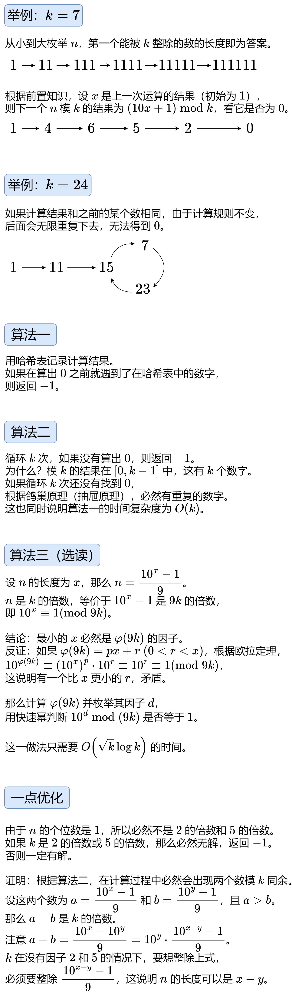

# 三种算法+优化（Python/Java/C++/Go）

> **[1015. 可被 K 整除的最小整数](https://leetcode.cn/problems/smallest-integer-divisible-by-k/solutions/2263780/san-chong-suan-fa-you-hua-pythonjavacgo-tk4cj/) · Medium**

> **所属题单**
> - [链表、二叉树与回溯 · 一、链表](../../../刷题路径/灵神原版题单/链表、二叉树与回溯/一、链表.md) · §1.6 快慢指针
> - [数学算法 · 一、数论](../../../刷题路径/灵神原版题单/数学算法/一、数论.md) · §1.12 其他

> **题目描述**
> 给定正整数 `k` ，你需要找出可以被 `k` 整除的、仅包含数字 `1` 的最 **小** 正整数 `n` 的长度。
>
> 返回 `n` 的长度。如果不存在这样的 `n` ，就返回-1。
>
> **注意：** `n` 可能不符合 64 位带符号整数。
>
> **示例 1：**
>
> ```
>
> 输入：k = 1
> 输出：1
> 解释：最小的答案是 n = 1，其长度为 1。
> ```
>
> **示例 2：**
>
> ```
>
> 输入：k = 2
> 输出：-1
> 解释：不存在可被 2 整除的正整数 n 。
> ```
>
> **示例 3：**
>
> ```
>
> 输入：k = 3
> 输出：3
> 解释：最小的答案是 n = 111，其长度为 3。
> ```
>
> **提示：**
>
> - `1 <= k <= 10⁵`

> **题解**
> ## 前置知识：模运算
>
> 如果让你计算 $1234\cdot 6789$ 的**个位数**，你会如何计算？
>
> 由于只有个位数会影响到乘积的个位数，那么 $4\cdot 9=36$ 的个位数 $6$ 就是答案。
>
> 对于 $1234+6789$ 的个位数，同理，$4+9=13$ 的个位数 $3$ 就是答案。
>
> 你能把这个结论抽象成数学等式吗？
>
> 一般地，涉及到取模的题目，通常会用到如下等式（上面计算的是 $m=10$）：
>
> $$
> (a+b)\bmod m = ((a\bmod m) + (b\bmod m)) \bmod m
> $$
>
> $$
> (a\cdot b) \bmod m=((a\bmod m)\cdot  (b\bmod m)) \bmod m
> $$
>
> 证明：根据**带余除法**，任意整数 $a$ 都可以表示为 $a=km+r$，这里 $r$ 相当于 $a\bmod m$。那么设 $a=k_1m+r_1,\ b=k_2m+r_2$。
>
> 第一个等式：
>
> $$
> \begin{aligned}
> &(a+b) \bmod m\\
> =&((k_1+k_2) m+r_1+r_2)\bmod m\\
> =&(r_1+r_2)\bmod m\\
> =&((a\bmod m) + (b\bmod m)) \bmod m
> \end{aligned}
> $$
>
> 第二个等式：
>
> $$
> \begin{aligned}
> &(a\cdot b) \bmod m\\
> =&(k_1k_2m^2+(k_1r_2+k_2r_1)m+r_1r_2)\bmod m\\
> =&(r_1r_2)\bmod m\\
> =&((a\bmod m)\cdot  (b\bmod m)) \bmod m
> \end{aligned}
> $$
>
> 更多有关模运算的知识，请看 [模运算的世界：当加减乘除遇上取模](https://leetcode.cn/circle/discuss/mDfnkW/)。
>
> ## 思路
>
> 
>
> ### 算法一（无优化）
>
> ```python
> class Solution:
>     def smallestRepunitDivByK(self, k: int) -> int:
>         seen = set()
>         x = 1 % k
>         while x and x not in seen:
>             seen.add(x)
>             x = (x * 10 + 1) % k
>         return -1 if x else len(seen) + 1
> ```
>
>
> #### 复杂度分析
>
> - 时间复杂度：$\mathcal{O}(k)$。
> - 空间复杂度：$\mathcal{O}(k)$。
>
> ### 算法二+优化
>
> ```python
> class Solution:
>     def smallestRepunitDivByK(self, k: int) -> int:
>         if k % 2 == 0 or k % 5 == 0:
>             return -1
>         x = 1 % k
>         for i in count(1):  # 一定有解
>             if x == 0:
>                 return i
>             x = (x * 10 + 1) % k
> ```
>
>
> #### 复杂度分析
>
> - 时间复杂度：$\mathcal{O}(k)$。
> - 空间复杂度：$\mathcal{O}(1)$。
>
> ### 算法三
>
> ```python
> # 计算欧拉函数（n 以内的与 n 互质的数的个数）
> def phi(n: int) -> int:
>     res = n
>     i = 2
>     while i * i <= n:
>         if n % i == 0:
>             res = res // i * (i - 1)
>             while n % i == 0:
>                 n //= i
>         i += 1
>     if n > 1:
>         res = res // n * (n - 1)
>     return res
>
> class Solution:
>     def smallestRepunitDivByK(self, k: int) -> int:
>         if k % 2 == 0 or k % 5 == 0:
>             return -1
>
>         m = phi(k * 9)
>
>         # 从小到大枚举不超过 sqrt(m) 的因子
>         i = 1
>         while i * i <= m:
>             if m % i == 0 and pow(10, i, k * 9) == 1:
>                 return i
>             i += 1
>
>         # 从小到大枚举不低于 sqrt(m) 的因子
>         i -= 1
>         while True:
>             if m % i == 0 and pow(10, m // i, k * 9) == 1:
>                 return m // i
>             i -= 1
> ```
>
>
> #### 复杂度分析
>
> - 时间复杂度：$\mathcal{O}(\sqrt{k}\log k)$。计算 $\varphi(9k)$ 和枚举 $\varphi(9k)$ 的因子都需要 $\mathcal{O}(\sqrt{k})$ 的时间，对每个因子计算快速幂需要 $\mathcal{O}(\log k)$ 的时间，所以时间复杂度为 $\mathcal{O}(\sqrt{k}\log k)$。
> - 空间复杂度：$\mathcal{O}(1)$。
>
> ### 思考题
>
> 对于算法三，把题目中的 $1$ 改成 $2$ 要怎么做？改成其它数字要怎么做？
>
> 欢迎在评论区分享你的思路/代码。
>
> ## 分类题单
>
> [如何科学刷题？](https://leetcode.cn/circle/discuss/RvFUtj/)
>
> 1. [滑动窗口与双指针（定长/不定长/单序列/双序列/三指针/分组循环）](https://leetcode.cn/circle/discuss/0viNMK/)
> 2. [二分算法（二分答案/最小化最大值/最大化最小值/第K小）](https://leetcode.cn/circle/discuss/SqopEo/)
> 3. [单调栈（基础/矩形面积/贡献法/最小字典序）](https://leetcode.cn/circle/discuss/9oZFK9/)
> 4. [网格图（DFS/BFS/综合应用）](https://leetcode.cn/circle/discuss/YiXPXW/)
> 5. [位运算（基础/性质/拆位/试填/恒等式/思维）](https://leetcode.cn/circle/discuss/dHn9Vk/)
> 6. [图论算法（DFS/BFS/拓扑排序/基环树/最短路/最小生成树/网络流）](https://leetcode.cn/circle/discuss/01LUak/)
> 7. [动态规划（入门/背包/划分/状态机/区间/状压/数位/数据结构优化/树形/博弈/概率期望）](https://leetcode.cn/circle/discuss/tXLS3i/)
> 8. [常用数据结构（前缀和/差分/栈/队列/堆/字典树/并查集/树状数组/线段树）](https://leetcode.cn/circle/discuss/mOr1u6/)
> 9. [数学算法（数论/组合/概率期望/博弈/计算几何/随机算法）](https://leetcode.cn/circle/discuss/IYT3ss/)
> 10. [贪心与思维（基本贪心策略/反悔/区间/字典序/数学/思维/脑筋急转弯/构造）](https://leetcode.cn/circle/discuss/g6KTKL/)
> 11. [链表、树与回溯（前后指针/快慢指针/DFS/BFS/直径/LCA）](https://leetcode.cn/circle/discuss/K0n2gO/)
> 12. [字符串（KMP/Z函数/Manacher/字符串哈希/AC自动机/后缀数组/子序列自动机）](https://leetcode.cn/circle/discuss/SJFwQI/)
>
> [我的题解精选（已分类）](https://github.com/EndlessCheng/codeforces-go/blob/master/leetcode/SOLUTIONS.md)
>
> 欢迎关注 [B站@灵茶山艾府](https://space.bilibili.com/206214)
