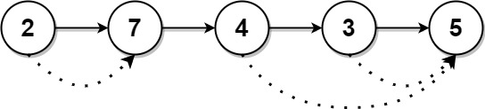

# 1019. 链表中的下一个更大节点

Medium · 难度分 1571 · [力扣原题](https://leetcode.cn/problems/next-greater-node-in-linked-list/)

所在刷题路径：灵神题单·单调栈、灵神题单·链表树与回溯

| 作者 | 题解 | 动画讲解 |
|---|---|---|
| 灵茶山艾府 | [📄 题解](灵茶山艾府.md) | [▶︎ 动画（GIF）](1019%20链表中的下一个更大节点%20·%20灵茶山艾府.gif) · [mp4 文件](1019%20链表中的下一个更大节点%20·%20灵茶山艾府.mp4) |
| yiduobo | [📄 题解](yiduobo.md) | [▶︎ 动画（GIF）](1019%20链表中的下一个更大节点%20·%20yiduobo.gif) · [mp4 文件](1019%20链表中的下一个更大节点%20·%20yiduobo.mp4) |

## 动画讲解

> 动图会循环播放；想暂停、拖进度条请下载上面表格里的 mp4 文件。

### 灵茶山艾府


### yiduobo


## 题目描述

给定一个长度为 `n` 的链表 `head`

对于列表中的每个节点，查找下一个 **更大节点** 的值。也就是说，对于每个节点，找到它旁边的第一个节点的值，这个节点的值 **严格大于** 它的值。

返回一个整数数组 `answer` ，其中 `answer[i]` 是第 `i` 个节点( **从1开始** )的下一个更大的节点的值。如果第 `i` 个节点没有下一个更大的节点，设置 `answer[i] = 0` 。

**示例 1：**


```

输入：head = [2,1,5]
输出：[5,5,0]
```

**示例 2：**



```

输入：head = [2,7,4,3,5]
输出：[7,0,5,5,0]
```

**提示：**

- 链表中节点数为 `n`

- `1 <= n <= 10⁴`

- `1 <= Node.val <= 10⁹`

---
[↑ 返回 1000-1099](../README.md) · [总索引](../../../索引.md) · [仓库首页](../../../README.md)
