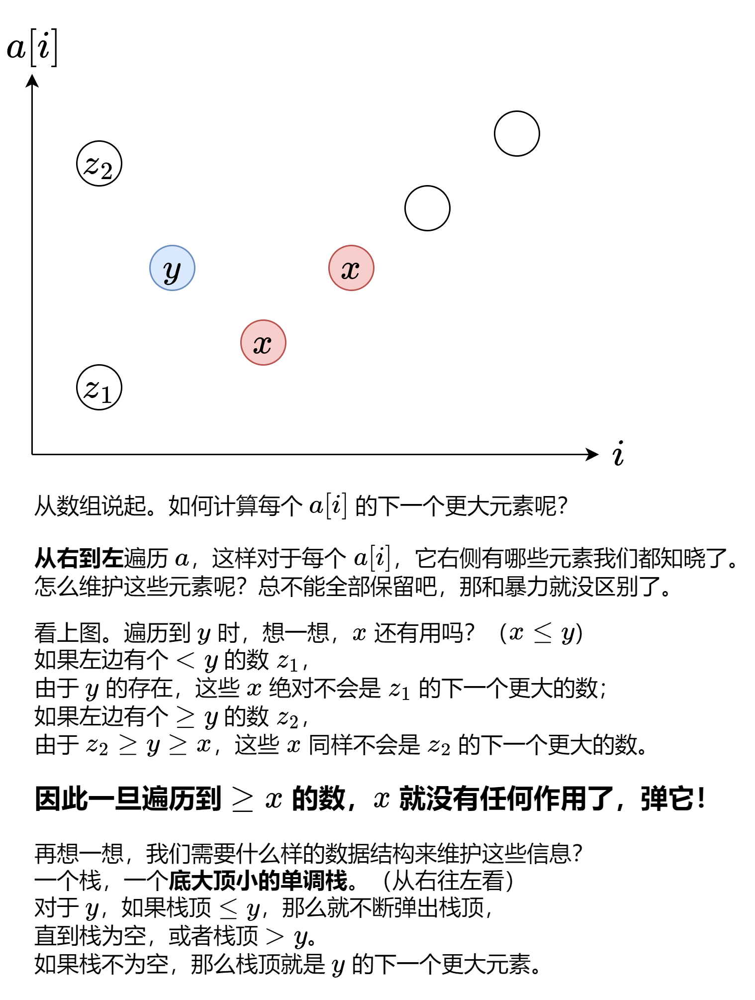
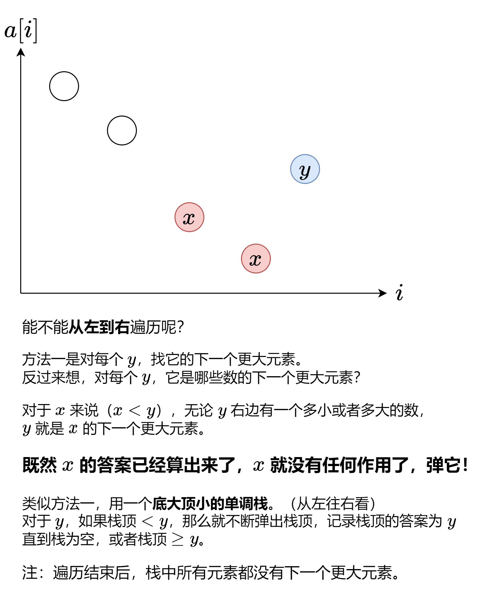

# 【图解单调栈】两种方法，两张图秒懂！附题单（Python/Java/C++/Go）

> **[1019. 链表中的下一个更大节点](https://leetcode.cn/problems/next-greater-node-in-linked-list/solutions/2217563/tu-jie-dan-diao-zhan-liang-chong-fang-fa-v9ab/) · Medium · 难度分 1571**

> **所属题单**
> - [链表、二叉树与回溯 · 一、链表](../../../刷题路径/灵神原版题单/链表、二叉树与回溯/一、链表.md) · §1.10 综合应用
> - [单调栈 · 一、单调栈](../../../刷题路径/灵神原版题单/单调栈/一、单调栈.md) · §1.2 进阶

> **题目描述**
> 给定一个长度为 `n` 的链表 `head`
>
> 对于列表中的每个节点，查找下一个 **更大节点** 的值。也就是说，对于每个节点，找到它旁边的第一个节点的值，这个节点的值 **严格大于** 它的值。
>
> 返回一个整数数组 `answer` ，其中 `answer[i]` 是第 `i` 个节点( **从1开始** )的下一个更大的节点的值。如果第 `i` 个节点没有下一个更大的节点，设置 `answer[i] = 0` 。
>
> **示例 1：**
>
> 
>
> ```
>
> 输入：head = [2,1,5]
> 输出：[5,5,0]
> ```
>
> **示例 2：**
>
> 
>
> ```
>
> 输入：head = [2,7,4,3,5]
> 输出：[7,0,5,5,0]
> ```
>
> **提示：**
>
> - 链表中节点数为 `n`
>
> - `1 <= n <= 10⁴`
>
> - `1 <= Node.val <= 10⁹`

> **题解**
> ## 方法一：对每个数，寻找它下一个更大元素
>
> 
>
> 对于链表来说，我们可以从头节点开始递归，在「归」的过程中，就相当于是从右到左遍历链表了。
>
> ```python
> class Solution:
>     def nextLargerNodes(self, head: Optional[ListNode]) -> List[int]:
>         ans = []
>         st = []  # 单调栈（节点值）
>         def f(node: Optional[ListNode], i: int) -> None:
>             if node is None:
>                 nonlocal ans
>                 ans = [0] * i  # i 就是链表长度
>                 return
>             f(node.next, i + 1)
>             while st and st[-1] <= node.val:
>                 st.pop()  # 弹出无用数据
>             if st:
>                 ans[i] = st[-1]  # 栈顶就是第 i 个节点的下一个更大元素
>             st.append(node.val)
>         f(head, 0)
>         return ans
> ```
>
>
> 不想写递归？也可以反转链表后，从头节点开始遍历。
>
> 如何反转链表？见[【基础算法精讲 06】](https://www.bilibili.com/video/BV1sd4y1x7KN/)。
>
> ```python
> class Solution:
>     # 206. 反转链表
>     def reverseList(self, head: Optional[ListNode]) -> Optional[ListNode]:
>         pre = None
>         cur = head
>         while cur:
>             nxt = cur.next
>             cur.next = pre
>             pre = cur
>             cur = nxt
>         return pre
>
>     def nextLargerNodes(self, head: Optional[ListNode]) -> List[int]:
>         head = self.reverseList(head)
>         ans = []
>         st = []  # 单调栈（节点值）
>         while head:
>             while st and st[-1] <= head.val:
>                 st.pop()  # 弹出无用数据
>             ans.append(st[-1] if st else 0)  # 栈顶就是第 i 个节点的下一个更大元素
>             st.append(head.val)
>             head = head.next
>         return ans[::-1]  # 由于是倒着记录答案的，返回前要把答案反转
> ```
>
>
> ### 复杂度分析
>
> - 时间复杂度：$O(n)$，其中 $n$ 为链表的长度。虽然我们写了个二重循环，但站在每个元素的视角看，这个元素在二重循环中最多入栈出栈各一次，因此整个二重循环的时间复杂度为 $O(n)$。
> - 空间复杂度：$O(n)$。单调栈中最多有 $O(n)$ 个数。
>
> # 方法二：用每个数，更新其它数的下一个更大元素
>
> 
>
> 由于记录答案需要元素的下标，所以栈中除了保存元素值以外，还需要保存元素的下标。
>
> ```python
> class Solution:
>     def nextLargerNodes(self, head: Optional[ListNode]) -> List[int]:
>         ans = []
>         st = []  # 单调栈（节点值，节点下标）
>         while head:
>             while st and st[-1][0] < head.val:
>                 ans[st.pop()[1]] = head.val  # 用当前节点值更新答案
>             st.append((head.val, len(ans)))  # 当前 ans 的长度就是当前节点的下标
>             ans.append(0)  # 占位
>             head = head.next
>         return ans
> ```
>
>
> ### 优化
>
> 把第 $i$ 个节点的值记录到 $\textit{ans}[i]$，这样栈中就可以只保存下标了。
>
> 在循环结束后，栈中下标对应元素是没有下一个更大元素的，所以要把栈中的下标对应的 $\textit{ans}$ 置为 $0$。
>
> ```python
> class Solution:
>     def nextLargerNodes(self, head: Optional[ListNode]) -> List[int]:
>         ans = []
>         st = []  # 单调栈（节点下标）
>         while head:
>             while st and ans[st[-1]] < head.val:
>                 ans[st.pop()] = head.val  # ans[st.pop()] 后面不会再访问到了
>             st.append(len(ans))  # 当前 ans 的长度就是当前节点的下标
>             ans.append(head.val)
>             head = head.next
>         for i in st:
>             ans[i] = 0  # 没有下一个更大元素
>         return ans
> ```
>
>
> ### 复杂度分析
>
> - 时间复杂度：$O(n)$，其中 $n$ 为链表的长度。虽然我们写了个二重循环，但站在每个元素的视角看，这个元素在二重循环中最多入栈出栈各一次，因此整个二重循环的时间复杂度为 $O(n)$。
> - 空间复杂度：$O(n)$。单调栈中最多有 $O(n)$ 个数。
>
> ### 强化训练
>
> 另外附一些单调栈/单调队列的题目。
>
> 做题时，无论题目变成什么样，请记住一个核心原则：**及时移除无用数据，保证栈/队列的有序性**。
>
> #### 单调栈
>
> - [496. 下一个更大元素 I](https://leetcode.cn/problems/next-greater-element-i/)（单调栈模板题）
> - [503. 下一个更大元素 II](https://leetcode.cn/problems/next-greater-element-ii/)
> - [2454. 下一个更大元素 IV](https://leetcode.cn/problems/next-greater-element-iv/)
> - [456. 132 模式](https://leetcode.cn/problems/132-pattern/)
> - [739. 每日温度](https://leetcode.cn/problems/daily-temperatures/)
> - [901. 股票价格跨度](https://leetcode.cn/problems/online-stock-span/)
> - [1019. 链表中的下一个更大节点](https://leetcode.cn/problems/next-greater-node-in-linked-list/)
> - [1124. 表现良好的最长时间段](https://leetcode.cn/problems/longest-well-performing-interval/)
> - [1475. 商品折扣后的最终价格](https://leetcode.cn/problems/final-prices-with-a-special-discount-in-a-shop/)
> - [2289. 使数组按非递减顺序排列](https://leetcode.cn/problems/steps-to-make-array-non-decreasing/)
>
> #### 矩形系列
>
> - [84. 柱状图中最大的矩形](https://leetcode.cn/problems/largest-rectangle-in-histogram/)
> - [85. 最大矩形](https://leetcode.cn/problems/maximal-rectangle/)
> - [1504. 统计全 1 子矩形](https://leetcode.cn/problems/count-submatrices-with-all-ones/)
>
> #### 字典序最小
>
> - [316. 去除重复字母](https://leetcode.cn/problems/remove-duplicate-letters/)
> - [316 扩展：重复个数不超过一个定值](https://leetcode.cn/contest/tianchi2022/problems/ev2bru/)
> - [402. 移掉 K 位数字](https://leetcode.cn/problems/remove-k-digits/)
> - [321. 拼接最大数](https://leetcode.cn/problems/create-maximum-number/)
>
> #### 贡献法
>
> - [907. 子数组的最小值之和](https://leetcode.cn/problems/sum-of-subarray-minimums/)
> - [1856. 子数组最小乘积的最大值](https://leetcode.cn/problems/maximum-subarray-min-product/)
> - [2104. 子数组范围和](https://leetcode.cn/problems/sum-of-subarray-ranges/)
> - [2281. 巫师的总力量和](https://leetcode.cn/problems/sum-of-total-strength-of-wizards/)
>
> #### 单调队列
>
> 原理见 [两张图秒懂单调队列](../../0800-0899/0862%20和至少为%20K%20的最短子数组/灵茶山艾府.md)。
>
> - [面试题 59-II. 队列的最大值](https://leetcode.cn/problems/dui-lie-de-zui-da-zhi-lcof/)（单调队列模板题）
> - [239. 滑动窗口最大值](https://leetcode.cn/problems/sliding-window-maximum/)
> - [862. 和至少为 K 的最短子数组](https://leetcode.cn/problems/shortest-subarray-with-sum-at-least-k/)
> - [1438. 绝对差不超过限制的最长连续子数组](https://leetcode.cn/problems/longest-continuous-subarray-with-absolute-diff-less-than-or-equal-to-limit/)
>
> 附：[每日一题·高质量题解精选](https://github.com/EndlessCheng/codeforces-go/blob/master/leetcode/SOLUTIONS.md)
>
> ---
>
> 欢迎关注[【biIibiIi@灵茶山艾府】](https://space.bilibili.com/206214)，高质量算法教学，持续更新中~
