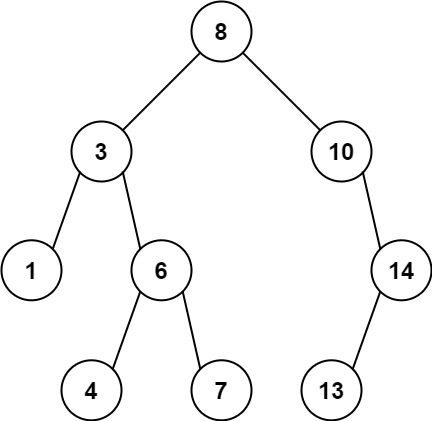
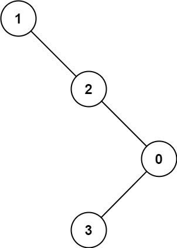

# 两种方法：自顶向下/自底向上（Python/Java/C++/Go）

> **[1026. 节点与其祖先之间的最大差值](https://leetcode.cn/problems/maximum-difference-between-node-and-ancestor/solutions/2232367/liang-chong-fang-fa-zi-ding-xiang-xia-zi-wj9v/) · Medium · 难度分 1446**

> **所属题单**
> - [链表、二叉树与回溯 · 二、二叉树](../../../刷题路径/灵神原版题单/链表、二叉树与回溯/二、二叉树.md) · §2.2 自顶向下 DFS（先序遍历）
> - [链表、二叉树与回溯 · 二、二叉树](../../../刷题路径/灵神原版题单/链表、二叉树与回溯/二、二叉树.md) · §2.3 自底向上 DFS（后序遍历）

> **题目描述**
> 给定二叉树的根节点 `root`，找出存在于 **不同** 节点 `A` 和 `B` 之间的最大值 `V`，其中 `V = |A.val - B.val|`，且 `A` 是 `B` 的祖先。
>
> （如果 A 的任何子节点之一为 B，或者 A 的任何子节点是 B 的祖先，那么我们认为 A 是 B 的祖先）
>
> **示例 1：**
>
> 
>
> ```
>
> 输入：root = [8,3,10,1,6,null,14,null,null,4,7,13]
> 输出：7
> 解释：
> 我们有大量的节点与其祖先的差值，其中一些如下：
> |8 - 3| = 5
> |3 - 7| = 4
> |8 - 1| = 7
> |10 - 13| = 3
> 在所有可能的差值中，最大值 7 由 |8 - 1| = 7 得出。
> ```
>
> **示例 2：**
>
> 
>
> ```
>
> 输入：root = [1,null,2,null,0,3]
> 输出：3
> ```
>
> **提示：**
>
> - 树中的节点数在 `2` 到 `5000` 之间。
>
> - `0 <= Node.val <= 10⁵`

> **题解**
> ## 核心思路
>
> 题目让我们计算两个节点值的最大绝对差，考虑**枚举**其中一个节点，那么只需要知道另一个节点值的最大值和最小值就够了。
>
> 注意这两个节点需要满足祖先后代关系，通俗地说，就是一个节点在上面，另一个节点在下面。
>
> 这引出了两种做法：
>
> - 方法一，枚举下面的节点 $B$，同时维护上面的节点值的最大值和最小值。什么是上面？就是从根到 $B$ 路径中的节点。
> - 方法二，枚举上面的节点 $A$，同时维护下面的节点值的最大值和最小值。什么是下面？就是子树 $A$ 中的节点。
>
> > 注：虽然题目要求「不同节点」，但由于我们计算的是差值（这是个非负数），而相同节点算出来的差值为 $0$，所以相同节点不影响**最大的**差值。
>
> ## 方法一：「递」
>
> 如果节点 $A$ 在从根节点到节点 $B$ 的路径上，我们称 $A$ 是 $B$ 的**祖先**节点，称 $B$ 是 $A$ 的**子孙**节点。
>
> > 注：在这个定义中，$B$ 的祖先节点可以是 $B$ 自己。例如示例 1 中 $6$ 的祖先节点自上而下依次为 $8,3,6$。
>
> 为了计算 $A$ 和 $B$ 的最大差值，是否需要记录从根到 $B$ 这条路径上的所有节点值？
>
> 对于题目给出的公式 $V = |A.\textit{val} - B.\textit{val}|$，为了让 $V$ 尽量大，分类讨论：
>
> - 如果 $A.\textit{val} < B.\textit{val}$，那么 $A.\textit{val}$ 越小，$V$ 越大。
> - 如果 $A.\textit{val} \ge B.\textit{val}$，那么 $A.\textit{val}$ 越大，$V$ 越大；
>
> 因此，无需记录路径中的全部节点值，只需记录路径中的最小节点值 $\textit{mn}$ 和最大节点值 $\textit{mx}$。
>
> 每递归到一个节点 $B$，计算
>
> $$
> \max(|\textit{mn}-B.\textit{val}|,|\textit{mx}-B.\textit{val}|)
> $$
>
> 并更新答案的最大值。
>
> 由于 $\textit{mn}\le B.\textit{val} \le \textit{mx}$，上式可化简为
>
> $$
> \max(B.\textit{val}-\textit{mn},\textit{mx}-B.\textit{val})
> $$
>
> 晕递归的同学，可以看视频讲解[【基础算法精讲 09】](https://www.bilibili.com/video/BV1UD4y1Y769/)，制作不易，欢迎点赞关注~
>
> ```python
> class Solution:
>     def maxAncestorDiff(self, root: Optional[TreeNode]) -> int:
>         ans = 0
>         def dfs(node: Optional[TreeNode], mn: int, mx: int) -> None:
>             if node is None: return
>             # 虽然题目要求「不同节点」，但是相同节点的差值为 0，不会影响最大差值
>             # 所以先更新 mn 和 mx，再计算差值也是可以的
>             # 在这种情况下，一定满足 mn <= node.val <= mx
>             mn = min(mn, node.val)
>             mx = max(mx, node.val)
>             nonlocal ans
>             ans = max(ans, node.val - mn, mx - node.val)
>             dfs(node.left, mn, mx)
>             dfs(node.right, mn, mx)
>         dfs(root, root.val, root.val)
>         return ans
> ```
>
>
> ### 优化
>
> 换个角度看问题：对于一条从根出发向下的路径，我们要计算的实际上是这条路径上**任意两点**的最大差值。
>
> 递归到叶子时，$\textit{mx}$ 是从根到叶子的路径上的最大值，$\textit{mn}$ 是从根到叶子的路径上的最小值，所以 $\textit{mx}-\textit{mn}$ 就是从根到叶子的路径上任意两点的最大差值。
>
> 所以无需每个节点都去更新答案，而是在递归到叶子时才去更新答案。
>
> 也可以在空节点处更新答案，写起来更简单。
>
> ```python
> class Solution:
>     def maxAncestorDiff(self, root: Optional[TreeNode]) -> int:
>         ans = 0
>         def dfs(node: Optional[TreeNode], mn: int, mx: int) -> None:
>             if node is None:
>                 nonlocal ans
>                 ans = max(ans, mx - mn)
>                 return
>             mn = min(mn, node.val)
>             mx = max(mx, node.val)
>             dfs(node.left, mn, mx)
>             dfs(node.right, mn, mx)
>         dfs(root, root.val, root.val)
>         return ans
> ```
>
>
> #### 复杂度分析
>
> - 时间复杂度：$\mathcal{O}(n)$，其中 $n$ 为二叉树的节点个数。
> - 空间复杂度：$\mathcal{O}(n)$。最坏情况下，二叉树退化成一条链，递归需要 $\mathcal{O}(n)$ 的栈空间。
>
> ## 方法二：「归」
>
> 方法一的思路是维护 $B$ 的祖先节点中的最小值和最大值，我们还可以站在祖先 $A$ 的视角，维护 $A$ 子孙节点中的最小值 $\textit{mn}$ 和最大值 $\textit{mx}$。
>
> 换句话说，最小值和最大值不再作为入参，而是作为返回值，意思是以 $A$ 为根的子树中的最小值 $\textit{mn}$ 和最大值 $\textit{mx}$。
>
> 递归到节点 $A$ 时，先递归左右子树，拿到左右子树的最小值和最大值。那么：
>
> - $\textit{mn}$ 等于当前节点值，左子树最小值，右子树最小值，这三者的最小值。
> - $\textit{mx}$ 等于当前节点值，左子树最大值，右子树最大值，这三者的最大值。
>
> 然后计算
>
> $$
> \max(|\textit{mn}-A.\textit{val}|,|\textit{mx}-A.\textit{val}|)
> $$
>
> 并更新答案的最大值。
>
> 由于 $\textit{mn}\le A.\textit{val} \le \textit{mx}$，上式可化简为
>
> $$
> \max(A.\textit{val}-\textit{mn},\textit{mx}-A.\textit{val})
> $$
>
> ```python
> class Solution:
>     def maxAncestorDiff(self, root: Optional[TreeNode]) -> int:
>         ans = 0
>         def dfs(node: Optional[TreeNode]) -> (int, int):
>             if node is None:
>                 return inf, -inf  # 保证空节点不影响 mn 和 mx
>             l_mn, l_mx = dfs(node.left)
>             r_mn, r_mx = dfs(node.right)
>             mn = min(node.val, l_mn, r_mn)
>             mx = max(node.val, l_mx, r_mx)
>             nonlocal ans
>             ans = max(ans, node.val - mn, mx - node.val)
>             return mn, mx
>         dfs(root)
>         return ans
> ```
>
>
> #### 复杂度分析
>
> - 时间复杂度：$\mathcal{O}(n)$，其中 $n$ 为二叉树的节点个数。
> - 空间复杂度：$\mathcal{O}(n)$。最坏情况下，二叉树退化成一条链，递归需要 $\mathcal{O}(n)$ 的栈空间。
>
> ## 练习
>
> 用「递」和「归」两种思路，解决如下题目：
>
> - [104. 二叉树的最大深度](https://leetcode.cn/problems/maximum-depth-of-binary-tree/) | [视频讲解](https://www.bilibili.com/video/BV1UD4y1Y769/)
> - [98. 验证二叉搜索树](https://leetcode.cn/problems/validate-binary-search-tree/) | [视频讲解](https://www.bilibili.com/video/BV14G411P7C1/)
>
> ## 分类题单
>
> [如何科学刷题？](https://leetcode.cn/circle/discuss/RvFUtj/)
>
> 1. [滑动窗口与双指针（定长/不定长/单序列/双序列/三指针）](https://leetcode.cn/circle/discuss/0viNMK/)
> 2. [二分算法（二分答案/最小化最大值/最大化最小值/第K小）](https://leetcode.cn/circle/discuss/SqopEo/)
> 3. [单调栈（基础/矩形面积/贡献法/最小字典序）](https://leetcode.cn/circle/discuss/9oZFK9/)
> 4. [网格图（DFS/BFS/综合应用）](https://leetcode.cn/circle/discuss/YiXPXW/)
> 5. [位运算（基础/性质/拆位/试填/恒等式/思维）](https://leetcode.cn/circle/discuss/dHn9Vk/)
> 6. [图论算法（DFS/BFS/拓扑排序/最短路/最小生成树/二分图/基环树/欧拉路径）](https://leetcode.cn/circle/discuss/01LUak/)
> 7. [动态规划（入门/背包/状态机/划分/区间/状压/数位/数据结构优化/树形/博弈/概率期望）](https://leetcode.cn/circle/discuss/tXLS3i/)
> 8. [常用数据结构（前缀和/差分/栈/队列/堆/字典树/并查集/树状数组/线段树）](https://leetcode.cn/circle/discuss/mOr1u6/)
> 9. [数学算法（数论/组合/概率期望/博弈/计算几何/随机算法）](https://leetcode.cn/circle/discuss/IYT3ss/)
> 10. [贪心与思维（基本贪心策略/反悔/区间/字典序/数学/思维/脑筋急转弯/构造）](https://leetcode.cn/circle/discuss/g6KTKL/)
> 11. 【本题相关】[链表、二叉树与一般树（前后指针/快慢指针/DFS/BFS/直径/LCA）](https://leetcode.cn/circle/discuss/K0n2gO/)
> 12. [字符串（KMP/Z函数/Manacher/字符串哈希/AC自动机/后缀数组/子序列自动机）](https://leetcode.cn/circle/discuss/SJFwQI/)
>
> [我的题解精选（已分类）](https://github.com/EndlessCheng/codeforces-go/blob/master/leetcode/SOLUTIONS.md)
>
> 欢迎关注 [B站@灵茶山艾府](https://space.bilibili.com/206214)
