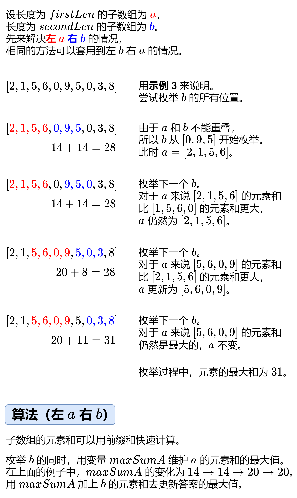

# 【图解】没有思路？一张图秒懂！（Python/Java/C++/Go）

> **[1031. 两个无重叠子数组的最大和](https://leetcode.cn/problems/maximum-sum-of-two-non-overlapping-subarrays/solutions/2245647/tu-jie-mei-you-si-lu-yi-zhang-tu-miao-do-3lli/) · Medium · 难度分 1680**

> **所属题单**
> - [常用数据结构 · 零、常用枚举技巧](../../../刷题路径/灵神原版题单/常用数据结构/零、常用枚举技巧.md) · §0.1 枚举右，维护左 · §0.1.2 进阶
> - [常用数据结构 · 一、前缀和](../../../刷题路径/灵神原版题单/常用数据结构/一、前缀和.md) · §1.5 进阶
> - [动态规划 · 专题：前后缀分解](../../../刷题路径/灵神原版题单/动态规划/专题：前后缀分解.md)

> **题目描述**
> 给你一个整数数组 `nums` 和两个整数 `firstLen` 和 `secondLen`，请你找出并返回两个无重叠 **子数组** 中元素的最大和<em>，</em>长度分别为 `firstLen` 和 `secondLen` 。
>
> 长度为 `firstLen` 的子数组可以出现在长为 `secondLen` 的子数组之前或之后，但二者必须是无重叠。
>
> 子数组是数组的一个 **连续** 部分。
>
> **示例 1：**
>
> ```
>
> 输入：nums = [0,6,5,2,2,5,1,9,4], firstLen = 1, secondLen = 2
> 输出：20
> 解释：子数组的一种选择中，[9] 长度为 1，[6,5] 长度为 2。
> ```
>
> **示例 2：**
>
> ```
>
> 输入：nums = [3,8,1,3,2,1,8,9,0], firstLen = 3, secondLen = 2
> 输出：29
> 解释：子数组的一种选择中，[3,8,1] 长度为 3，[8,9] 长度为 2。
> ```
>
> **示例 3：**
>
> ```
>
> 输入：nums = [2,1,5,6,0,9,5,0,3,8], firstLen = 4, secondLen = 3
> 输出：31
> 解释：子数组的一种选择中，[5,6,0,9] 长度为 4，[0,3,8] 长度为 3。
> ```
>
> **提示：**
>
> - `1 <= firstLen, secondLen <= 1000`
>
> - `2 <= firstLen + secondLen <= 1000`
>
> - `firstLen + secondLen <= nums.length <= 1000`
>
> - `0 <= nums[i] <= 1000`

> **题解**
> ## 前置知识
>
> [前缀和](../../0300-0399/0303%20区域和检索%20-%20数组不可变/灵茶山艾府.md)
>
> ## 思路
>
> 
>
> ## 实现细节
>
> 设 $b$ 的下标范围为左闭右开区间 $[i-\textit{secondLen},i)$，其元素和为 $s[i] - s[i-\textit{secondLen}]$。
>
> 由于左边要留空间给 $a$，所以 $i$ 要从 $\textit{firstLen}+\textit{secondLen}$ 开始枚举（结合上图理解）。
>
> 由于每次枚举一个新的 $i$，都会在 $b$ 的左边产生一个新的子数组 $[i-\textit{secondLen}-\textit{firstLen},i-\textit{secondLen})$，所以用它的元素和 $s[i-\textit{secondLen}] - s[i-\textit{secondLen}-\textit{firstLen}]$ 去更新 $\textit{maxSumA}$。
>
> 把这个算法封装成一个函数 $f(\textit{firstLen},\textit{secondLen})$，表示左 $a$ 右 $b$ 的计算。那么 $f(\textit{secondLen},\textit{firstLen})$ 就是左 $b$ 右 $a$ 的计算了。
>
> ```python
> class Solution:
>     def maxSumTwoNoOverlap(self, nums: List[int], firstLen: int, secondLen: int) -> int:
>         s = list(accumulate(nums, initial=0))  # nums 的前缀和
>         ans = 0
>         def f(firstLen: int, secondLen: int) -> None:
>             nonlocal ans
>             maxSumA = 0
>             for i in range(firstLen + secondLen, len(s)):
>                 maxSumA = max(maxSumA, s[i - secondLen] - s[i - secondLen - firstLen])
>                 ans = max(ans, maxSumA + s[i] - s[i - secondLen])
>         f(firstLen, secondLen)  # 左 a 右 b
>         f(secondLen, firstLen)  # 左 b 右 a
>         return ans
> ```
>
>
> ## 简化代码
>
> 「左 $a$ 右 $b$」和「左 $b$ 右 $a$」可以合并到同一个循环中。
>
> ```python
> class Solution:
>     def maxSumTwoNoOverlap(self, nums: List[int], firstLen: int, secondLen: int) -> int:
>         s = list(accumulate(nums, initial=0))  # nums 的前缀和
>         ans = maxSumA = maxSumB = 0
>         for i in range(firstLen + secondLen, len(s)):
>             maxSumA = max(maxSumA, s[i - secondLen] - s[i - firstLen - secondLen])
>             maxSumB = max(maxSumB, s[i - firstLen] - s[i - firstLen - secondLen])
>             ans = max(ans, maxSumA + s[i] - s[i - secondLen], maxSumB + s[i] - s[i - firstLen])
>         return ans
> ```
>
>
> #### 复杂度分析
>
> - 时间复杂度：$\mathcal{O}(n)$，其中 $n$ 为 $\textit{nums}$ 的长度。
> - 空间复杂度：$\mathcal{O}(n)$。
>
> > 注：本题还可以用 $4$ 个滑动窗口实现。可以做到 $\mathcal{O}(1)$ 额外空间，且不修改 $\textit{nums}$。
>
> ## 总结
>
> 对于有两个变量的题目，通常可以枚举其中一个变量，把它视作常量，从而转化成只有一个变量的问题。
>
> 对于本题来说，就是枚举 $b$，把问题转化成计算 $a$ 的最大元素和。
>
> 其实这个技巧在 [1. 两数之和](https://leetcode.cn/problems/two-sum/) 中就体现了：枚举第二个数，去左边找第一个数。（用哈希表优化找第一个数的过程。）
>
> ## 相似题目
>
> - [2555. 两个线段获得的最多奖品](https://leetcode.cn/problems/maximize-win-from-two-segments/)，[题解](../../2500-2599/2555%20两个线段获得的最多奖品/灵茶山艾府.md)
>
> ## 分类题单
>
> [如何科学刷题？](https://leetcode.cn/circle/discuss/RvFUtj/)
>
> 1. [滑动窗口与双指针（定长/不定长/单序列/双序列/三指针）](https://leetcode.cn/circle/discuss/0viNMK/)
> 2. [二分算法（二分答案/最小化最大值/最大化最小值/第K小）](https://leetcode.cn/circle/discuss/SqopEo/)
> 3. [单调栈（基础/矩形面积/贡献法/最小字典序）](https://leetcode.cn/circle/discuss/9oZFK9/)
> 4. [网格图（DFS/BFS/综合应用）](https://leetcode.cn/circle/discuss/YiXPXW/)
> 5. [位运算（基础/性质/拆位/试填/恒等式/思维）](https://leetcode.cn/circle/discuss/dHn9Vk/)
> 6. [图论算法（DFS/BFS/拓扑排序/最短路/最小生成树/二分图/基环树/欧拉路径）](https://leetcode.cn/circle/discuss/01LUak/)
> 7. [动态规划（入门/背包/状态机/划分/区间/状压/数位/数据结构优化/树形/博弈/概率期望）](https://leetcode.cn/circle/discuss/tXLS3i/)
> 8. [常用数据结构（前缀和/差分/栈/队列/堆/字典树/并查集/树状数组/线段树）](https://leetcode.cn/circle/discuss/mOr1u6/)
> 9. [数学算法（数论/组合/概率期望/博弈/计算几何/随机算法）](https://leetcode.cn/circle/discuss/IYT3ss/)
> 10. [贪心与思维（基本贪心策略/反悔/区间/字典序/数学/思维/脑筋急转弯/构造）](https://leetcode.cn/circle/discuss/g6KTKL/)
> 11. [链表、二叉树与一般树（前后指针/快慢指针/DFS/BFS/直径/LCA）](https://leetcode.cn/circle/discuss/K0n2gO/)
>
> [我的题解精选（已分类）](https://github.com/EndlessCheng/codeforces-go/blob/master/leetcode/SOLUTIONS.md)
>
> 欢迎关注 [B站@灵茶山艾府](https://space.bilibili.com/206214)
