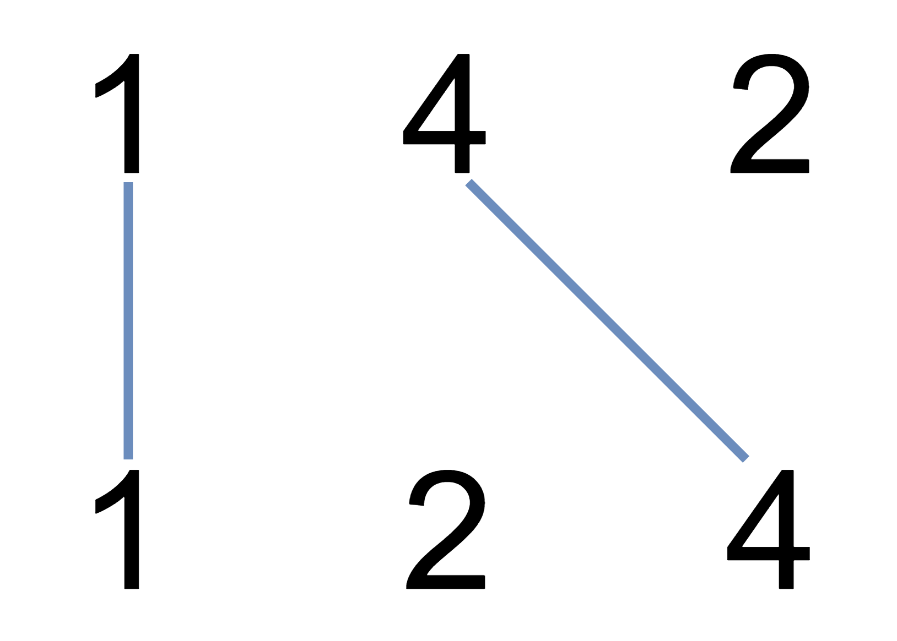

# 1035. 不相交的线

Medium · 难度分 1806 · [力扣原题](https://leetcode.cn/problems/uncrossed-lines/)

所在刷题路径：灵神核心路线、灵神题单·动态规划

| 作者 | 题解 | 动画讲解 |
|---|---|---|
| 灵茶山艾府 | [📄 题解](灵茶山艾府.md) | [▶︎ 动画（GIF）](1035%20不相交的线%20·%20灵茶山艾府.gif) · [mp4 文件](1035%20不相交的线%20·%20灵茶山艾府.mp4) |
| yiduobo | [📄 题解](yiduobo.md) | [▶︎ 动画（GIF）](1035%20不相交的线%20·%20yiduobo.gif) · [mp4 文件](1035%20不相交的线%20·%20yiduobo.mp4) |

## 动画讲解

> 动图会循环播放；想暂停、拖进度条请下载上面表格里的 mp4 文件。

### 灵茶山艾府


### yiduobo


## 题目描述

在两条独立的水平线上按给定的顺序写下 `nums1` 和 `nums2` 中的整数。

现在，可以绘制一些连接两个数字 `nums1[i]` 和 `nums2[j]` 的直线，这些直线需要同时满足：

-  `nums1[i] == nums2[j]`

- 且绘制的直线不与任何其他连线（非水平线）相交。

请注意，连线即使在端点也不能相交：每个数字只能属于一条连线。

以这种方法绘制线条，并返回可以绘制的最大连线数。

**示例 1：**



```

输入：nums1 = [1,4,2], nums2 = [1,2,4]
输出：2
解释：可以画出两条不交叉的线，如上图所示。
但无法画出第三条不相交的直线，因为从 nums1[1]=4 到 nums2[2]=4 的直线将与从 nums1[2]=2 到 nums2[1]=2 的直线相交。
```

**示例 2：**

```

输入：nums1 = [2,5,1,2,5], nums2 = [10,5,2,1,5,2]
输出：3
```

**示例 3：**

```

输入：nums1 = [1,3,7,1,7,5], nums2 = [1,9,2,5,1]
输出：2
```

**提示：**

- `1 <= nums1.length, nums2.length <= 500`

- `1 <= nums1[i], nums2[j] <= 2000`

---
[↑ 返回 1000-1099](../README.md) · [总索引](../../../索引.md) · [仓库首页](../../../README.md)
