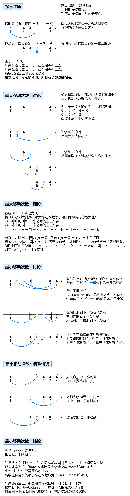

# 【图解】下跳棋（Python/Java/C++/Go）

> **[1040. 移动石子直到连续 II](https://leetcode.cn/problems/moving-stones-until-consecutive-ii/solutions/2212638/tu-jie-xia-tiao-qi-pythonjavacgo-by-endl-r1eb/) · Medium · 难度分 2456**

> **所属题单**
> - [滑动窗口与双指针 · 二、不定长滑动窗口](../../../刷题路径/灵神原版题单/滑动窗口与双指针/二、不定长滑动窗口.md) · §2.1 越短越合法/求最长/最大 · §2.1.2 进阶（选做）
> - [贪心算法 · 五、思维题](../../../刷题路径/灵神原版题单/贪心算法/五、思维题.md) · §5.3 等价转化
> - [贪心算法 · 五、思维题](../../../刷题路径/灵神原版题单/贪心算法/五、思维题.md) · §5.8 分类讨论

> **题目描述**
> 在 X 轴上有一些不同位置的石子。给定一个整数数组 `stones` 表示石子的位置。
>
> 如果一个石子在最小或最大的位置，称其为 **端点石子**。每个回合，你可以将一颗 **端点石子** 拿起并移动到一个未占用的位置，使得该石子不再是一颗 **端点石子**。
>
> - 值得注意的是，如果石子像 `stones = [1,2,5]` 这样，你将 **无法** 移动位于位置 `5` 的端点石子，因为无论将它移动到任何位置（例如 `0` 或 `3`），该石子都仍然会是端点石子。
>
> 当你无法进行任何移动时，即，这些石子的位置连续时，游戏结束。
>
> 以长度为 2 的数组形式返回答案，其中：
>
> - `answer[0]` 是你可以移动的最小次数
>
> - `answer[1]` 是你可以移动的最大次数。
>
> **示例 1：**
>
> ```
>
> 输入：[7,4,9]
> 输出：[1,2]
> 解释：
> 我们可以移动一次，4 -> 8，游戏结束。
> 或者，我们可以移动两次 9 -> 5，4 -> 6，游戏结束。
> ```
>
> **示例 2：**
>
> ```
>
> 输入：[6,5,4,3,10]
> 输出：[2,3]
> 解释：
> 我们可以移动 3 -> 8，接着是 10 -> 7，游戏结束。
> 或者，我们可以移动 3 -> 7, 4 -> 8, 5 -> 9，游戏结束。
> 注意，我们无法进行 10 -> 2 这样的移动来结束游戏，因为这是不合要求的移动。
> ```
>
> **提示：**
>
> - `3 <= stones.length <= 10⁴`
>
> - `1 <= stones[i] <= 10⁹`
>
> - `stones` 的值各不相同。

> **题解**
> 
>
> ### 答疑
>
> **问**：如何使用滑动窗口？如何避免下标算错？
>
> **答**：请看 [滑动窗口【基础算法精讲 03】](https://www.bilibili.com/video/BV1hd4y1r7Gq/)。
>
> **问**：在窗口右边界 $s[\textit{right}]$ 比较小时（比如 $\textit{right}=0$），窗口内部左边都是空的，无法把石子移过去，为什么代码中没有判断这种不合法的情况呢？
>
> **答**：无需考虑这种情况。如果窗口内部左边都是空的，那么继续向右滑动窗口，在窗口左边界有石子之前，窗口内的石子个数是不会减少的，后面算出来的 $\textit{maxCnt}$ 必然更大，所以无需考虑窗口内部左边都是空的情况。代码实现时，在 $\textit{right}$ 比较小时也做了计算，因为在取 $\max$ 的情况下，这对最终的 $\textit{maxCnt}$ 是没有影响的。
>
> **问**：对于最小移动次数，除了图中的「特殊情况」外，是否还存在其它的特殊情况？你能构造出一个具体的移动方式吗？
>
> **答**：没有其它的特殊情况了，因为一定可以通过如下方式完成移动：
>
> - 首先，按照算法流程，窗口右边界 $s[\textit{right}]$ 一定可以位于一颗石子上。（因为在窗口滑到下一颗石子**之前**，窗口内的石子不会增加，所以只需要考虑窗口右边界在石子上的情况。）
> - 情况一：窗口左边界也有石子。那么窗口内任意空位的左右两侧都有石子，窗口外的石子怎么移动都行。
>   - 注意：窗口左边界是 $s[\textit{right}]-n+1$，它 $\le s[\textit{left}]$。
> - 情况二：窗口左边界没有石子，且窗口右边界的右侧还有石子。那么把右端点石子移到窗口的左边界上，就能转换到情况一。
> - 情况三：窗口左边界没有石子，且窗口右边界的右侧也没有石子（即窗口右边界的石子就是右端点石子）。由于不是特殊情况，窗口左侧必然有至少 $2$ 颗石子，那么左端点石子可以移到窗口的左边界上，这样就转换到了情况一。（具体见「最小移动次数：讨论」的第三幅图。）
>
> **问**：为什么不在滑动窗口内判断特殊情况？
>
> **答**：不需要，在滑动窗口之前判断就行。这是因为如果不是特殊情况，窗口内至少有 $2$ 个空位，所以在窗口滑动时，是无论如何都不会出现特殊情况的。
>
> **问**：你是如何想到本题的做法的？是否有一些通用的思考方式？
>
> **答**：个人觉得这题有点构造的味道（想算出答案，要大致知道怎么移动石子）。对于构造题，通常是先从最基本的情况开始思考，比如本题就是从 $n=3$ 开始思考。在纸上多画一画，比较不同的移动方案，猜想出一个大致的结论。接着思考 $n=4,5,\cdots$ 的情况，验证/修正你的结论。这就是「**从特殊到一般**」。如果你想做更多的构造题，可以去 Codeforces 搜索 tag：constructive algorithms。
>
> ```python
> class Solution:
>     def numMovesStonesII(self, s: List[int]) -> List[int]:
>         s.sort()
>         n = len(s)
>         e1 = s[-2] - s[0] - n + 2
>         e2 = s[-1] - s[1] - n + 2  # 计算空位
>         max_move = max(e1, e2)
>         if e1 == 0 or e2 == 0:  # 特殊情况：没有空位
>             return [min(2, max_move), max_move]
>         max_cnt = left = 0
>         for right, sr in enumerate(s):  # 滑动窗口：枚举右端点所在石子
>             while sr - s[left] + 1 > n:  # 窗口长度大于 n
>                 left += 1  # 缩小窗口长度
>             max_cnt = max(max_cnt, right - left + 1)  # 维护窗口内的最大石子数
>         return [n - max_cnt, max_move]
> ```
>
>
> #### 复杂度分析
>
> - 时间复杂度：$\mathcal{O}(n\log n)$，其中 $n$ 为 $\textit{stones}$ 的长度。瓶颈在排序上。
> - 空间复杂度：$\mathcal{O}(1)$。忽略排序时的栈开销，仅用到若干额外变量。
>
> ## 分类题单
>
> 1. [滑动窗口（定长/不定长/多指针）](https://leetcode.cn/circle/discuss/0viNMK/)
> 2. [二分算法（二分答案/最小化最大值/最大化最小值/第K小）](https://leetcode.cn/circle/discuss/SqopEo/)
> 3. [单调栈（矩形系列/字典序最小/贡献法）](https://leetcode.cn/circle/discuss/9oZFK9/)
> 4. [网格图（DFS/BFS/综合应用）](https://leetcode.cn/circle/discuss/YiXPXW/)
> 5. [位运算（基础/性质/拆位/试填/恒等式/贪心/脑筋急转弯）](https://leetcode.cn/circle/discuss/dHn9Vk/)
> 6. [图论算法（DFS/BFS/拓扑排序/最短路/最小生成树/二分图/基环树/欧拉路径）](https://leetcode.cn/circle/discuss/01LUak/)
> 7. [动态规划（入门/背包/状态机/划分/区间/状压/数位/数据结构优化/树形/博弈/概率期望）](https://leetcode.cn/circle/discuss/tXLS3i/)
>
> 更多题单，点我个人主页 - 讨论发布。
>
> 欢迎关注 [B站@灵茶山艾府](https://space.bilibili.com/206214)
>
> [往期题解精选（已分类）](https://github.com/EndlessCheng/codeforces-go/blob/master/leetcode/SOLUTIONS.md)
