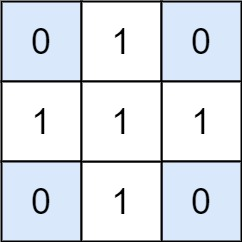

# 1074. 元素和为目标值的子矩阵数量

Hard · 难度分 2189 · [力扣原题](https://leetcode.cn/problems/number-of-submatrices-that-sum-to-target/)

所在刷题路径：灵神题单·常用数据结构

| 作者 | 题解 | 动画讲解 |
|---|---|---|
| 灵茶山艾府 | [📄 题解](灵茶山艾府.md) | [▶︎ 动画（GIF）](1074%20元素和为目标值的子矩阵数量%20·%20灵茶山艾府.gif) · [mp4 文件](1074%20元素和为目标值的子矩阵数量%20·%20灵茶山艾府.mp4) |
| yiduobo | [📄 题解](yiduobo.md) | [▶︎ 动画（GIF）](1074%20元素和为目标值的子矩阵数量%20·%20yiduobo.gif) · [mp4 文件](1074%20元素和为目标值的子矩阵数量%20·%20yiduobo.mp4) |

## 动画讲解

> 动图会循环播放；想暂停、拖进度条请下载上面表格里的 mp4 文件。

### 灵茶山艾府


### yiduobo


## 题目描述

给出矩阵 `matrix` 和目标值 `target`，返回元素总和等于目标值的非空子矩阵的数量。

子矩阵 `x1, y1, x2, y2` 是满足 `x1 <= x <= x2` 且 `y1 <= y <= y2` 的所有单元 `matrix[x][y]` 的集合。

如果 `(x1, y1, x2, y2)` 和 `(x1', y1', x2', y2')` 两个子矩阵中部分坐标不同（如：`x1 != x1'`），那么这两个子矩阵也不同。

**示例 1：**



```

输入：matrix = [[0,1,0],[1,1,1],[0,1,0]], target = 0
输出：4
解释：四个只含 0 的 1x1 子矩阵。
```

**示例 2：**

```

输入：matrix = [[1,-1],[-1,1]], target = 0
输出：5
解释：两个 1x2 子矩阵，加上两个 2x1 子矩阵，再加上一个 2x2 子矩阵。
```

**示例 3：**

```

输入：matrix = [[904]], target = 0
输出：0
```

提示：

- `1 <= matrix.length <= 100`

- `1 <= matrix[0].length <= 100`

- `-1000 <= matrix[i][j] <= 1000`

- `-10^8 <= target <= 10^8`

---
[↑ 返回 1000-1099](../README.md) · [总索引](../../../索引.md) · [仓库首页](../../../README.md)
