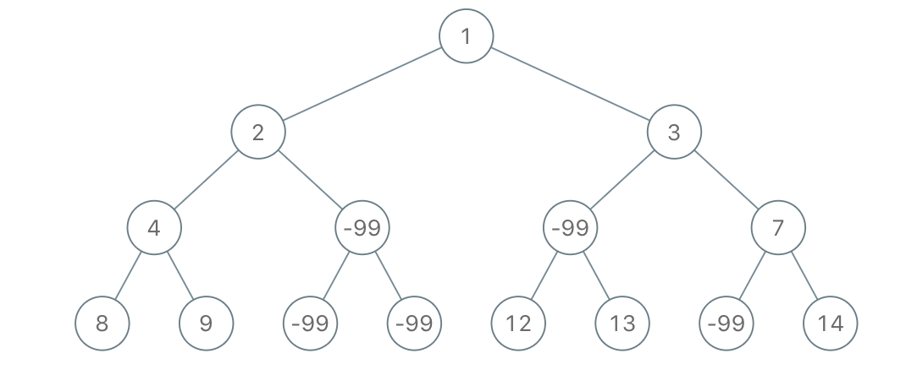
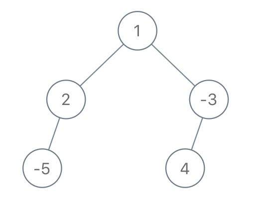

# 简洁写法，调用自身！（Python/Java/C++/Go）

> **[1080. 根到叶路径上的不足节点](https://leetcode.cn/problems/insufficient-nodes-in-root-to-leaf-paths/solutions/2278769/jian-ji-xie-fa-diao-yong-zi-shen-pythonj-64lf/) · Medium · 难度分 1805**

> **所属题单**
> - [链表、二叉树与回溯 · 二、二叉树](../../../刷题路径/灵神原版题单/链表、二叉树与回溯/二、二叉树.md) · §2.5 有递有归

> **题目描述**
> 给你二叉树的根节点 `root` 和一个整数 `limit` ，请你同时删除树中所有 **不足节点** ，并返回最终二叉树的根节点。
>
> 假如通过节点 `node` 的每种可能的 “根-叶” 路径上值的总和全都小于给定的 `limit`，则该节点被称之为 **不足节点** ，需要被删除。
>
> **叶子节点**，就是没有子节点的节点。
>
> **示例 1：**
>
> 
>
> ```
>
> 输入：root = [1,2,3,4,-99,-99,7,8,9,-99,-99,12,13,-99,14], limit = 1
> 输出：[1,2,3,4,null,null,7,8,9,null,14]
> ```
>
> **示例 2：**
>
> 
>
> ```
>
> 输入：root = [5,4,8,11,null,17,4,7,1,null,null,5,3], limit = 22
> 输出：[5,4,8,11,null,17,4,7,null,null,null,5]
> ```
>
> **示例 3：**
>
> 
>
> ```
>
> 输入：root = [1,2,-3,-5,null,4,null], limit = -1
> 输出：[1,null,-3,4]
> ```
>
> **提示：**
>
> - 树中节点数目在范围 `[1, 5000]` 内
>
> - `-10⁵ <= Node.val <= 10⁵`
>
> - `-10⁹ <= limit <= 10⁹`

> **题解**
> ## 一、思考
>
> 首先，理解清楚题目意思。不足节点算的是根到叶子的路径和，不是根到某个中间节点的路径和。题目说「同时删除所有不足节点」，这句话相当于，**删除节点后，中间节点仍然是中间节点，不是叶子**。
>
> 对于一个叶子节点，要想删除它，需要满足什么条件？
>
> 对于一个非叶节点，如果它有一个儿子没被删除，那么它能被删除吗？如果它的儿子都被删除，意味着什么？
>
> ## 二、解惑
>
> 对于一个叶子节点 $\textit{leaf}$，由于根到 $\textit{leaf}$ 的路径仅有一条，所以如果这条路径的元素和小于 $\textit{limit}$，就删除 $\textit{leaf}$。
>
> 对于一个非叶节点 $\textit{node}$，如果 $\textit{node}$ 有一个儿子没被删除，那么 $\textit{node}$ 就不能被删除。这可以用反证法证明：假设可以把 $\textit{node}$ 删除，那么经过 $\textit{node}$ 的所有路径和都小于 $\textit{limit}$，也就意味着经过 $\textit{node}$ 的儿子的路径和也小于 $\textit{limit}$，说明 $\textit{node}$ 的儿子需要被删除，矛盾，所以 $\textit{node}$ 不能被删除。
>
> 如果 $\textit{node}$ 的儿子都被删除，说明经过 $\textit{node}$ 的所有儿子的路径和都小于 $\textit{limit}$，这等价于经过 $\textit{node}$ 的所有路径和都小于 $\textit{limit}$，所以 $\textit{node}$ 需要被删除。
>
> 因此，要删除非叶节点 $\textit{node}$，**当且仅当** $\textit{node}$ 的所有儿子都被删除。
>
> ## 三、算法
>
> 一个直接的想法是，添加一个递归参数 $\textit{sumPath}$，表示从根到当前节点的路径和。
>
> 但为了能直接调用 $\texttt{sufficientSubset}$，还可以从 $\textit{limit}$ 中减去当前节点值。
>
> 如果当前节点是叶子，且此时 $\textit{limit}>0$，说明从根到这个叶子的路径和小于 $\textit{limit}$，那么删除这个叶子。
>
> 如果当前节点不是叶子，那么往下递归，更新它的左儿子为对左儿子调用 $\texttt{sufficientSubset}$ 的结果，更新它的右儿子为对右儿子调用 $\texttt{sufficientSubset}$ 的结果。
>
> 如果左右儿子都为空，那么就删除当前节点，返回空；否则不删，返回当前节点。
>
> 晕递归的同学，请看[【基础算法精讲 09】](https://www.bilibili.com/video/BV1UD4y1Y769/)。
>
> ```python
> class Solution:
>     def sufficientSubset(self, root: Optional[TreeNode], limit: int) -> Optional[TreeNode]:
>         limit -= root.val
>         if root.left is None and root.right is None:  # root 是叶子
>             # 如果 limit > 0 说明从根到叶子的路径和小于 limit，删除叶子，否则不删除
>             return None if limit > 0 else root
>         if root.left: root.left = self.sufficientSubset(root.left, limit)
>         if root.right: root.right = self.sufficientSubset(root.right, limit)
>         # 如果有儿子没被删除，就不删 root，否则删 root
>         return root if root.left or root.right else None
> ```
>
>
> #### 复杂度分析
>
> - 时间复杂度：$\mathcal{O}(n)$，其中 $n$ 是二叉树的节点个数。
> - 空间复杂度：$\mathcal{O}(n)$。最坏情况下，二叉树是一条链，递归需要 $\mathcal{O}(n)$ 的栈空间。
>
> ## 分类题单
>
> [如何科学刷题？](https://leetcode.cn/circle/discuss/RvFUtj/)
>
> 1. [滑动窗口与双指针（定长/不定长/单序列/双序列/三指针/分组循环）](https://leetcode.cn/circle/discuss/0viNMK/)
> 2. [二分算法（二分答案/最小化最大值/最大化最小值/第K小）](https://leetcode.cn/circle/discuss/SqopEo/)
> 3. [单调栈（基础/矩形面积/贡献法/最小字典序）](https://leetcode.cn/circle/discuss/9oZFK9/)
> 4. [网格图（DFS/BFS/综合应用）](https://leetcode.cn/circle/discuss/YiXPXW/)
> 5. [位运算（基础/性质/拆位/试填/恒等式/思维）](https://leetcode.cn/circle/discuss/dHn9Vk/)
> 6. [图论算法（DFS/BFS/拓扑排序/基环树/最短路/最小生成树/网络流）](https://leetcode.cn/circle/discuss/01LUak/)
> 7. [动态规划（入门/背包/划分/状态机/区间/状压/数位/数据结构优化/树形/博弈/概率期望）](https://leetcode.cn/circle/discuss/tXLS3i/)
> 8. [常用数据结构（前缀和/差分/栈/队列/堆/字典树/并查集/树状数组/线段树）](https://leetcode.cn/circle/discuss/mOr1u6/)
> 9. [数学算法（数论/组合/概率期望/博弈/计算几何/随机算法）](https://leetcode.cn/circle/discuss/IYT3ss/)
> 10. [贪心与思维（基本贪心策略/反悔/区间/字典序/数学/思维/脑筋急转弯/构造）](https://leetcode.cn/circle/discuss/g6KTKL/)
> 11. [链表、二叉树与回溯（前后指针/快慢指针/DFS/BFS/直径/LCA/一般树）](https://leetcode.cn/circle/discuss/K0n2gO/)
> 12. [字符串（KMP/Z函数/Manacher/字符串哈希/AC自动机/后缀数组/子序列自动机）](https://leetcode.cn/circle/discuss/SJFwQI/)
>
> [我的题解精选（已分类）](https://github.com/EndlessCheng/codeforces-go/blob/master/leetcode/SOLUTIONS.md)
>
> 欢迎关注 [B站@灵茶山艾府](https://space.bilibili.com/206214)
