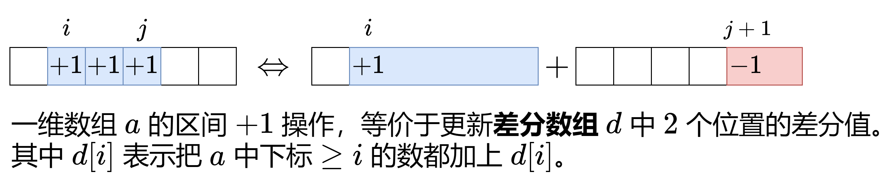

# 【算法小课堂】差分数组（Python/Java/C++/Go/JS/Rust）

> **[1094. 拼车](https://leetcode.cn/problems/car-pooling/solutions/2550264/suan-fa-xiao-ke-tang-chai-fen-shu-zu-fu-9d4ra/) · Medium · 难度分 1441**

> **所属题单**
> - [常用数据结构 · 二、差分](../../../刷题路径/灵神原版题单/常用数据结构/二、差分.md) · §2.1 一维差分 · §2.1.1 基础

> **题目描述**
> 车上最初有 `capacity` 个空座位。车 **只能** 向一个方向行驶（也就是说，**不允许掉头或改变方向**）
>
> 给定整数 `capacity` 和一个数组 `trips` ,  `trips[i] = [numPassengers_i, from_i, to_i]` 表示第 `i` 次旅行有 `numPassengers_i` 乘客，接他们和放他们的位置分别是 `from_i` 和 `to_i` 。这些位置是从汽车的初始位置向东的公里数。
>
> 乘客在接上新乘客之前会被放下。在路线的每个点，车内乘客总数不得超过 `capacity`。
>
> 当且仅当你可以在所有给定的行程中接送所有乘客时，返回 `true`，否则请返回 `false`。
>
> **示例 1：**
>
> ```
>
> 输入：trips = [[2,1,5],[3,3,7]], capacity = 4
> 输出：false
> ```
>
> **示例 2：**
>
> ```
>
> 输入：trips = [[2,1,5],[3,3,7]], capacity = 5
> 输出：true
> ```
>
> **提示：**
>
> - `1 <= trips.length <= 1000`
>
> - `trips[i].length == 3`
>
> - `1 <= numPassengers_i <= 100`
>
> - `0 <= from_i < to_i <= 1000`
>
> - `1 <= capacity <= 10⁵`

> **题解**
> 
>
> ## 举例
>
> 考虑数组 $a=[1,3,3,5,8]$，对其中的相邻元素两两作差（右边减左边），得到数组 $[2,0,2,3]$。然后在开头补上 $a[0]$，得到差分数组
>
> $$
> d=[1,2,0,2,3]
> $$
>
> 这有什么用呢？如果从左到右累加 $d$ 中的元素，我们就「还原」回了 $a$ 数组 $[1,3,3,5,8]$。这类似**求导与积分**。
>
> 这又有什么用呢？现在把连续子数组 $a[1],a[2],a[3]$ 都加上 $10$，得到 $a'=[1,13,13,15,8]$。再次两两作差，并在开头补上 $a'[0]$，得到差分数组
>
> $$
> d'=[1,12,0,2,-7]
> $$
>
> 对比 $d$ 和 $d'$，可以发现只有 $d[1]$ 和 $d[4]$ 变化了，这意味着对 $a$ 中连续子数组的操作，可以转变成对差分数组 $d$ 中**两个数**的操作。
>
> ## 定义和性质
>
> 对于数组 $a$，定义其**差分数组**（difference array）为
>
> $$
> d[i] =
> \begin{cases}
> a[0],&i=0\\
> a[i]-a[i-1],&i\ge 1
> \end{cases}
> $$
>
> **性质 1**：从左到右累加 $d$ 中的元素，可以得到数组 $a$。
>
> **性质 2**：如下两个操作是等价的。
>
> - 把 $a$ 的子数组 $a[i],a[i+1],\ldots,a[j]$ 都加上 $x$。
> - 把 $d[i]$ 增加 $x$，把 $d[j+1]$ 减少 $x$。
>
> 利用性质 2，我们只需要 $\mathcal{O}(1)$ 的时间就可以完成对 $a$ 的子数组的操作。最后利用性质 1 从差分数组复原出数组 $a$。
>
> **注**：也可以这样理解，$d[i]$ 表示把下标 $\ge i$ 的数都加上 $d[i]$。
>
> ## 本题思路
>
> 对于本题，设 $a[i]$ 表示车行驶到位置 $i$ 时车上的人数。我们需要判断是否所有 $a[i]$ 都不超过 $\textit{capacity}$。
>
> $\textit{trips}[i]$ 相当于把 $a$ 中下标从 $\textit{from}_i$ 到 $\textit{to}_i-1$ 的数都增加 $\textit{numPassengers}_i$。这正好可以用上面讲的差分数组解决。
>
> 例如示例 1 对应的 $d$ 数组，$d[1]=2,\ d[5]=-2,\ d[3]=3,\ d[7]=-3$，即
>
> $$
> d = [0, 2, 0, 3, 0, -2, 0, -3,\ldots]
> $$
>
> 从左到右累加，得到
>
> $$
> a = [0, 2, 2, 5, 5, 3, 3, 0,\ldots]
> $$
>
> $\textit{capacity}=4$，由于 $\max(a)=5>4$，所以返回 `false`。
>
> ## 实现方法
>
> 有两种写法：
>
> 1. 第一种写法是，创建一个长为 $1001$ 的差分数组，这可以保证 $d$ 数组不会下标越界。
> 2. 第二种写法是，用平衡树（C++ 中的 `map`，Java 中的 `TreeMap`）代替差分数组，因为我们只需要考虑在 $\textit{from}_i$ 和 $\textit{to}_i$ 这些位置上的乘客数，其余位置的乘客是保持不变的，无需考虑。平衡树可以保证我们是从小到大遍历这些位置的。当然，如果你不想用平衡树的话，也可以用哈希表，把哈希表的 key 取出来排序，就可以从小到大遍历这些位置了。
>
> 代码实现时，其实无需创建数组 $a$，只需要用一个变量 $s$ 累加差分值，如果在累加过程中发现 $s>\textit{capacity}$ 就返回 `false`。如果没有出现这种情况，就返回 `true`。
>
> #### 第一种写法
>
> ```python
> class Solution:
>     def carPooling(self, trips: List[List[int]], capacity: int) -> bool:
>         d = [0] * 1001
>         for num, from_, to in trips:
>             d[from_] += num
>             d[to] -= num
>         return all(s <= capacity for s in accumulate(d))
> ```
>
>
> #### 复杂度分析
>
> - 时间复杂度：$\mathcal{O}(n+U)$，其中 $n$ 为 $\textit{trips}$ 的长度，$U=\max(\textit{to}_i)$。
> - 空间复杂度：$\mathcal{O}(U)$。
>
> #### 第二种写法
>
> ```python
> class Solution:
>     def carPooling(self, trips: List[List[int]], capacity: int) -> bool:
>         d = defaultdict(int)
>         for num, from_, to in trips:
>             d[from_] += num
>             d[to] -= num
>
>         s = 0
>         for k in sorted(d):
>             s += d[k]
>             if s > capacity:
>                 return False
>         return True
> ```
>
>
> #### 复杂度分析
>
> - 时间复杂度：$\mathcal{O}(n\log n)$，其中 $n$ 为 $\textit{trips}$ 的长度。
> - 空间复杂度：$\mathcal{O}(n)$。
>
> ## 分类题单
>
> [如何科学刷题？](https://leetcode.cn/circle/discuss/RvFUtj/)
>
> 1. [滑动窗口与双指针（定长/不定长/单序列/双序列/三指针/分组循环）](https://leetcode.cn/circle/discuss/0viNMK/)
> 2. [二分算法（二分答案/最小化最大值/最大化最小值/第K小）](https://leetcode.cn/circle/discuss/SqopEo/)
> 3. [单调栈（基础/矩形面积/贡献法/最小字典序）](https://leetcode.cn/circle/discuss/9oZFK9/)
> 4. [网格图（DFS/BFS/综合应用）](https://leetcode.cn/circle/discuss/YiXPXW/)
> 5. [位运算（基础/性质/拆位/试填/恒等式/思维）](https://leetcode.cn/circle/discuss/dHn9Vk/)
> 6. [图论算法（DFS/BFS/拓扑排序/基环树/最短路/最小生成树/网络流）](https://leetcode.cn/circle/discuss/01LUak/)
> 7. [动态规划（入门/背包/划分/状态机/区间/状压/数位/数据结构优化/树形/博弈/概率期望）](https://leetcode.cn/circle/discuss/tXLS3i/)
> 8. [常用数据结构（前缀和/差分/栈/队列/堆/字典树/并查集/树状数组/线段树）](https://leetcode.cn/circle/discuss/mOr1u6/)
> 9. [数学算法（数论/组合/概率期望/博弈/计算几何/随机算法）](https://leetcode.cn/circle/discuss/IYT3ss/)
> 10. [贪心与思维（基本贪心策略/反悔/区间/字典序/数学/思维/脑筋急转弯/构造）](https://leetcode.cn/circle/discuss/g6KTKL/)
> 11. [链表、二叉树与回溯（前后指针/快慢指针/DFS/BFS/直径/LCA/一般树）](https://leetcode.cn/circle/discuss/K0n2gO/)
> 12. [字符串（KMP/Z函数/Manacher/字符串哈希/AC自动机/后缀数组/子序列自动机）](https://leetcode.cn/circle/discuss/SJFwQI/)
>
> [我的题解精选（已分类）](https://github.com/EndlessCheng/codeforces-go/blob/master/leetcode/SOLUTIONS.md)
>
> 欢迎关注 [B站@灵茶山艾府](https://space.bilibili.com/206214)
