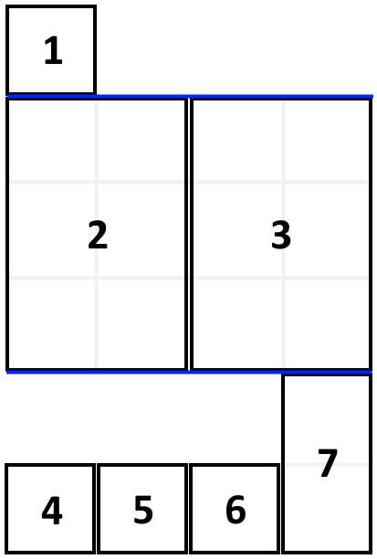

# 教你一步步思考动态规划！（Python/Java/C++/Go）

> **[1105. 填充书架](https://leetcode.cn/problems/filling-bookcase-shelves/solutions/2240688/jiao-ni-yi-bu-bu-si-kao-dong-tai-gui-hua-0vg6/) · Medium · 难度分 2014**

> **所属题单**
> - [动态规划 · 五、划分型 DP](../../../刷题路径/灵神原版题单/动态规划/五、划分型%20DP.md) · §5.2 最优划分

> **题目描述**
> 给定一个数组 `books` ，其中 `books[i] = [thickness_i, height_i]` 表示第 `i` 本书的厚度和高度。你也会得到一个整数 `shelfWidth` 。
>
> **按顺序** 将这些书摆放到总宽度为 `shelfWidth` 的书架上。
>
> 先选几本书放在书架上（它们的厚度之和小于等于书架的宽度 `shelfWidth` ），然后再建一层书架。重复这个过程，直到把所有的书都放在书架上。
>
> 需要注意的是，在上述过程的每个步骤中，**摆放书的顺序与给定图书数组** `books` **顺序相同**。
>
> - 例如，如果这里有 5 本书，那么可能的一种摆放情况是：第一和第二本书放在第一层书架上，第三本书放在第二层书架上，第四和第五本书放在最后一层书架上。
>
> 每一层所摆放的书的最大高度就是这一层书架的层高，书架整体的高度为各层高之和。
>
> 以这种方式布置书架，返回书架整体可能的最小高度。
>
> **示例 1：**
>
> 
>
> ```
>
> 输入：books = [[1,1],[2,3],[2,3],[1,1],[1,1],[1,1],[1,2]], shelfWidth = 4
> 输出：6
> 解释：
> 3 层书架的高度和为 1 + 3 + 2 = 6 。
> 第 2 本书不必放在第一层书架上。
> ```
>
> **示例 2:**
>
> ```
>
> 输入: books = [[1,3],[2,4],[3,2]], shelfWidth = 6
> 输出: 4
> ```
>
> **提示：**
>
> - `1 <= books.length <= 1000`
>
> - `1 <= thickness_i <= shelfWidth <= 1000`
>
> - `1 <= height_i <= 1000`

> **题解**
> ## 前置知识：动态规划入门
>
> 详见 [动态规划入门：从记忆化搜索到递推【基础算法精讲 17】](https://www.bilibili.com/video/BV1Xj411K7oF/)。
>
> > APP 用户需要分享到微信打开视频链接。
>
> ## 一、寻找子问题
>
> {:width=300}
>
> 对于示例 1（上图），考虑书架的最底层，可以放 $\textit{books}$ 的最后 $1$ 到 $4$ 本书（题目要求**按顺序摆放**，且书的厚度之和不能超过 $\textit{shelfWidth}$）。假设放了 $4$ 本书，那么剩余的要解决的问题是 $\textit{books}$ 的前 $3$ 本书按顺序摆放后的最小高度。由于这是一个和原问题相似的子问题，所以可以用递归解决。
>
> 由于每个子问题处理的都是 $\textit{books}$ 的前缀，所以递归参数只需要一个 $i$。定义 $\textit{dfs}(i)$ 表示把 $\textit{books}[0]$ 到 $\textit{books}[i]$ 按顺序摆放后的最小高度。
>
> 枚举最后一层的第一本书的下标 $j$，那么从 $\textit{books}[j]$ 到 $\textit{books}[i]$ 的厚度之和不能超过 $\textit{shelfWidth}$。
>
> 把这些书的最大高度，加上 $\textit{dfs}(j-1)$ 这个子问题的结果，再取最小值，就是 $\textit{dfs}(i)$。写成式子就是
>
> $$
> \textit{dfs}(i) = \min_{j}\left\{\textit{dfs}(j-1) +  \max_{k=j}^{i}\textit{books}[k][1]\right\}
> $$
>
> 其中 $j\le i$ 且 $\sum\limits_{k=j}^{i}\textit{books}[k][0]\le \textit{shelfWidth}$。
>
> 递归边界：$\textit{dfs}(-1) = 0$。没有书，最小高度为 $0$。
>
> 递归入口：$\textit{dfs}(n-1)$，表示把所有书按顺序摆放后的最小高度，也就是答案。
>
> 代码实现时，可以从 $i$ 开始倒着枚举 $j$，一边枚举一边计算厚度之和（或者剩余空间），同时更新最大高度。
>
> ```python
> # 暴力递归，会超时
> class Solution:
>     def minHeightShelves(self, books: List[List[int]], shelf_width: int) -> int:
>         def dfs(i: int) -> int:
>             if i < 0: return 0  # 没有书了，高度是 0
>             res, max_h, left_w = inf, 0, shelf_width
>             for j in range(i, -1, -1):
>                 left_w -= books[j][0]
>                 if left_w < 0: break  # 空间不足，无法放书
>                 max_h = max(max_h, books[j][1])  # 从 j 到 i 的最大高度
>                 res = min(res, dfs(j - 1) + max_h)
>             return res
>         return dfs(len(books) - 1)
> ```
>
>
> ### 复杂度分析
>
> - 时间复杂度：$\mathcal{O}(2^n)$，其中 $n$ 为 $\textit{books}$ 的长度。等价于枚举 $n-1$ 条分割线选或不选，对于选择的分割线，把数组划分成若干段，每一段都对应一层书架上的书。所以至多有 $2^{n-1}$ 种划分方式，所以时间复杂度为 $\mathcal{O}(2^n)$。
> - 空间复杂度：$\mathcal{O}(n)$。递归需要 $\mathcal{O}(n)$ 的栈空间
>
> ## 二、递归 + 记录返回值 = 记忆化搜索
>
> 上面的做法太慢了，怎么优化呢？
>
> 举个例子，「把 $\textit{books}[n-1]$ 单独放一层，把 $\textit{books}[n-2]$ 单独放一层」和「把 $\textit{books}[n-2]$ 和 $\textit{books}[n-1]$放同一层」，都会递归到 $\textit{dfs}(n-3)$。
>
> 一叶知秋，整个递归中有大量重复递归调用（递归入参相同）。由于递归函数没有副作用，同样的入参无论计算多少次，算出来的结果都是一样的，因此可以用**记忆化搜索**来优化：
>
> - 如果一个状态（递归入参）是第一次遇到，那么可以在返回前，把状态及其结果记到一个 $\textit{memo}$ 数组（或哈希表）中。
> - 如果一个状态不是第一次遇到，那么直接返回 $\textit{memo}$ 中保存的结果。
>
> ```python
> class Solution:
>     def minHeightShelves(self, books: List[List[int]], shelf_width: int) -> int:
>         @cache  # 缓存装饰器，避免重复计算 dfs 的结果
>         def dfs(i: int) -> int:
>             if i < 0: return 0  # 没有书了，高度是 0
>             res, max_h, left_w = inf, 0, shelf_width
>             for j in range(i, -1, -1):
>                 left_w -= books[j][0]
>                 if left_w < 0: break  # 空间不足，无法放书
>                 max_h = max(max_h, books[j][1])  # 从 j 到 i 的最大高度
>                 res = min(res, dfs(j - 1) + max_h)
>             return res
>         return dfs(len(books) - 1)
> ```
>
>
> ### 复杂度分析
>
> - 时间复杂度：$\mathcal{O}(n^2)$，其中 $n$ 为 $\textit{books}$ 的长度。动态规划的时间复杂度 $=$ 状态个数 $\times$ 单个状态的计算时间。这里状态个数为 $\mathcal{O}(n)$，单个状态的计算时间为 $\mathcal{O}(n)$，因此时间复杂度为 $\mathcal{O}(n^2)$。
> - 空间复杂度：$\mathcal{O}(n)$。即状态个数。
>
> ## 三、1:1 翻译成递推
>
> 我们可以去掉递归中的「递」，只保留「归」的部分，即自底向上计算。
>
> 通用做法：
>
> - $\textit{dfs}$ 改成 $f$ 数组；
> - 递归改成循环（每个参数都对应一层循环）；
> - 递归边界改成 $f$ 数组的初始值。
>
> > 相当于原来是用递归去计算每个状态，现在是按照某个顺序去枚举并计算每个状态。
>
> 具体来说，$f[i]$ 的含义和 $\textit{dfs}(i)$ 的含义是一致的，都表示把 $\textit{books}[0]$ 到 $\textit{books}[i]$ 按顺序摆放后的最小高度。
>
> 相应的递推式（状态转移方程）也和 $\textit{dfs}$ 的一致：
>
> $$
> f[i] = \min_{j}\left\{f[j-1] +  \max_{k=j}^{i}\textit{books}[k][1]\right\}
> $$
>
> 其中 $j\le i$ 且 $\sum\limits_{k=j}^{i}\textit{books}[k][0]\le \textit{shelfWidth}$。
>
> 但是这种定义方式**没有状态能表示递归边界**，即 $i=-1$ 的情况。
>
> 解决办法：在 $f$ 数组的最左边插入一个状态，那么其余状态全部向右偏移一位，也就是 $f[i]$ 改为 $f[i+1]$，$f[j-1]$ 改为 $f[j]$。
>
> 修改后 $f[i+1]$ 表示把 $\textit{books}[0]$ 到 $\textit{books}[i]$ 按顺序摆放后的最小高度。这样 $f[0]=0$ 就对应递归边界了。
>
> 修改后的递推式为
>
> $$
> f[i+1] = \min_{j}\left\{f[j] +  \max_{k=j}^{i}\textit{books}[k][1]\right\}
> $$
>
> 其中 $j\le i$ 且 $\sum\limits_{k=j}^{i}\textit{books}[k][0]\le \textit{shelfWidth}$。
>
> > 问：为什么 $j$ 的起止下标不用变？为什么 $\textit{books}[k]$ 的下标不用变？
> >
> > 答：只是在 $f$ 的最左边插入一个状态，那就只需要修改和 $f$ 有关的下标，其余任何逻辑都无需修改。
>
> 初始值 $f[0]=0$。（翻译自 $\textit{dfs}(-1)=0$。）
>
> 答案为 $f[n]$。（翻译自 $\textit{dfs}(n-1)$。）
>
> ```python
> class Solution:
>     def minHeightShelves(self, books: List[List[int]], shelf_width: int) -> int:
>         n = len(books)
>         f = [0] + [inf] * n  # 在前面插入一个状态表示 dfs(-1)=0
>         for i in range(n):
>             max_h, left_w = 0, shelf_width
>             for j in range(i, -1, -1):
>                 left_w -= books[j][0]
>                 if left_w < 0: break  # 空间不足，无法放书
>                 max_h = max(max_h, books[j][1])  # 从 j 到 i 的最大高度
>                 f[i + 1] = min(f[i + 1], f[j] + max_h)
>         return f[n]  # 翻译自 dfs(n-1)
> ```
>
>
> ### 复杂度分析
>
> - 时间复杂度：$\mathcal{O}(n^2)$，其中 $n$ 为 $\textit{books}$ 的长度。动态规划的时间复杂度 $=$ 状态个数 $\times$ 单个状态的计算时间。这里状态个数为 $\mathcal{O}(n)$，单个状态的计算时间为 $\mathcal{O}(n)$，因此时间复杂度为 $\mathcal{O}(n^2)$。
> - 空间复杂度：$\mathcal{O}(n)$。即状态个数。
>
> ## 练习
>
> - [2369. 检查数组是否存在有效划分](https://leetcode.cn/problems/check-if-there-is-a-valid-partition-for-the-array/)
> - [1416. 恢复数组](https://leetcode.cn/problems/restore-the-array/)
> - [1043. 分隔数组以得到最大和](https://leetcode.cn/problems/partition-array-for-maximum-sum/)
>
> [每日一题·高质量题解精选](https://github.com/EndlessCheng/codeforces-go/blob/master/leetcode/SOLUTIONS.md)
>
> ---
>
> 欢迎关注[ biIibiIi@灵茶山艾府](https://space.bilibili.com/206214)，高质量算法教学，持续输出中~
