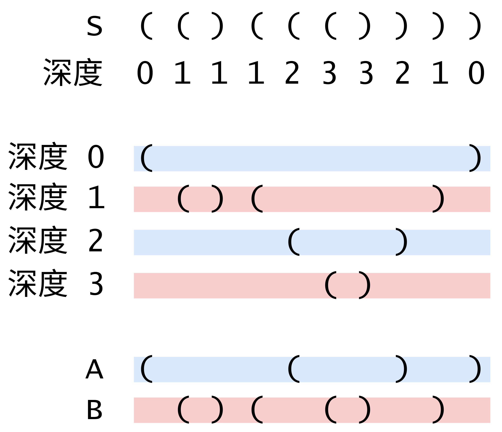

# 一图秒懂（Python/Java/C++/Go）

> **[1111. 有效括号的嵌套深度](https://leetcode.cn/problems/maximum-nesting-depth-of-two-valid-parentheses-strings/solutions/4026271/yi-tu-miao-dong-pythonjavacgo-by-endless-5exs/) · Medium · 难度分 1749**

> **所属题单**
> - [常用数据结构 · 三、栈](../../../刷题路径/灵神原版题单/常用数据结构/三、栈.md) · §3.4 合法括号字符串（RBS）

> **题目描述**
> 如果一个字符串仅由字符 `"("` 和 `")"` 组成，并且满足以下条件，则称为有效括号字符串（VPS）：
>
> - 它是空字符串，或
>
> - 它可以表示为 `AB`（`A` 连接 `B`），其中 `A` 和 `B` 都是VPS，或者
>
> - 它可以表示为 `(A)`，其中 `A` 是一个 VPS。
>
> 我们可以类似地定义任何 VPS `S` 的嵌套深度 `depth(S)` 如下：
>
> - `depth("") = 0`
>
> - `depth(A + B) = max(depth(A), depth(B))`，其中 `A` 和 `B` 都是 VPS
>
> - `depth("(" + A + ")") = 1 + depth(A)`，其中 `A` 是一个 VPS。
>
> 例如，`""`，`"()()"` 和 `"()(()())"` 都是 VPS（嵌套深度 0，1 和 2），并且 `")("` 和 `"(()"` 不是 VPS。
>
> 给定一个 VPS 序列，将其拆分成两个不相交的子序列 `A` 和 `B`，使得 `A` 和 `B` 都是 VPS（且 `A.length + B.length = seq.length`）。这些子序列不一定是连续的。
>
> 例如，对于序列 `123456789`，一种可能的拆分是：
>
> -
>
> `A = {1, 3, 5, 7, 9}`，
>
> -
>
> `B = {2, 4, 6, 8}`。
>
> -
>
> 这对应于输出 `[0, 1, 0, 1, 0, 1, 0, 1, 0]`，其中 0 表示属于 `A`，1 表示属于 `B`。
>
> 现在选择 **任意** 这样的 `A` 和 `B`，使得 `max(depth(A), depth(B))` 的值是最小的。
>
> 返回一个 `answer` 数组（长度为 `seq.length`），该数组编码了 `A` 和 `B` 的选择：如果 `seq[i]` 是 `A` 的一部分则 `answer[i] = 0`，否则 `answer[i] = 1`。请注意，尽管可能存在多种答案，但你可以返回其中任意一种。
>
> **示例 1：**
>
> ```
>
> 输入：seq = "(()())"
> 输出：[0,1,1,1,1,0]
> ```
>
> **示例 2：**
>
> ```
>
> 输入：seq = "()(())()"
> 输出：[0,0,0,1,1,0,1,1]
> 解释：本示例答案不唯一。
> 按此输出 A = "()()", B = "()()", max(depth(A), depth(B)) = 1，它们的深度最小。
> 像 [1,1,1,0,0,1,1,1]，也是正确结果，其中 A = "()()()", B = "()", max(depth(A), depth(B)) = 1 。
> ```
>
> **提示：**
>
> - `1 < seq.size <= 10000`
>
> **有效括号字符串：**
>
> ```
>
> 仅由 "(" 和 ")" 构成的字符串，对于每个左括号，都能找到与之对应的右括号，反之亦然。
> 下述几种情况同样属于有效括号字符串：
>
>   1. 空字符串
>   2. 连接，可以记作 AB（A 与 B 连接），其中 A 和 B 都是有效括号字符串
>   3. 嵌套，可以记作 (A)，其中 A 是有效括号字符串
> ```
>
> **嵌套深度：**
>
> ```
>
> 类似地，我们可以定义任意有效括号字符串 s 的 嵌套深度 depth(S)：
>
>   1. s 为空时，depth("") = 0
>   2. s 为 A 与 B 连接时，depth(A + B) = max(depth(A), depth(B))，其中 A 和 B 都是有效括号字符串
>   3. s 为嵌套情况，depth("(" + A + ")") = 1 + depth(A)，其中 A 是有效括号字符串
>
> 例如：""，"()()"，和 "()(()())" 都是有效括号字符串，嵌套深度分别为 0，1，2，而 ")(" 和 "(()" 都不是有效括号字符串。
> ```

> **题解**
> 从一个简单的例子开始。例如 $S = \texttt{(((())))}$，看成一个套娃（或者洋葱），题目让我们把它分成两个套娃，使得最大嵌套数尽量小。那么均分最好，把最内部的一半套娃拿出来即可。或者，把偶数层的分成一组，奇数层的分成另一组。
>
> 对于更复杂的嵌套情况，求出每个括号的深度，才能看清楚怎么分。怎么求深度？例如 $S = \texttt{(()(( X )))}$，只看 $\texttt{X}$ 的左边，有 $4$ 个左括号，其中有 $3$ 个未闭合（未配对）的左括号，所以 $\texttt{X}$ 的外面套了 $3$ 层括号。
>
> 定义：
>
> - **左括号的深度**为该括号左侧未闭合（未配对）的左括号的个数。
> - **右括号的深度**为该括号及其左侧未闭合（未配对）的左括号的个数。
>
> 求出每个括号的深度，可以得到下面这张图。
>
> {:width=550px}
>
> **思路一**：横着一刀两半，把深度 $0,1$ 分到 $A$ 中，深度 $2,3$ 分到 $B$ 中。但这需要先求出最大深度再拆分，需要两次遍历。
>
> **思路二**：更好的做法是**按照深度的奇偶性拆分**，偶数深度分到 $A$ 中，奇数深度分到 $B$ 中，这样只需一次遍历。
>
> ## 写法一
>
> ```python
> class Solution:
>     def maxDepthAfterSplit(self, seq: str) -> List[int]:
>         ans = [0] * len(seq)
>         depth = 0
>         for i, ch in enumerate(seq):
>             if ch == '(':
>                 ans[i] = depth % 2
>                 depth += 1
>             else:
>                 depth -= 1
>                 ans[i] = depth % 2
>         return ans
> ```
>
>
> ## 写法二
>
> 设 $[0,i-1]$ 中有 $L$ 个左括号，$R$ 个右括号，那么一共有 $L+R = i$ 个括号。
>
> 如果 $\textit{seq}[i]$ 是左括号，那么 $\textit{seq}[i]$ 的深度 
>
> $$
> \textit{depth} = L - R = (i-R) - R = i-2R
> $$
>
> 两边同时模 $2$，得
>
> $$
> \textit{depth}\bmod 2 = i\bmod 2
> $$
>
> 如果 $\textit{seq}[i]$ 是右括号，其深度 $\textit{depth} = L-R - 1$，同理可得 $\textit{depth}\bmod 2 = (i-1)\bmod 2 = (i+1)\bmod 2$。
>
> 所以 $\textit{depth}$ 变量是多余的，用 $i$ 的奇偶性就能算出答案。
>
> ```python
> class Solution:
>     def maxDepthAfterSplit(self, seq: str) -> List[int]:
>         ans = [0] * len(seq)
>         for i, ch in enumerate(seq):
>             if ch == '(':
>                 ans[i] = i % 2
>             else:
>                 ans[i] = (i + 1) % 2
>         return ans
> ```
>
>
> ## 写法三
>
> 可以用左右括号的 ASCII 值简化代码。
>
> - 左括号的 ASCII 值是 $40$，模 $2$ 后是 $0$。
> - 右括号的 ASCII 值是 $41$，模 $2$ 后是 $1$。
>
> 所以有
>
> $$
> \textit{answer}[i] = (i + \text{ASCII}(\textit{seq}[i])) \bmod 2
> $$
>
> > **问**：这也太巧了吧。如果左右括号的 ASCII 值都是偶数呢？
> > 
> > **答**：看成两个二进制数 $x$ 和 $y$。在 $x\ne y$ 的情况下，总有一个比特位上的数字不同，即一个是 $0$ 另一个是 $1$。
>
> ```python
> class Solution:
>     def maxDepthAfterSplit(self, seq: str) -> List[int]:
>         ans = [0] * len(seq)
>         for i, ch in enumerate(seq):
>             ans[i] = (i + ord(ch)) % 2
>         return ans
> ```
>
> > [!example]- Python3 一行
> > ```python
> > class Solution:
> >     def maxDepthAfterSplit(self, seq: str) -> List[int]:
> >         return [(i + ord(ch)) % 2 for i, ch in enumerate(seq)]
> > ```
>
>
> #### 复杂度分析
>
> - 时间复杂度：$\mathcal{O}(n)$，其中 $n$ 是 $\textit{nums}$ 的长度。
> - 空间复杂度：$\mathcal{O}(1)$。返回值不计入。
>
> ## 专题训练
>
> 见下面数据结构题单的「**§3.4 合法括号字符串**」。
>
> ## 分类题单
>
> [如何科学刷题？](https://leetcode.cn/discuss/post/3141566/ru-he-ke-xue-shua-ti-by-endlesscheng-q3yd/)
>
> 1. [滑动窗口与双指针（定长/不定长/单序列/双序列/三指针/分组循环）](https://leetcode.cn/discuss/post/3578981/ti-dan-hua-dong-chuang-kou-ding-chang-bu-rzz7/)
> 2. [二分算法（二分答案/最小化最大值/最大化最小值/第K小）](https://leetcode.cn/discuss/post/3579164/ti-dan-er-fen-suan-fa-er-fen-da-an-zui-x-3rqn/)
> 3. [单调栈（基础/矩形面积/贡献法/最小字典序）](https://leetcode.cn/discuss/post/3579480/ti-dan-dan-diao-zhan-ju-xing-xi-lie-zi-d-u4hk/)
> 4. [网格图（DFS/BFS/综合应用）](https://leetcode.cn/discuss/post/3580195/fen-xiang-gun-ti-dan-wang-ge-tu-dfsbfszo-l3pa/)
> 5. [位运算（基础/性质/拆位/试填/恒等式/思维）](https://leetcode.cn/discuss/post/3580371/fen-xiang-gun-ti-dan-wei-yun-suan-ji-chu-nth4/)
> 6. [图论算法（DFS/BFS/拓扑排序/基环树/最短路/最小生成树/网络流）](https://leetcode.cn/discuss/post/3581143/fen-xiang-gun-ti-dan-tu-lun-suan-fa-dfsb-qyux/)
> 7. [动态规划（入门/背包/划分/状态机/区间/状压/数位/数据结构优化/树形/博弈/概率期望）](https://leetcode.cn/discuss/post/3581838/fen-xiang-gun-ti-dan-dong-tai-gui-hua-ru-007o/)
> 8. [常用数据结构（前缀和/差分/栈/队列/堆/字典树/并查集/树状数组/线段树）](https://leetcode.cn/discuss/post/3583665/fen-xiang-gun-ti-dan-chang-yong-shu-ju-j-bvmv/)
> 9. [数学算法（数论/组合/概率期望/博弈/计算几何/随机算法）](https://leetcode.cn/discuss/post/3584388/fen-xiang-gun-ti-dan-shu-xue-suan-fa-shu-gcai/)
> 10. [贪心与思维（基本贪心策略/反悔/区间/字典序/数学/思维/脑筋急转弯/构造）](https://leetcode.cn/discuss/post/3091107/fen-xiang-gun-ti-dan-tan-xin-ji-ben-tan-k58yb/)
> 11. [链表、树与回溯（前后指针/快慢指针/DFS/BFS/直径/LCA）](https://leetcode.cn/discuss/post/3142882/fen-xiang-gun-ti-dan-lian-biao-er-cha-sh-6srp/)
> 12. [字符串（KMP/Z函数/Manacher/字符串哈希/AC自动机/后缀数组/子序列自动机）](https://leetcode.cn/discuss/post/3144832/fen-xiang-gun-ti-dan-zi-fu-chuan-kmpzhan-ugt4/)
>
> [我的题解精选（已分类）](https://github.com/EndlessCheng/codeforces-go/blob/master/leetcode/SOLUTIONS.md)
>
> 欢迎关注 [B站@灵茶山艾府](https://space.bilibili.com/206214)
