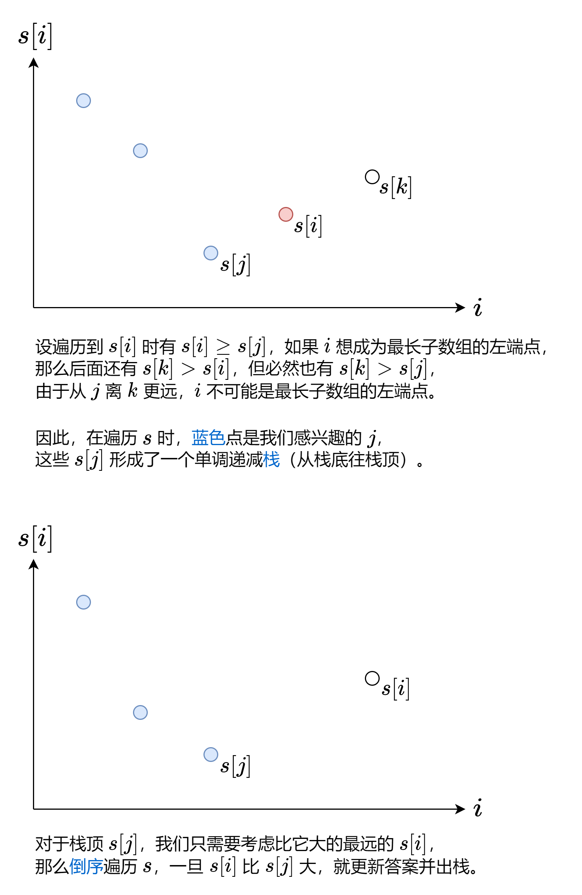
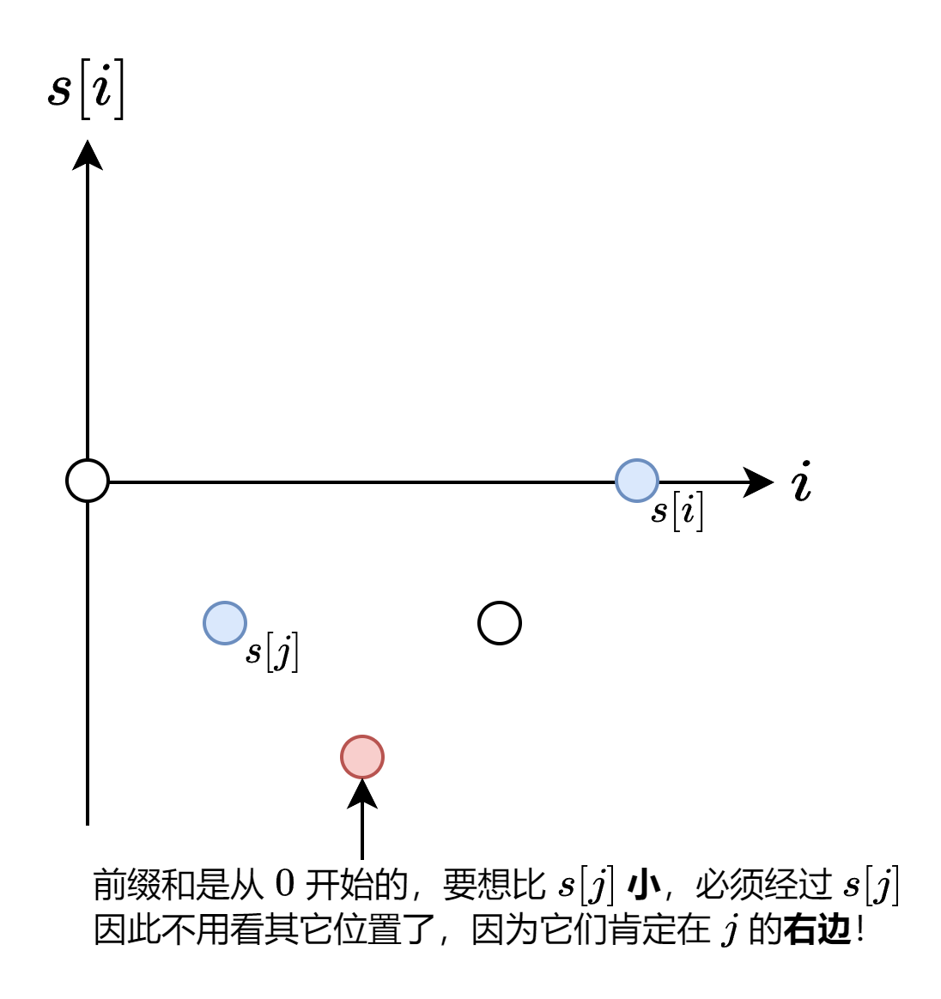

# 两种做法，两张图秒懂！（Python/Java/C++/Go）

> **[1124. 表现良好的最长时间段](https://leetcode.cn/problems/longest-well-performing-interval/solutions/2110211/liang-chong-zuo-fa-liang-zhang-tu-miao-d-hysl/) · Medium · 难度分 1908**

> **所属题单**
> - [常用数据结构 · 一、前缀和](../../../刷题路径/灵神原版题单/常用数据结构/一、前缀和.md) · §1.2 前缀和与哈希表
> - [单调栈 · 一、单调栈](../../../刷题路径/灵神原版题单/单调栈/一、单调栈.md) · §1.2 进阶

> **题目描述**
> 给你一份工作时间表 `hours`，上面记录着某一位员工每天的工作小时数。
>
> 我们认为当员工一天中的工作小时数大于 `8` 小时的时候，那么这一天就是「**劳累的一天**」。
>
> 所谓「表现良好的时间段」，意味在这段时间内，「劳累的天数」是严格 **大于**「不劳累的天数」。
>
> 请你返回「表现良好时间段」的最大长度。
>
> **示例 1：**
>
> ```
>
> 输入：hours = [9,9,6,0,6,6,9]
> 输出：3
> 解释：最长的表现良好时间段是 [9,9,6]。
> ```
>
> **示例 2：**
>
> ```
>
> 输入：hours = [6,6,6]
> 输出：0
> ```
>
> **提示：**
>
> - `1 <= hours.length <= 10⁴`
>
> - `0 <= hours[i] <= 16`

> **题解**
> # 前置知识：前缀和
>
> 对于数组 $\textit{nums}$，定义它的前缀和 $\textit{s}[0]=0$，$\textit{s}[i+1] = \sum\limits_{j=0}^{i}\textit{nums}[j]$。
>
> 例如 $\textit{nums}=[1,2,-1,2]$，对应的前缀和数组为 $s=[0,1,3,2,4]$。
>
> 通过前缀和，我们可以把**子数组的元素和转换成两个前缀和的差**，即
>
> $$
> \sum_{j=\textit{left}}^{\textit{right}}\textit{nums}[j] = \sum\limits_{j=0}^{\textit{right}}\textit{nums}[j] - \sum\limits_{j=0}^{\textit{left}-1}\textit{nums}[j] = \textit{s}[\textit{right}+1] - \textit{s}[\textit{left}]
> $$
>
> 例如 $\textit{nums}$ 的子数组 $[2,-1,2]$ 的和就可以用 $s[4]-s[1]=4-1=3$ 算出来。
>
> > 注：为方便计算，常用左闭右开区间 $[\textit{left},\textit{right})$ 来表示子数组，此时子数组的和为 $\textit{s}[\textit{right}] - \textit{s}[\textit{left}]$，子数组的长度为 $\textit{right}-\textit{left}$。
>
> # 方法一：单调栈
>
> 先把问题转换到我们熟悉的东西上。
>
> 「劳累天数大于不劳累天数」等价于「劳累天数减去不劳累天数大于 $0$」。
>
> 那么把劳累的一天视作 $\textit{nums}[i]=1$，不劳累的一天视作 $\textit{nums}[i]=-1$，则问题变为：
>
> 计算 $\textit{nums}$ 的最长子数组，其元素和大于 $0$。
>
> 既然说到了「子数组的元素和」，那么利用前缀和 $s$，将问题变为：
>
> 找到两个下标 $i$ 和 $j$，满足 $j<i$ 且 $s[j]<s[i]$，最大化 $i-j$ 的值。
>
> 想一想，哪些值可以作为 $j$（最长子数组的左端点）呢？
>
> 
>
> ### 答疑
>
> **问**：我怎么觉得这题和我做过的单调栈题目不太一样呢？~~没法快乐套模板~~
>
> **答**：通常的单调栈题目（例如 [496. 下一个更大元素 I](https://leetcode.cn/problems/next-greater-element-i/)）都是求的「最近」或「最短」，本题求的是「最长」，不能一概而论。~~就当成是新的模板~~
>
> ```python
> class Solution:
>     def longestWPI(self, hours: List[int]) -> int:
>         n = len(hours)
>         s = [0] * (n + 1)  # 前缀和
>         st = [0]  # s[0]
>         for j, h in enumerate(hours, 1):
>             s[j] = s[j - 1] + (1 if h > 8 else -1)
>             if s[j] < s[st[-1]]: st.append(j)  # 感兴趣的 j
>         ans = 0
>         for i in range(n, 0, -1):
>             while st and s[i] > s[st[-1]]:
>                 ans = max(ans, i - st.pop())  # [st[-1],i) 可能是最长子数组
>         return ans
> ```
>
>
> ### 复杂度分析
>
> - 时间复杂度：$O(n)$，其中 $n$ 为 $\textit{hours}$ 的长度。注意每个元素至多入栈出栈各一次，因此二重循环的时间复杂度是 $O(n)$ 的。
> - 空间复杂度：$O(n)$。
>
> # 方法二：利用前缀和的连续性
>
> 虽说方法一更加通用，不过利用 $\textit{nums}$ 中只有 $1$ 和 $-1$ 的特点，可以做到**一次遍历**。
>
> 考虑 $s[i]$：
>
> - 如果 $s[i]>0$，那么 $j=0$ 就是最远的左端点，因为 $s[0]=0$，故 $s[i]-s[0]=s[i]>0$，符合要求。
> - 如果 $s[i]\le 0$，那么 $j$ 就是 $s[i]-1$ 首次出现的位置。为什么是 $s[i]-1$ 而不是其它更小的数？这是因为前缀和是从 $0$ 开始的，由于 $\textit{nums}$ 中只有 $1$ 和 $-1$，那么相邻前缀和的差都恰好为 $1$，要想算出比 $s[i]-1$ 更小的数，必然会先算出 $s[i]-1$，那么这些更小数必然在 $s[i]-1$ 首次出现的位置的**右边**。
>
> 
>
> 代码实现时，可以用哈希表记录每个 $s[i]$ 首次出现的下标。
>
> 不过，由于我们只需要考虑值在闭区间 $[-n,0]$ 内的前缀和，用数组记录是更加高效的。同时，为了避免用负数访问数组，可以在计算过程中把前缀和取反。
>
> ```python
> class Solution:
>     def longestWPI(self, hours: List[int]) -> int:
>         pos = [0] * (len(hours) + 2)  # 记录前缀和首次出现的位置
>         ans = s = 0
>         for i, h in enumerate(hours, 1):
>             s -= 1 if h > 8 else -1  # 取反，改为减法
>             if s < 0:
>                 ans = i
>             else:
>                 if pos[s + 1]:  # 原本是 s-1，取反改为 s+1
>                     ans = max(ans, i - pos[s + 1])  # 这里手写 if 会更快
>                 if pos[s] == 0:
>                     pos[s] = i
>         return ans
> ```
>
>
> ### 复杂度分析
>
> - 时间复杂度：$O(n)$，其中 $n$ 为 $\textit{hours}$ 的长度。
> - 空间复杂度：$O(n)$。
>
> ### 相似题目
>
> 单调栈和单调队列背后的思想是类似的，本题求的是「最长」，而 [862. 和至少为 K 的最短子数组](https://leetcode.cn/problems/shortest-subarray-with-sum-at-least-k/) 求的是「最短」。
>
> 通过比较这两题的区别，相信各位能对单调栈和单调队列有一个更加深刻的认识。具体请看 [两张图秒懂单调队列](../../0800-0899/0862%20和至少为%20K%20的最短子数组/灵茶山艾府.md)。我在这篇题解的末尾附上了大量单调栈和单调队列的题目，供各位练习。
>
> 另外，[962. 最大宽度坡](https://leetcode.cn/problems/maximum-width-ramp/) 和本题非常像，你可以用方法一的代码秒杀。~~双倍经验~~
