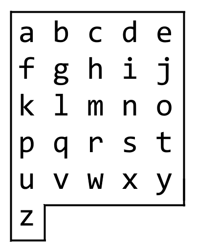

# 1138. 字母板上的路径

Medium · [力扣原题](https://leetcode.cn/problems/alphabet-board-path/)

| 作者 | 题解 | 动画讲解 |
|---|---|---|
| 灵茶山艾府 | [📄 题解](灵茶山艾府.md) | [▶︎ 动画（GIF）](1138%20字母板上的路径%20·%20灵茶山艾府.gif) · [mp4 文件](1138%20字母板上的路径%20·%20灵茶山艾府.mp4) |
| yiduobo | [📄 题解](yiduobo.md) | [▶︎ 动画（GIF）](1138%20字母板上的路径%20·%20yiduobo.gif) · [mp4 文件](1138%20字母板上的路径%20·%20yiduobo.mp4) |

## 动画讲解

> 动图会循环播放；想暂停、拖进度条请下载上面表格里的 mp4 文件。

### 灵茶山艾府


### yiduobo


## 题目描述

我们从一块字母板上的位置 `(0, 0)` 出发，该坐标对应的字符为 `board[0][0]`。

在本题里，字母板为`board = ["abcde", "fghij", "klmno", "pqrst", "uvwxy", "z"]`，如下所示。



我们可以按下面的指令规则行动：

- 如果方格存在，`'U'` 意味着将我们的位置上移一行；

- 如果方格存在，`'D'` 意味着将我们的位置下移一行；

- 如果方格存在，`'L'` 意味着将我们的位置左移一列；

- 如果方格存在，`'R'` 意味着将我们的位置右移一列；

- `'!'` 会把在我们当前位置 `(r, c)` 的字符 `board[r][c]` 添加到答案中。

（注意，字母板上只存在有字母的位置。）

返回指令序列，用最小的行动次数让答案和目标 `target` 相同。你可以返回任何达成目标的路径。

**示例 1：**

```

输入：target = "leet"
输出："DDR!UURRR!!DDD!"
```

**示例 2：**

```

输入：target = "code"
输出："RR!DDRR!UUL!R!"
```

**提示：**

- `1 <= target.length <= 100`

- `target` 仅含有小写英文字母。

---
[↑ 返回 1100-1199](../README.md) · [总索引](../../../索引.md) · [仓库首页](../../../README.md)
