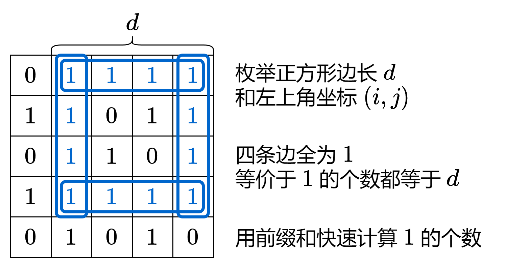

# 【图解】前缀和轻松 AC！（Python/Java/C++/Go）

> **[1139. 最大的以 1 为边界的正方形](https://leetcode.cn/problems/largest-1-bordered-square/solutions/2115990/tu-jie-qian-zhui-he-qing-song-acpythonja-5mnn/) · Medium**

> **题目描述**
> 给你一个由若干 `0` 和 `1` 组成的二维网格 `grid`，请你找出边界全部由 `1` 组成的最大 **正方形** 子网格，并返回该子网格中的元素数量。如果不存在，则返回 `0`。
>
> **示例 1：**
>
> ```
> 输入：grid = [[1,1,1],[1,0,1],[1,1,1]]
> 输出：9
> ```
>
> **示例 2：**
>
> ```
> 输入：grid = [[1,1,0,0]]
> 输出：1
> ```
>
> **提示：**
>
> - `1 <= grid.length <= 100`
>
> - `1 <= grid[0].length <= 100`
>
> - `grid[i][j]` 为 `0` 或 `1`

> **题解**
> ## 前置知识：前缀和
>
> 对于数组 $\textit{nums}$，定义它的前缀和 $\textit{s}[0]=0$，$\textit{s}[i+1] = \sum\limits_{j=0}^{i}\textit{nums}[j]$。
>
> 例如 $\textit{nums}=[1,2,-1,2]$，对应的前缀和数组为 $s=[0,1,3,2,4]$。
>
> 通过前缀和，我们可以把**子数组的元素和转换成两个前缀和的差**，即
>
> $$
> \sum_{j=\textit{left}}^{\textit{right}}\textit{nums}[j] = \sum\limits_{j=0}^{\textit{right}}\textit{nums}[j] - \sum\limits_{j=0}^{\textit{left}-1}\textit{nums}[j] = \textit{s}[\textit{right}+1] - \textit{s}[\textit{left}]
> $$
>
> 例如 $\textit{nums}$ 的子数组 $[2,-1,2]$ 的和就可以用 $s[4]-s[1]=4-1=3$ 算出来。
>
> > 注：为方便计算，常用左闭右开区间 $[\textit{left},\textit{right})$ 来表示子数组，此时子数组的和为 $\textit{s}[\textit{right}] - \textit{s}[\textit{left}]$，子数组的长度为 $\textit{right}-\textit{left}$。
> > 
> > 注 2：$s[0]=0$ 表示的是一个空数组的元素和。为什么要额外定义它？想一想，如果要计算的子数组恰好是一个前缀（从 $\textit{nums}[0]$ 开始），你要用 $s[\textit{right}]$ 减去谁呢？通过定义 $s[0]=0$，任意子数组（包括前缀）都可以表示为两个前缀和的差。
>
> ## 思路
>
> 
>
> ```python
> class Solution:
>     def largest1BorderedSquare(self, grid: List[List[int]]) -> int:
>         m, n = len(grid), len(grid[0])
>         rs = [list(accumulate(row, initial=0)) for row in grid]  # 每行的前缀和
>         cs = [list(accumulate(col, initial=0)) for col in zip(*grid)]  # 每列的前缀和
>         for d in range(min(m, n), 0, -1):  # 从大到小枚举正方形边长 d
>             for i in range(m - d + 1):
>                 for j in range(n - d + 1):  # 枚举正方形左上角坐标 (i,j)
>                     # 上 左 下 右 四条边 1 的个数均为 d
>                     if rs[i][j + d] - rs[i][j] == d and \
>                        cs[j][i + d] - cs[j][i] == d and \
>                        rs[i + d - 1][j + d] - rs[i + d - 1][j] == d and \
>                        cs[j + d - 1][i + d] - cs[j + d - 1][i] == d:
>                         return d * d
>         return 0
> ```
>
>
> #### 复杂度分析
>
> - 时间复杂度：$O(mn\cdot\min(m,n))$，其中 $m$ 和 $n$ 分别为 $\textit{grid}$ 的行数和列数。
> - 空间复杂度：$O(mn)$。
>
> 欢迎关注 [B站@灵茶山艾府](https://space.bilibili.com/206214)
>
> 更多精彩题解，请看 [往期题解精选（已分类）](https://github.com/EndlessCheng/codeforces-go/blob/master/leetcode/SOLUTIONS.md)
