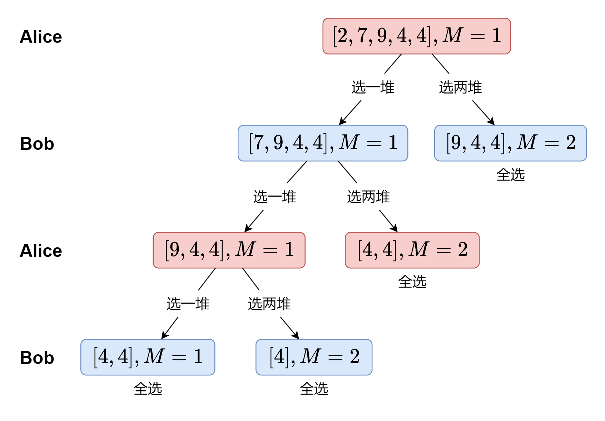

# 动态规划：从 O(n^3) 到 O(n^2)，单调队列优化（Python/Java/C++/Go）

> **[1140. 石子游戏 II](https://leetcode.cn/problems/stone-game-ii/solutions/2125753/jiao-ni-yi-bu-bu-si-kao-dong-tai-gui-hua-jjax/) · Medium · 难度分 2035**

> **所属题单**
> - [动态规划 · 十一、优化 DP](../../../刷题路径/灵神原版题单/动态规划/十一、优化%20DP.md) · §11.3 单调队列优化 DP
> - [动态规划 · 十四、博弈 DP](../../../刷题路径/灵神原版题单/动态规划/十四、博弈%20DP.md)
> - [数学算法 · 四、博弈论](../../../刷题路径/灵神原版题单/数学算法/四、博弈论.md)

> **题目描述**
> Alice 和 Bob 继续他们的石子游戏。许多堆石子 **排成一行**，每堆都有正整数颗石子 `piles[i]`。游戏以谁手中的石子最多来决出胜负。
>
> Alice 和 Bob 轮流进行，Alice 先开始。最初，`M = 1`。
>
> 在每个玩家的回合中，该玩家可以拿走剩下的 **前** `X` 堆的所有石子，其中 `1 <= X <= 2M`。然后，令 `M = max(M, X)`。
>
> 游戏一直持续到所有石子都被拿走。
>
> 假设 Alice 和 Bob 都发挥出最佳水平，返回 Alice 可以得到的最大数量的石头。
>
> **示例 1：**
>
> ```
>
> 输入：piles = [2,7,9,4,4]
> 输出：10
> 解释：如果一开始 Alice 取了一堆，Bob 取了两堆，然后 Alice 再取两堆。Alice 可以得到 2 + 4 + 4 = 10 堆。
> 如果 Alice 一开始拿走了两堆，那么 Bob 可以拿走剩下的三堆。在这种情况下，Alice 得到 2 + 7 = 9 堆。返回 10，因为它更大。
> ```
>
> **示例 2:**
>
> ```
>
> 输入：piles = [1,2,3,4,5,100]
> 输出：104
> ```
>
> **提示：**
>
> - `1 <= piles.length <= 100`
>
> - `1 <= piles[i] <= 10⁴`

> **题解**
> ## 一、思考递归怎么写
>
> 游戏规则：「以谁手中的石子最多来决出胜负」。
>
> 在示例 1 中，Alice 一开始有两个选择：拿前一堆或者前两堆石子。如果 Alice 拿前一堆，那么轮到 Bob 时，他也可以在剩下的四堆石子中，拿前一堆或者前两堆石子。如果 Bob 拿前一堆，那么又轮到 Alice …… 不断这样思考下去，可以画出如下搜索树。注意如果可以全部拿完，就全拿。
>
> 
>
> 根据上图，定义 $\textit{dfs}(i,M)$ 表示当前玩家从 $\textit{piles}[i]$ 开始拿石子，当前玩家在本回合以及之后的回合中，总共可以得到的最大石子数。其中 $M$ 的含义同题目描述。
>
> 由于剩余石子的总数是固定的，所以剩余石子的总数 - 对手拿走的石子总数 = 当前玩家拿走的石子总数。
>
> 如果当前玩家在本回合拿了 $X$ 堆石子，根据 $\textit{dfs}$ 的定义，在这之后的所有回合中，对手总共可以拿走 $\textit{dfs}(i+X,\max(M,X))$ 颗石子，即
>
> $$
> \textit{dfs}(i,M) = s[i] - \textit{dfs}(i+X,\max(M,X))
> $$
>
> 其中 $s[i]$ 为后缀和，即 $s[i] = \sum\limits_{j=i}^{n-1}\textit{piles}[j]$。
>
> 枚举 $X$，取对手可以拿走的石子个数的最小值，得
>
> $$
> \textit{dfs}(i,M) = s[i] - \min_{X=1}^{2M}\textit{dfs}(i+X,\max(M,X))
> $$
>
> **递归边界**：如果 $i+2M\ge n$，那么当前玩家可以全拿，直接返回 $s[i]$。
>
> **递归入口**：$\textit{dfs}(0,1)$。
>
> ```python
> # 尚未优化，会超时
> class Solution:
>     def stoneGameII(self, s: List[int]) -> int:
>         n = len(s)
>         for i in range(n - 2, -1, -1):
>             s[i] += s[i + 1]  # 后缀和
>
>         def dfs(i: int, m: int) -> int:
>             if i + m * 2 >= n:  # 全拿
>                 return s[i]
>             return s[i] - min(dfs(i + x, max(m, x)) for x in range(1, m * 2 + 1))
>
>         return dfs(0, 1)
> ```
>
>
> ## 二、改成记忆化搜索
>
> 举个例子，「Alice 拿一堆，Bob 拿两堆」和「Alice 拿两堆，Bob 拿一堆」，都会递归到 $\textit{dfs}(3,2)$。
>
> 一叶知秋，整个回溯过程是有大量重复递归调用的。由于递归函数没有副作用，无论调用 $\textit{dfs}(i,M)$ 多少次，算出来的结果都是一样的，因此可以用**记忆化搜索**来优化：
>
> - 如果一个状态（递归入参）是第一次遇到，那么可以在返回前，把状态及其结果记到一个 $\textit{memo}$ 数组（或者哈希表）中；
> - 如果一个状态不是第一次遇到，那么直接返回 $\textit{memo}$ 中保存的结果。
>
> 关于记忆化搜索的原理，请看视频讲解 [动态规划入门：从记忆化搜索到递推【基础算法精讲 17】](https://www.bilibili.com/video/BV1Xj411K7oF/)，其中包含把记忆化搜索 1:1 翻译成递推的技巧。
>
> #### 答疑
>
> **问**：我要用二维数组记录的话，第二个维度开多大空间比较合适？或者说，**需要被记忆化的** $M$ 的上界是多少？
>
> **答**：两人交替拿石子，为了在 $i$ 尽量小的情况下，使 $M$ 尽量大，那么每次都拿满 $2M$ 堆，最后有 $(2+4+8+\cdots+M)+2M<n$，即 $4M-2<n$，亦为 $4M\le n+1$，这样算的话 $M$ 的上界为 $\left\lfloor\dfrac{n+1}{4}\right\rfloor$。注意后面可以根据 $n$ 来调整，不一定要拿满 $2M$，比如 $n=12$ 时，可以第一轮拿 $2$ 堆，第二轮拿 $3$ 堆，此时 $2+3+2\cdot 3=11<12$，那么 $M$ 最大为 $3$。
>
> 总而言之，**需要被记忆化的** $M$ 的上界为 $\left\lfloor\dfrac{n+1}{4}\right\rfloor$。
>
> ```python
> class Solution:
>     def stoneGameII(self, s: List[int]) -> int:
>         n = len(s)
>         for i in range(n - 2, -1, -1):
>             s[i] += s[i + 1]  # 后缀和
>
>         @cache  # 缓存装饰器，避免重复计算 dfs（一行代码实现记忆化）
>         def dfs(i: int, m: int) -> int:
>             if i + m * 2 >= n:  # 全拿
>                 return s[i]
>             return s[i] - min(dfs(i + x, max(m, x)) for x in range(1, m * 2 + 1))
>
>         return dfs(0, 1)
> ```
>
>
> #### 复杂度分析
>
> - 时间复杂度：$\mathcal{O}(n^3)$，其中 $n$ 是 $\textit{piles}$ 的长度。记忆化后，每个状态只会计算一次，因此时间复杂度 $=$ 状态个数 $\times$ 单个状态的计算时间。本题中状态个数等于 $\mathcal{O}(n^2)$，而单个状态的计算时间为 $\mathcal{O}(n)$，因此时间复杂度为 $\mathcal{O}(n^3)$。
> - 空间复杂度：$\mathcal{O}(n^2)$。保存多少状态，就需要多少空间。
>
> ## 三、1:1 翻译成递推
>
> 我们可以去掉递归中的「递」，只保留「归」的部分，即自底向上计算。
>
> 做法：
>
> - $\textit{dfs}$ 改成 $f$ 数组；
> - 递归改成循环（每个参数都对应一层循环）；
> - 递归边界改成 $f$ 数组的初始值。由于本题的边界比较复杂，直接在递推中计算。
>
> 代码实现时，可以一边计算 $f$，一边计算后缀和。
>
> #### 答疑
>
> **问**：为什么一定要倒序循环？
>
> **答**：在记忆化搜索中，我们从起点 $(0,1)$ 出发向下「递」，此时 $i$ 不断变大；「归」就是从叶子出发向着起点计算，此时 $i$ 不断变小。所以要改成递推（只有「归」），$i$ 必须从大到小计算。对于 $M$ 来说正序逆序都可以，因为我们是从 $f[i+x][\cdot]$ 转移来的，无论先算哪个 $M$ 都是正确的。
>
> **问**：为什么 $f$ 数组第二个维度的大小比 $\textit{memo}$ 的要大？
>
> **答**：记忆化搜索没有把递归边界记录进去，而递推为了代码实现方便，把递归边界也记录到了数组中。
>
> **问**：为什么 $M$ 循环到了 $\left\lfloor\dfrac{i}{2}\right\rfloor+1$？
>
> **答**：极端情况下，每次都拿满 $2M$ 堆，有 $i=2+4+8+\cdots+M=2M-2$；不是这种极端情况的话，$i\ge 2M-2$，整理得到 $M\le\left\lfloor\dfrac{i+2}{2}\right\rfloor=\left\lfloor\dfrac{i}{2}\right\rfloor+1$。
>
> ```python
> class Solution:
>     def stoneGameII(self, piles: List[int]) -> int:
>         s, n = 0, len(piles)
>         f = [[0] * (n + 1) for _ in range(n)]
>         for i in range(n - 1, -1, -1):
>             s += piles[i]
>             for m in range(1, i // 2 + 2):
>                 if i + m * 2 >= n:  # 全拿
>                     f[i][m] = s
>                 else:
>                     f[i][m] = s - min(f[i + x][max(m, x)] for x in range(1, m * 2 + 1))
>         return f[0][1]
> ```
>
>
> #### 复杂度分析
>
> - 时间复杂度：$\mathcal{O}(n^3)$，其中 $n$ 是 $\textit{piles}$ 的长度。
> - 空间复杂度：$\mathcal{O}(n^2)$。
>
> ## 四、单调队列优化
>
> 讨论 $\max(m,x)$ 的值：
>
> - 当 $x\le m$ 时，$\max(m,x) = m$。
> - 当 $x> m$ 时，$\max(m,x) = x$。
>
> 当 $i+2m<n$ 时，状态转移方程可以分成两部分：
>
> $$
> f[i][m] = s_i - \min
> \begin{cases}
> & \min\limits_{j=i+1}^{i+m} f[j][m]    \\
> & \min\limits_{x=m+1}^{2m} f[i+x][x]    \\
> \end{cases}
> $$
>
> 第一部分，我们求的是长为 $m$ 的**滑动窗口最小值**（窗口向上滑动），做法同 [239. 滑动窗口最大值](https://leetcode.cn/problems/sliding-window-maximum/)，原理请看 [单调队列【基础算法精讲 27】](https://www.bilibili.com/video/BV1bM411X72E/)。
>
> 第二部分，在 $f$ 矩阵上看，我们求的是一个斜向的滑动窗口最小值。左上角在 $(i+m+1,m+1)$，右下角在 $(i+2m,2m)$，窗口长度为 $m$。窗口向右下滑动。
>
> ```python
> class Solution:
>     def stoneGameII(self, piles: list[int]) -> int:
>         n = len(piles)
>         f = [[0] * (n + 1) for _ in range(n)]
>         col_q = [deque() for _ in range(n + 1)]  # 每列的滑动窗口最小值（窗口向上滑动）
>
>         s = 0
>         for i in range(n - 1, -1, -1):
>             s += piles[i]
>             diag_q = deque()  # 斜向的滑动窗口最小值（窗口向右下滑动）
>             for m in range(1, i // 2 + 2):
>                 if i + m * 2 >= n:  # 全拿
>                     f[i][m] = s
>                     continue
>
>                 # f[i+1][m] 进入列窗口
>                 q = col_q[m]
>                 while q and f[q[-1]][m] >= f[i + 1][m]:
>                     q.pop()
>                 q.append(i + 1)
>
>                 # 队首离开列窗口
>                 if q[0] > i + m:
>                     q.popleft()
>
>                 # f[i+m*2-1][m*2-1] 和 f[i+m*2][m*2] 进入斜向窗口
>                 for x in range(m * 2 - 1, m * 2 + 1):
>                     while diag_q and f[i + diag_q[-1]][diag_q[-1]] >= f[i + x][x]:
>                         diag_q.pop()
>                     diag_q.append(x)
>
>                 # 队首离开斜向窗口
>                 if diag_q[0] <= m:
>                     diag_q.popleft()
>
>                 f[i][m] = s - min(f[q[0]][m], f[i + diag_q[0]][diag_q[0]])
>
>         return f[0][1]
> ```
>
>
> #### 复杂度分析
>
> - 时间复杂度：$\mathcal{O}(n^2)$，其中 $n$ 是 $\textit{piles}$ 的长度。每个 $f[i][m]$ 至多进出窗口两次（列窗口和斜向窗口各一次），所以总的循环次数是 $\mathcal{O}(n^2)$ 的。
> - 空间复杂度：$\mathcal{O}(n^2)$。
>
> ## 专题训练
>
> 见下面动态规划题单的「**十四、博弈 DP**」和「**§11.3 单调队列优化 DP**」。
>
> ## 分类题单
>
> [如何科学刷题？](https://leetcode.cn/discuss/post/3141566/ru-he-ke-xue-shua-ti-by-endlesscheng-q3yd/)
>
> 1. [滑动窗口与双指针（定长/不定长/单序列/双序列/三指针/分组循环）](https://leetcode.cn/discuss/post/3578981/ti-dan-hua-dong-chuang-kou-ding-chang-bu-rzz7/)
> 2. [二分算法（二分答案/最小化最大值/最大化最小值/第K小）](https://leetcode.cn/discuss/post/3579164/ti-dan-er-fen-suan-fa-er-fen-da-an-zui-x-3rqn/)
> 3. [单调栈（基础/矩形面积/贡献法/最小字典序）](https://leetcode.cn/discuss/post/3579480/ti-dan-dan-diao-zhan-ju-xing-xi-lie-zi-d-u4hk/)
> 4. [网格图（DFS/BFS/综合应用）](https://leetcode.cn/discuss/post/3580195/fen-xiang-gun-ti-dan-wang-ge-tu-dfsbfszo-l3pa/)
> 5. [位运算（基础/性质/拆位/试填/恒等式/思维）](https://leetcode.cn/discuss/post/3580371/fen-xiang-gun-ti-dan-wei-yun-suan-ji-chu-nth4/)
> 6. [图论算法（DFS/BFS/拓扑排序/基环树/最短路/最小生成树/网络流）](https://leetcode.cn/discuss/post/3581143/fen-xiang-gun-ti-dan-tu-lun-suan-fa-dfsb-qyux/)
> 7. [动态规划（入门/背包/划分/状态机/区间/状压/数位/数据结构优化/树形/博弈/概率期望）](https://leetcode.cn/discuss/post/3581838/fen-xiang-gun-ti-dan-dong-tai-gui-hua-ru-007o/)
> 8. [常用数据结构（前缀和/差分/栈/队列/堆/字典树/并查集/树状数组/线段树）](https://leetcode.cn/discuss/post/3583665/fen-xiang-gun-ti-dan-chang-yong-shu-ju-j-bvmv/)
> 9. [数学算法（数论/组合/概率期望/博弈/计算几何/随机算法）](https://leetcode.cn/discuss/post/3584388/fen-xiang-gun-ti-dan-shu-xue-suan-fa-shu-gcai/)
> 10. [贪心与思维（基本贪心策略/反悔/区间/字典序/数学/思维/脑筋急转弯/构造）](https://leetcode.cn/discuss/post/3091107/fen-xiang-gun-ti-dan-tan-xin-ji-ben-tan-k58yb/)
> 11. [链表、树与回溯（前后指针/快慢指针/DFS/BFS/直径/LCA）](https://leetcode.cn/discuss/post/3142882/fen-xiang-gun-ti-dan-lian-biao-er-cha-sh-6srp/)
> 12. [字符串（KMP/Z函数/Manacher/字符串哈希/AC自动机/后缀数组/子序列自动机）](https://leetcode.cn/discuss/post/3144832/fen-xiang-gun-ti-dan-zi-fu-chuan-kmpzhan-ugt4/)
>
> [我的题解精选（已分类）](https://github.com/EndlessCheng/codeforces-go/blob/master/leetcode/SOLUTIONS.md)
>
> 欢迎关注 [B站@灵茶山艾府](https://space.bilibili.com/206214)
