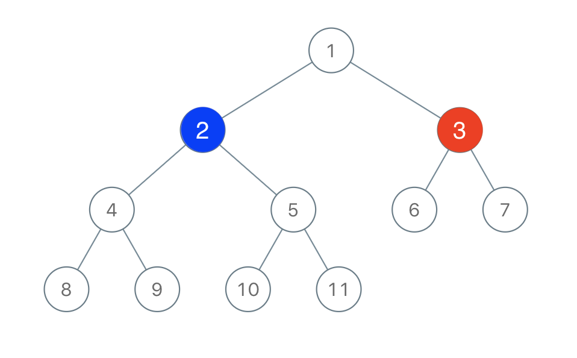
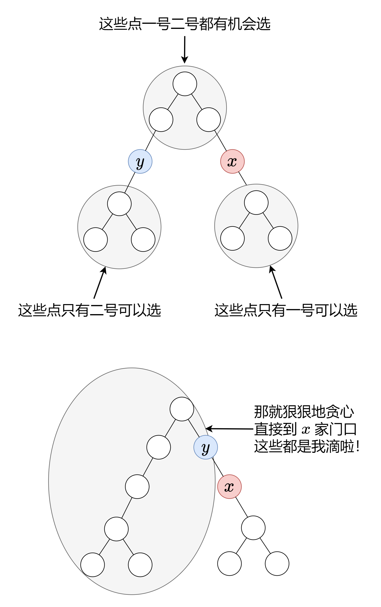

# 没有思路？一张图秒懂！（Python/Java/C++/Go）

> **[1145. 二叉树着色游戏](https://leetcode.cn/problems/binary-tree-coloring-game/solutions/2089813/mei-you-si-lu-yi-zhang-tu-miao-dong-pyth-btav/) · Medium · 难度分 1741**

> **所属题单**
> - [链表、二叉树与回溯 · 二、二叉树](../../../刷题路径/灵神原版题单/链表、二叉树与回溯/二、二叉树.md) · §2.3 自底向上 DFS（后序遍历）
> - [贪心算法 · 五、思维题](../../../刷题路径/灵神原版题单/贪心算法/五、思维题.md) · §5.2 脑筋急转弯

> **题目描述**
> 有两位极客玩家参与了一场「二叉树着色」的游戏。游戏中，给出二叉树的根节点 `root`，树上总共有 `n` 个节点，且 `n` 为奇数，其中每个节点上的值从 `1` 到 `n` 各不相同。
>
> 最开始时：
>
> - 「一号」玩家从 `[1, n]` 中取一个值 `x`（`1 <= x <= n`）；
>
> - 「二号」玩家也从 `[1, n]` 中取一个值 `y`（`1 <= y <= n`）且 `y != x`。
>
> 「一号」玩家给值为 `x` 的节点染上红色，而「二号」玩家给值为 `y` 的节点染上蓝色。
>
> 之后两位玩家轮流进行操作，「一号」玩家先手。每一回合，玩家选择一个被他染过色的节点，将所选节点一个 **未着色** 的邻节点（即左右子节点、或父节点）进行染色（「一号」玩家染红色，「二号」玩家染蓝色）。
>
> 如果（且仅在此种情况下）当前玩家无法找到这样的节点来染色时，其回合就会被跳过。
>
> 若两个玩家都没有可以染色的节点时，游戏结束。着色节点最多的那位玩家获得胜利 ✌️。
>
> 现在，假设你是「二号」玩家，根据所给出的输入，假如存在一个 `y` 值可以确保你赢得这场游戏，则返回 `true` ；若无法获胜，就请返回 `false` 。
>
> **示例 1 ：**
>
> 
>
> ```
>
> 输入：root = [1,2,3,4,5,6,7,8,9,10,11], n = 11, x = 3
> 输出：true
> 解释：第二个玩家可以选择值为 2 的节点。
> ```
>
> **示例 2 ：**
>
> ```
>
> 输入：root = [1,2,3], n = 3, x = 1
> 输出：false
> ```
>
> **提示：**
>
> - 树中节点数目为 `n`
>
> - `1 <= x <= n <= 100`
>
> - `n` 是奇数
>
> - `1 <= Node.val <= n`
>
> - 树中所有值 **互不相同**

> **题解**
> 
>
> 以 $x$ 为根，它的三个邻居（左儿子、右儿子和父节点）就对应着三棵子树：
>
> - 左子树
> - 右子树
> - 父节点子树
>
> 哪棵子树最大，二号玩家就选哪棵。
>
> 设 $n_2$ 为二号玩家最多可以染的节点个数，左子树的大小为 $\textit{lsz}$，右子树的大小为 $\textit{rsz}$，那么父节点子树的大小就是 $n-1-\textit{lsz}-\textit{rsz}$，因此
>
> $$
> n_2 = \max(\textit{lsz},\textit{rsz},n-1-\textit{lsz}-\textit{rsz})
> $$
>
> 一号玩家染的节点个数为 $n-n_2$，获胜条件为 $n_2 > n-n_2$，即 $2\cdot n_2 > n$。
>
> 计算子树大小可以用**深度优先搜索**，如果你不了解这块内容，可以看我精心制作的[【基础算法精讲 09】](https://www.bilibili.com/video/BV1UD4y1Y769/)。
>
> ```python
> class Solution:
>     def btreeGameWinningMove(self, root: Optional[TreeNode], n: int, x: int) -> bool:
>         lsz = rsz = 0
>         def dfs(node: Optional[TreeNode]) -> int:
>             if node is None:
>                 return 0
>             ls = dfs(node.left)
>             rs = dfs(node.right)
>             if node.val == x:
>                 nonlocal lsz, rsz
>                 lsz, rsz = ls, rs
>             return ls + rs + 1
>         dfs(root)
>         return max(lsz, rsz, n - 1 - lsz - rsz) * 2 > n
> ```
>
>
> ### 复杂度分析
>
> - 时间复杂度：$O(n)$，其中 $n$ 为二叉树的节点个数。每个节点仅被访问一次。
> - 空间复杂度：$O(n)$。最坏情况下，二叉树是一条链，递归需要 $O(n)$ 的栈空间。
>
> ### 思考题
>
> 假如你是一号玩家，$x$ 由你决定，你是否有**必胜**策略？
>
> 如果题目给的是一般的树呢（不是二叉树）？
>
> 见 [树的重心](https://oi-wiki.org/graph/tree-centroid/)。
>
> 把 $x$ 选在重心上，一号玩家是必胜的。
