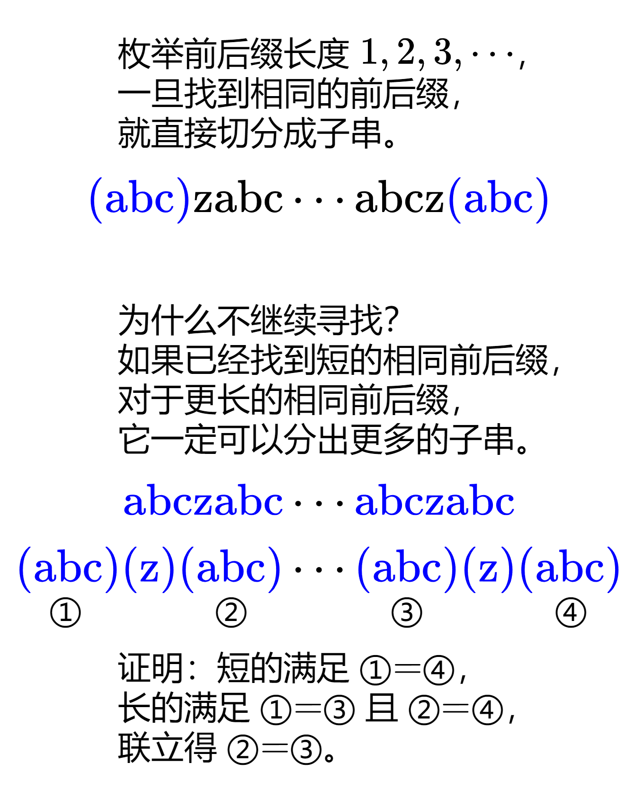

# 【图解】贪心做法，一图秒懂！（Python/Java/C++/Go）

> **[1147. 段式回文](https://leetcode.cn/problems/longest-chunked-palindrome-decomposition/solutions/2221544/tu-jie-tan-xin-zuo-fa-yi-tu-miao-dong-py-huik/) · Hard · 难度分 1912**

> **所属题单**
> - [贪心算法 · 三、字符串贪心](../../../刷题路径/灵神原版题单/贪心算法/三、字符串贪心.md) · §3.2 回文串贪心

> **题目描述**
> 你会得到一个字符串 `text` 。你应该把它分成 `k` 个子字符串 `(subtext1, subtext2，…， subtextk)` ，要求满足:
>
> - `subtext_i`<sub> </sub>是 **非空** 字符串
>
> - 所有子字符串的连接等于 `text` ( 即`subtext₁ + subtext₂ + ... + subtext_k == text` )
>
> - 对于所有 i 的有效值( 即 `1 <= i <= k` ) ，`subtext_i == subtext_(k - i + 1)` 均成立
>
> 返回`k`可能最大值。
>
> **示例 1：**
>
> ```
>
> 输入：text = "ghiabcdefhelloadamhelloabcdefghi"
> 输出：7
> 解释：我们可以把字符串拆分成 "(ghi)(abcdef)(hello)(adam)(hello)(abcdef)(ghi)"。
> ```
>
> **示例 2：**
>
> ```
>
> 输入：text = "merchant"
> 输出：1
> 解释：我们可以把字符串拆分成 "(merchant)"。
> ```
>
> **示例 3：**
>
> ```
>
> 输入：text = "antaprezatepzapreanta"
> 输出：11
> 解释：我们可以把字符串拆分成 "(a)(nt)(a)(pre)(za)(tep)(za)(pre)(a)(nt)(a)"。
> ```
>
> **提示：**
>
> - `1 <= text.length <= 1000`
>
> - `text` 仅由小写英文字符组成

> **题解**
> 
>
> ### 答疑
>
> **问**：如果短的长度超过了长的长度的一半呢？
>
> **答**：这是不可能的。用反证法证明。假设短的长度超过了长的长度的一半，上图证明中还可以得到 ①=②，结合前面的假设，说明 ① 和 ② 有重叠，且重叠部分既是短的前缀，也是短的后缀。比如 $\text{ababa}\cdots\text{ababa}$ 中 ①=②=$\text{aba}$，重叠部分为 $\text{a}$，既是 $\text{aba}$ 的前缀，也是 $\text{aba}$ 的后缀。这说明短的 $\text{aba}$ 还可以继续分割出更短的子串 $\text{a}$，而不是作为一个无法分割的整体，矛盾，所以不会出现短的长度超过了长的长度的一半的情况。
>
> ### 递归写法
>
> ```python
> class Solution:
>     def longestDecomposition(self, s: str) -> int:
>         if s == "":
>             return 0
>         for i in range(1, len(s) // 2 + 1):  # 枚举前后缀长度
>             if s[:i] == s[-i:]:  # 立刻分割
>                 return 2 + self.longestDecomposition(s[i:-i])
>         return 1  # 无法分割
> ```
>
>
> ### 迭代写法
>
> ```python
> class Solution:
>     def longestDecomposition(self, s: str) -> int:
>         ans = 0
>         while s:
>             i = 1
>             while i <= len(s) // 2 and s[:i] != s[-i:]:  # 枚举前后缀
>                 i += 1
>             if i > len(s) // 2:  # 无法分割
>                 ans += 1
>                 break
>             ans += 2  # 分割出 s[:i] 和 s[-i:]
>             s = s[i:-i]
>         return ans
> ```
>
>
> ### 复杂度分析
>
> - 时间复杂度：$O(n^2)$，其中 $n$ 为字符串的长度。最坏情况下无法分割，需要执行 $O(n)$ 次长为 $O(n)$ 的字符串比较，所以时间复杂度为 $O(n^2)$。
> - 空间复杂度：$O(n)$ 或 $O(1)$。Go 语言切片不会有拷贝，所以空间复杂度为 $O(1)$。当然，也可以手动比较字符串，这样无需生成子串。
>
> ---
>
> 欢迎关注[【biIibiIi@灵茶山艾府】](https://space.bilibili.com/206214)，高质量算法教学，持续更新中~
>
> 附：[每日一题·高质量题解精选](https://github.com/EndlessCheng/codeforces-go/blob/master/leetcode/SOLUTIONS.md)
