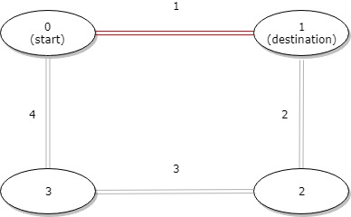
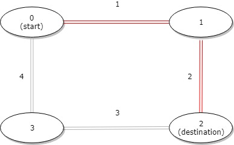
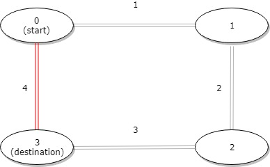

# 1184. 公交站间的距离

Easy · [力扣原题](https://leetcode.cn/problems/distance-between-bus-stops/)

| 作者 | 题解 | 动画讲解 |
|---|---|---|
| 灵茶山艾府 | [📄 题解](灵茶山艾府.md) | [▶︎ 动画（GIF）](1184%20公交站间的距离%20·%20灵茶山艾府.gif) · [mp4 文件](1184%20公交站间的距离%20·%20灵茶山艾府.mp4) |
| yiduobo | [📄 题解](yiduobo.md) | [▶︎ 动画（GIF）](1184%20公交站间的距离%20·%20yiduobo.gif) · [mp4 文件](1184%20公交站间的距离%20·%20yiduobo.mp4) |

## 动画讲解

> 动图会循环播放；想暂停、拖进度条请下载上面表格里的 mp4 文件。

### 灵茶山艾府


### yiduobo


## 题目描述

环形公交路线上有 `n` 个站，按次序从 `0` 到 `n - 1` 进行编号。我们已知每一对相邻公交站之间的距离，`distance[i]` 表示编号为 `i` 的车站和编号为 `(i + 1) % n` 的车站之间的距离。

环线上的公交车都可以按顺时针和逆时针的方向行驶。

返回乘客从出发点 `start` 到目的地 `destination` 之间的最短距离。

**示例 1：**



```
输入：distance = [1,2,3,4], start = 0, destination = 1
输出：1
解释：公交站 0 和 1 之间的距离是 1 或 9，最小值是 1。
```

**示例 2：**



```
输入：distance = [1,2,3,4], start = 0, destination = 2
输出：3
解释：公交站 0 和 2 之间的距离是 3 或 7，最小值是 3。
```

**示例 3：**



```
输入：distance = [1,2,3,4], start = 0, destination = 3
输出：4
解释：公交站 0 和 3 之间的距离是 6 或 4，最小值是 4。
```

**提示：**

- `1 <= n <= 10^4`

- `distance.length == n`

- `0 <= start, destination < n`

- `0 <= distance[i] <= 10^4`

---
[↑ 返回 1100-1199](../README.md) · [总索引](../../../索引.md) · [仓库首页](../../../README.md)
