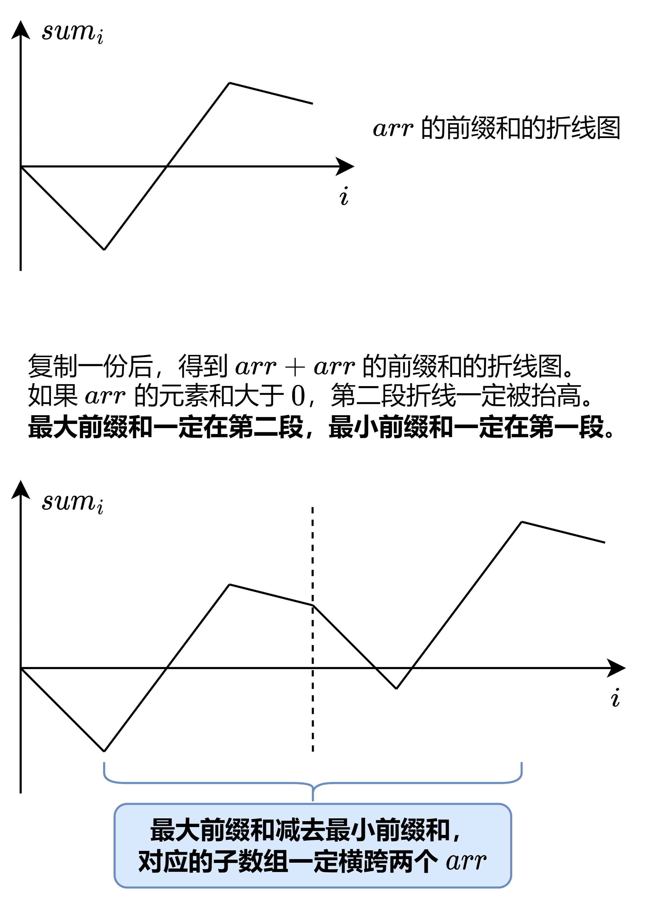

# 复用 53 题代码，简洁写法（Python/Java/C++/C/Go/JS/Rust）

> **[1191. K 次串联后最大子数组之和](https://leetcode.cn/problems/k-concatenation-maximum-sum/solutions/3675237/fu-yong-53-ti-dai-ma-jian-ji-xie-fa-pyth-qmtp/) · Medium · 难度分 1748**

> **所属题单**
> - [动态规划 · 一、入门 DP](../../../刷题路径/灵神原版题单/动态规划/一、入门%20DP.md) · §1.3 最大子数组和（最大子段和）

> **题目描述**
> 给定一个整数数组 `arr` 和一个整数 `k` ，通过重复 `k` 次来修改数组。
>
> 例如，如果 `arr = [1, 2]` ， `k = 3` ，那么修改后的数组将是 `[1, 2, 1, 2, 1, 2]` 。
>
> 返回修改后的数组中的最大的子数组之和。注意，子数组长度可以是 `0`，在这种情况下它的总和也是 `0`。
>
> 由于 **结果可能会很大**，需要返回结果对 `10⁹ + 7` 取 **模**。
>
> **示例 1：**
>
> ```
>
> 输入：arr = [1,2], k = 3
> 输出：9
> ```
>
> **示例 2：**
>
> ```
>
> 输入：arr = [1,-2,1], k = 5
> 输出：2
> ```
>
> **示例 3：**
>
> ```
>
> 输入：arr = [-1,-2], k = 7
> 输出：0
> ```
>
> **提示：**
>
> - `1 <= arr.length <= 10⁵`
>
> - `1 <= k <= 10⁵`
>
> - `-10⁴ <= arr[i] <= 10⁴`

> **题解**
> **前置题目**：[53. 最大子数组和](https://leetcode.cn/problems/maximum-subarray/)。
>
> 如果 $k=1$，那就是 53 题。注意本题允许子数组为空，答案最小是 $0$，不可能是负数。
>
> 如果 $k=2$，我们计算的是 $\textit{arr}+\textit{arr}$ 的最大子数组和。直接调用 53 题的代码。
>
> 如果 $k\ge 3$ 呢？
>
> **定理**：设 $s$ 是 $\textit{arr}$ 的元素和。如果 $s>0$，那么 $\textit{arr}+\textit{arr}$ 的最大子数组和必然横跨两个 $\textit{arr}$，不会在其中一个 $\textit{arr}$ 中间。
>
> **证明方法一**：用 53 题的前缀和做法（请看 [我的题解](../../0000-0099/0053%20最大子数组和/灵茶山艾府.md)）解释。如果 $s>0$，那么前缀和的最大值一定在第二段，前缀和的最小值一定在第一段，所以最大前缀和减去最小前缀和，对应的子数组一定横跨两个 $\textit{arr}$。如下图。
>
> {:width=500}
>
> **证明方法二**：反证法。假设最大子数组只在第一个 $\textit{arr}$ 中间，下标范围为 $[l,r]$。我们可以在最大子数组后面拼接一个完整的 $\textit{arr}$，即第一个数组的后缀 $[r+1,n-1]$ 加上第二个数组的前缀 $[0,r]$，就可以得到一个更大的子数组和。这个更大的子数组一定横跨两个 $\textit{arr}$，矛盾。
>
> 对于 $k\ge 3$ 的情况，分类讨论：
>
> - 如果 $s < 0$，那么最大子数组不可能包含一个完整的 $\textit{arr}$。反证法：如果包含，那么去掉这个完整的 $\textit{arr}$，子数组和可以增大 $-s$，矛盾。
> - 如果 $s > 0$，此时我们可以把 $k$ 个 $\textit{arr}$ 看成是 $\textit{arr} + (k-2)\times \textit{arr} + \textit{arr}$。这中间的 $(k-2)$ 的 $\textit{arr}$ **必须全部包含**。反证法：如果没有包含中间的某个 $\textit{arr}$，那么包含这个 $\textit{arr}$ 可以让子数组增大 $s$，矛盾。
> - $s=0$ 的情况包不包含中间的 $\textit{arr}$ 都可以。
>
> 所以我们只需要计算 $\textit{arr}+\textit{arr}$ 的最大子数组和。如果 $s>0$，那么答案额外增加 $s\cdot (k-2)$。相当于在 $\textit{arr}+\textit{arr}$ 的最大子数组和中间插入 $k-2$ 个完整的 $\textit{arr}$。
>
> 最后，小心乘法溢出，以及别忘了取模。
>
> ```python
> class Solution:
>     # 53. 最大子数组和（遍历 nums repeat 次）
>     def maxSubArray(self, nums: List[int], repeat: int) -> int:
>         ans = f = 0  # 本题允许子数组为空，ans 可以初始化成 0
>         for _ in range(repeat):
>             for x in nums:
>                 f = max(f, 0) + x
>                 ans = max(ans, f)
>         return ans
>
>     def kConcatenationMaxSum(self, arr: List[int], k: int) -> int:
>         if k == 1:
>             return self.maxSubArray(arr, 1)  # arr 的最大子数组和
>         ans = self.maxSubArray(arr, 2)  # arr+arr 的最大子数组和
>         ans += max(sum(arr), 0) * (k - 2)
>         return ans % 1_000_000_007
> ```
>
>
> #### 复杂度分析
>
> - 时间复杂度：$\mathcal{O}(n)$，其中 $n$ 是 $\textit{arr}$ 的长度。
> - 空间复杂度：$\mathcal{O}(1)$。
>
> ## 专题训练
>
> 见下面动态规划题单的「**§1.3 最大子数组和**」。
>
> ## 分类题单
>
> [如何科学刷题？](https://leetcode.cn/circle/discuss/RvFUtj/)
>
> 1. [滑动窗口与双指针（定长/不定长/单序列/双序列/三指针/分组循环）](https://leetcode.cn/circle/discuss/0viNMK/)
> 2. [二分算法（二分答案/最小化最大值/最大化最小值/第K小）](https://leetcode.cn/circle/discuss/SqopEo/)
> 3. [单调栈（基础/矩形面积/贡献法/最小字典序）](https://leetcode.cn/circle/discuss/9oZFK9/)
> 4. [网格图（DFS/BFS/综合应用）](https://leetcode.cn/circle/discuss/YiXPXW/)
> 5. [位运算（基础/性质/拆位/试填/恒等式/思维）](https://leetcode.cn/circle/discuss/dHn9Vk/)
> 6. [图论算法（DFS/BFS/拓扑排序/基环树/最短路/最小生成树/网络流）](https://leetcode.cn/circle/discuss/01LUak/)
> 7. [动态规划（入门/背包/划分/状态机/区间/状压/数位/数据结构优化/树形/博弈/概率期望）](https://leetcode.cn/circle/discuss/tXLS3i/)
> 8. [常用数据结构（前缀和/差分/栈/队列/堆/字典树/并查集/树状数组/线段树）](https://leetcode.cn/circle/discuss/mOr1u6/)
> 9. [数学算法（数论/组合/概率期望/博弈/计算几何/随机算法）](https://leetcode.cn/circle/discuss/IYT3ss/)
> 10. [贪心与思维（基本贪心策略/反悔/区间/字典序/数学/思维/脑筋急转弯/构造）](https://leetcode.cn/circle/discuss/g6KTKL/)
> 11. [链表、二叉树与回溯（前后指针/快慢指针/DFS/BFS/直径/LCA/一般树）](https://leetcode.cn/circle/discuss/K0n2gO/)
> 12. [字符串（KMP/Z函数/Manacher/字符串哈希/AC自动机/后缀数组/子序列自动机）](https://leetcode.cn/circle/discuss/SJFwQI/)
>
> [我的题解精选（已分类）](https://github.com/EndlessCheng/codeforces-go/blob/master/leetcode/SOLUTIONS.md)
>
> 欢迎关注 [B站@灵茶山艾府](https://space.bilibili.com/206214)
