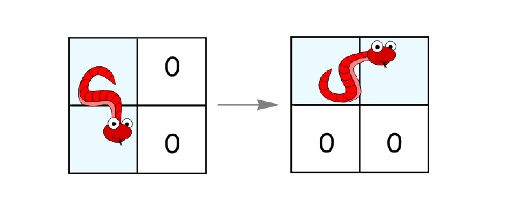
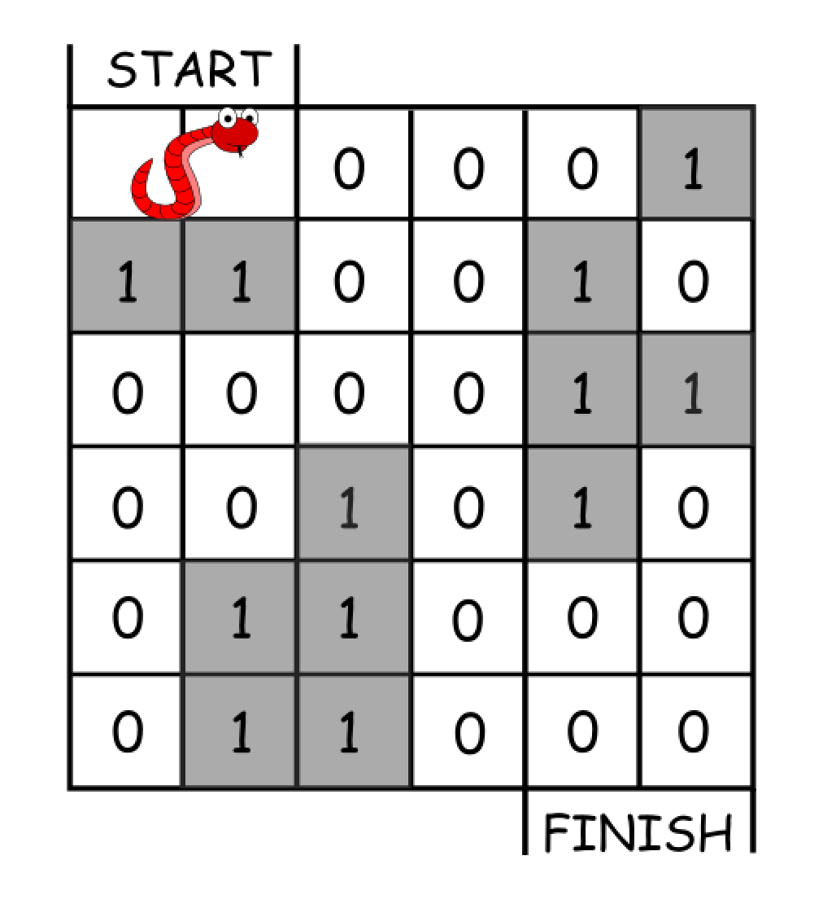

# 1210. 穿过迷宫的最少移动次数

Hard · 难度分 2022 · [力扣原题](https://leetcode.cn/problems/minimum-moves-to-reach-target-with-rotations/)

所在刷题路径：灵神题单·网格图

| 作者 | 题解 | 动画讲解 |
|---|---|---|
| 灵茶山艾府 | [📄 题解](灵茶山艾府.md) | [▶︎ 动画（GIF）](1210%20穿过迷宫的最少移动次数%20·%20灵茶山艾府.gif) · [mp4 文件](1210%20穿过迷宫的最少移动次数%20·%20灵茶山艾府.mp4) |
| yiduobo | [📄 题解](yiduobo.md) | [▶︎ 动画（GIF）](1210%20穿过迷宫的最少移动次数%20·%20yiduobo.gif) · [mp4 文件](1210%20穿过迷宫的最少移动次数%20·%20yiduobo.mp4) |

## 动画讲解

> 动图会循环播放；想暂停、拖进度条请下载上面表格里的 mp4 文件。

### 灵茶山艾府


### yiduobo


## 题目描述

你还记得那条风靡全球的贪吃蛇吗？

我们在一个 `n*n` 的网格上构建了新的迷宫地图，蛇的长度为 2，也就是说它会占去两个单元格。蛇会从左上角（`(0, 0)` 和 `(0, 1)`）开始移动。我们用 `0` 表示空单元格，用 1 表示障碍物。蛇需要移动到迷宫的右下角（`(n-1, n-2)` 和 `(n-1, n-1)`）。

每次移动，蛇可以这样走：

- 如果没有障碍，则向右移动一个单元格。并仍然保持身体的水平／竖直状态。

- 如果没有障碍，则向下移动一个单元格。并仍然保持身体的水平／竖直状态。

- 如果它处于水平状态并且其下面的两个单元都是空的，就顺时针旋转 90 度。蛇从（`(r, c)`、`(r, c+1)`）移动到 （`(r, c)`、`(r+1, c)`）。


- 如果它处于竖直状态并且其右面的两个单元都是空的，就逆时针旋转 90 度。蛇从（`(r, c)`、`(r+1, c)`）移动到（`(r, c)`、`(r, c+1)`）。



返回蛇抵达目的地所需的最少移动次数。

如果无法到达目的地，请返回 `-1`。

**示例 1：**



```
输入：grid = [[0,0,0,0,0,1],
               [1,1,0,0,1,0],
               [0,0,0,0,1,1],
               [0,0,1,0,1,0],
               [0,1,1,0,0,0],
               [0,1,1,0,0,0]]
输出：11
解释：
一种可能的解决方案是 [右, 右, 顺时针旋转, 右, 下, 下, 下, 下, 逆时针旋转, 右, 下]。
```

**示例 2：**

```
输入：grid = [[0,0,1,1,1,1],
               [0,0,0,0,1,1],
               [1,1,0,0,0,1],
               [1,1,1,0,0,1],
               [1,1,1,0,0,1],
               [1,1,1,0,0,0]]
输出：9
```

**提示：**

- `2 <= n <= 100`

- `0 <= grid[i][j] <= 1`

- 蛇保证从空单元格开始出发。

---
[↑ 返回 1200-1299](../README.md) · [总索引](../../../索引.md) · [仓库首页](../../../README.md)
